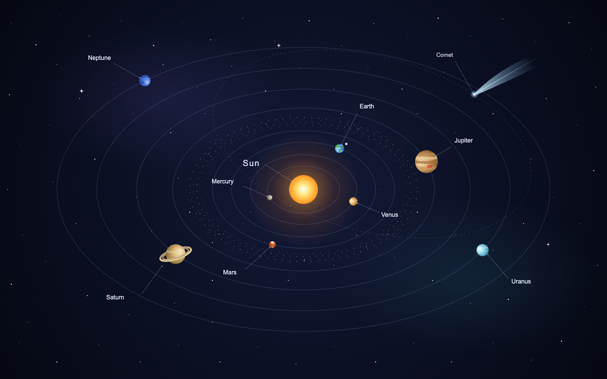
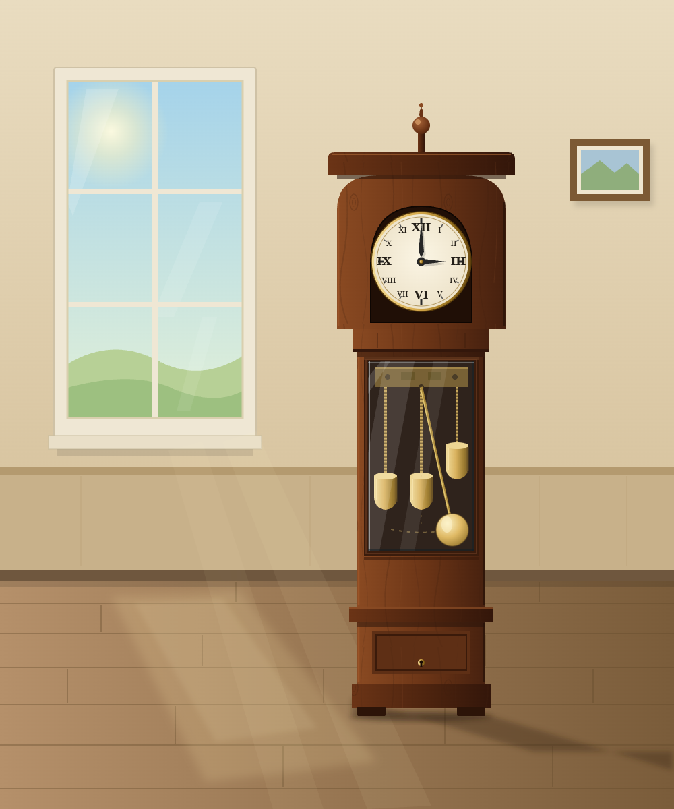
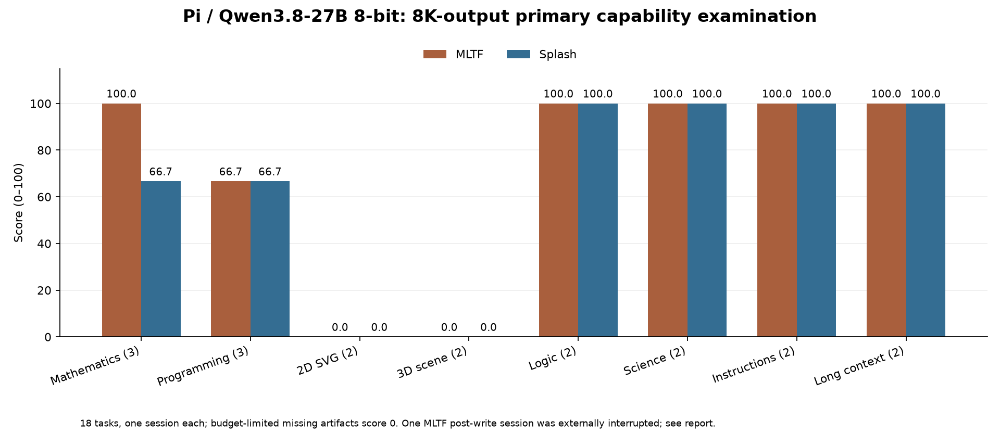
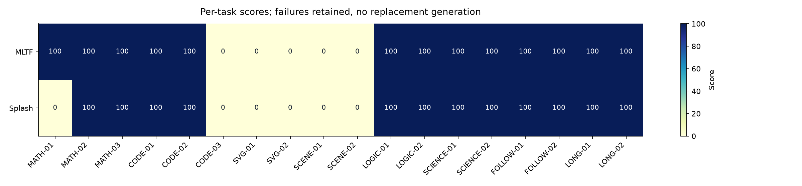

# Pi capability examination: Qwen3.8-27B 8-bit on MLTF and Splash

[English](2026-10-21-pi-qwen38-27b-mltf-splash-capabilities.md) | [简体中文](2026-10-21-pi-qwen38-27b-mltf-splash-capabilities_CN.md)

CAP-01 · Local test started 2026-10-21, America/Toronto. 18 primary questions, eight domains, 36 primary sessions, plus eight separately scored 32K-output visual supplement sessions. This is a curated subset and adaptation, not any named benchmark’s official full-run score.

## 2026-10-21 update: visual quality is for the user to judge

At the user's request, screenshots of every successfully rendered 2D/3D artifact are presented for human review. **Human visual verdicts are pending.** Earlier assistant rubric assessments below are retained as historical preliminary assessments, not user-approved quality scores or preferences. The earlier 32K 2D domain figures (MLTF 50.00 / Splash 94.44) must be read in that light. Objective file-delivery and execution results remain separate; the 8K primary scores are unchanged.

| Review ID | Task / engine | Actual Chromium screenshot | User verdict |
|---|---|---|---|
| A | SVG-02 grandfather clock / MLTF | [Full-size screenshot](../../assets/figures/cap-01-32k-mltf-svg-02.png) | Pending |
| B | SVG-02 grandfather clock / Splash | [Full-size screenshot](../../assets/figures/cap-01-32k-splash-svg-02.png) | Pending |
| C | SVG-01 solar system / Splash | [Full-size screenshot](../../assets/figures/cap-01-32k-splash-svg-01.png) | Pending |

The screenshots appear in full below and come from the original model outputs without visual repair. MLTF SVG-01 delivered no file. No 3D submission produced a valid project/render, so there is no scene screenshot to judge; the recorded missing-delivery/execution failures remain available. These failures do not represent a human aesthetic rating of a finished scene. User feedback will be recorded separately with attribution, without overwriting the earlier assistant record.

## 8K primary scores and interpretation

| Domain (equal overall weight) | Questions | MLTF | Splash |
|---|---|---|---|
| Mathematics | 3 | 100.00 | 66.67 |
| Programming | 3 | 66.67 | 66.67 |
| 2D SVG | 2 | 0.00 | 0.00 |
| 3D scene generation | 2 | 0.00 | 0.00 |
| Logical reasoning | 2 | 100.00 | 100.00 |
| Scientific knowledge | 2 | 100.00 | 100.00 |
| Instruction following | 2 | 100.00 | 100.00 |
| Long-context retrieval | 2 | 100.00 | 100.00 |
| Overall: mean of eight domains | 18 | 70.83 | 66.67 |

A zero may mean no delivery, budget truncation or execution failure, rather than a visual judgment of a delivered work. The 8,192-token per-turn output cap was chosen for this examination; the user requested 128K context, not that output cap. Each task is scored 0–100. Domain means are averaged equally, so the three-question mathematics/programming domains do not outweigh the two-question domains. Exact-answer, strict-format, executable-code and subjective visual-rubric results remain separate. There is one primary stochastic session per engine/task, with no confidence interval or general engine-intelligence ranking. Public-data contamination was not measured.

| Engine | Artifact tasks with source delivered | Artifact tasks planned | Sessions ending normally with stop | Sessions hitting length |
|---|---|---|---|---|
| mltf | 3 | 7 | 13 | 4 |
| splash | 2 | 7 | 12 | 6 |

Sensitivity only: excluding the CODE-03 pair affected by operator interruption, while retaining equal domain weights, gives MLTF 75.00 and Splash 70.83. The primary score above retains all planned questions and the verified delivered MLTF file.

## Host and fixed configuration

| Item | Recorded value |
|---|---|
| Inference host | Local MacBook Pro / Apple M5 Max / 18 CPU / 40 GPU / 128 GiB |
| Test-time OS | macOS 27.0.1 (26A434), arm64 |
| Pi | 1.3.0; actual CLI, fresh session; global default model preserved |
| MLTF | 0.1.2 / packed q8c |
| Splash | 1.4.0 / 1482f6bbc2abf12375332725302019594150b6cb / MLX affine8 input |
| Source target | mlx-community/Qwen3.8-27B-8bit @ 815b83c0df8ffd1d1b5244cf75fd6ef14fca9ef9 |
| Draft source | incoai/Qwen3.8-27B-DFlash2 @ 015e795645c74b1a0eeef3b570031fb62e769bc5; same raw weights as packed MLTF provenance |
| Context/output budget | 131072 context / 8192 per model turn |
| Sampling and reasoning | temperature=1, top_p=.95, top_k=20, reasoning_effort=medium |
| Memory/KV/cache | 96 GiB cap, INT8 KV, fresh engine per question; SSD prefix cache disabled |
| Generation tools | No tools for exact/text questions; confined read/write for file tasks; at most three turns, no evaluator feedback |
| Blender | 5.1.2 / fresh factory startup; requested Cycles CPU max32 samples; grading after inference |

Both configurations derive from the same source 8-bit checkpoint, but packed/loading, state, numerical and sampling paths can differ. Splash keeps its default automatic ANE plan. Native status/provenance and before/after snapshots are archived; matching a 128K limit does not establish bit-identical execution. No fixed inference sampling seed was supplied. Actual request fields are checked before forwarding; auth headers are not logged.

## Question preparation and scoring

The complete question packet and gold/rubric definitions were frozen as local commit 77eea8d before editing Pi models or submitting inference. See the downloadable evidence for QUESTION_BOOK, exam.json, prompt hashes, source revisions and graders. Original prompts retain their source language. The rewritten SVG briefs make their requirements explicit; synthetic retrieval is RULER-inspired, not the official generator.

| Task | Domain/title | Source/adaptation |
|---|---|---|
| MATH-01 | Mathematics / Algebra / polynomial interpolation | [Source](https://huggingface.co/datasets/HuggingFaceH4/MATH-500/blob/6e4ed1a2a79af7d8630a6b768ec859cb5af4d3be/test.jsonl#test/intermediate_algebra/1197.json) · Source mathematical facts paraphrased; values and reference answers unchanged. Final-answer marker added. |
| MATH-02 | Mathematics / Number theory / sums of proper divisors | [Source](https://huggingface.co/datasets/HuggingFaceH4/MATH-500/blob/6e4ed1a2a79af7d8630a6b768ec859cb5af4d3be/test.jsonl#test/number_theory/737.json) · Source mathematical facts paraphrased; values and reference answers unchanged. Final-answer marker added. |
| MATH-03 | Mathematics / Geometry / parallelogram | [Source](https://huggingface.co/datasets/HuggingFaceH4/MATH-500/blob/6e4ed1a2a79af7d8630a6b768ec859cb5af4d3be/test.jsonl#test/geometry/627.json) · Source mathematical facts paraphrased; values and reference answers unchanged. Final-answer marker added. |
| CODE-01 | Programming / HumanEval/24 / largest_divisor | [Source](https://github.com/openai/human-eval/blob/b9453e8f1865df0a0057a1383767caa400acfbcf/data/HumanEval.jsonl.gz) · None; original question with a local answer-delivery wrapper. |
| CODE-02 | Programming / HumanEval/129 / minPath | [Source](https://github.com/openai/human-eval/blob/b9453e8f1865df0a0057a1383767caa400acfbcf/data/HumanEval.jsonl.gz) · None; original question with a local answer-delivery wrapper. |
| CODE-03 | Programming / HumanEval/145 / order_by_points | [Source](https://github.com/openai/human-eval/blob/b9453e8f1865df0a0057a1383767caa400acfbcf/data/HumanEval.jsonl.gz) · None; original question with a local answer-delivery wrapper. |
| SVG-01 | 2D SVG / Solar-system diagram | [Source](https://github.com/johnbean393/SVGBench/blob/55c1cde8bf03b63d385c931e95bd7f728cde8fde/questions/questions.json) · Locally rewritten brief inspired by source task and requirements; requirements made explicit, output dimensions fixed. Not an official SVGBench score. Source has no stated repository license; original full dataset is not included in public evidence. |
| SVG-02 | 2D SVG / Grandfather clock at 3:00 | [Source](https://github.com/johnbean393/SVGBench/blob/55c1cde8bf03b63d385c931e95bd7f728cde8fde/questions/questions.json) · Locally rewritten brief inspired by source task and requirements; requirements made explicit, output dimensions fixed. Not an official SVGBench score. Source has no stated repository license; original full dataset is not included in public evidence. |
| SCENE-01 | 3D scene generation / Urban plaza and fountain diorama | [Source](https://huggingface.co/datasets/Qwen/BlenderWorld/tree/e67837a78e2d963447bc1b147db42f46bc6ef07f/bw_0115) · Original MIT task brief and weighted binary rubric; local script-delivery, Blender 5.1.2 and max32-sample CPU render replace official 4.2.10 multi-agent evaluation. No official holistic judge component; report rubric score only. |
| SCENE-02 | 3D scene generation / Nordic brass table lamp | [Source](https://huggingface.co/datasets/Qwen/BlenderWorld/tree/e67837a78e2d963447bc1b147db42f46bc6ef07f/bw_0150) · Original MIT task brief and weighted binary rubric; local script-delivery, Blender 5.1.2 and max32-sample CPU render replace official 4.2.10 multi-agent evaluation. No official holistic judge component; report rubric score only. |
| LOGIC-01 | Logical reasoning / Five-object deduction | [Source](https://github.com/suzgunmirac/BIG-Bench-Hard/blob/9ee07bd481feebf959a6b59d61ea57bdcf30964d/bbh/logical_deduction_five_objects.json) · None; original question with a local answer-delivery wrapper. |
| LOGIC-02 | Logical reasoning / Calendar reasoning | [Source](https://github.com/suzgunmirac/BIG-Bench-Hard/blob/9ee07bd481feebf959a6b59d61ea57bdcf30964d/bbh/date_understanding.json) · None; original question with a local answer-delivery wrapper. |
| SCIENCE-01 | Scientific knowledge / physics / MMLU-Pro validation 10 | [Source](https://huggingface.co/datasets/TIGER-Lab/MMLU-Pro/tree/b189ec765aa7ed75c8acfea42df31fdae71f97be) · First physics item and second biology item from released validation subset; 10 options and answer retained. API snapshot SHA frozen; not full/test-split MMLU-Pro accuracy. |
| SCIENCE-02 | Scientific knowledge / biology / MMLU-Pro validation 21 | [Source](https://huggingface.co/datasets/TIGER-Lab/MMLU-Pro/tree/b189ec765aa7ed75c8acfea42df31fdae71f97be) · First physics item and second biology item from released validation subset; 10 options and answer retained. API snapshot SHA frozen; not full/test-split MMLU-Pro accuracy. |
| FOLLOW-01 | Instruction following / IFEval 1021 | [Source](https://github.com/google-research/google-research/tree/3bbd8fbea969c2ebee2bcce61711b5cd32b5ec32/instruction_following_eval) · Original prompt. Local deterministic strict checks for selected instructions; not official aggregate IFEval implementation. |
| FOLLOW-02 | Instruction following / IFEval 1075 | [Source](https://github.com/google-research/google-research/tree/3bbd8fbea969c2ebee2bcce61711b5cd32b5ec32/instruction_following_eval) · Original prompt. Local deterministic strict checks for selected instructions; not official aggregate IFEval implementation. |
| LONG-01 | Long-context retrieval / Multi-key retrieval / ~64K input | [Source](https://github.com/NVIDIA/RULER/tree/c3f5e3b4f87f97e048793bb510a3a6b19a46bf3a) · Original deterministic synthetic multi-key task inspired by RULER; not generated by official RULER scripts or an official RULER score. Actual formatted token counts will be audited before inference and reported; filenames indicate approximate intended size. |
| LONG-02 | Long-context retrieval / Multi-key retrieval / ~120K input | [Source](https://github.com/NVIDIA/RULER/tree/c3f5e3b4f87f97e048793bb510a3a6b19a46bf3a) · Original deterministic synthetic multi-key task inspired by RULER; not generated by official RULER scripts or an official RULER score. Actual formatted token counts will be audited before inference and reported; filenames indicate approximate intended size. |

Mathematics and multiple-choice answers use exact deterministic checks. HumanEval uses the original tests plus seeded oracle edge/random cases: all must pass for 100, otherwise 0; the per-test fraction is diagnostic, not the primary score and not HumanEval+. IFEval uses local strict checks on the selected instructions; MMLU-Pro questions are released validation examples. Retrieval scores five exact key/value pairs.

Artifact files must actually be delivered. Delivered Python and Blender scripts are evaluated unchanged with time limits and isolated filesystem/network access; no supervisor repair or model feedback is allowed. Static SVGs render in Chromium with JavaScript and network disabled. Blender criteria use the source importance-weighted binary rubric against delivered render and scene inspection, without the official holistic/multi-agent evaluator. SVG criteria use the frozen equal-weight checklist. Visual ratings are by this supervising Codex assistant with per-criterion evidence; V-labels anonymize presentation but the supervisor can access the mapping, so this is not an independent or fully blind judge.

## Every task and actual delivery

| Task | MLTF score | Splash score | Initial input tokens | MLTF upstream s | Splash upstream s | MLTF reasoning / completion tokens | Splash reasoning / completion tokens |
|---|---|---|---|---|---|---|---|
| MATH-01 | 100.00 | 0.00 | 197 | 103.24 | 152.95 | 5889 / 6297 | 8192 / 8192 |
| MATH-02 | 100.00 | 100.00 | 193 | 7.83 | 12.46 | 290 / 486 | 512 / 785 |
| MATH-03 | 100.00 | 100.00 | 206 | 24.63 | 10.41 | 1129 / 1394 | 370 / 543 |
| CODE-01 | 100.00 | 100.00 | 738 | 9.75 | 6.92 | 185 / 369 | 100 / 261 |
| CODE-02 | 100.00 | 100.00 | 1094 | 42.56 | 54.29 | 701 / 1792 | 1049 / 2120 |
| CODE-03 | 0.00 | 0.00 | 812 | incomplete | 194.31 | ≥5408 / ≥5660 | 8192 / 8192 |
| SVG-01 | 0.00 | 0.00 | 803 | 154.58 | 209.48 | 8192 / 8192 | 8192 / 8192 |
| SVG-02 | 0.00 | 0.00 | 802 | 238.79 | 249.32 | 8192 / 8192 | 8192 / 8192 |
| SCENE-01 | 0.00 | 0.00 | 940 | 284.98 | 284.65 | 8192 / 8192 | 8192 / 8192 |
| SCENE-02 | 0.00 | 0.00 | 1093 | 256.04 | 246.62 | 8192 / 8192 | 8192 / 8192 |
| LOGIC-01 | 100.00 | 100.00 | 297 | 3.63 | 3.45 | 155 / 161 | 97 / 138 |
| LOGIC-02 | 100.00 | 100.00 | 265 | 3.22 | 1.68 | 82 / 152 | 49 / 81 |
| SCIENCE-01 | 100.00 | 100.00 | 287 | 3.50 | 3.79 | 106 / 202 | 99 / 185 |
| SCIENCE-02 | 100.00 | 100.00 | 308 | 7.98 | 7.78 | 258 / 508 | 195 / 479 |
| FOLLOW-01 | 100.00 | 100.00 | 190 | 40.78 | 36.77 | 1526 / 1944 | 1532 / 1876 |
| FOLLOW-02 | 100.00 | 100.00 | 183 | 29.10 | 30.55 | 64 / 925 | 64 / 887 |
| LONG-01 | 100.00 | 100.00 | 65556 | 149.74 | 148.31 | 169 / 242 | 262 / 335 |
| LONG-02 | 100.00 | 100.00 | 119359 | 310.76 | 313.38 | 177 / 253 | 185 / 261 |

Output token totals include reasoning and all model turns; an interrupted request without terminal usage is shown only as a lower bound (≥). Upstream time excludes proxy template/token preflight and server startup; a multi-turn total is not decode throughput. The first-model-event metric in evidence includes reasoning/tool deltas and must not be confused with the first nonempty final content TTFT in PERF-09/10. Pi wall time includes client/housekeeping overhead; interrupted timing is unavailable.

| Programming task | Original tests passed | Seeded additional checks passed | Primary score |
|---|---|---|---|
| CODE-01 / splash | True | 211/211 | 100.00 |
| CODE-01 / mltf | True | 211/211 | 100.00 |
| CODE-02 / mltf | True | 120/120 | 100.00 |
| CODE-02 / splash | True | 120/120 | 100.00 |
| CODE-03 / splash | N/A | N/A/N/A | 0.00 |
| CODE-03 / mltf | False | 15/202 | 0.00 |

## Failures and operator intervention

| Case | Score | Pi stop | Request errors | Grading evidence |
|---|---|---|---|---|
| MATH-01 / splash | 0.00 | length | [] | {'expected': '\\frac{3}{56}', 'extracted': ''} |
| CODE-03 / splash | 0.00 | length | [] | Required artifact missing |
| CODE-03 / mltf | 0.00 | toolUse | ["BrokenPipeError(32, 'Broken pipe')"] |  |
| SVG-01 / mltf | 0.00 | length | [] | Required artifact missing |
| SVG-01 / splash | 0.00 | length | [] | Required artifact missing |
| SVG-02 / splash | 0.00 | length | [] | Required artifact missing |
| SVG-02 / mltf | 0.00 | length | [] | Required artifact missing |
| SCENE-01 / mltf | 0.00 | length | [] | Required artifact missing |
| SCENE-01 / splash | 0.00 | length | [] | Required artifact missing |
| SCENE-02 / splash | 0.00 | length | [] | Required artifact missing |
| SCENE-02 / mltf | 0.00 | length | [] | Required artifact missing |

The supervisor’s attempt to investigate a post-agent_settled Pi shutdown delay raced with progression into MLTF CODE-03 and interrupted its post-write response. answer.py had already been completely written; it is verified byte-for-byte against that same session’s write-tool payload and is graded as delivered, while session completion/timing is flagged interrupted. Splash CODE-03 had no delivered file and retains its length-limit failure. A transient recovery copy placed in the wrong artifact folder was corrected against tool logs before grading. No replacement inference was submitted within the primary phase; the later user-requested 32K visual supplement is a separate phase. The controller incident, raw traces and artifact hashes remain available; this intervention limits clean agent-completion comparison.

Subsequent process cleanup acts only on its current Pi child after agent_settled and a three-second grace period. Generation settings/questions remain unchanged. Budget truncation, errors, missing files and failed renders remain in the score denominator. No generated answer or scene was repaired.

## Matching-input and execution audit

| Task | Same initial token IDs | Input counts |
|---|---|---|
| MATH-01 | True | [197, 197] |
| MATH-02 | True | [193, 193] |
| MATH-03 | True | [206, 206] |
| CODE-01 | True | [738, 738] |
| CODE-02 | True | [1094, 1094] |
| CODE-03 | True | [812, 812] |
| SVG-01 | True | [803, 803] |
| SVG-02 | True | [802, 802] |
| SCENE-01 | True | [940, 940] |
| SCENE-02 | True | [1093, 1093] |
| LOGIC-01 | True | [297, 297] |
| LOGIC-02 | True | [265, 265] |
| SCIENCE-01 | True | [287, 287] |
| SCIENCE-02 | True | [308, 308] |
| FOLLOW-01 | True | [190, 190] |
| FOLLOW-02 | True | [183, 183] |
| LONG-01 | True | [65556, 65556] |
| LONG-02 | True | [119359, 119359] |

Only initial requests are expected to match: later tool turns contain different model-produced artifacts. 128K is configured capacity, not the length of each short question. Long-input actual counts are listed above. Background load and thermal state were not controlled; per-second native/frontend/system CPU, global GPU, pressure/swap and status traces are retained, with overlapping unified-memory scopes never added. No speed difference is assigned a single cause.

| Engine | Native allocator peak GiB | Native process footprint peak GiB | Frontend footprint peak GiB | Global GPU memory peak GiB | Global pressure states |
|---|---|---|---|---|---|
| mltf | 34.02 | 5.50 | 0.60 | 31.37 | normal |
| splash | 34.28 | 35.16 | 0.60 | 36.24 | normal |

These are maxima observed in one-second inference-phase samples across each engine’s cases, with different scopes; they cannot be summed. Metal/unified allocations need not appear in native-process footprint. Global GPU memory, pressure and swap include background applications; full per-case first/last swap and CPU/GPU samples are downloadable.

## Visual deliverables and rubric evidence

No SVG or Blender source was delivered by either engine within the fixed 8,192-token budget, so no visual rendering or subjective criterion rating was performed. All eight visual-task sessions receive the frozen missing-delivery score of 0. This examination therefore provides no comparison of finished 2D/3D work quality; see the separately labeled 32K-output supplement below.

## Separate 32K-output visual supplement

After both engines failed to deliver visual artifacts under the primary output budget, the user explicitly requested a larger-budget supplement. Packet commit 2aaf3f6 freezes the same four question/rubric bytes before supplemental inference; follow-up protocol commits 66908c6 / 3a3eb3a sequence it after the primary and record the Pi update. Each engine receives one new session per visual task. The only changed generation knob is per-turn max_tokens, from 8192 to 32768; context stays 131072, with the same medium reasoning, sampling, tools/turn limit, 1800-second case deadline, fresh-engine policy, render limits and scoring criteria. The actual global Pi entries are raised to 32768 after primary inference; the global default remains MTPLX. No primary score is overwritten. This is a budget follow-up motivated by observed failures, not an independent blind replication.

| Supplement domain | MLTF | Splash |
|---|---|---|
| 2D SVG | 50.00 | 94.44 |
| 3D scene generation | 0.00 | 0.00 |

Pi also automatically injects `<cwd>` metadata into the system message. The supplemental phase uses its own fixed workspace, adding seven initial input tokens versus the primary phase (for example SVG-01: 803 versus 810). The frozen question and neutral system files are unchanged, and both engines within each phase receive matching input; across budget phases the actual system messages are not byte-identical. This is an additional cross-phase difference, so do not attribute every change solely to the output cap. The workspace remains fixed for all supplemental cases; there is no replacement inference.

Executor correction 5a94013, made before any 3D supplemental output and before all artifact execution, broadened an initially too-short import shortlist to the standard-library set permitted by the written scene contract. No submitted source, frozen question, gold answer or rubric was changed, and no artifact had yet been executed.

Before supplemental output, operational note a40ab28 fixed a consistent 10% tolerance for approximately specified physical dimensions, evaluated in world-space scene units. Original binary criteria remain conjunctive. SVG-01 R01 additionally requires rays although the rewritten brief explicitly asks only for a luminous Sun; that underspecification is retained and disclosed, with an R01-excluded sensitivity score below.

| SVG-01 engine | Frozen strict score | Sensitivity excluding R01 |
|---|---|---|
| mltf | 0.00 | 0.00 |
| splash | 88.89 | 100.00 |

Pi may continue within the same session when a length-truncated response contains incomplete tool arguments: its tool-error message asks the model to re-issue a complete call. This is ordinary tool feedback within the pre-set three-turn limit, not supervisor code repair or benchmark-evaluator feedback. All such turns, output tokens and latency are included.

| Supplement case | Score | Pi stop | Initial input tokens | Reasoning / completion tokens | Upstream seconds | Delivered source |
|---|---|---|---|---|---|---|
| SVG-01 / mltf | 0.00 | length | 810 | 32768 / 32768 | 788.86 | — |
| SVG-01 / splash | 88.89 | length, toolUse, stop | 810 | 28095 / 43118 | 1025.44 | image.svg |
| SVG-02 / splash | 100.00 | toolUse, stop | 809 | 16905 / 24788 | 670.81 | image.svg |
| SVG-02 / mltf | 100.00 | length, toolUse, stop | 809 | 30599 / 43088 | 1176.95 | image.svg |
| SCENE-01 / mltf | 0.00 | length | 947 | 32768 / 32768 | 1018.31 | — |
| SCENE-01 / splash | 0.00 | toolUse, stop | 947 | 12296 / 19163 | 577.77 | scene.py |
| SCENE-02 / splash | 0.00 | toolUse, toolUse, stop | 1100 | 13849 / 18089 | 546.53 | scene.py |
| SCENE-02 / mltf | 0.00 | toolUse, stop | 1100 | 8724 / 12298 | 349.41 | scene.py |

| Supplement task | Same initial token IDs | Input counts |
|---|---|---|
| SVG-01 | True | [810, 810] |
| SVG-02 | True | [809, 809] |
| SCENE-01 | True | [947, 947] |
| SCENE-02 | True | [1100, 1100] |

### 32K supplement / mltf / SVG-01

Delivery/execution gate failed: `Required artifact missing`

### 32K supplement / splash / SVG-01

| Criterion (source rubric) | Weight | Pass | Evidence (original assessment) |
|---|---|---|---|
| Central luminous Sun and rays | 1 | False | The Sun is centered and luminous with a radial halo, but no distinct rays are drawn; the frozen conjunctive rays requirement fails. |
| All eight planets in correct radial order | 1 | True | Mercury through Neptune occupy the eight nested solar orbits in the correct inward-to-outward order. |
| Sun-facing illumination and opposite-side shading | 1 | True | Separate bright-to-dark planet gradients have focal offsets toward the central Sun; Earth, for example, is lit from its lower-left. |
| Eight distinct elliptical orbital paths | 1 | True | Eight distinct concentric ellipses define the planetary orbits, separate from the asteroid band and comet path. |
| Plausible relative planet size hierarchy | 1 | True | Jupiter is the largest planet, followed by Saturn and the ice giants; all terrestrial planets are substantially smaller. |
| Recognizable Earth/Moon, Mars cap, Jupiter storm, Saturn rings | 1 | True | Earth has land, cloud streaks and a nearby Moon; Mars has white caps, Jupiter bands/red storm, and Saturn visible rings. |
| Nine readable labels with leaders | 1 | True | Sun and all eight planet names are readable, separated, and connected by subtle leader lines. |
| Asteroid band located between Mars and Jupiter | 1 | True | The dotted asteroid band sits outside the Mars ellipse and inside the Jupiter ellipse. |
| Dark star field and a comet tail pointing away from Sun | 1 | True | A dark star field is present; the upper-right comet tail extends outward away from the central Sun. |

Rater notes (original): R01 alone fails under the frozen strict rays wording. The rewritten brief asks for a luminous Sun but does not explicitly ask for rays; excluding that underspecified item gives 100/100. Gradient geometry was checked against the rendered illumination.

### 32K supplement / splash / SVG-02

| Criterion (source rubric) | Weight | Pass | Evidence (original assessment) |
|---|---|---|---|
| Clock stands in a room beside a window | 1 | True | The clock stands next to the left-hand window in a room with a clear wall-floor junction and boards. |
| Mahogany case with grain, finial, hood, trunk and base | 1 | True | A reddish mahogany-like case includes fine grain/knots, finial, rounded hood, tall glazed trunk and shaped base. |
| Roman dial with hour hand at III and minute hand at XII | 1 | True | The Roman dial has a vertical minute hand toward XII and a horizontal shorter hour hand toward III. |
| Window sunlight and consistent long floor shadow | 1 | True | The left window contains the sun; floor illumination and the long lower-right clock shadow follow the same light direction. |
| Brass pendulum visible at right end of arc behind glass | 1 | True | Behind the glass the rod and brass bob lean right, with the bob meeting the right endpoint of the indicated arc. |
| Three chain-hung brass weights with right weight higher | 1 | True | All three chain-hung brass weights are visible, with the rightmost weight raised above the left and middle weights. |
| Effective wood/metal/glass shading and dimensional appearance | 1 | True | Dark wood contours/grain, metallic cylinder highlights and translucent diagonal glass streaks provide material separation and volume. |

Rater notes (original): All seven frozen binary conditions are met. The image remains a stylized vector illustration; no extra holistic or photorealism score is added.

### 32K supplement / mltf / SVG-02

| Criterion (source rubric) | Weight | Pass | Evidence (original assessment) |
|---|---|---|---|
| Clock stands in a room beside a window | 1 | True | A full standing longcase clock is shown beside a large window, against a wall and plank floor. |
| Mahogany case with grain, finial, hood, trunk and base | 1 | True | The warm dark-brown case has visible grain/knots, a top finial, hood, glazed trunk and broad base. |
| Roman dial with hour hand at III and minute hand at XII | 1 | True | Roman numerals are visible; the long minute hand points up to XII and the shorter hour hand right to III. |
| Window sunlight and consistent long floor shadow | 1 | True | Light comes from the left window; sunlight patches cross the floor and a long clock shadow extends lower-right. |
| Brass pendulum visible at right end of arc behind glass | 1 | True | The brass bob is right of its suspension point at the right end of the drawn swing arc, visible through the glass. |
| Three chain-hung brass weights with right weight higher | 1 | True | Three brass weights hang on distinct chains; the right weight is visibly higher than the other two. |
| Effective wood/metal/glass shading and dimensional appearance | 1 | True | Wood panels/grain, graded metal highlights and diagonal glass reflections clearly distinguish the three materials and depth. |

Rater notes (original): All seven frozen binary conditions are met. Some cardinal Roman numerals are overdrawn/crowded; the 3:00 reading remains clear. This is not an overall artistic-polish score.

### 32K supplement / mltf / SCENE-01

Delivery/execution gate failed: `Required artifact missing`

### 32K supplement / splash / SCENE-01

Delivery/execution gate failed: `Unchanged Blender source failed in transparent executor`

### 32K supplement / splash / SCENE-02

Delivery/execution gate failed: `AssertionError('Unexpected scene import')`

### 32K supplement / mltf / SCENE-02

Delivery/execution gate failed: `AssertionError('Unexpected scene import')`

## 3D execution failures and executor diagnostics

No valid Blender project/render was produced by any 3D submission. The missing MLTF city script remains 0. The initially selected blender-exec wrapper suppresses Python stderr when Blender exits with code 0, so the city attempt originally showed no usable Python traceback. That attempt/log/score snapshot is retained. A local executor retry used direct Blender 5.1.2 with --factory-startup, the same empty-scene wipe, --python-exit-code 1, complete stdout/stderr, and Blender user directories redirected inside the isolated workspace. The original source bytes were not changed and no model was queried again. The retry exposed the city script error below; it still produces no deliverable.

Both lamp scripts import Blender’s built-in bmesh, which is outside the literal bpy/math/mathutils/standard-library whitelist in the frozen brief. Their strict import-gate scores remain 0. For diagnosis only, both original scripts were also executed unchanged with bmesh permitted; both then failed on original API errors. These exploratory executions do not replace the strict scores or provide repaired visual samples. All execution attempts and unchanged source hashes are retained.

| Case | Strict result | Unchanged-source execution evidence |
|---|---|---|
| Splash / SCENE-01 | 0 | scene.py:44/181: Base Color receives an RGB tuple of length 3; Blender requires 4 components. ValueError; no project/render. |
| Splash / SCENE-02 | 0 | Strict bmesh import rejection. With bmesh allowed: scene.py:269 recalc_face_normals(..., direction=...) raises TypeError for an invalid keyword. |
| MLTF / SCENE-02 | 0 | Strict bmesh import rejection. With bmesh allowed: scene.py:90 requests mix.outputs["Result"], raising KeyError for a missing output. |

## Programming counterexample

The delivered MLTF CODE-03 file ignores the minus sign by summing digits of abs(n). For the original example [1, 11, -1, -11, -12], its stable sort yields [1, -1, 11, -11, -12], while the task expects [-1, -11, 1, -12, 11]. It fails the original test group and passes only 15/202 additional checks. This source was completely written before the documented external interruption; the full interrupted agent session remains an experimental limitation.

## Score figures and archived evidence

[Complete evidence and question packet](../../assets/evidence/cap-01-evidence.zip) includes primary and supplementary frozen prompts, graders, source pins/licenses, per-case Pi/native requests/SSE/results, model-produced files, execution logs, criterion judgments, input hashes, resources and intervention record. No model weights, private model configuration/auth, personal sessions or runtime caches are included. Publication generalizes home/workspace paths in textual evidence, including generated source when needed, and lists original/public SHA256 for each file. Local generated sources remain unchanged. Any binary .blend files, if generated, are kept locally and excluded from the public ZIP because they may embed workstation paths. This run produced no valid .blend deliverable; source scripts and execution diagnostics remain available.

Limitations: small curated sample, stochastic medium thinking and finite output budgets; public-data contamination unmeasured; local runtime adaptations and subjective visual scoring; one externally interrupted post-write session; no long-session, concurrent throughput or broad intelligence ranking. A higher aggregate here means a better result under this packet and configuration.
