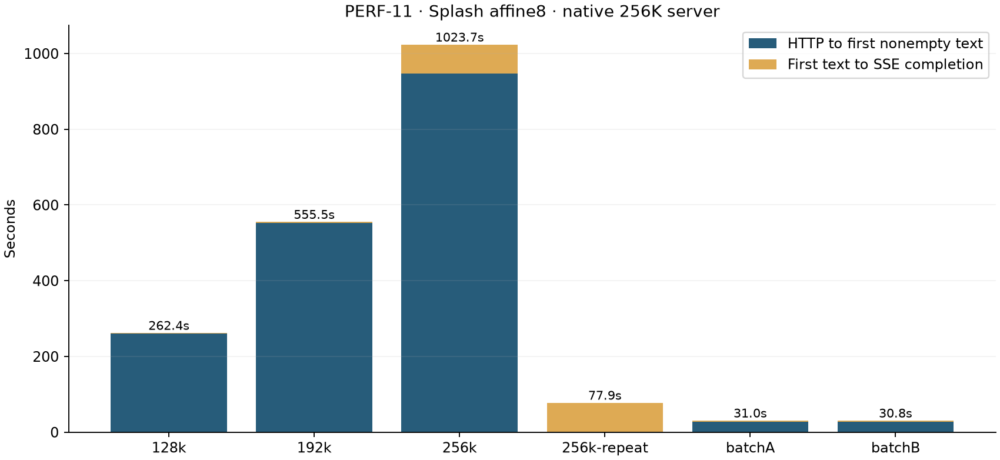
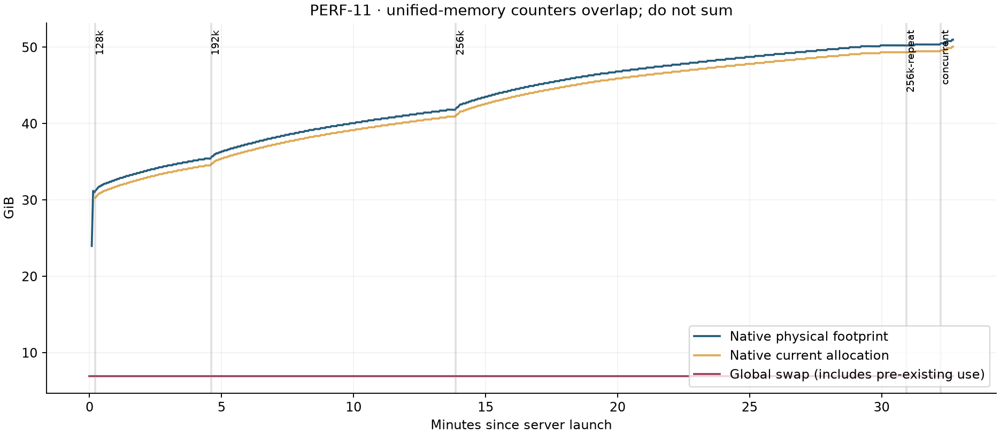

# Splash Qwen3.8-27B affine8: native 256K context stress test

[English](2026-10-21-splash-affine8-256k-stress.md) | [简体中文](2026-10-21-splash-affine8-256k-stress_CN.md)

PERF-11 · Test started 2026-10-21, America/Toronto. Actual local inference; no MLTF rerun in this experiment.

## Observed outcome

| Case | Delivery/count/limit checks | Key retrieval | At least 2048 output | Healthy after |
|---|---|---|---|---|
| 256k | True | 5/5 | True | True |
| 256k-repeat | True | 5/5 | True | True |
| batchA | True | 5/5 | None | True |
| batchB | True | 5/5 | None | True |

Mechanical completion and semantic retrieval are distinct. A running 256K server alone does not prove that an actual near-256K request completed; the terminal usage and independent preflight below establish the processed counts. A failed/missing result remains visible and is not replaced. Cold here means no native KV/prefix match; it does not mean cold OS file caches or freshly downloaded weights.

This run accepted and processed the actual near-256K input without truncation: 258048 input and 4096 output tokens. Cold TTFT was 947.72 s and total 1023.74 s; five-key retrieval was 5/5. Capacity, waiting time and retrieval usefulness should be read separately.

## Question and criteria fixed before inference

The user requested Splash 8-bit at 256K and a stress report. Protocol/harness freeze e64ddb6 precedes all generation. The native window is 262144 total tokens (input plus output), not 262144 input plus an additional output allowance. The 256K long case uses exactly 258048 template-inclusive input tokens plus up to 4096 output. Reasoning is off so the finite output budget measures visible generation.

The fixed sequence is 128K, 192K, 256K, an exact repeat of 256K, two simultaneous long-input clients, one oversized-input rejection, and small recovery probes after each serial stage and after the concurrent pair. Lower tiers run on the same 256K-configured server; they are not separate 128K/192K engine configurations. Success includes SSE completion with usage, no silent input truncation, total within 262144, five-key retrieval, ready/Metal health and no transport restart. At least 2048 output tokens establishes long-decode coverage; 4096 is full output-budget coverage, and a natural early stop is not resampled.

## Actual environment and fixed conditions

| Item | Recorded configuration |
|---|---|
| Inference location | Local loopback HTTP on this Mac |
| Hardware | MacBook Pro / Apple M5 Max / 18 CPU / 40 GPU / 128 GiB |
| Test-time OS | ProductName:		macOS; ProductVersion:		27.0.1; BuildVersion:		26A434; arm64 |
| Power | Now drawing from 'AC Power';  -InternalBattery-0 (id=REDACTED)	68%; charging; 1:04 remaining present: true |
| Target | mlx-community/Qwen3.8-27B-8bit @ 815b83c0df8ffd1d1b5244cf75fd6ef14fca9ef9 |
| Draft | incoai/Qwen3.8-27B-DFlash2 @ 015e795645c74b1a0eeef3b570031fb62e769bc5; BF16 |
| Engine | Splash 1.4.0 native Metal @ 1482f6bbc2abf12375332725302019594150b6cb |
| Binary SHA256 | 15b4ac64d5f4f2070361fc0e94623f8a67d74f083632ccaa6a7b9acd4ed8cf79 |
| Quantization / KV / state | MLX affine8, group64 / INT8 / FP32 |
| Context / memory cap | 262144 total tokens / 96 GiB |
| RoPE | None (no extension beyond native window) |
| Sampling / reasoning | temperature=1, top_p=.95, top_k=20; reasoning=none; recovery temperature=0 |
| Cache / ANE | Disk cache disabled; RAM prefixes retained; automatic ANE policy |
| Client / Pi | Python direct HTTP; global Pi configuration unchanged |
| Server startup seconds | 11.05 |
| Source protocol / harness | e64ddb6 / 5ecf5f6fe3d04a1a3432b2e7e574e6de523d6a5b |

Hardware/software snapshots are from this run, not filled from an older workstation reference. The existing installed target/draft and assembly are reused offline; this test does not redownload or freshly hash every weight tensor. Installed source digests and actual native identity/build/layout/KV are retained. MLX describes the input checkpoint; inference is Splash native Metal. Vision components remain loaded but this workload is text-only and does not establish 256K vision capability.

## Synthetic tasks and input verification

| Packet | Actual input | Max output | Sum budget | Approximate needle positions |
|---|---|---|---|---|
| 128k | 130560 | 512 | 131072 | KEY_A:1.036%, KEY_B:24.999%, KEY_C:49.922%, KEY_D:74.799%, KEY_E:98.709% |
| 192k | 196096 | 512 | 196608 | KEY_A:1.015%, KEY_B:24.895%, KEY_C:49.771%, KEY_D:74.597%, KEY_E:98.471% |
| 256k | 258048 | 4096 | 262144 | KEY_A:1.008%, KEY_B:24.948%, KEY_C:49.841%, KEY_D:74.709%, KEY_E:98.574% |
| batchA | 258048 | 256 | 258304 | KEY_A:1.008%, KEY_B:24.948%, KEY_C:49.841%, KEY_D:74.709%, KEY_E:98.574% |
| batchB | 258048 | 256 | 258304 | KEY_A:1.008%, KEY_B:24.948%, KEY_C:49.841%, KEY_D:74.709%, KEY_E:98.574% |
| overflow | 262145 | 16 | 262161 | KEY_A:1.010%, KEY_B:24.889%, KEY_C:49.738%, KEY_D:74.616%, KEY_E:98.462% |

Seeded synthetic records contain five independently generated key/value needles around 1%, 25%, 50%, 75% and 99%. The first output line must be exactly the requested JSON object. In the long-output case it is followed by many SQLite INSERT statements to sustain decode; SQL correctness is not scored. The two concurrent variants keep the same archive and alter the final instruction/tag. Their input length is also exactly 258048, with 256 output allowance each. All request bytes, expected keys, input-ID hashes, service-side apply-template/tokenize checks and final usage remain in the evidence. No prompt is shortened after a failure. This is a local synthetic exercise, not an official RULER score.

| Packet | Frozen hash unchanged | Server token/hash check |
|---|---|---|
| 128k | True | True |
| 192k | True | True |
| 256k | True | True |
| batchA | True | True |
| batchB | True | True |
| overflow | True | True |

## Client-observed timing and results

| Case | HTTP | Input | Output | TTFT s | Total s | Content tok/s | Cached input | Restart delta | Errors |
|---|---|---|---|---|---|---|---|---|---|
| 128k | 200 | 130560 | 76 | 260.66 | 262.36 | 44.55 | 0 | 0 | [] |
| 192k | 200 | 196096 | 75 | 553.24 | 555.49 | 33.35 | 0 | 0 | [] |
| 256k | 200 | 258048 | 4096 | 947.72 | 1023.74 | 53.88 | 0 | 0 | [] |
| 256k-repeat | 200 | 258048 | 4096 | 0.36 | 77.89 | 52.83 | 258016 | 0 | [] |
| batchA | 200 | 258048 | 77 | 27.06 | 30.96 | 19.73 | 258016 | 0 | [] |
| batchB | 200 | 258048 | 77 | 27.06 | 30.83 | 20.44 | 253952 | 0 | [] |
| overflow | 400 | N/A | N/A | N/A | 0.14 | N/A | N/A | 0 | [] |

TTFT ends at the first nonempty final-content delta, not a role-only event. Total seconds run from HTTP submission to SSE completion and exclude CPU token preflight, startup, recovery and telemetry shutdown. Content rate is all output tokens divided by the first-to-last nonempty content span; streamed speculative chunks can contain multiple tokens, so it is not per-token latency. Native metrics below use their own prompt/decode denominators. An early natural stop, failure and length-limited long output are all retained. Different requested outputs mean the tier wall times are not pure prefill comparisons.

| Case | Native prompt s | Prompt tok/s | Native decode s | Decode tok/s | Drafted | Accepted |
|---|---|---|---|---|---|---|
| 128k | 260.59 | 501.02 | 1.71 | 43.98 | 140 | 55 |
| 192k | 553.14 | 354.52 | 2.25 | 32.90 | 161 | 51 |
| 256k | 947.59 | 272.32 | 76.01 | 53.87 | 3730 | 3563 |
| 256k-repeat | 0.35 | 90.69 | 77.53 | 52.82 | 3794 | 3554 |
| batchA | 0.51 | 62.57 | 3.90 | 19.48 | 154 | 54 |
| batchB | 26.62 | 153.87 | 3.77 | 20.17 | 147 | 55 |
| overflow | N/A | N/A | N/A | N/A | N/A | N/A |

Native cached-prompt throughput counts only uncached input: the exact repeat processes 32 uncached tokens after matching 258016. Its subsecond TTFT is not a full cold prefill of 258048 tokens. The long decode is repetitive SQL with high DFlash acceptance, so its output rate is workload-specific and not a general text/coding throughput claim.

## Cache reuse, concurrent clients, rejection and recovery

The exact 256K request is repeated after a short recovery. Interpret its actual cache match separately from the preceding unique-prefix request. The concurrent clients overlap for a group wall time of 30.97 s. Observed native decode/prefill batch widths peak at 2/2. The preserved prefix means this is warm-prefix admission/batch stress; two HTTP clients alone do not prove independent cold-prefill throughput or simultaneous GPU lanes.

The oversized input contains 262145 verified tokens, already larger than the full window before output. Expected HTTP400/context_length_exceeded check: True. It must be rejected without truncation; the subsequent recovery is evaluated separately.

| Recovery probe | Exact text + health passed | Seconds | Errors |
|---|---|---|---|
| 128k-recovery | True | 0.16 | [] |
| 192k-recovery | True | 0.17 | [] |
| 256k-recovery | True | 0.19 | [] |
| 256k-repeat-recovery | True | 0.19 | [] |
| concurrent-recovery | True | 0.19 | [] |
| overflow-recovery | True | 0.16 | [] |

Native queue-to-start is 26.05 s for batchA and 0.00 s for batchB. batchB initially misses 4096 input tokens; batchA starts later and reuses the newly available shared prefix, then both decode in lanes 0/1. Client TTFT includes this waiting. Concurrent short JSON outputs and serial repetitive SQL have different draft acceptance and length; their content rates are not an isolated concurrency-speedup comparison.

## Memory, load, thermal state and safeguards

| Stage | Samples | Footprint peak GiB | Allocation peak GiB | System CPU mean % | Global GPU busy mean % | Memory pressure | Thermal state |
|---|---|---|---|---|---|---|---|
| startup | 4 | 31.20 | N/A | 10.83 | 61.50 | {'normal': 4} | {'null': 4} |
| preflight | 1 | 31.02 | 30.30 | 15.53 | 21.00 | {'normal': 1} | {'nominal': 1} |
| 128k | 131 | 35.44 | 34.53 | 7.47 | 99.44 | {'normal': 131} | {'nominal': 39, 'fair': 92} |
| 192k | 277 | 41.84 | 40.92 | 9.19 | 99.64 | {'normal': 277} | {'fair': 277} |
| 256k | 510 | 50.25 | 49.34 | 7.10 | 99.68 | {'normal': 510} | {'fair': 510} |
| 256k-repeat | 39 | 50.36 | 49.47 | 4.94 | 98.97 | {'normal': 39} | {'fair': 39} |
| concurrent | 15 | 50.99 | 50.08 | 4.31 | 99.60 | {'normal': 15} | {'fair': 15} |

Total samples: 977; telemetry error counts: {'native_status': 4, 'engine_pid': 1, 'primary_process': 1}. Global swap starts at 6.93 GiB, peaks at 6.93 GiB and ends at 6.93 GiB. Peak growth relative to this run's baseline is 0.00 GiB. Pre-existing swap is not attributed to Splash. Resource abort: None; run error: None.

One server persists and retains RAM prefixes, so later memory includes earlier cache state. Footprint, RSS, native allocations, process-tree sums and global GPU memory overlap in unified memory and must not be added. GPU utilization is a global driver sample, not exclusively Splash; background applications and thermal conditions were not controlled. Two-second sampling can miss brief peaks. Abort policy fixed before inference: 15 consecutive critical pressure samples, native footprint >115 GiB, or additional swap >8 GiB. Each request has a 3600-second absolute deadline and server timeout; only this test-owned process group can be terminated.

Strict audit: 62/63. The only failed audit check requires no missing/error telemetry across all samples: four samples taken before server readiness lacked native status, including one before the native child was resolvable. All 973 later samples had zero telemetry errors. The startup gaps and original failed audit item remain visible; they are not inference failures or a reason to replace requests. Sampling targets two seconds, but startup status timeouts can lengthen the actual interval. Missing counters are N/A/gaps, not zero memory.

## Failures, operator involvement and limits

CPU-only input preparation initially misread the installed Transformers apply_chat_template mapping as a token-ID list. Preparation failed before any generation. The helper was corrected to render text and explicitly encode it; source, dated note and failure receipt are retained. Every packet subsequently passed the server tokenizer hash/count preflight before generation. No generated answer was repaired, no failed sample was replaced, and no model-source patch was made. The supervisor generated synthetic inputs, launched/monitored the owned service, evaluated exact keys and assembled reports.

One finite sequence, one stochastic request per unique tier, a deliberate warm repeat and shared-prefix concurrent pair do not establish long-duration leak freedom, general 256K reasoning quality, production concurrency capacity, or a stable comparison with MLTF/GGUF. This run uses reasoning off and text-only records, unlike the earlier Pi medium-thinking exam and 128K image/code replay; their timings are not interchangeable. Any retrieval failure limits practical long-context usefulness even if the capacity test mechanically completes.

## Evidence and cleanup

[Sanitized complete evidence](../../assets/evidence/perf-11-evidence.zip): 2117519 bytes, 104 manifest entries, SHA256 a89e6d2bd3f6dd777cae7ef6f5fd540cd9030aa222dfe7d11ee12de56be859f4. Contains protocol/harness, seeded actual requests, token/hash preflight, model/OS provenance, raw SSE/text, status/resource samples, all failures and recovery/exit receipts. Original/public SHA256 is listed per file. Generalize home/runtime/test paths to symbolic variables and redact battery IDs; code paths need adaptation for reproduction. Authentication keys/headers, private client configuration, weights, runtime caches and unrelated personal sessions are excluded. Generated records and answers are synthetic. ZIP integrity, manifest hashes and absence of the actual API key are verified.

The test-owned server is stopped after the sequence; existing model files and global Pi settings are retained. exit.json records the actual shutdown result. A SIGTERM used for planned cleanup after completion is not an inference crash.
