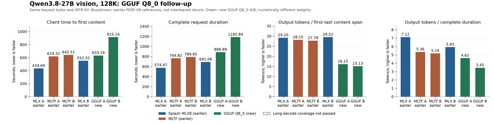
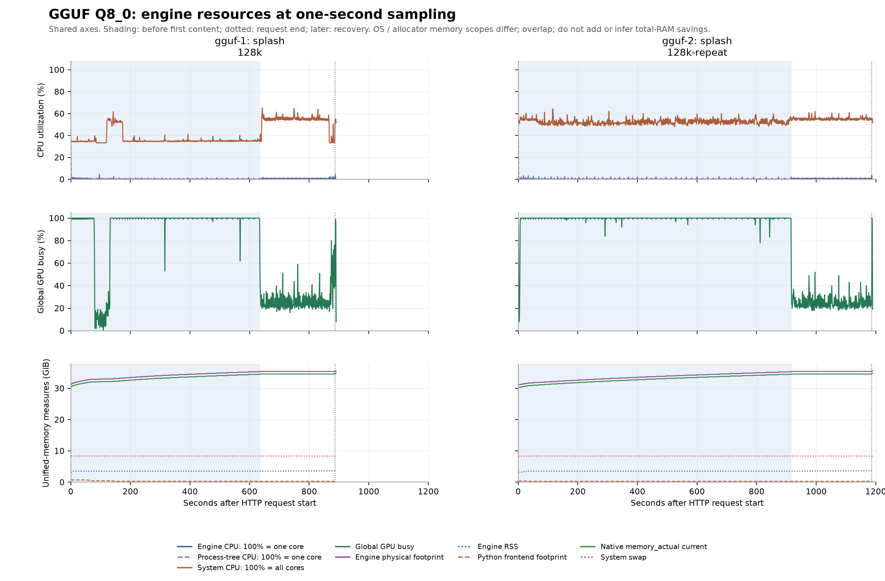
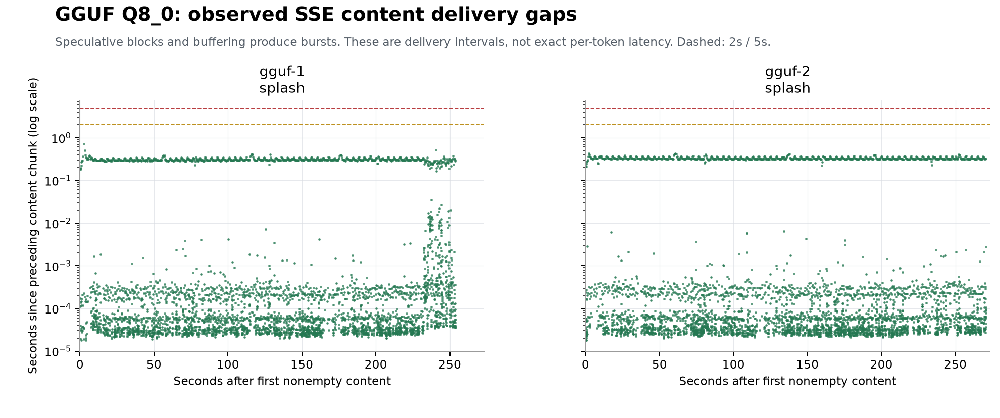

# Splash GGUF Q8_0: PERF-06 128K vision follow-up

[English](2026-10-21-splash-gguf-q8-perf06-replay.md) | [简体中文](2026-10-21-splash-gguf-q8-perf06-replay_CN.md)

PERF-10 · Test date: 2026-10-21, America/Toronto. Local inference on the same M5 Max host as PERF-09.

## Question and observed performance

Test Unsloth Q8_0 on Splash using the two original PERF-06 long image requests. New measurements use one fresh process per task. PERF-09 MLX affine8 and MLTF results below are earlier same-day references; neither baseline was rerun or interleaved with this follow-up.

| Configuration; n=2 tasks | TTFT s | Complete request s | Content delivery tok/s | Output / total tok/s |
|---|---|---|---|---|
| Splash / GGUF Q8_0 | 774.17 | 1036.37 | 15.64 | 4.04 |
| Splash / MLX affine8 (earlier PERF-09) | 493.50 | 633.02 | 29.36 | 6.53 |
| MLTF / q8c (earlier PERF-09) | 630.92 | 777.38 | 27.97 | 5.27 |

These are descriptive observations, not a controlled format-only speed comparison. Q8_0 and MLX affine8 contain different quantized values, and use different native projection paths. Both have BF16 vision linears, with different source containers and auxiliary dtypes. Test order, thermal state, filesystem cache and stochastic output/speculation also matter. Two tasks do not establish a stable ranking or general quality equivalence.

Background load was not controlled. During GGUF content delivery, global CPU averaged 53.25% / 55.19% and global GPU busy 26.91% / 24.98% for A/B. A post-test read-only process snapshot found multiple browser helpers each above 50% of one CPU core. That snapshot is after inference and cannot establish their exact load throughout the requests. These conditions further limit causal attribution of the speed difference; user applications were left running.

## Host, runtime and model provenance

| Item | Recorded configuration |
|---|---|
| Inference location | Local Apple MacBook Pro; Mac17,6 |
| CPU / GPU / memory | Apple M5 Max / 18 CPU cores / 40 GPU cores / 128 GiB (137438953472 bytes) |
| Test-time OS | macOS 27.0.1 (26A434), arm64 |
| Splash | 1.4.0 / 1482f6bbc2abf12375332725302019594150b6cb / native Metal |
| Build | Xcode 27.1 (27A9275); Metal 4 |
| Target | unsloth/Qwen3.8-27B-GGUF / Qwen3.8-27B-Q8_0.gguf |
| Target revision | 4ca720788d1e01f1bff70c033e0d0028fd02e502 |
| Target / projector bytes | 29,047,086,048 / 931,146,432 (mmproj-BF16.gguf) |
| Draft | incoai/Qwen3.8-27B-DFlash2 / BF16 / 015e795645c74b1a0eeef3b570031fb62e769bc5 |
| Draft bytes | 3,848,817,896; same source weights as PERF-09 |
| Model weight files total | 33,827,050,376 bytes (target + projector + draft); not runtime RAM |
| API model ID | mlx-community/Qwen3.8-27B-8bit (compatibility alias only; actual target is GGUF) |
| Memory / context / KV / state | 96 GiB cap / 131072 tokens / INT8 KV / FP32 recurrent state |
| Cache / reasoning | SSD prefix cache disabled; cold KV verified; reasoning none |
| Power | AC power; automatic power mode (powermode=0); per-run thermal/status evidence saved |

| File | Bytes | SHA-256 | Hub LFS hash matches |
|---|---|---|---|
| unsloth/Qwen3.8-27B-GGUF/Qwen3.8-27B-Q8_0.gguf | 29047086048 | a680f44a06920e5d689774823782006aa3acc8db95750323373b24139b67e348 | True |
| unsloth/Qwen3.8-27B-GGUF/mmproj-BF16.gguf | 931146432 | 83ee4f4f205fa514161778c41df1ea14144faa0f713510893b63c2395f5c2d53 | True |
| incoai/Qwen3.8-27B-DFlash2/model.safetensors | 3848817896 | 67fc76d68dc5a9415511a4f394ef744d67510cd20e93b37cc2cc7d28e4bab65c | True |
| incoai/Qwen3.8-27B-DFlash2/config.json | 1239 | 873e3556509b0da06e29654ba00d4944888d4b5e8a33afde25f7eb27d321e980 | None |

Files were fully downloaded, checked against pinned Hub sizes/LFS SHA-256 where available, and prepared before server startup. Downloads, metadata conversion, loading, warmup and ANE calibration are excluded from client request timing. No source-model files were rewritten. BF16 describes the draft source checkpoint: Splash applies its native draft-projection quantization during loading, as in PERF-09; source file size is not runtime precision or RAM.

## What 8-bit means in this comparison

The inspected GGUF has 866 tensors: 506 Q8_0 and 360 F32. Q8_0 uses 32 signed int8 values plus one FP16 scale per block (8.5 stored bits/weight for those blocks). The earlier MLX checkpoint uses unsigned affine8 groups of 64 with scale and bias; its 333 vision tensors are BF16 with no quantized scale/bias tensors. This follow-up loads a GGUF projector with 110 BF16 and 224 F32 tensors. Therefore the two checkpoints are not numerically identical, and neither visual results nor speed isolate target quantization alone.

Splash is a native Metal runtime. It accepts both MLX safetensors and GGUF as input formats; loading an MLX checkpoint does not make it an MLX inference framework. Its loader repacks either target into kernel layouts; this 27B Q8_0 target is not a conversion to MLX affine8.

## Original workload and controls

A and B are two synthetic SQLite queue/DAG/test-code tasks, each with a different three-shape image. The fixture named 128k-repeat is task B, not a warm-cache repetition. Each request processes 126,976 input tokens, including one image expanded to 234 tokens, and reserves 4,096 output tokens in a 131,072-token window. Temperature=1, top_p=.95, top_k=20, enable_thinking=false and streaming usage are unchanged. The API model alias preserves the exact original JSON bytes.

One loaded test engine at a time; A then B, each in a fresh server process. CPU-only template/tokenization preflight verifies request, formatted-prompt and token-ID hashes before generation. No trimming, filler edits, EOS suppression, seed selection or success-only retry. Natural EOS and failures remain evidence. Filesystem cache is not purged. Startup/readiness is outside HTTP timing. After each main request, a temperature-0 short image probe (max 128 output tokens) checks recovery before stopping that process.

| Run | Request SHA-256 | Input tokens | Expanded token IDs SHA-256 | KV matched tokens |
|---|---|---|---|---|
| gguf-1 | 052763e089b1f87de8e721832e9ee918ac56503473efc2a1136d3cd8062da790 | 126976 | 4a282b941080c009a313edb954c5478efe2bb43537f399e63a9d5bddea8b0107 | 0 |
| gguf-2 | 2055ef57041a7afa551928d99fe9b7047ae5ee070a38e87f8727671bde35d45c | 126976 | 65e7b7f5f4dec5064245f5a34231ac95cfa6ba7457921d021aa77f0603fec203 | 0 |

## Individual client results and recovery

| Run/task | Input/output | TTFT s | Total s | Content span s | tok/s | Long / full4096 | Vision / recovery | Finish |
|---|---|---|---|---|---|---|---|---|
| gguf-1 / 128k | 126976 / 4096 | 633.19 | 886.89 | 253.70 | 16.15 | pass / pass | pass / pass | length |
| gguf-2 / 128k-repeat | 126976 / 4096 | 915.14 | 1185.84 | 270.70 | 15.13 | pass / pass | pass / pass | length |

TTFT ends at the first nonempty content chunk, not an initial role chunk. Complete time ends at SSE completion. Content delivery rate is completion tokens / first-to-last nonempty content span, including first-block tokens. Speculative/buffered chunks are not exact individual-token latency. Mechanical long-decode coverage requires at least 2,048 output tokens plus input/cache/health checks; full 4,096 output is recorded separately. Shape/color/order checks and recovery do not prove the generated SQLite code correct; no generated code was executed.

## Native timing and speculative decoding

| Run | Prompt s | Prompt tok/s | Decode s | Decode tok/s | Drafted / accepted / image / restart deltas |
|---|---|---|---|---|---|
| gguf-1 | 633.10 | 200.56 | 253.69 | 16.14 | {'drafted_tokens': 5794, 'accepted_draft_tokens': 3268, 'images_encodes': 1, 'transport_restarts': 0} |
| gguf-2 | 915.04 | 138.77 | 270.70 | 15.13 | {'drafted_tokens': 5754, 'accepted_draft_tokens': 3273, 'images_encodes': 1, 'transport_restarts': 0} |

Native prompt_ms is start-to-first-emission and includes first speculative-block work. Native decode excludes the first block from its numerator. Status command counters use another elapsed-time scope and are saved before recovery. These are not isolated GPU kernel timings.

| Run | Before prefill/decode tokens | Prefill tokens | Command prefill s | Decode tokens | Command decode s |
|---|---|---|---|---|---|
| gguf-1 | 0 / 0 | 126976 | 632.70 | 4096 | 252.56 |
| gguf-2 | 0 / 0 | 126976 | 914.44 | 4096 | 269.96 |

| Run | Native thermal before request | Native default ANE status |
|---|---|---|
| gguf-1 | nominal | {'state': 'split', 'share': 0.2352941176, 'minimum_rows': 512, 'reason': "at share 0.24 for chunks of 512 rows or more: 16.2 ms per 2048-row FFN layer against 21.2 on the GPU alone, 2.7% from the GPU alone on the Neural Engine's part (calibrated in 5.8 s)", 'split_commands': 1, 'reruns': 0, 'ane_ms': 827.745579, 'evaluations': 64} |
| gguf-2 | fair | {'state': 'split', 'share': 0.2352941176, 'minimum_rows': 512, 'reason': "at share 0.24 for chunks of 512 rows or more, 2.7% from the GPU alone on the Neural Engine's part (set up as calibrated before in 1.6 s)", 'split_commands': 1, 'reruns': 0, 'ane_ms': 2272.782076, 'evaluations': 64} |

ANE uses the same default automatic selection as PERF-09; per-run logs/status preserve calibration and selected work share. No ANE-off control was run, so an ANE-only causal gain is not established. Ambient temperature and independent GPU clock/power are not recorded.

## Memory, CPU/GPU and delivery sampling

Nominal 1 Hz telemetry distinguishes the native engine from Python frontend/process tree. Process CPU 100% is one logical core; system CPU and GPU busy are global. RSS, physical footprint, native memory_actual and global GPU-driver counters overlap in unified memory: do not add them or infer total RAM savings from their differences. Tree sums may double-count shared pages. Sampling can miss short peaks; individual column peaks need not coincide.

| Run / phase | Samples | Engine CPU mean/max % | Tree CPU mean/max % | System CPU mean % | Global GPU mean % | RSS / footprint peak GiB | Native current peak GiB | GPU in-use / allocated peak GiB |
|---|---|---|---|---|---|---|---|---|
| gguf-1 / before_first_content | 629 | 0.26 / 4.11 | 0.47 / 29.41 | 36.44 | 92.72 | 3.53 / 35.29 | 34.44 | 36.26 / 38.48 |
| gguf-1 / content_delivery | 252 | 0.62 / 1.18 | 1.12 / 2.41 | 53.25 | 26.91 | 3.66 / 35.40 | 34.57 | 36.33 / 38.59 |
| gguf-2 / before_first_content | 909 | 0.16 / 3.06 | 0.45 / 35.44 | 52.35 | 99.43 | 3.54 / 35.23 | 34.44 | 36.20 / 38.45 |
| gguf-2 / content_delivery | 269 | 0.59 / 1.82 | 1.06 / 2.17 | 55.19 | 24.98 | 3.66 / 35.38 | 34.57 | 36.32 / 38.57 |

| Run | Frontend footprint peak GiB | Tree footprint sum peak GiB | Native cumulative allocation peak GiB | Swap delta request / recovery GiB | Pressure counts | SSE max gap s / >2s / >5s |
|---|---|---|---|---|---|---|
| gguf-1 | 0.74 | 35.69 | 34.57 | -0.01 / -0.01 | {'normal': 881} | 0.71 / 0 / 0 |
| gguf-2 | 0.38 | 35.67 | 34.57 | 0.00 / 0.00 | {'normal': 1178} | 0.43 / 0 / 0 |

The guard stops only the current test process group after 15 consecutive critical samples or native footprint >115 GiB. Swap and GPU counters are machine-wide. Each server is intentionally terminated after its recovery probe; SIGTERM cleanup is not a crash.

## Audit, failures and comparison limits

Evidence audit: 38/38 checks passed. Any failed checks would be retained; no success-only resubmission.

- `gguf-1`: errors=[]; telemetry_errors={}; native_status_stale=0; native_status_callback_failed=0

- `gguf-2`: errors=[]; telemetry_errors={}; native_status_stale=0; native_status_callback_failed=0

PERF-09 earlier same-day means are 29.36 tok/s for Splash MLX affine8 and 27.97 tok/s for MLTF. That MLTF replay did not reproduce the older PERF-06 ~58.06 tok/s; the cause was not isolated. Do not substitute that old number as a contemporary control for this GGUF run. PERF-09 also retains one MLTF task-B status telemetry timeout (66/67 audit checks); its generation evidence is independently complete. [PERF-09](../experiments/perf-09.md)

This is a performance/functional coverage follow-up, not a perplexity, code-correctness, broad intelligence, long-session stability, concurrency or tool-use benchmark. A result here cannot validate the user’s earlier IQ2_XS/IQ3_S experience on Windows Strata or compare this dense 27B to Flash-Next. Higher precision alone does not establish a framework ranking.

Startup emitted a Transformers tokenizer regex warning for the GGUF-derived tokenizer. No tokenizer patch was applied during this test: both original fixtures passed exact formatted-prompt and expanded token-ID hash checks against PERF-06 before generation. That validates these fixtures only, not every possible input. The warning and template-patch notice remain in server logs.

## Figures and reproducible evidence

[Evidence bundle](../../assets/evidence/perf-10-evidence.zip): exact requests/images/outputs, SSE, results, 1 Hz resource traces, summary JSON/CSV, request/token hashes, thermal/status logs, model checksums, pinned runtime and harness sources, audit and cleanup records. Earlier PERF-09 summary and audit are included as references. No model weights, environments, caches or authentication are included.

Publication generalizes local home/runtime paths in metadata/logs and omits battery identifiers. Original request JSON, PNG and output text bytes, numerical measurements and hashes remain unchanged; publication-manifest.json records original/published hashes. No full personal sessions or unrelated command lines were collected.

Sources: [pinned GGUF](https://huggingface.co/unsloth/Qwen3.8-27B-GGUF/tree/4ca720788d1e01f1bff70c033e0d0028fd02e502), [pinned Splash loading contract](https://github.com/incoai/splash/blob/1482f6bbc2abf12375332725302019594150b6cb/DEVELOPMENT.md), [same DFlash2 draft](https://huggingface.co/incoai/Qwen3.8-27B-DFlash2/tree/015e795645c74b1a0eeef3b570031fb62e769bc5).
