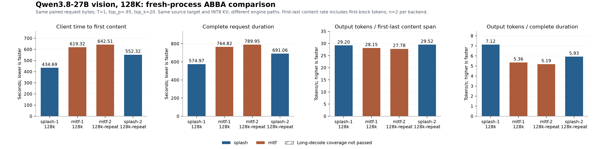
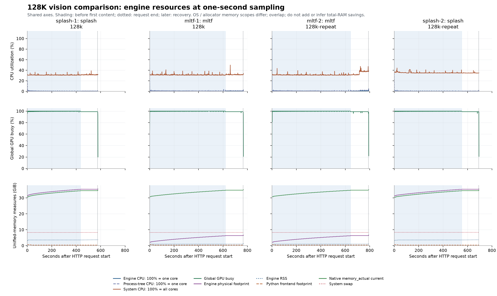
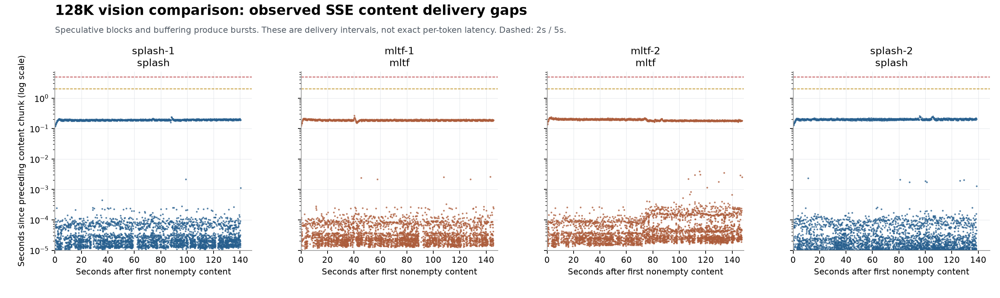

# Splash 与 MLTF：复现 PERF-06 的 128K 图文性能对照

[English](2026-10-21-splash-vs-mltf-perf06-replay.md) | [简体中文](2026-10-21-splash-vs-mltf-perf06-replay_CN.md)

测试日期：2026-10-21，America/Toronto。新增实验 PERF-09；保留历史 PERF-06 不变。

## 问题与实测结果

在 Splash 与 MLTF 上复用 PERF-06 原始长图文请求、新进程和相同客户端计时，比较完整引擎路径；不把结果当作单个 kernel 或通用模型质量结论。

| 指标（两项任务均值） | Splash | MLTF | Splash / MLTF |
|---|---|---|---|
| 客户端首正文等待（秒） | 493.50 | 630.92 | 0.78 |
| 完整请求耗时（秒） | 633.02 | 777.38 | 0.81 |
| 正文交付率（tok/s） | 29.36 | 27.97 | 1.05 |
| 输出 / 完整耗时（tok/s） | 6.53 | 5.27 | 1.24 |

本轮 Splash 的平均完整请求耗时缩短 18.57%，平均正文交付率提高 4.98%。观测到的主要时间差发生在首正文之前，不是数倍 decode 提升。

基线复现边界：本次 MLTF 正文交付均值为 27.97 tok/s，而 PERF-06 为 58.06 tok/s。跨日期差异的原因尚未隔离。主比例只使用本次 ABBA 对照，不能表述为相对历史安装的一般性性能提升。

每个后端 n=2，来自两项不同任务。均值和比例仅描述本轮，不提供置信区间、持续负载或质量等价保证。实际输出长度与失败记录在下表，不筛选成功样本。

## 硬件、系统与固定条件

| 项目 | 实际记录 |
|---|---|
| 推理位置 | 本机；两个引擎在同一台 Mac 上运行 |
| 硬件 | MacBook Pro / Apple M5 Max / 18 核 CPU / 40 核 GPU / 128 GiB 统一内存（137438953472 字节） |
| 实验时系统 | ProductName:		macOS; ProductVersion:		27.0.1; BuildVersion:		26A434;  / arm64 |
| 证据采集时间（Unix） | 1792583312.070633 |
| 供电 | Now drawing from 'AC Power';  -InternalBattery-0 (id omitted)	80%; AC attached; not charging present: true;  |
| Target 来源 | mlx-community/Qwen3.8-27B-8bit @ 815b83c0df8ffd1d1b5244cf75fd6ef14fca9ef9 |
| Splash 引擎 | 1.4.0 @ 1482f6bbc2abf12375332725302019594150b6cb；原生 Metal；输入为 MLX affine8 group64 权重 |
| Splash 构建工具链 | Xcode 27.1（27A9275）；Metal 4.0 编译目标；未继承 shader-validation 环境开关 |
| MLTF 引擎 | my-little-trie-forge 0.1.2；打包 q8c；参考源码 checkout 为 873d5574d903f5c1685e286c9cd59b79475a49f6；保留实际安装二进制哈希 |
| Draft | incoai/Qwen3.8-27B-DFlash2 @ 015e795645c74b1a0eeef3b570031fb62e769bc5; original BF16 safetensors SHA256 67fc76d68dc5a9415511a4f394ef744d67510cd20e93b37cc2cc7d28e4bab65c |
| 上下文与采样 | 上下文 131072；含图像输入 126976；输出预算 4096；T=1、top_p=.95、top_k=20；thinking 关闭 |
| 内存与 KV | Metal 上限 96 GiB；INT8 KV；Splash 循环状态为 FP32；SSD prefix cache 关闭 |
| 并发与缓存 | 每次只提交一个生成请求；每个主请求重启服务；核对 matched tokens；不清除文件系统缓存 |

全部 checkpoint 在测试前下载并完成 SHA-256 校验。Target revision 与 MLTF provenance 相同；draft revision 与旧打包 manifest 不同，但原始 draft 权重 SHA-256 一致。MLTF 打包权重与 Splash affine8 加载、视觉准备、执行和采样路径仍可能存在数值差异。同源 target 与相同 INT8 KV 不等于逐位一致。

Splash 保留默认 ANE 选择，启动与校准在 HTTP 请求计时之外，实际计划保存在 status / 日志证据中。MLTF 保留现有运行路径。Splash 自动准入容量可能不同于 MLTF 最大并发=1，但实际测试负载始终串行。

| 运行 | 启动至就绪快照秒 | ANE 状态 | ANE 分流比例 | ANE 最小 rows |
|---|---|---|---|---|
| splash-1 | 96.38 | split | 0.24 | 2012 |
| mltf-1 | 14.07 | N/A | N/A | N/A |
| mltf-2 | 11.12 | N/A | N/A | N/A |
| splash-2 | 16.07 | split | 0.24 | 2012 |

就绪间隔包含启动轮询，独立于 HTTP 请求计时。没有独立测量 ANE 利用率或功耗；MLTF 的 ANE 空项不表示其具有相同 ANE 执行路径。

## 原始流程复现与核对

复用 PERF-06 的 runner、CPU-only 请求核对、macOS 遥测、图片回答检查、汇总公式与图表布局；适配后端启动命令及安装路径，认证仅存在于私有运行目录。仅将启动就绪超时延长到 900 秒，以容纳初始化/校准。ABBA 顺序把原 mlx-vlm 一侧替换为 Splash：Splash A → MLTF A → MLTF B → Splash B。

每个新进程先进行 CPU-only 模板/token 核对，再发送一份未修改长请求，然后发送原来的短图片恢复探针，最后停止服务。两项任务是不同的合成 SQLite 队列 / DAG / 测试代码任务，配不同三形状图片。128k-repeat 是第二份原始 fixture 的名称，不表示热缓存复用。用户选择 MLX 8bit checkpoint 并要求复现本流程。监督者只适配测试与报告工具，没有修改 prompt 或模型输出。没有执行生成代码；没有裁剪输入、调整 filler、屏蔽 EOS 或重复筛选成功输出。

| 运行 | Request SHA-256 | 展开后输入 | Expanded token IDs SHA-256 | 命中缓存 tokens |
|---|---|---|---|---|
| splash-1 | 052763e089b1f87de8e721832e9ee918ac56503473efc2a1136d3cd8062da790 | 126976 | 4a282b941080c009a313edb954c5478efe2bb43537f399e63a9d5bddea8b0107 | 0 |
| mltf-1 | 052763e089b1f87de8e721832e9ee918ac56503473efc2a1136d3cd8062da790 | 126976 | 4a282b941080c009a313edb954c5478efe2bb43537f399e63a9d5bddea8b0107 | 0 |
| mltf-2 | 2055ef57041a7afa551928d99fe9b7047ae5ee070a38e87f8727671bde35d45c | 126976 | 65e7b7f5f4dec5064245f5a34231ac95cfa6ba7457921d021aa77f0603fec203 | 0 |
| splash-2 | 2055ef57041a7afa551928d99fe9b7047ae5ee070a38e87f8727671bde35d45c | 126976 | 65e7b7f5f4dec5064245f5a34231ac95cfa6ba7457921d021aa77f0603fec203 | 0 |

两份请求 SHA-256 与 PERF-06 原文件逐字节一致；每张图片展开为 234 tokens。原请求 enable_thinking=false 与服务默认 reasoning none 配套，核对实际 thinking-OFF assistant 结尾。模板或 token 数差异应作为偏差保留，不能通过修改任务掩盖。

## 完成情况与共同客户端性能

| 运行 / 任务 | 输入 / 输出 | 长 decode / 满4096 | 图片 / 恢复 | TTFT s | 总秒 | 正文跨度秒 | tok/s | 终止 |
|---|---|---|---|---|---|---|---|---|
| splash-1 / 128k | 126976 / 4096 | 通过 / 通过 | 通过 / 通过 | 434.69 | 574.97 | 140.28 | 29.20 | length |
| mltf-1 / 128k | 126976 / 4096 | 通过 / 通过 | 通过 / 通过 | 619.32 | 764.82 | 145.50 | 28.15 | length |
| mltf-2 / 128k-repeat | 126976 / 4096 | 通过 / 通过 | 通过 / 通过 | 642.51 | 789.95 | 147.43 | 27.78 | length |
| splash-2 / 128k-repeat | 126976 / 4096 | 通过 / 通过 | 通过 / 通过 | 552.32 | 691.06 | 138.74 | 29.52 | length |

TTFT 为提交 HTTP 至第一段非空正文，总耗时至 SSE 完成。正文交付率为全部 completion tokens / 首末非空正文跨度，包括首块已交付的 tokens。推测块可能包含多个 tokens，因此不是逐 token 延迟。机械长 decode 覆盖要求至少 2048 输出 tokens 并满足其他请求/缓存/健康检查；不证明生成代码正确。

## 后端计时与推测解码

| 运行 | Prompt 秒 | Prompt tok/s | Decode 秒 | Decode tok/s | Drafted / accepted / image encodes |
|---|---|---|---|---|---|
| splash-1 | 434.60 | 292.17 | 140.28 | 29.19 | {'drafted_tokens': 5097, 'accepted_draft_tokens': 3367, 'images_encodes': 1, 'transport_restarts': 0} |
| mltf-1 | 619.18 | 205.07 | 145.50 | 28.12 | {'drafted_tokens': 5383, 'accepted_draft_tokens': 3327, 'images_encodes': 1, 'transport_restarts': 0} |
| mltf-2 | 642.35 | 197.67 | 147.43 | 27.76 | {'drafted_tokens': 5362, 'accepted_draft_tokens': 3330, 'images_encodes': 1, 'transport_restarts': 0} |
| splash-2 | 552.21 | 229.94 | 138.74 | 29.52 | {'drafted_tokens': 4818, 'accepted_draft_tokens': 3407, 'images_encodes': 1, 'transport_restarts': 0} |

Native prompt_ms 为开始至首次 native 输出，包含首轮推测输出工作；native elapsed decode 的 token 分子排除首个输出块。Status 的 command-level prefill/decode wall 是另一口径。共同对比仍以客户端计时为准，不将这些率当作独立 GPU kernel 时间。累计 status 在恢复探针前保存，并保留请求前后值。

| 运行 | 请求前 prefill / decode tokens | Prefill tokens | Command prefill 秒 | Command prefill tok/s | Decode tokens | Command decode 秒 | Command decode tok/s |
|---|---|---|---|---|---|---|---|
| splash-1 | 0 / 0 | 126976 | 433.86 | 292.67 | 4096 | 139.98 | 29.26 |
| mltf-1 | 0 / 0 | 126976 | 618.88 | 205.17 | 4096 | 145.10 | 28.23 |
| mltf-2 | 0 / 0 | 126976 | 642.03 | 197.77 | 4096 | 146.90 | 27.88 |
| splash-2 | 0 / 0 | 126976 | 551.86 | 230.09 | 4096 | 138.50 | 29.57 |

这些 status 计数在恢复探针前读取；请求前计数为零时，可支持主请求隔离。Command 耗时不能替代 HTTP TTFT 或 native 开始至首输出计时。

## 内存与分阶段资源

两个后端均以 1Hz 遥测区分 native splash 子进程与 Python frontend。CPU 100% 为一个逻辑核，system CPU 与 GPU busy 是整机口径。RSS、footprint、运行时 allocator 和全局 GPU 驱动内存属于重叠的统一内存观测，不能相加，也不能根据差值声称总 RAM 节省。进程树求和可能重复共享页。启动期与请求期样本分开；1Hz 可能漏掉短尖峰。

| 运行 / 阶段 | 样本 | 引擎 CPU 均/峰 % | 进程树 CPU 均/峰 % | 系统 CPU 均/峰 % | 全局 GPU 均/峰 % | 引擎 RSS / footprint 峰 GiB | 运行时分配峰 GiB | 全局 GPU in-use / allocated 峰 GiB |
|---|---|---|---|---|---|---|---|---|
| splash-1 / before_first_content | 431 | 0.29 / 1.74 | 0.46 / 20.44 | 31.03 / 37.36 | 99.85 / 100.00 | 3.59 / 35.35 | 34.44 | 36.25 / 38.57 |
| splash-1 / content_delivery | 139 | 0.45 / 0.56 | 0.71 / 0.90 | 31.48 / 39.09 | 99.00 / 99.00 | 3.72 / 35.46 | 34.57 | 36.29 / 38.67 |
| mltf-1 / before_first_content | 615 | 0.18 / 18.75 | 0.61 / 50.51 | 31.33 / 41.01 | 99.85 / 100.00 | 0.99 / 6.19 | 34.73 | 31.08 / 38.81 |
| mltf-1 / content_delivery | 145 | 0.65 / 2.15 | 1.17 / 2.56 | 31.81 / 49.92 | 98.99 / 99.00 | 0.99 / 6.34 | 34.86 | 32.05 / 38.94 |
| mltf-2 / before_first_content | 640 | 0.32 / 104.69 | 0.83 / 105.69 | 31.23 / 43.63 | 99.67 / 100.00 | 0.99 / 6.34 | 34.86 | 32.08 / 38.78 |
| mltf-2 / content_delivery | 146 | 0.81 / 1.16 | 1.67 / 2.58 | 34.87 / 47.39 | 98.93 / 99.00 | 0.99 / 6.34 | 34.86 | 30.90 / 38.82 |
| splash-2 / before_first_content | 548 | 0.26 / 2.19 | 0.46 / 34.01 | 35.34 / 44.33 | 99.89 / 100.00 | 3.59 / 35.35 | 34.44 | 36.18 / 38.45 |
| splash-2 / content_delivery | 138 | 0.38 / 0.55 | 0.65 / 0.86 | 34.87 / 39.73 | 98.98 / 99.00 | 3.72 / 35.46 | 34.57 | 36.32 / 38.57 |

| 运行 | 最大 SSE 间隔秒 / >2s / >5s | 压力 normal / warn / critical | 请求 swap 增量 GiB | 遥测错误 | 缓存 status / 回调失败 |
|---|---|---|---|---|---|
| splash-1 | 0.24 / 0 / 0 | 570 / 0 / 0 | 0.00 | {} | 0 / 0 |
| mltf-1 | 0.27 / 0 / 0 | 760 / 0 / 0 | 0.00 | {} | 0 / 0 |
| mltf-2 | 0.24 / 0 / 0 | 786 / 0 / 0 | 0.00 | {'native_status': 1} | 0 / 1 |
| splash-2 | 0.26 / 0 / 0 | 686 / 0 / 0 | -0.01 | {} | 0 / 0 |

| 运行 | Frontend footprint 峰 GiB | Tree footprint 求和峰 GiB | Native current / 累计 peak GiB | 恢复后 swap 增量 GiB |
|---|---|---|---|---|
| splash-1 | 0.64 | 35.84 | 34.57 / 34.57 | 0.00 |
| mltf-1 | 0.64 | 6.72 | 34.86 / 34.86 | 0.00 |
| mltf-2 | 0.66 | 6.74 | 34.86 / 34.86 | 0.00 |
| splash-2 | 0.64 | 35.84 | 34.57 / 34.57 | -0.01 |

保留原保护阈值：连续 15 次 critical 压力或 native footprint 超过 115GiB 时，仅停止本次测试进程组。Swap 为系统级，变化不自动归因于该引擎。各列峰值独立取样，未必发生在同一时刻。测试清理时 SIGTERM 是主动停止，不构成崩溃证据。

## 历史 PERF-06 对照（单列）

| 运行 / 日期 | TTFT s | 总秒 | 正文交付 tok/s |
|---|---|---|---|
| mltf-1 / 2026-10-19 | 295.59 | 369.08 | 55.74 |
| mltf-2 / 2026-10-19 | 288.43 | 356.26 | 60.39 |

这些历史 MLTF 行不计入本次均值，测试日期不同，关联至保留不变的 PERF-06。主比较使用本次 ABBA 四行，历史数值不替代当前复跑。 [PERF-06](../experiments/perf-06_CN.md)

## 失败、边界与清理

- `splash-1`: 错误 = []; 标记 = []

- `mltf-1`: 错误 = []; 标记 = []

- `mltf-2`: 错误 = []; 标记 = ['请求期间存在遥测错误（详见计数）']

- `splash-2`: 错误 = []; 标记 = []

证据审计 67 项中 66 项通过。例外是 MLTF Task B 的一次 native /status 遥测超时：样本时间约在 HTTP 请求开始后 0.18 秒，raw phase 为 startup，采集耗时 2.08 秒。保留原来的按时间划分阶段规则，该边界样本计入请求区间；这个样本缺少 native status 字段。生成 SSE、usage、图像/恢复回答和请求计时另有完整证据。没有为了取得全绿审计而重跑。

性能与图片检查不建立 SQLite/DAG 生成代码正确性、广泛质量等价、长会话稳定性、并发吞吐、工具能力或 ANE 单因素收益。采样具有随机性，推测接受率可随输出内容变化。未记录环境温度及独立 GPU 时钟/功耗，不为历史性能变化指定单一原因。没有只保留成功样本的重跑或隐藏修改任务。每轮测试后停止对应服务，保留模型文件与独立环境。

## 图表与可下载证据

[证据包](../../assets/evidence/perf-09-evidence.zip)包含请求、形状图片、SSE、输出、结果、汇总 JSON/CSV、逐秒 CSV 及压缩原始遥测、核对和 thermal/status 记录、模型文件哈希与脚本适配。没有模型权重、虚拟环境、运行缓存或认证文件。

发布转换：元数据/日志中的本机用户目录与运行路径泛化，省略电池标识符；请求 JSON 与图片字节、输出文本、数值和哈希保持。复现脚本路径改为可配置，并保留原本机源文件哈希。没有采集完整个人会话或无关进程命令行。

来源：[Splash 固定源码](https://github.com/incoai/splash/tree/1482f6bbc2abf12375332725302019594150b6cb)、[MLX target](https://huggingface.co/mlx-community/Qwen3.8-27B-8bit/tree/815b83c0df8ffd1d1b5244cf75fd6ef14fca9ef9)。
