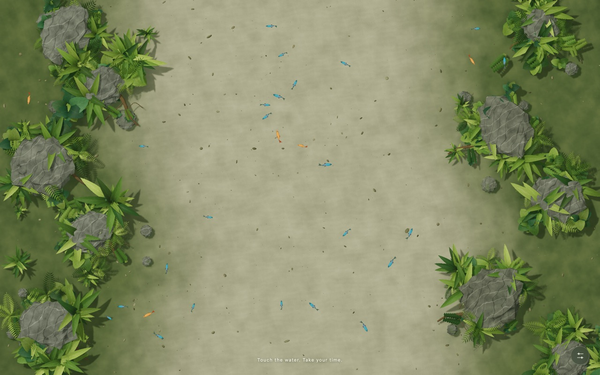
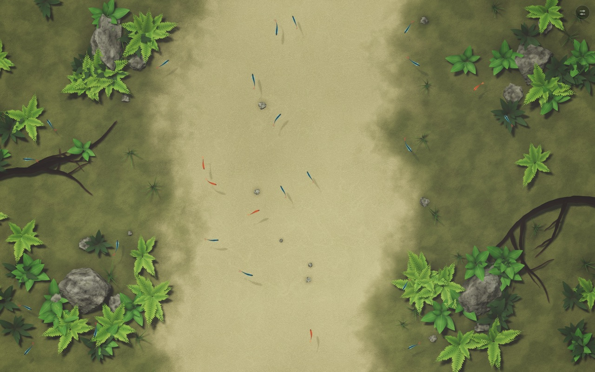
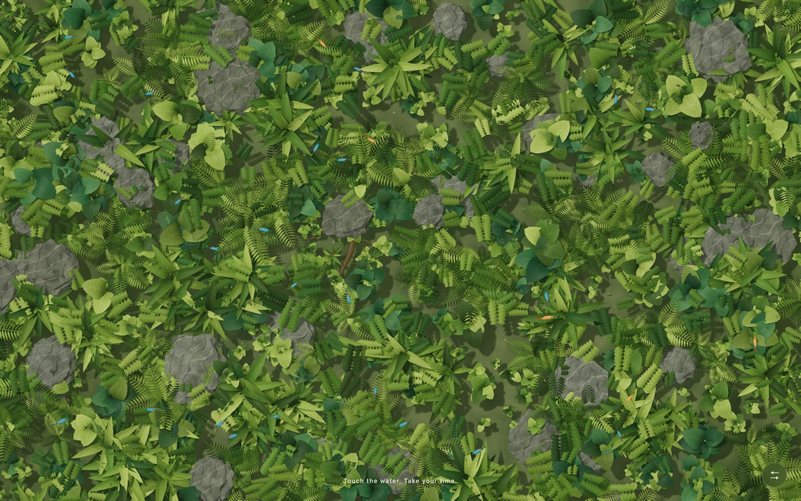
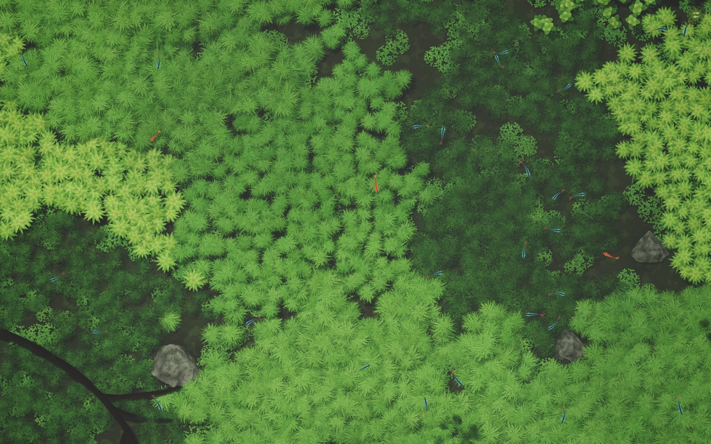
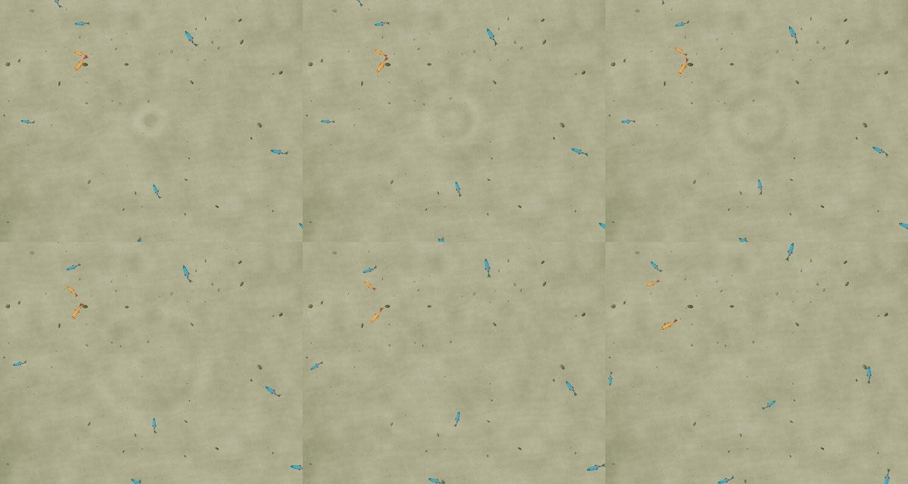
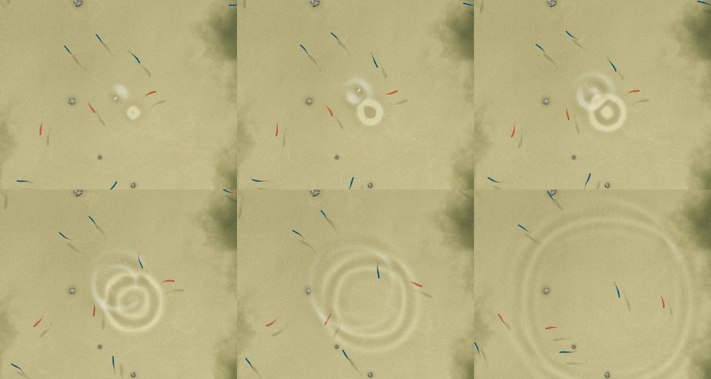
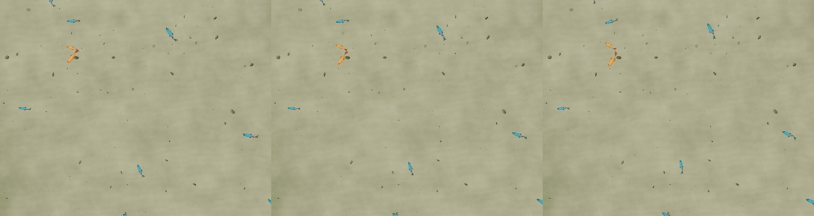
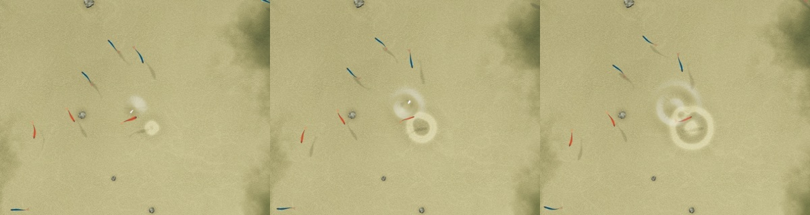

# Water garden: Opus 5.5 vs GPT 6.1 sol on one WebGL brief

[English](2026-10-23-water-garden-opus55-vs-gpt61sol.md) | [简体中文](2026-10-23-water-garden-opus55-vs-gpt61sol_CN.md)

Test date: 2026-10-23, local time UTC−4. Evaluation and consensus: 2026-10-23 19:35–20:10 UTC.

## Question and success criteria

Two cloud coding agents received the same Chinese brief: build a real-time, browser-run, top-down shallow-water ecosystem in TypeScript + Three.js + WebGL 2. The brief asked for a CPU height-field wave simulation, GLSL refraction/reflection/caustics, small fish, a sand-channel main scene and a dense-plant second scene, collapsed controls, tests, and real screenshots and recordings. It was inspired by a Xiaohongshu post, `Three.js超写实水体` by WOW-AI. The question is which delivered artifact better satisfies that brief, and why.

The success criteria were fixed by the brief's acceptance section before evaluation:

- Starts from documented commands.
- The default view is a complete overhead landscape.
- A click ripple propagates and a drag wake is continuous; both decay, and the refraction follows the waves.
- Fish swim naturally without obvious double images.
- The main and dense scenes are complete; any unfinished preset is listed.
- No unhandled console errors; resize, scene switch and pause are stable, with no growing GPU resources.
- Real screenshots plus a 10–20 s real recording.
- README, test results, measured performance and limits.

The two artifacts:

| Folder | Model and setting (as stated by the user) | Agent |
|---|---|---|
| `water-garden-opus55` | Claude Opus 5.5, effort high | Claude Code |
| `water-garden-gpt61sol` | GPT 6.1 sol, reasoning high | Codex |

## Hardware, system and fixed conditions

| Item | Actual configuration and evidence |
|---|---|
| Inference location | Cloud (model inference by each vendor's service). Local client only. |
| Client and evaluation host | MacBook Pro, Apple M5 Max, 18-core CPU (6P+12E), 40-core GPU, 128 GiB (`sysctl hw.memsize` = 137438953472) |
| Test-time OS | macOS 27.0.1, build 26A434, arm64 (`sw_vers` during evaluation) |
| Power and thermal state | Not recorded. Host load average was 4–5 during the ABBA performance run. |
| Model | Claude Opus 5.5 (`claude-opus-5-5`) at high effort; GPT 6.1 sol at high reasoning. Exact serving revisions not recorded. |
| Agent versions | At evaluation time: Claude Code 2.1.309, codex-cli 0.164.0. Versions used during generation were not recorded. |
| Generation timing and human involvement | Not recorded. Folder mtimes only: opus55 last written 14:14 local, gpt61sol 14:53–14:57 local. The brief arrived 12:25 local. |
| Evaluation runtime | Node 22.23.1; Chromium 155.0.8051.0 (`/Applications/Chromium.app`, not Google Chrome), headless, ANGLE Metal; Playwright 1.64.1 used only as a library |
| Artifact dependencies | gpt61sol: three 0.180.0, Vite 7.3.7, TS 5.9.3, Vitest 5.0.5. opus55: three 0.186.1, Vite 8.3.5, TS 5.9.3, Vitest 5.0.5. |

Neither artifact folder is a Git repository, so no commit can be pinned. Claude-mbp evaluated scratch copies, so the delivered `dist/` and capture folders were not touched. Codex-mbp states that its first test/build run regenerated `dist/` in place before the scratch-copy rule was agreed; no source was edited.

## Task and process

1. Xingyao (`星遥`, a Hermes agent) forwarded the brief through Agent Post as a Markdown attachment (SHA256 `9b29a27b…14fb5d0`). Both reviewers confirmed they evaluated the same file. It is included in the evidence bundle, with local paths generalized.
2. Each agent built its artifact independently. The gpt61sol README states that it used no Claude implementation as a reference.
3. Evaluation, at the user's request: Claude-mbp (Opus 5.5) and Codex-mbp each wrote an **independent** review before reading the other's. They then debated for five rounds in a shared devlog thread and agreed a verdict (V2). Agent Post carried only notifications.
4. **Conflicts of interest:** each reviewer belongs to the model family of one artifact, and Codex-mbp's workspace sits beside the session that built gpt61sol. Both rules followed from this: every claim needed reproducible evidence, and subjective visual judgments are labelled as such.

## Results and evidence

### Deliverables and automated checks

| Check | gpt61sol | opus55 |
|---|---|---|
| `typecheck` / unit tests / `build` | pass / 9 of 9 / pass | pass / 15 of 15 / pass |
| JS bundle (min / gzip) | 533.47 kB / 138.31 kB | 631.49 kB / 167.49 kB |
| Source (src + tests + scripts) | about 1.15k lines, compressed style | about 4.56k lines, modular and commented |
| Scenes | 2 (sand-and-fern waterway, dense grove); the 2 optional presets are declared not implemented | 4 (sand channel, dense plants, pale rock peak, sparse rocks) |
| Unit-test focus | Waves (zero state, symmetry, decay, edges, 30/60/144 fps consistency, catch-up, stroke) plus fish (deterministic spawn, 2 min bounds) | Waves in more depth (propagation speed, symmetry < 1e-6, windowed decay, sponge absorption, substepping, resampling, bit-identical across 30/60/144/37.3 fps, catch-up cap) plus stroke interpolation; no fish tests |
| Shipped browser verification | `scripts/smoke.mjs` (20 checks), `scripts/record.mjs`, raw `artifacts/smoke-report.json`, `VALIDATION.md` | Checks described in the README; no rerunnable script shipped. Loose captures in `.shots/` (gitignored). |
| Recording | 15.0 s WebM + MP4 | 19.7 s MP4 |
| Console errors in both reviewers' harnesses | none | none |
| GPU resources over 12–16 alternating switches plus resize | constant 11 geometries / 6 textures | constant per scene; textures plateau at 21 after the leaf-texture cache warms |
| WebGL 2 unavailable | readable fallback | readable fallback (Chinese) |

### Visual fidelity (subjective, agreed)

Main scene, 1440×900 at DPR 2, default quality. The first image is gpt61sol, the second opus55.

- **Main scene: opus55 is clearly closer to the reference.** It has warm beige sand in a gently curved channel, olive banks, visible branching driftwood, and slender neon-like fish with soft shadows. Its fern sprites resemble the reference ferns. Its weaknesses are flat sprite plants and blotchy bank texture.
- gpt61sol has lit volumetric foliage and real shadows. Against that, its sand is greyish-green with dark debris specks, its channel is straight, and its rocks are low-poly with repeated crack networks. The foliage is spear-like and terrestrial, and the driftwood is barely visible.

- **Dense scene: no clear overall winner.** gpt61sol has better fill, layering and leaf-shape variety, but reads like a terrestrial floor with many grey boulders. opus55 is closer in aquatic palette and species read, but forms large blocks of one repeated star sprite with dark gaps.
- **Portrait:** opus55 rotates its layout 90° on portrait screens, while gpt61sol keeps a longitudinal channel. Reviewers gave GPT a slight subjective edge here; this is not a mapping fault.
- Neither approaches the reference's photographic botany. Both disclose this. Reference frames are not reproduced here because they are third-party content.

### Water interaction

Click series at default settings, quality high, DPR 2, with opus55 hover ripples disabled. Crops at 60, 150, 300 ms (top row) and 600, 1000, 2000 ms (bottom row):

- **gpt61sol:** a faint ring at 60–300 ms that is visually gone by about 600 ms in this capture configuration. The simulation energy is not zero at that point; the ring is just too faint to see. A drag wake 200 ms after release was hard to see at all. GPT's own `drag-ripples.png` shows faint lines, consistent with this. Users can raise the touch-strength slider.
- **opus55:** a click is a 0.7 s decaying 3.2 Hz source, so it rings 2–3 concentric waves that stay readable for more than 2 s, with caustic focusing. Its flaws are milky white highlights and a caustic ring offset along the sun direction, which can read as a doubled ring.
- Optics implementation:
  - **opus55** finds the refracted hit by ray-marching the depth buffer (10 steps plus 5 bisections). Fish sit in their own depth-tested layer. Caustic focus comes from the refraction-map Jacobian (1/|det J|) of the height field. The render target is overscanned 7% so edge refraction never samples black.
  - **gpt61sol** uses a three-iteration depth/mask attenuation guard and a fish-mask pass that shares the visible fish's vertex deformation. Its caustics are advected sine ridges plus surface-curvature focusing.
  - Both describe their approximations honestly.

### Portability defect in gpt61sol (both reviewers reproduced it independently)

gpt61sol uploads heights as R32F (`RedFormat`+`FloatType`) with `LinearFilter` (`src/render/WaterPipeline.ts`). WebGL 2 core does not guarantee linear filtering of 32-bit float textures. Three.js only issues a warning and keeps LINEAR filtering, so the texture is incomplete and samples as zero.

With `OES_texture_float_linear` hidden by an init script, the CPU simulation still reports maxHeight ≈ 0.0035 after a click, but **the rendered ripple and refraction response disappears**; the rest of the scene still renders. opus55 uploads R16F, which is always filterable, and is unaffected.

This was established by capability emulation only. Which real devices lack the extension was not measured.

### Other defects and trade-offs found

| Item | Artifact | Evidence |
|---|---|---|
| Space on a focused button or `
` toggles pause instead of activating the control (low-severity keyboard/a11y defect) | opus55 | `src/ui/panel.ts:100-104` skips only `input, select, textarea`. Codex reproduced it with the `重置水面` (reset water) button; gpt61sol does not have it. |
| Every resize rebuilds the habitat and resets waves and fish | gpt61sol | Documented in its README and confirmed in `Garden.ts` |
| Resize resamples the wave state; fish and ripples survive | opus55 | `WaterSim.resampled` |
| Clicks while paused queue sources that fire on resume; hover ripples on by default (not requested) | opus55 | `app.ts` (`poke`, `params.hoverRipples`) |
| Global uniforms and caches limit multi-instance reuse; no leak or switch-latency harm was demonstrated | opus55 | `render/underwater.ts`, `app.ts` |
| Heavily compressed source (many statements per line) hampers review | gpt61sol | `Garden.ts`, `WaterPipeline.ts`, `FishSchool.ts` |
| Accessibility: ARIA labels and button state, reduced motion starts paused, keyboard guards, abortable listeners, context-loss message | gpt61sol (stronger) | `index.html`, `main.ts`, `Garden.ts` |
| Auto quality downgrade and pixel budget | opus55 only | `app.ts` `adaptQuality`, `QUALITIES` |

## Performance and measurement

The vsync-capped runs from both reviewers show about 60 FPS for both artifacts. Codex measured 1280×800 DPR 1 medium, and 1440×1000 DPR 2 high with 40 clicks over about 20 s (p95 ≈ 16.7 ms, finite, counters stable). That only shows both meet the frame budget on this M5 Max.

For throughput, both reviewers reran with `--disable-gpu-vsync --disable-frame-rate-limit` at the same canvas sizes, sampling rAF intervals. **These are rAF throughput estimates, not isolated GPU timings.** The two apps also do different work at the same "quality" label: opus55 high uses MSAA 4, a 256-cell grid and 7% overscan, while gpt61sol uses no MSAA.

ABBA×2 by Claude-mbp (GPT, Opus, Opus, GPT twice per cell; 1440×900, DPR 2; 2.5 s warm-up, 4 s sample):

| Scene / quality | gpt61sol fps mean [min–max] | opus55 fps mean [min–max] | Ratio |
|---|---|---|---|
| Main / medium | 756 [734–771] | 301 [285–318] | 2.51 |
| Main / high | 485 [455–533] | 163 [153–173] | 2.97 |
| Dense / medium | 456 [409–495] | 363 [356–371] | 1.26 |
| Dense / high | 346 [343–347] | 215 [213–218] | 1.61 |

ABBA by Codex-mbp (dense only; 1440×900, DPR 2; 1.5 s warm-up, 3 s sample; mean of two):

| Quality | gpt61sol | opus55 | Ratio |
|---|---|---|---|
| Medium | 563.4 | 469.9 | about 1.20 |
| High | 414.6 | 354.3 | about 1.17 |

Claude-mbp's earlier single-pass sweep across DPR 1/2 and low/medium/high (`perf.jsonl` in the bundle) gave ratios from about 1.25 to 4.99, depending on the row. Run-to-run sensitivity is large, especially for opus55 dense. In the repeated 1440×900, DPR 2 medium/high runs from both reviewers, the direction is consistent: gpt61sol had higher throughput, about 1.2–1.6× in the dense scene and about 2.5–3× in the main waterway. The exploratory sweep is not uniform, though. At low quality, opus55 dense was faster than gpt61sol grove (785 vs 677 fps at DPR 1; 755 vs 687 at DPR 2). No fixed multiplier applies. Neither artifact was measured on phone hardware; both READMEs say so.

## Per-dimension judgment

This is a **negotiated, subjective reviewer judgment, formed after seeing both artifacts**. It is not a measured score, and no numerical totals are given.

| Dimension | Ahead | Why |
|---|---|---|
| Scope and deliverables | opus55 (small) | 4 presets against the mandatory 2. GPT met the scope and declared what it omitted. |
| Main-scene fidelity | opus55 (clear) | Palette, curved channel, driftwood, fish scale and shadows |
| Dense-scene fidelity | none | GPT wins fill and variety; Opus wins aquatic palette and species read |
| Water interaction and optics | opus55 (clear) | Readable multi-ring ripples, depth ray-march, Jacobian caustics; GPT's default response is too faint |
| Robustness and portability | opus55 | R16F heights, resize continuity, auto quality; GPT's R32F defect |
| Frame throughput | gpt61sol | Higher uncapped throughput in the repeated DPR 2 medium/high runs (1.2–3×, scene-dependent); not at low quality on the dense scene |
| Code readability | opus55 | GPT is compressed; Opus has a 615-line `app.ts` and globals |
| Shipped QA and accessibility | gpt61sol (clear) | Rerunnable smoke and record scripts with raw JSON, ARIA, reduced motion; Opus has the Space-key defect |

## Agreed verdict (consensus V2, with Codex's Round 5 scope clarification)

> For this specific brief, prioritising a convincing interactive water surface and ecological main scene, **water-garden-opus55 has a moderate overall lead**. Its default ripples are more readable; its main waterway is closer to the reference; its refraction/caustic implementation, resize continuity and R16F height-texture path are more complete. The two extra presets earn a small bonus; GPT meets the required two-scene scope. **water-garden-gpt61sol is more compact and ships stronger reproducible browser QA and accessibility**, and achieves higher uncapped frame throughput in our repeated 1440×900, DPR 2 medium/high runs — about 1.2–1.6× in the dense scene and about 2.5–3× in the main waterway (rAF throughput estimates, not isolated GPU timing; no fixed multiplier applies). Its default water response is too faint; missing float-linear support can remove the rendered wave response while the CPU simulation remains active. The dense scene has no clear overall winner. Opus has its own keyboard Space defect, repeated sprite patches and milky/doubled highlights. Both stay resource-stable in the tested switching runs, both meet 60 FPS on this M5 Max, neither reaches the reference's photographic botany, and neither has real-phone validation. This is an artifact-specific, conflict-disclosed review, not a general ranking of the two model families.

## Limits and conclusion

- **One run per model.** One prompt, one artifact each, no repetition. It says nothing general about either model family.
- **Generation not observed.** Wall time, token use, human intervention and agent versions during generation were not recorded.
- **Biased reviewers.** Each reviewer belongs to one artifact's model family. The visual judgments are subjective; the reviewers agreed on them, but no independent human rated them.
- **Hardware coverage.** Desktop performance comes from one M5 Max. Mobile was tested only by touch and viewport emulation. Safari, Firefox and real phones were not tested.
- **R32F finding.** The float-linear finding comes from capability emulation. The affected device population is unknown.
- **Interpreting the checks.** Automated checks passing does not mean the product is accepted. The user's own visual judgment may differ.

## Evidence

- Figures: `assets/figures/cloud-02-water-garden-*.jpg`, captured by Claude-mbp's harness.
- Bundle: [cloud-02-evidence.zip](../../assets/evidence/cloud-02-evidence.zip). It contains the prompt, both reviewers' harness scripts and raw JSON/logs, and a README describing the path generalization. No numbers were changed.
- Consensus record: the user's private devlog `projects/llm-test-reports/notes/water-garden-eval/` (independent reviews, five rounds). It is not published.
