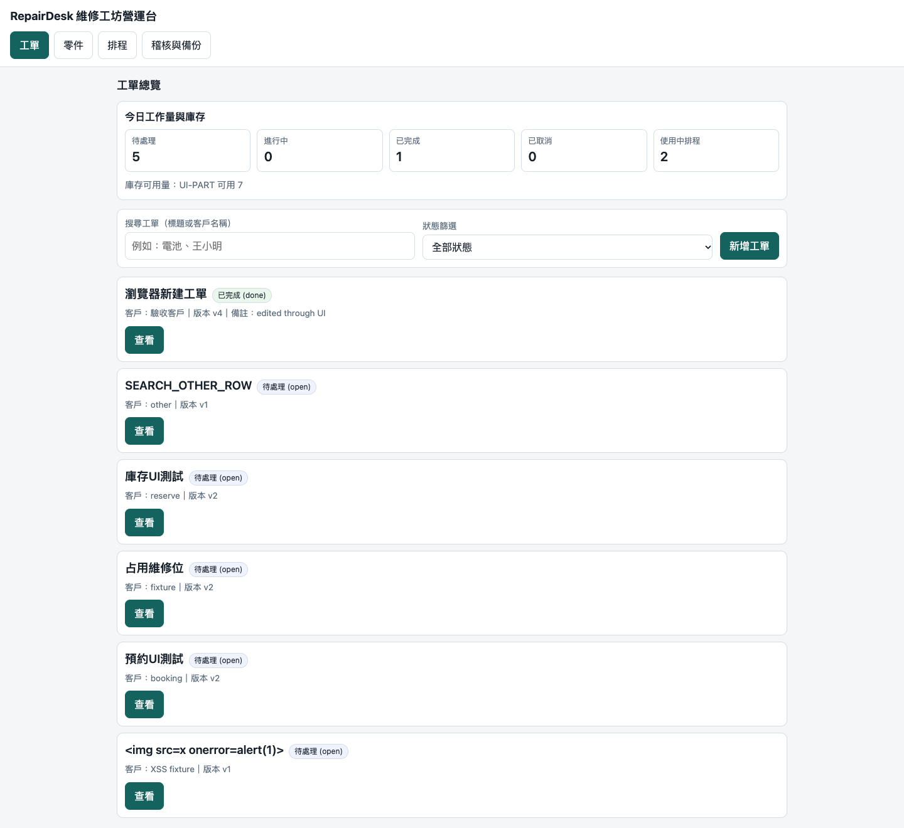
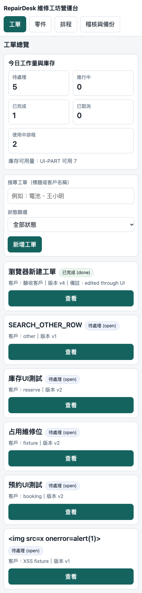
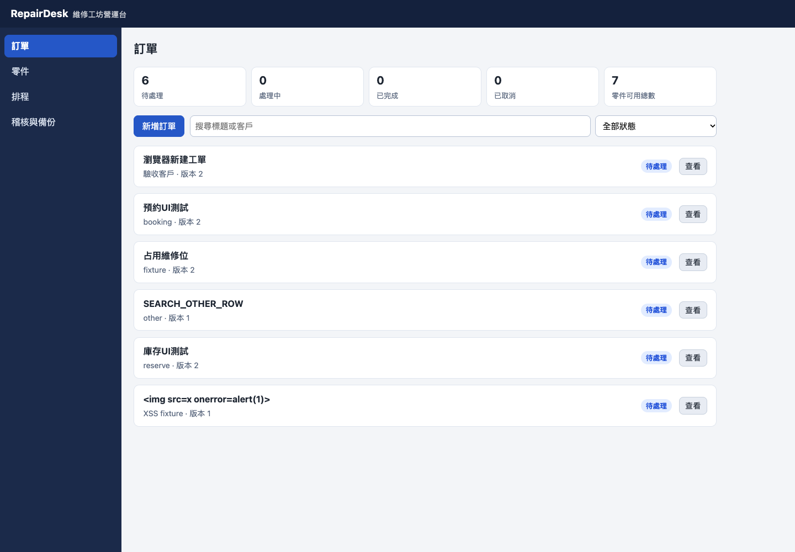
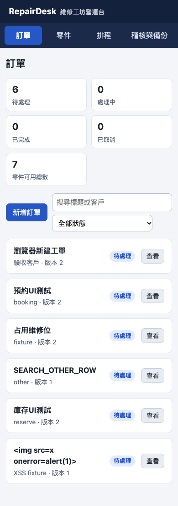

# RepairDesk: Pi × Strata / Splash paired complex-project report

[English](2026-10-25-pi-strata-splash-repairdesk.md) | [简体中文](2026-10-25-pi-strata-splash-repairdesk_CN.md)

Test-time OS: macOS 27.0.1 (26A434), arm64. Inference and client ran on the same local M5 Max, 18 CPU / 40 GPU cores, 128 GiB unified memory. This is captured test-time evidence from configs/host.json, not a substitution from the current workstation reference.

CAP-03. Local run on 2026-10-25, America/Toronto. One paired experiment; no public release was made by the original evaluation.

## Result and judgment

For this project, **the Strata implementation is the stronger starting point for further development**. Development took 38.16 minutes versus 50.89 minutes for Splash, a difference of 12.73 minutes. Fixed completion scores are 79/80 versus 77/80; code-quality scores are 14/20 versus 10/20. Both applications start and support the main workflows, but a total score does not cancel a reproduced high-severity defect. The supervisor did not repair either implementation.

| System | Development min | Independent API | UI /20 | Completion /80 | Quality /20 | Additional total /100 |
|---|---|---|---|---|---|---|
| strata | 38.16 | 30/30 | 19 | 79 | 14 | 93 |
| splash | 50.89 | 29/30 | 19 | 77 | 10 | 87 |

Strata has a more reliable transaction boundary and a clearer HTTP/domain split. Its remaining defects include clearing entered dates after a booking conflict, incomplete schemaVersion type checks, and an unstable model-written race test. Splash has denser visual organization, but actual defects include failure to restore exported historical bookings, committed business data after audit failure, stored XSS through an imported ID, and broken return-to-list navigation.

**Shared issue:** an isolated HTTP probe with an untrusted Origin and text/plain body could perform destructive import on both applications. This establishes absent source/media-type checks at the entry point; it is not a complete cross-site exploit study under every browser or Private-Network policy. Lack of login alone was not penalized because the brief explicitly specifies a local tool. The assessment concerns the destructive request that was actually accepted.

## Project and paired protocol

The private new [BRIEF: BRIEF.md](../../assets/evidence/cap-03-evidence.zip) specifies a workshop operations app: SQLite persistence, versioned CRUD, inventory reservations and completion consumption, two-bay UTC half-open scheduling, audit, atomic import/export, and a responsive Chinese interface. Both use Python standard-library backends and browser-native HTML/CSS/JS, with no package downloads. No existing open-source implementation or previous project source was supplied.

The new experiment directory was `~/Code/qwen3.8_tests/2026-10-25-repairdesk-comparison/`, retaining the user-requested underscore and leaving the older `qwen3.8-tests` directory unchanged. Candidates received identical empty Git baselines, BRIEF, four predetermined prompts, and a 60-minute total development budget each. Each used one continuous Pi session. Tools were read/bash/edit/write; MCP, extensions, skills, prompt templates, and inherited context files were disabled. External AI, network access, and reading the other candidate or evaluator source were prohibited. These were instructions with recorded activity, not an OS sandbox.

Strata ran first, then Splash, with only one large candidate model loaded. The supervisor did not close ordinary background applications. Model loading, smoke checks, and a 10-second baseline were excluded from development time; thinking, tools, tests, self-repair, and compaction were included. Safety caps were 3600 seconds, 800 tool starts, or 200000 assistant output tokens. Both completed their four phases without hitting a cap.

The [PLAN: PLAN.md](../../assets/evidence/cap-03-evidence.zip) and initial API evaluator/brief were committed as `33e236e` before formal development. Evaluator positive/negative controls passed 5/5. Assumptions about unspecified DOM structure, option values, and asynchronous rendering were subsequently corrected uniformly, with v1/v2/v3 evidence preserved: [evaluator change log: scoring/evaluator-change-log.md](../../assets/evidence/cap-03-evidence.zip). Independent acceptance began only after both final source snapshots were frozen. Hidden results were not fed back to either model; there was no best-of selection, replacement of failed samples, or supervisor application patch.

## Actual models, tools, and context

| Item | Strata | Splash |
|---|---|---|
| Base model / quantization | Qwen3.8-Flash-Next GSQ-RCO IQ3_S | Qwen3.8-27B MLX affine8 |
| Engine | Terminal0.2.6 / Control0.1.51 / released Metal0.1.50 | Splash1.4.0, source1482f6b |
| Agent | Pi1.4.0 | Pi1.4.0 |
| Pi / native context | 262144 / 262144 | 262144 / 262144 |
| Per-response cap / thinking | 32768 / medium | 32768 / medium |
| Observed request sampling | temperature1 / top_p.95 / top_k20 | temperature1 / top_p.95 / top_k20 |
| Maximum observed input | 162672 | 124477 |
| Spontaneous compaction / restart | 0 / False | 0 / False |
| Self-generated screenshot inputs | 3 unique images; repeated in histories 99 times | 0 images; DOM/CDP checks instead |
| Final source SHA | 8ef8a5f4c7206f4953d495ed351f051916fefacd | 1de5c3088520f9beeeb5ff7ef67a35dbfeaf2908 |

The inference host was an M5 Max with 18 CPU / 40 GPU cores and 128 GiB unified memory, macOS27.0.1 build26A434; Node22.23.1 and Python3.14.7. Both Pi declarations and native service status were checked at 256K. Strata actually exceeded 128K input during this project; Splash did not exceed 128K. Configuring 256K is not evidence that both consumed a full 256K window.

Both had the same read-image capability and GPU vision available. Strata independently read 3 screenshots it generated; Splash read none. These were not extra supervisor hints. An identical medium label does not imply identical computation. Existing previously verified weight installations were reused; paths, sizes, and configuration were captured without rehashing all weights. Actual engine binary hashes and BUILD metadata are in [configs: configs/](../../assets/evidence/cap-03-evidence.zip). The Strata audit-source clone and released binary have different commits; the actual binary hash/BUILD is authoritative.

This compares complete systems with different base models, precision, inference acceleration, and engines. It cannot establish a single-factor engine advantage or IQ3-versus-8bit fidelity result.

## Development time and execution cost

| Phase | Strata min | Splash min |
|---|---|---|
| Domain/API | 11.25 | 13.01 |
| Booking/audit/backup | 6.90 | 14.50 |
| UI | 12.14 | 18.55 |
| Integration and handoff | 7.87 | 4.83 |

| Metric | Strata | Splash |
|---|---|---|
| Development wall min | 38.16 | 50.89 |
| LLM requests | 126 | 58 |
| Assistant output tokens, including thinking etc. | 122489 | 101779 |
| Tool starts / error flags | 137 / 3 | 65 / 5 |
| Unclosed tool calls | 0 | 0 |
| LLM API errors | 0 | 0 |
| Median first model event s | 0.38 | 2.32 |
| Weighted native decode tok/s | 78.31 | 43.32 |

Wall time uses a monotonic clock and includes the framework and tools. First model event ends at a nonempty thinking/content/tool delta, excluding role-only events; it is not final-answer TTFT. Most requests reuse prefixes and are not cold-start measurements. Decode is weighted from each request SSE predicted_n divided by accumulated predicted_ms, including thinking/tool generation. The services use incompatible prompt_n accounting, so native prefill rates are not ranked across engines. Tool error flags include failed development tests and interrupted cleanup, and are distinct from LLM API errors.

Splash service loading took 14.18 seconds, recorded separately. Strata was already ready at test start; there was no symmetric cold-start experiment, so loading cannot be ranked. Splash smoke work took about8.15 seconds and Strata4.81 seconds. Each was one tool task with write/readback/JSON checks, all3/3, not three independent capability samples. See [service switches: raw/service-switches.json](../../assets/evidence/cap-03-evidence.zip).

## System pressure and memory

| Development sampling metric | Strata | Splash |
|---|---|---|
| Approximately1-second samples | 2274 | 3032 |
| Native RSS peak GiB | 53.57 | 15.32 |
| Native footprint peak GiB | 21.92 | 45.12 |
| Pi + tool-tree RSS peak GiB | 1.40 | 1.24 |
| Global GPU in-use memory peak GiB | 63.70 | 46.35 |
| Whole-system CPU mean % | 7.30 | 5.61 |
| Global GPU busy mean % | 72.31 | 88.04 |
| Swap growth peak GiB | 0.00 | 0.00 |
| Pressure distribution | {'normal': 2274} | {'normal': 3032} |
| Telemetry errors | {} | {} |

RSS can include resident mmap file pages, while footprint and Metal heaps are charged differently. Pi-tree shared pages may be double-counted. These counters overlap with global GPU memory: do not add them or use RSS alone to claim lower total RAM. GPU/CPU are whole-machine counters, including background activity and the model’s browser/tests. Sampled peaks are not exact instantaneous peaks. Temperature and the Strata allocator high-water mark were unavailable, not zero; no absence of thermal throttling is claimed.

All development samples for both systems were normal, swap did not grow, and no resource stop condition was triggered. Planned stops/reloads between candidates and during final restoration are not spontaneous restarts.

## Independent functional acceptance

| API case | Strata | Splash |
|---|---|---|
| A01 | PASS | PASS |
| A02 | PASS | PASS |
| A03 | PASS | PASS |
| A04 | PASS | PASS |
| A05 | PASS | PASS |
| A06 | PASS | PASS |
| A07 | PASS | PASS |
| A08 | PASS | PASS |
| A09 | PASS | PASS |
| A10 | PASS | PASS |
| A11 | PASS | PASS |
| A12 | PASS | PASS |
| A13 | PASS | PASS |
| A14 | PASS | PASS |
| A15 | PASS | PASS |
| A16 | PASS | PASS |
| A17 | PASS | PASS |
| A18 | PASS | PASS |
| A19 | PASS | PASS |
| A20 | PASS | PASS |
| A21 | PASS | PASS |
| A22 | PASS | PASS |
| A23 | PASS | PASS |
| A24 | PASS | PASS |
| A25 | PASS | PASS |
| A26 | PASS | PASS |
| A27 | PASS | FAIL |
| A28 | PASS | PASS |
| A29 | PASS | PASS |
| A30 | PASS | PASS |

Thirty binary cases at2 points each give60 API points. Fresh disposable DBs and real HTTP cover versions, failure atomicity, literal search, stock races, state transitions, half-open booking intervals, restart, backup, and file-path protection. Names are in PLAN. Splash A27 remains0: booking→in_progress→done→export→import returns422. Its input was not replaced and its code was not repaired.

| UI case | Strata /2 | Splash /2 |
|---|---|---|
| U01 | 2 | 2 |
| U02 | 2 | 2 |
| U03 | 2 | 2 |
| U04 | 2 | 2 |
| U05 | 2 | 1 |
| U06 | 2 | 2 |
| U07 | 1 | 2 |
| U08 | 2 | 2 |
| U09 | 2 | 2 |
| U10 | 2 | 2 |

Final UI scores use v3 plus documented manual adjudication in [review: scoring/review.json](../../assets/evidence/cap-03-evidence.zip). Strata U07 receives1 because conflicts clear the entered dates. Splash U05 receives1: detail/edit/start/complete work, but returning to the list is broken. Splash U09 was blocked by that earlier navigation defect; a fresh-page keyboard/labels/validation check passed and receives2, avoiding a duplicate penalty. Additional real part-update and cancellation workflows passed for both. All v1/v2/v3 and supplemental records remain, with no candidate source changes.

The browser executable was `/Applications/Chromium.app/Contents/MacOS/Chromium`, never Google Chrome or the chrome channel, with1440px desktop and390px mobile viewports. Neither had pageerrors or external asset requests; neither overflowed the390px page, and title-XSS text rendered literally. That case covers only the title and does not negate the separately reproduced Splash imported-ID stored XSS.

## Code quality: dimension-by-dimension review

| Dimension /5 | Strata | Splash |
|---|---|---|
| correctness | 4 — Fixed API30/30; audit failure rolls back. Wrong schemaVersion types remain accepted and conflict handling loses dates. | 2 — Core CRUD/inventory/scheduling work, but exported historical bookings cannot be restored, audit failure leaves committed data, and list return is broken. |
| security | 3 — Parameterized SQL, static-root boundaries and DOM text rendering are stronger, but untrusted-Origin text/plain destructive import is accepted. | 2 — SQL and static paths have protection, but imported IDs enter unescaped HTML attributes: stored XSS was reproduced. Untrusted-Origin text/plain import is also accepted. |
| architecture | 4 — CLI/HTTP/domain separation and shared test support; the850-line service and797-line JS remain large. | 3 — The1214-line app.py is organized into sections/classes, but validation, DB and HTTP remain together; the business-transaction/audit boundary is misplaced. |
| tests_docs | 3 — Broad tests and candid limits, but107 of108 passed on verification; one race test assumes reservations always win and passed only6 of10 repeats. | 3 — All69 tests passed verification and the negative matrix is substantive. The browser driver was not committed; historical-booking roundtrip, audit failure and list return were missed. |

Strata has a60-line CLI,257-line HTTP layer and850-line domain service. Splash has a1214-line app.py. Frontend JavaScript is797/638 lines. Line count is not directly scored: responsibility boundaries, transaction consistency, reproduced defects and repeatable tests drive the judgment. Both include real SQLite/HTTP tests and detailed READMEs, not just static UI.

### Reproduced or located findings

**S01 · strata · medium: Booking conflict clears entered dates**

The failure branch calls refreshAfterMutation→reloadCurrentOrder→renderBookingForm, replacing the draft with empty values when the server has no booking. Preserve the user draft instead. [Source excerpt: strata/static/app.js:461](../../assets/evidence/cap-03-source-review.txt) · [Evidence: scoring/strata/browser-v3/results.json](../../assets/evidence/cap-03-evidence.zip)

**S02 · strata · low: Incomplete schemaVersion type validation**

Python True==1 and1.0==1 allow invalid types to import successfully. Require an integer and explicitly exclude bool. [Source excerpt: strata/workshop/service.py:658](../../assets/evidence/cap-03-source-review.txt) · [Evidence: scoring/diagnostics.json](../../assets/evidence/cap-03-evidence.zip)

**S03 · strata · medium: Race test assumes a fixed winner**

Start and reservation updates race at the same version; either can legitimately win, but the test always requires a reservation. Verification was107/108, and the case passed6 of10 repeats with4 failures. One108-green run is not a stability guarantee. [Source excerpt: strata/tests/test_phase4_audit.py:72](../../assets/evidence/cap-03-source-review.txt) · [Evidence: scoring/strata/flaky-test-repeats.json](../../assets/evidence/cap-03-evidence.zip)

**P01 · splash · high: Backup rejects its own exported historical booking**

Export retains a closed order’s booking, while validate_backup rejects inactive orders. Booking→in_progress→done→export→import returns422. Allow historical bookings and apply occupancy checks only to active rows. [Source excerpt: splash/app.py:301](../../assets/evidence/cap-03-source-review.txt) · [Evidence: scoring/splash/api/A27/http.jsonl](../../assets/evidence/cap-03-evidence.zip)

**P02 · splash · high: Business write and audit are separate transactions**

transaction(work) commits before a separate audit write. Injecting failure into audit INSERT makes the part POST return500 while the part remains in the DB. Audit belongs inside the same BEGIN IMMEDIATE transaction. [Source excerpt: splash/app.py:493](../../assets/evidence/cap-03-source-review.txt) · [Evidence: scoring/diagnostics.json](../../assets/evidence/cap-03-evidence.zip)

**P03 · splash · high: Imported ID produces stored XSS**

data-id interpolates an unescaped id. Importing a valid string-typed ID containing quotes/onclick, opening details and pressing start executes the injected alert in Chromium. Use DOM attribute assignment or full attribute escaping. Strata did not execute the same probe. [Source excerpt: splash/static/app.js:181](../../assets/evidence/cap-03-source-review.txt) · [Evidence: scoring/splash/id-xss-v2/result.json](../../assets/evidence/cap-03-evidence.zip)

**P04 · splash · medium: Return-to-list does not restore DOM state**

renderOrderDetail sets orders-list to display:none. Returning only clears detailId and calls renderOrdersView, without clearing the old detail or restoring the list. A fresh page works, but the list remains invisible after opening details. Restore both sections together. [Source excerpt: splash/static/app.js:499](../../assets/evidence/cap-03-source-review.txt) · [Evidence: scoring/splash/manual-ui-v2/result.json](../../assets/evidence/cap-03-evidence.zip)

**B01 · both · high: Untrusted-Origin text/plain import is accepted**

Both parse JSON content without checking Origin or Content-Type. An isolated probe with untrusted Origin and text/plain returned200 and cleared test parts. This demonstrates missing entry protection, not a complete real cross-site exploit under every browser/Private-Network policy. Restrict sources and JSON media type, and use a local operation token where appropriate. The counterpart is splash/app.py:945. [Source excerpt: strata/workshop/http_app.py:152](../../assets/evidence/cap-03-source-review.txt) · [Evidence: scoring/cross-origin.json](../../assets/evidence/cap-03-evidence.zip)

### Model-written tests are not the independent score

Strata’s final author-run record reports108/108. The supervisor verified the frozen copy at107/108. The failing mixed-race test incorrectly requires reservations to win; either a start or reservation win is valid. Ten repeats passed6 and failed4. This is a test defect, not a valid business result being treated as application corruption, and it does not make the earlier108-green author run fabricated. Splash verified69/69 but missed the backup/fault/XSS defects. Different model-written test counts are not a shared comparison denominator.

An SQLite trigger forced audit INSERT failure: Strata returned500 with no part created; Splash returned500 with the part present. schemaVersion=true and1.0 gave Strata200 and Splash422. The imported-ID click XSS reproduced in Splash in two Chromium diagnostics, not in Strata. A separate schedule-ID probe did not execute a script; that negative result is also retained. These later diagnostics do not rewrite the fixed30 API points; they are evidence for the predetermined quality review.

### Agent operation risk

Both candidates used command-string pkill cleanup. Strata used specific ports; Splash also used broader `app.py --host` and `remote-debugging-port` patterns. Such cleanup lacks PID/cwd/start-time ownership checks and can affect unrelated development/debugging processes. There is no evidence confirming actual termination of a user process, but the risk is not hidden. It is an execution-behavior finding, listed separately in [cleanup audit: scoring/process-cleanup-audit.json](../../assets/evidence/cap-03-evidence.zip), not silently mixed into source-code quality points. The supervisor’s model-service switching and temporary-app cleanup verify the owned service/PID/cwd/start time.

## Screens and usability

Inspection of final screenshots finds that Splash’s sidebar, KPIs and compact horizontal controls use space more efficiently. Strata uses top navigation, larger whitespace and a simpler vertical card layout. Both mobile layouts are usable. Appearance preferences were not given hidden bonus points; Splash’s broken list return and Strata’s lost dates are interaction defects supported by actual operations.

| Strata | Splash |
|---|---|
| [Desktop](../../assets/figures/cap-03-strata-desktop-final.png) | [Desktop](../../assets/figures/cap-03-splash-desktop-final.png) |
| [390px](../../assets/figures/cap-03-strata-mobile390.png) | [390px](../../assets/figures/cap-03-splash-mobile390.png) |
| [Independent workflow: scoring/strata/manual-ui-v2/result.json](../../assets/evidence/cap-03-evidence.zip) | [Independent workflow: scoring/splash/manual-ui-v2/result.json](../../assets/evidence/cap-03-evidence.zip) |

## Audit, limits, and delivery

Evidence/configuration/source-integrity checks passed **22/22**; this is not the functional pass rate. Original projects, validation copies and BRIEF hashes match. Global Pi configuration digests did not change, and the supervisor did not repair candidate source. See [audit: audit.json](../../assets/evidence/cap-03-evidence.zip) and [integrity: scoring/final-integrity.json](../../assets/evidence/cap-03-evidence.zip).

The reviewer knew candidate identities: this was not blinded. There was one project and one run per system, a fixed Strata-then-Splash order, and different timing/visual strategies. No meaningless single-sample confidence interval is offered. Conclusions apply to this hardware, deployment, Python/native-frontend brief and budget, not all programming, quantization fidelity, real multi-user loads or general256K reasoning. PPL/KL were not measured.

Tests ran on byte-preserving Git archive copies and synthetic DBs, without real customer data or contacting a real external site. Final service state was Strata native262144 ready, in_flight0, with Splash stopped, restoring the initial state. Both global Pi entries were already256K; other providers/defaults were unchanged.

Start the original local projects with different ports and separate DBs:

```sh
cd ~/Code/qwen3.8_tests/2026-10-25-repairdesk-comparison/strata
python3 app.py --host 127.0.0.1 --port 4101 --db "$PWD/demo.sqlite"
# 另一終端
cd ~/Code/qwen3.8_tests/2026-10-25-repairdesk-comparison/splash
python3 app.py --host 127.0.0.1 --port 4102 --db "$PWD/demo.sqlite"
```

The original product source and full Git-history bundles remain in separate local experiment repositories, pinned by the source SHAs above. They are not included in this report archive. [Reproduction: reproduce.md](../../assets/evidence/cap-03-evidence.zip) · [CSV: results.csv](../../assets/evidence/cap-03-evidence.zip) · [Complete numeric summary](../../assets/evidence/cap-03-summary.json) · [Curated evidence: README.md](../../assets/evidence/cap-03-evidence.zip).

## Archive/publication-evidence edition — 2026-10-25

This request adds reports and a local commit only: no push, deployment or publication of the two products. Neither original evaluation was rerun; scores, failures, adjudication and limits are preserved in full English/Chinese editions. Source code, commands and original screenshots retain their evidence language. Absolute source links are replaced by review excerpts; other evidence links identify ZIP member paths. Complete product source stays in its separate local repositories.

The linked evidence is a curated publication-safe edition, not the original39,095,476-byte local ZIP. It excludes full Pi conversations, model messages/full SSE, private settings/credentials, weights/caches, runtime DBs and complete product source. It retains protocol, evaluators, request timing/usage metadata, original numeric telemetry columns, acceptance/diagnostics, failures, source hashes and screenshots. Account homes become `/Users/benchmark`; full process rosters/native status are omitted without changing numeric aggregates. Adapt placeholder paths before running scripts. See the [transformation/hash record](../../assets/evidence/cap-03-publication.json).

[Curated evidence ZIP](../../assets/evidence/cap-03-evidence.zip): 1510710 bytes, 441 entries, SHA256 `c2c1cfa08546526642d536f9e53770760ece05484ab8c0a9b4eab23560fb86ab`. Each manifest entry was read back and verified. Original report SHA256 `ab308e32cf1c80666d5244906f7cf6ccefb9327a883257ab22f680d3273ade4f`; original evaluation-archive commit `fe5bf41`.

## Original interface screenshots

### Strata desktop /390px





### Splash desktop /390px





[Translation/numeric/source preservation audit](../../assets/evidence/cap-03-localization-audit.json) · [Archive build and Chromium checks](../../assets/evidence/cap-03-archive-checks.json).

The curated edition also redacts personal Git author/committer attribution while retaining commit IDs, messages and source hashes; the transformation is recorded in publication.json inside the ZIP.
