# CAP-04 — Pi visual triad: MLTF, Splash and Strata at 256K

[English](2026-10-25-pi-visual-triad-three-engines.md) | [简体中文](2026-10-25-pi-visual-triad-three-engines_CN.md)

Test started 2026-10-25; development and independent review continued into 2026-10-26, America/Toronto. Nine separate local projects; maximum60minutes per project. This is a new experiment, not a revision of CAP-03.

Strata produces the strongest overall visual results in these three observed tasks. Pelican scores are close; courtyard and solar explanation show larger craft gaps. MLTF courtyard is an agent-delivery failure with a usable artifact, not an inference crash.

| Topic | MLTF | Splash | Strata |
| --- | --- | --- | --- |
| 2D pelican on the Champs-Élysées | 92/100 · 26.25 min | 89/100 · 29.24 min | 93/100 · 14.71 min |
| 3D traditional Chinese courtyard | 87/100 · 60.01 min | 85/100 · 24.83 min | 95/100 · 31.75 min |
| 3D animation: birth of the Sun | 86/100 · 29.00 min | 91/100 · 33.92 min | 96/100 · 29.95 min |

These totals combine requirement coverage40, visual craft25, usability20, technical runtime10 and handoff5. They are identity-aware Codex judgments, not human/blind aesthetic scores. Visual craft alone is17/16/19 for the pelican,16/12/20 for the courtyard and14/19/21 for the Sun (MLTF/Splash/Strata). Small pelican score differences should not be treated as a robust universal ranking.

Eight agents finished all three phases. MLTF courtyard hit the60-minute deadline while a model-authored browser test remained open; no LLM API error or native worker crash occurred. Its scene still renders, so artwork quality and delivery failure are reported separately. All nine independent pages loaded without fatal page errors; all three PNG/SVG export pairs were actually downloaded and opened.

[Machine-readable results](../../assets/evidence/cap-04-summary.json) · [Metadata, protocol and full ratings](../../assets/evidence/cap-04-evidence.zip) · [Archive hashes](../../assets/evidence/cap-04-publication.json)

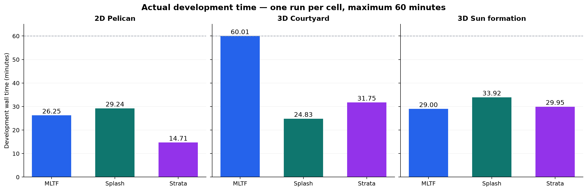

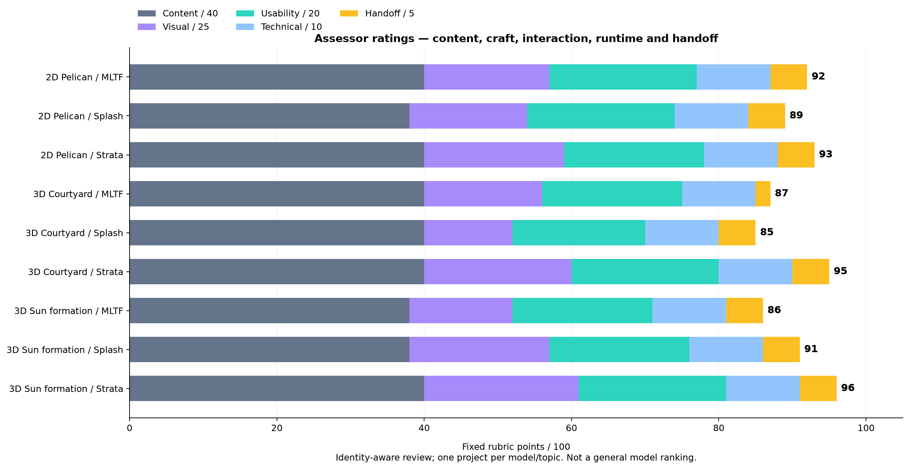

## Questions, common briefs and fixed procedure

The user asked for a2D pelican cycling on the Champs-Élysées, a3D traditional Chinese courtyard containing its elements, and a3D animation introducing the birth of the Sun. For a comparable agent exercise, the original short requests were expanded before execution into common checklists and controls:2D export and responsive viewing; twenty courtyard elements plus orbit/zoom/reset/three named views; a90-second solar timeline with play/pause/replay/scrub/speed, captions and camera orbit. This is an expanded-brief agent test, not a single naked-prompt image contest.

Each project began from a fresh Git baseline and a fresh isolated Pi session. The three fixed phases were build, visual self-review and final verification, sharing a3600-second development budget. Thinking, tools, tests, repairs and any compaction counted; loading, smoke checks, a10-second baseline and independent evaluation did not. Early completion was allowed. Only one large candidate model was loaded at a time. Ordinary background applications stayed open. Fixed balanced order: pelican MLTF→Splash→Strata; courtyard Splash→Strata→MLTF; Sun Strata→MLTF→Splash. There is no randomisation or repeated sample.

Pi tools were read/bash/edit/write. MCP, extensions, skills, prompt templates and inherited context files were disabled. Network use, external AI and reading other candidates/evaluators were prohibited by instructions and recorded activity; this was not an OS sandbox. Identical local Three.js r178, a patched local OrbitControls import and a generic screenshot helper were supplied, with no artwork or reference composition. All three had image input and actually read screenshots. The supervisor neither repaired candidate source nor sent hidden scores or additional hints. All nine snapshots were frozen before acceptance review.

The frozen PLAN, COMMON, three BRIEFs, SCIENCE and three phase prompts are in the metadata archive. The twenty courtyard items are a practical composite checklist, not a claim that every historical Chinese courtyard must contain every item. NASA reference facts were supplied equally, so scientific content is not an unaided astronomy-memory test.

## Actual machine, versions and configuration

| Item | Recorded value |
| --- | --- |
| Inference host| MacBook Pro Mac17,6 · Apple M5 Max · CPU18 · GPU40 · 128 GiB (137438953472 bytes) |
| Test-time OS| macOS27.0.1 · build26A434 · arm64 |
| Agent| Pi1.4.0 · Node22.23.1 · host Python3.14.7 |
| Browser| Chromium155.0.8051.0 · actual ANGLE Metal Renderer: Apple M5 Max |
| Shared request| context262144 · max output32768 · reasoning medium · temperature1 · top_p0.95 · top_k20 |
| Sessions| fresh session per project · autoretry off · auto-compaction enabled · actual compactions0 |
| Visual runtime| Three.js r178 · 1440×900 / 390×844 · DPR1 |
| Telemetry| psutil + macOS process footprint, GPU IORegistry and memory pressure · nominal1 Hz |

| System | Model ID| Quantization| Runtime|
| --- | --- | --- | --- |
| MLTF | local/Qwen3.8-27B-MLTF-q8c | MLTF q8c | CLI0.1.2 · source873d5574d903f5c1685e286c9cd59b79475a49f6 |
| Splash | mlx-community/Qwen3.8-27B-8bit | MLX affine8 | source1.4.0 · 1482f6bbc2abf12375332725302019594150b6cb |
| Strata | qwen3.8-flash-next-iq3_s | Flash Next GSQ-RCO IQ3_S | Terminal0.2.6 · Control0.1.51 · Metal release0.1.50 |

MLTF and Splash used int8 KV and a96G Metal budget; Splash recorded fp32 state and idle release off. Strata serving/requested concurrency was1. Native cache/vision/admission and timing counters are retained in the selected status series; their internal definitions differ. Existing installed weights were reused without a complete weight rehash this run; an immutable upstream weight revision was not re-established. Strata audit checkout head4b9e05a2a806a3fe24f7b2560d98626c37dade35 (untracked third_party/metal-cpp/) is not represented as the source of its released binary. Actual native child binaries, not just wrapper launchers, were hashed.

| Native binary | SHA256 |
| --- | --- |
| MLTF splash | 0d3d56f7a8133b01d9bcf6ea8414a3e05bfb50ee248aaa8b8695a3db9f06a7bb |
| Splash splash | 15b4ac64d5f4f2070361fc0e94623f8a67d74f083632ccaa6a7b9acd4ed8cf79 |
| Strata strata | 3fb8c8c8fabfcdc89446a1a0eb02cbc49bcd1a9123fc98aaa0c361af2912669d |

Pi state and native status both confirmed262144 for every run. MLTF’s display name still said128K, but its actual native context was temporarily raised to262144 and restored to131072 afterward. Global Pi configuration remained byte-identical. The original service availability was restored: Strata ready, MLTF/Splash stopped. Maximum observed input ranged from85357 to168095, so these are project workloads configured for256K, not saturation, retrieval or quality measurements across a full256K window.

## Measured time, LLM status and development pressure

| Case | min | Phases| Requests| Max input| Output| Decode tok/s | Tool errors|
| --- | --- | --- | --- | --- | --- | --- | --- |
| pelican-mltf | 26.25 | 3/3 | 42 | 87025 | 65221 | 48.54 | 2 |
| pelican-splash | 29.24 | 3/3 | 54 | 102938 | 64250 | 43.39 | 3 |
| pelican-strata | 14.71 | 3/3 | 61 | 85357 | 63239 | 84.56 | 3 |
| courtyard-splash | 24.83 | 3/3 | 52 | 90928 | 54988 | 45.11 | 1 |
| courtyard-strata | 31.75 | 3/3 | 156 | 168095 | 112951 | 84.56 | 7 |
| courtyard-mltf | 60.01 | 0/3 | 34 | 102364 | 76553 | 44.18 | 0 +1 unclosed|
| sun-strata | 29.95 | 3/3 | 143 | 161541 | 100897 | 88.59 | 4 |
| sun-mltf | 29.00 | 3/3 | 58 | 103196 | 54727 | 41.16 | 3 |
| sun-splash | 33.92 | 3/3 | 73 | 106306 | 57602 | 37.67 | 7 |

Combined measured development was279.644613 minutes. API errors were0 in every cell, and each native worker PID/start identity count was1; frontend identity also stayed stable. Completed-tool error flags above include ordinary self-repair, while the courtyard timeout has an unfinished call and a real TypeError despite0 completed error flags. Phase completion is not an artwork score. Native weighted decode is total predicted_n divided by predicted_ms, including thinking and tool generation; it is not final-answer typing speed. First meaningful model event includes reasoning/tool deltas and is not final-answer TTFT. Cross-engine prefill/cache accounting is not comparable, so no universal prefill ranking is inferred.

| Case | First event mean s| Unique images| History images| Native RSS peak GiB | Native footprint peak GiB | Global GPU memory peak GiB | CPU mean % | GPU busy mean % |
| --- | --- | --- | --- | --- | --- | --- | --- | --- |
| pelican-mltf | 4.15 | 15 | 241 | 17.22 | 21.70 | 33.07 | 6.74 | 93.80 |
| pelican-splash | 4.06 | 16 | 430 | 13.69 | 43.73 | 44.90 | 6.51 | 96.23 |
| pelican-strata | 1.14 | 19 | 633 | 72.79 | 29.46 | 64.56 | 7.36 | 88.52 |
| courtyard-splash | 3.69 | 25 | 612 | 13.36 | 43.67 | 44.49 | 6.73 | 94.99 |
| courtyard-strata | 0.89 | 44 | 2872 | 74.23 | 30.53 | 64.16 | 9.79 | 76.64 |
| courtyard-mltf | 6.20 | 16 | 216 | 12.75 | 18.27 | 32.58 | 6.69 | 59.94 |
| sun-strata | 1.01 | 44 | 3154 | 64.12 | 26.52 | 65.25 | 7.21 | 71.64 |
| sun-mltf | 4.31 | 35 | 981 | 23.22 | 28.20 | 32.94 | 6.15 | 89.77 |
| sun-splash | 3.54 | 34 | 1225 | 17.56 | 47.89 | 46.80 | 5.18 | 86.03 |

Unique images means distinct image payload bytes sent to the model; repeated image history occurrences are not independent visual tasks or fresh image encodes. All candidates actually used vision, with different self-selected inspection counts. Memory columns overlap and must never be added: process RSS, physical footprint, Metal/engine allocation and global GPU memory have different scopes. Global GPU includes background apps and the candidate’s own test browser. Pi/tool process-tree RSS and engine allocated-byte series are also retained, but process-tree sums can double-count shared pages. A smaller RSS value alone does not establish lower total RAM cost.

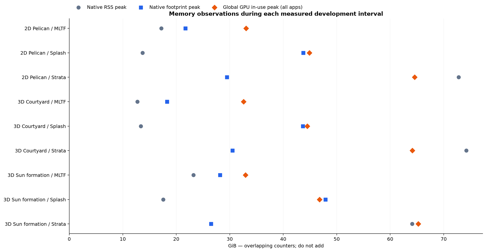

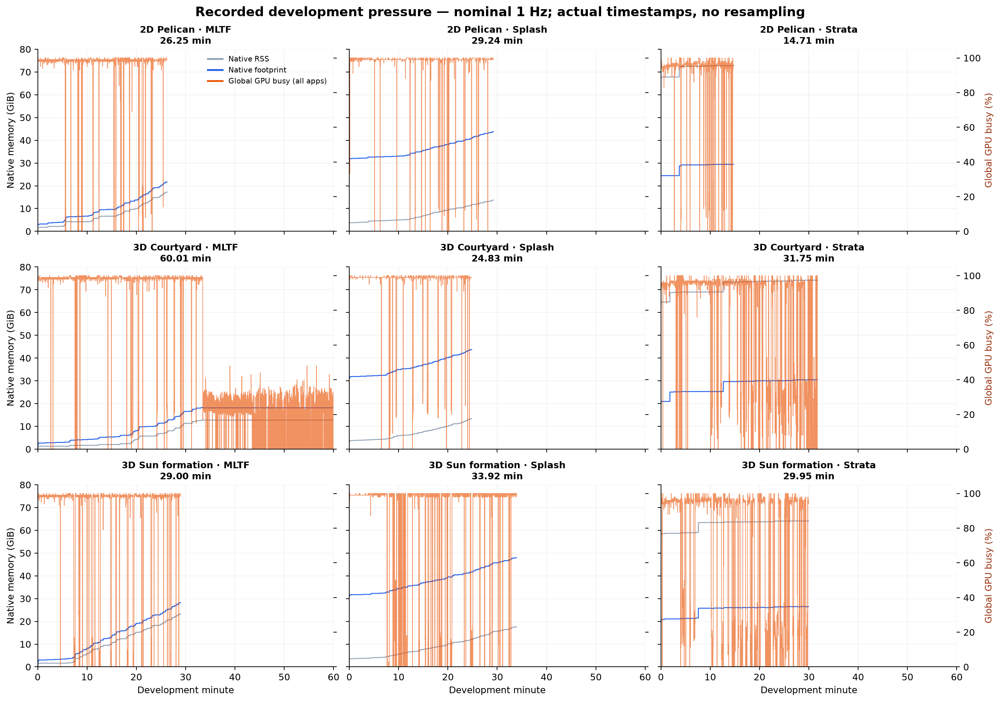

All development samples reported normal memory pressure; no swap growth was observed and telemetry error dictionaries were empty. No temperature series was available: this is not evidence of no thermal throttling. Real development sample intervals were roughly1.005–1.009s mean, with the largest interval1.082833s. Short spikes can be missed. Planned model loading/service switching is separate from an unplanned native restart; none was observed during a cell. Lifecycle, loading, baseline, development and independent-review telemetry are retained separately so the low-GPU waiting tail of the timed-out courtyard is not hidden.

| Case | Samples| Mean gap s| Max gap s| First delay s| Final lag s| Pi+tools RSS peak GiB |
| --- | --- | --- | --- | --- | --- | --- |
| pelican-mltf | 1565 | 1.006876 | 1.027982 | 0.075 | 0.329 | 1.30 |
| pelican-splash | 1741 | 1.007696 | 1.038267 | 0.098 | 0.738 | 1.59 |
| pelican-strata | 877 | 1.006885 | 1.029600 | 0.121 | 0.280 | 1.38 |
| courtyard-splash | 1479 | 1.007731 | 1.030206 | 0.097 | 0.489 | 1.69 |
| courtyard-strata | 1892 | 1.007103 | 1.047901 | 0.103 | 0.241 | 2.22 |
| courtyard-mltf | 3574 | 1.007560 | 1.082833 | 0.103 | 0.279 | 1.54 |
| sun-strata | 1788 | 1.005011 | 1.045803 | 0.108 | 0.725 | 2.81 |
| sun-mltf | 1729 | 1.006315 | 1.051543 | 0.077 | 0.799 | 1.52 |
| sun-splash | 2018 | 1.008776 | 1.057804 | 0.119 | 0.283 | 1.66 |

## Independent acceptance and examiner corrections

Chromium ran frozen Git-archive copies. The WebGL positive control passed8/8 on the actual Apple M5 Max Metal renderer. Instrumentation watched application context creation without allocating a competing context; a generic cube fixture also checked unused2D export canvases. All nine pages had0 fatal page errors,0 external resource dependencies in the observed loads, and stable resize/60-second loops. About3601 requestAnimationFrame callbacks in60s, median16.7ms and no callback gap above50ms, are a browser responsiveness proxy at a60Hz cap, not GPU frame time or a rendered-frame throughput comparison. Mobile tests emulate390×844 touch/viewport; no physical phone was used.

The first automated collector recorded90 probes. One export-selector assumption missed MLTF’s real PNG/SVG controls. Uniform manual verification then completed103 checks across nine projects, plus6 courtyard keyboard checks: real play/pause/resume/reset, actual download/open, camera drag/wheel, mobile touch, labels/presets, solar scrub and observed2× rate, and uninterrupted real90-second solar playback. All passed. These counts are evidence coverage, not scores; composition, clipping and scientific wording still lose points.

Original v1 evidence is preserved. A supplemental observer static server initially crashed on an absent favicon; its own handler was corrected and all three keyboard flows rerun. An earlier generic OrbitControls(null).dispose fixture cleanup failed and was fixed outside candidate code. A default-Python auxiliary psutil probe was switched to the bundled runtime. None was a candidate application repair. Every page had a viewport meta tag and actual mobile innerWidth=scrollWidth=390. Solar pause freezes simulation time; a separately enabled auto-camera can continue. Primary film evidence uses live playback, because300ms seek captures can catch camera transitions.

## Fixed rubric and work-by-work review

The rubric was frozen before development. Content/usability/technical use0, half or full credit; visual axes use integer0–5; handoff uses0/0.5/1. Full row-level bilingual reasons, evidence paths and scores are in scoring/review.json in the metadata pack. Tables below expose every criterion rather than substituting model self-reported checks. Runtime and code organisation are assessed in scope; no extra post-hoc code-quality score is added.

### 2D pelican on the Champs-Élysées

**Content /40**

| Criterion | Max| MLTF | Splash | Strata |
| --- | --- | --- | --- | --- |
| C01 Identifiable pelican | 4 | 4 | 4 | 4 |
| C02 Long beak and throat pouch | 4 | 4 | 4 | 4 |
| C03 Body, wings and feet | 4 | 4 | 4 | 4 |
| C04 Recognizable two-wheel bicycle, frame, fork and handlebar | 4 | 4 | 4 | 4 |
| C05 Plausible riding contact and pose | 4 | 4 | 4 | 4 |
| C06 Champs-Elysees perspective avenue | 4 | 4 | 4 | 4 |
| C07 Arc de Triomphe context | 4 | 4 | 2 | 4 |
| C08 Parisian facades | 4 | 4 | 4 | 4 |
| C09 Trees, pavement and street furniture | 4 | 4 | 4 | 4 |
| C10 Integrated original composition, not labels as substitutes | 4 | 4 | 4 | 4 |

**Visual craft /25**

| Criterion | Max| MLTF | Splash | Strata |
| --- | --- | --- | --- | --- |
| V01 Composition | 5 | 3 | 3 | 4 |
| V02 Shape and material detail | 5 | 3 | 3 | 3 |
| V03 Lighting and color | 5 | 4 | 3 | 4 |
| V04 Spatial depth or2D layer readability | 5 | 3 | 4 | 4 |
| V05 Coherence and storytelling | 5 | 4 | 3 | 4 |

**Usability /20**

| Criterion | Max| MLTF | Splash | Strata |
| --- | --- | --- | --- | --- |
| U01 Entry and clear scene | 2 | 2 | 2 | 2 |
| U02 Readable full desktop | 2 | 2 | 2 | 2 |
| U03 Readable390px | 2 | 2 | 2 | 1 |
| U04 Accessible controls if present | 2 | 2 | 2 | 2 |
| U05 Reliable reset or reload | 2 | 2 | 2 | 2 |
| U06 No obstructing overlays | 2 | 2 | 2 | 2 |
| U07 PNG or SVG export | 2 | 2 | 2 | 2 |
| U08 Export matches rendered scene | 2 | 2 | 2 | 2 |
| U09 Keyboard-accessible controls | 2 | 2 | 2 | 2 |
| U10 Concise title/context without replacing drawing | 2 | 2 | 2 | 2 |

**Technical /10**

| Criterion | Max| MLTF | Splash | Strata |
| --- | --- | --- | --- | --- |
| T01 No fatal page errors | 2 | 2 | 2 | 2 |
| T02 Self-contained offline resource loads | 2 | 2 | 2 | 2 |
| T03 Stable resize | 2 | 2 | 2 | 2 |
| T04 Stable60-second run | 2 | 2 | 2 | 2 |
| T05 Credible actual2D or3D rendering | 2 | 2 | 2 | 2 |

**Handoff /5**

| Criterion | Max| MLTF | Splash | Strata |
| --- | --- | --- | --- | --- |
| H01 README launch | 1 | 1 | 1 | 1 |
| H02 Controls documentation | 1 | 1 | 1 | 1 |
| H03 Coverage documentation | 1 | 1 | 1 | 1 |
| H04 Limitations documentation | 1 | 1 | 1 | 1 |
| H05 Reproducible local entry | 1 | 1 | 1 | 1 |

#### MLTF — 92/100

A cheerful, complete illustration with a clear long beak and pouch. The large foreground trees partly hide the rear bicycle and the facades remain repetitive. Exports preserve the drawing.

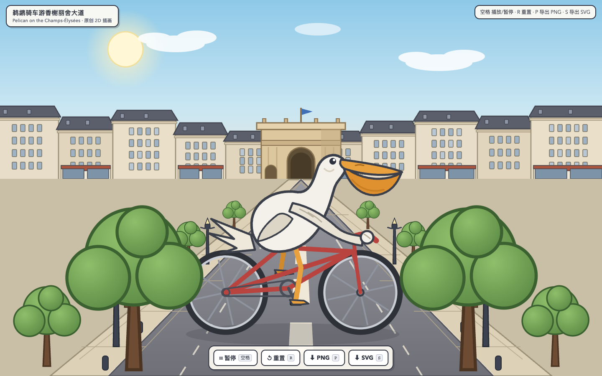


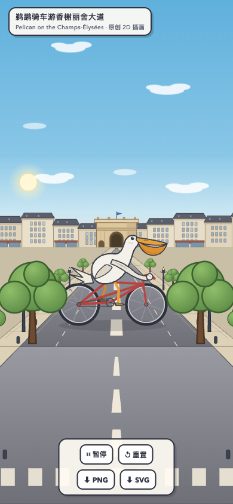

[Original screenshot pack](../../assets/evidence/cap-04-pelican-mltf-screenshots.zip)

#### Splash — 89/100

Strong avenue perspective and a readable bird/bicycle silhouette. The head and beak obscure most of the central Arc de Triomphe; flat shapes and repeated windows limit craft.

C07: The head/beak hides most of the Arc; part of its upper mass and avenue inscription remain visible.

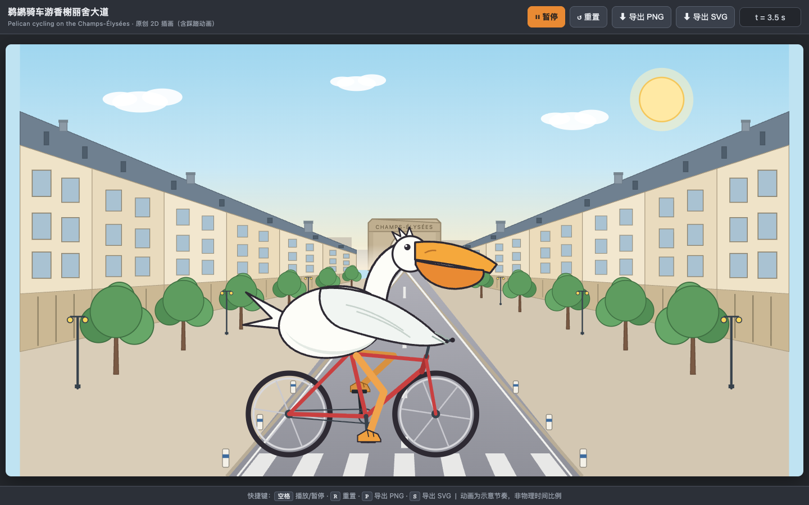


[Original screenshot pack](../../assets/evidence/cap-04-pelican-splash-screenshots.zip)

#### Strata — 93/100

The off-centre rider leaves the landmark legible; beret and trailing scarf add a coherent Paris story. Angular limbs remain simple. Portrait mode wastes much of the screen with black letterboxing.

U03: Controls are usable, but the landscape canvas becomes a small strip between large black bars.


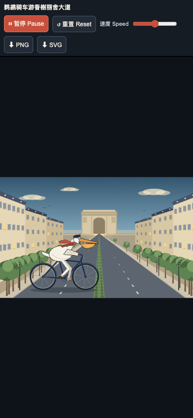

[Original screenshot pack](../../assets/evidence/cap-04-pelican-strata-screenshots.zip)

The2D sources preserve vectors or drawing primitives and export PNG/SVG, rather than substituting a label for a bird. Exported PNG and SVG were opened and visually matched; the untouched files are in evidence. MLTF foreground occlusion is modest, Splash’s hidden landmark affects content, while Strata’s off-centre story gains craft but loses mobile presentation.

### 3D traditional Chinese courtyard

**Content /40**

| Criterion | Max| MLTF | Splash | Strata |
| --- | --- | --- | --- | --- |
| C01 Enclosing courtyard walls | 2 | 2 | 2 | 2 |
| C02 Main gate or moon gate | 2 | 2 | 2 | 2 |
| C03 Screen wall | 2 | 2 | 2 | 2 |
| C04 Main hall | 2 | 2 | 2 | 2 |
| C05 Side rooms | 2 | 2 | 2 | 2 |
| C06 Covered corridor | 2 | 2 | 2 | 2 |
| C07 Pavilion | 2 | 2 | 2 | 2 |
| C08 Traditional curved or tiled roofs | 2 | 2 | 2 | 2 |
| C09 Timber posts or brackets | 2 | 2 | 2 | 2 |
| C10 Lattice windows | 2 | 2 | 2 | 2 |
| C11 Plaque or couplets | 2 | 2 | 2 | 2 |
| C12 Stone or brick paving | 2 | 2 | 2 | 2 |
| C13 Pond or water | 2 | 2 | 2 | 2 |
| C14 Small bridge | 2 | 2 | 2 | 2 |
| C15 Rockery | 2 | 2 | 2 | 2 |
| C16 Bamboo | 2 | 2 | 2 | 2 |
| C17 Tree, shrub and flower planting | 2 | 2 | 2 | 2 |
| C18 Furniture or lanterns | 2 | 2 | 2 | 2 |
| C19 Coherent layout and circulation | 2 | 2 | 2 | 2 |
| C20 Real3D and visible from suitable views | 2 | 2 | 2 | 2 |

**Visual craft /25**

| Criterion | Max| MLTF | Splash | Strata |
| --- | --- | --- | --- | --- |
| V01 Composition | 5 | 4 | 2 | 4 |
| V02 Shape and material detail | 5 | 3 | 2 | 4 |
| V03 Lighting and color | 5 | 3 | 2 | 4 |
| V04 Spatial depth or2D layer readability | 5 | 3 | 3 | 4 |
| V05 Coherence and storytelling | 5 | 3 | 3 | 4 |

**Usability /20**

| Criterion | Max| MLTF | Splash | Strata |
| --- | --- | --- | --- | --- |
| U01 Entry and full scene | 2 | 2 | 1 | 2 |
| U02 Orbit works | 2 | 2 | 2 | 2 |
| U03 Zoom works | 2 | 2 | 2 | 2 |
| U04 Reset restores view | 2 | 2 | 2 | 2 |
| U05 Three named view presets work | 2 | 2 | 2 | 2 |
| U06 Required elements discoverable | 2 | 2 | 2 | 2 |
| U07 Labels toggle or equivalent inspection | 2 | 2 | 2 | 2 |
| U08 Desktop resize | 2 | 2 | 2 | 2 |
| U09 Mobile interaction and layout | 2 | 1 | 1 | 2 |
| U10 Keyboard-readable control labels | 2 | 2 | 2 | 2 |

**Technical /10**

| Criterion | Max| MLTF | Splash | Strata |
| --- | --- | --- | --- | --- |
| T01 No fatal page errors | 2 | 2 | 2 | 2 |
| T02 Self-contained offline resource loads | 2 | 2 | 2 | 2 |
| T03 Stable resize | 2 | 2 | 2 | 2 |
| T04 Stable60-second run | 2 | 2 | 2 | 2 |
| T05 Credible actual2D or3D rendering | 2 | 2 | 2 | 2 |

**Handoff /5**

| Criterion | Max| MLTF | Splash | Strata |
| --- | --- | --- | --- | --- |
| H01 README launch | 1 | 0 | 1 | 1 |
| H02 Controls documentation | 1 | 0.5 | 1 | 1 |
| H03 Coverage documentation | 1 | 0.5 | 1 | 1 |
| H04 Limitations documentation | 1 | 0 | 1 | 1 |
| H05 Reproducible local entry | 1 | 1 | 1 | 1 |

#### MLTF — 87/100

A readable enclosed compound with a well-fitted overview, lattice, timber details and water/bridge. Repeated bright ripple rings look artificial and fixed mobile panels obscure the scene. The agent timed out in its own test and supplied no README or visual notes.

U09: Real touch orbit works, but two fixed panels obscure much of the upper mobile scene.

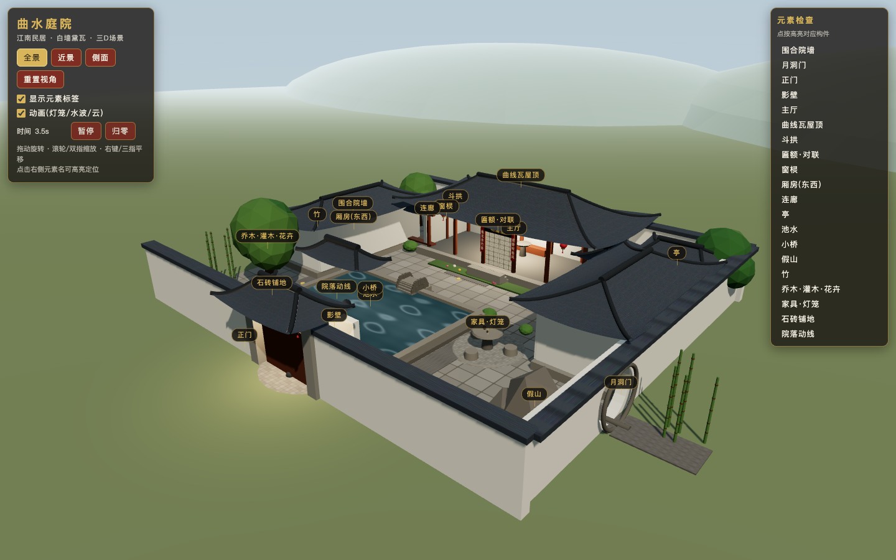

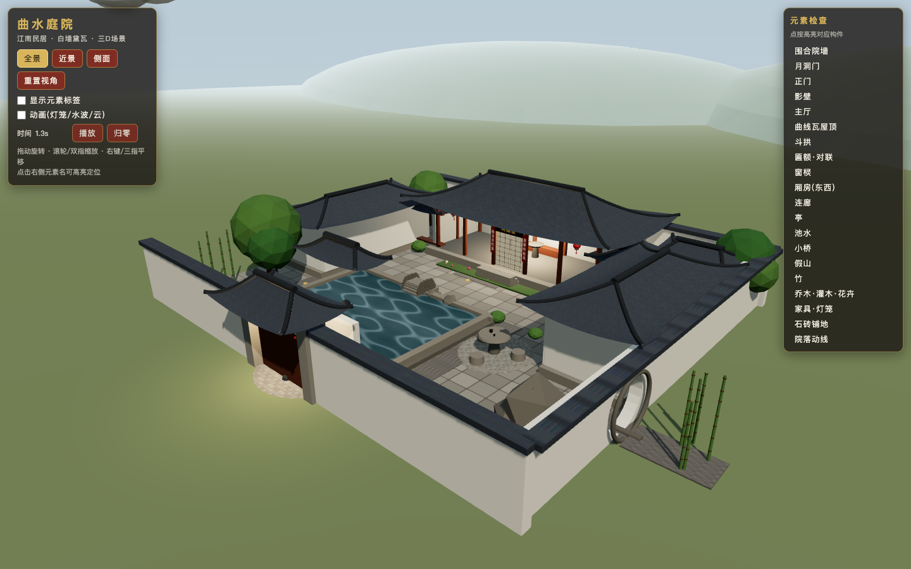

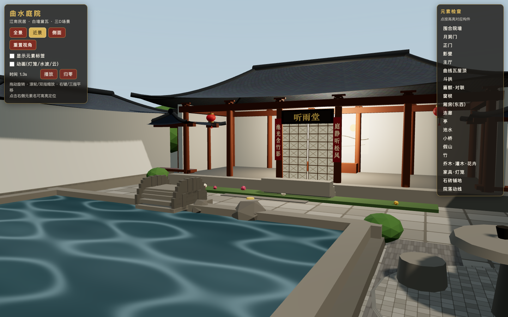

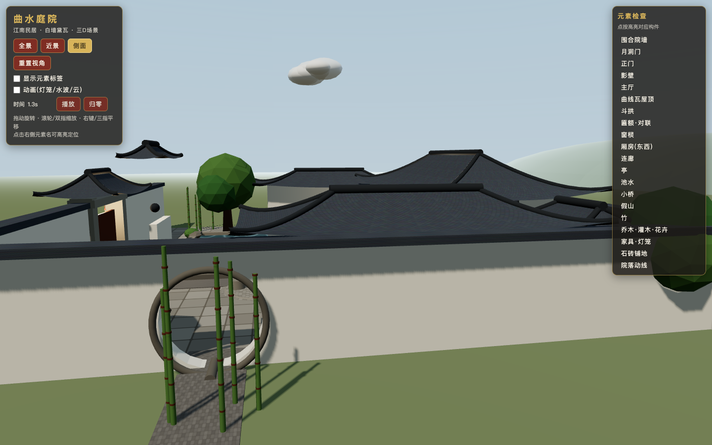

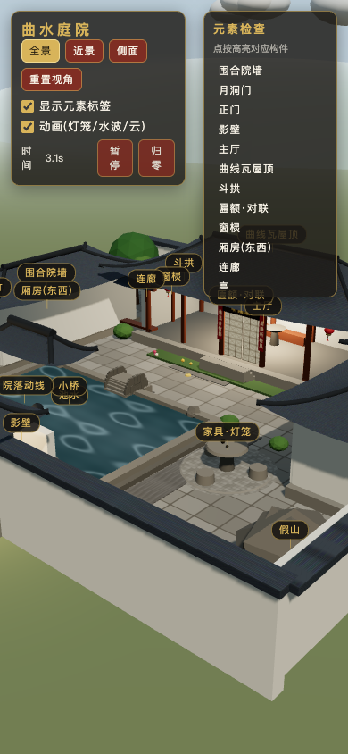

[Original screenshot pack](../../assets/evidence/cap-04-courtyard-mltf-screenshots.zip)

#### Splash — 85/100

All twenty checklist items are represented, with roof, pavilion, bridge, rockery and planting. Default framing crowds the foreground and crops the compound; deep eaves are very dark and large roof planes dominate both desktop and portrait views.

U01: Entry renders, but the default camera crops the compound and foreground roof blocks the pond. Other views recover it.

U09: Touch orbit works and controls are reachable; the portrait scene is tightly cropped and dominated by roofs.

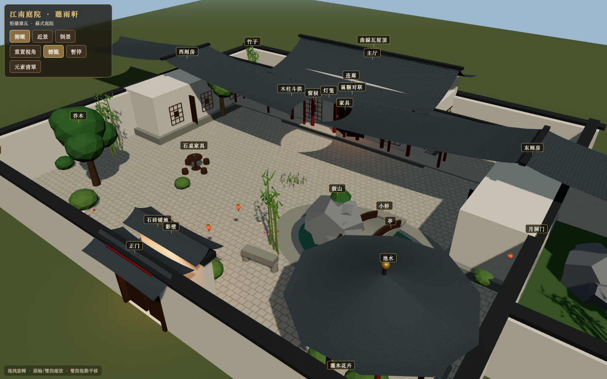

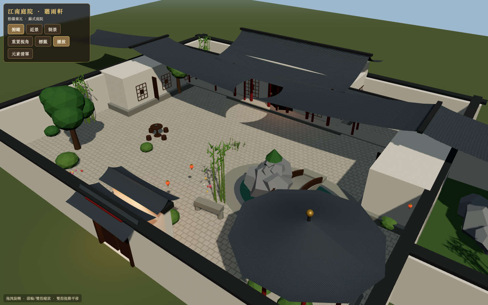

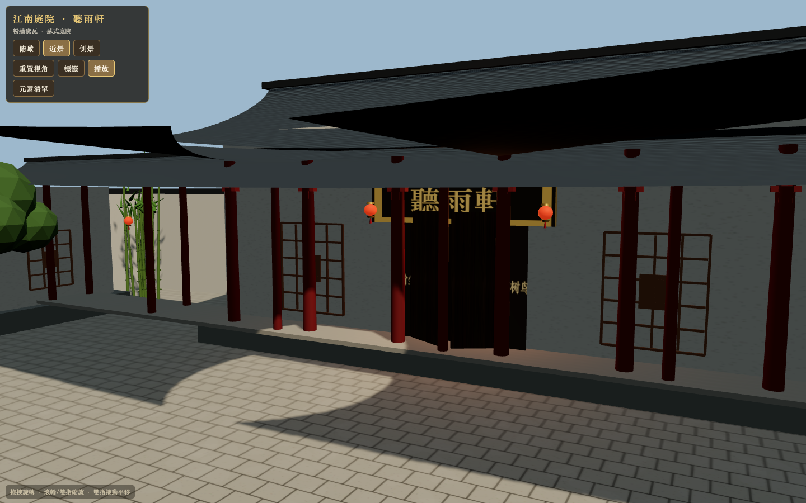

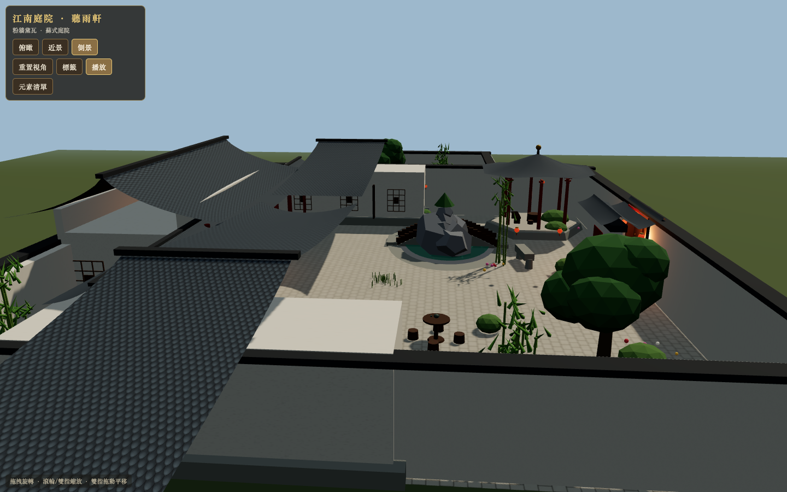

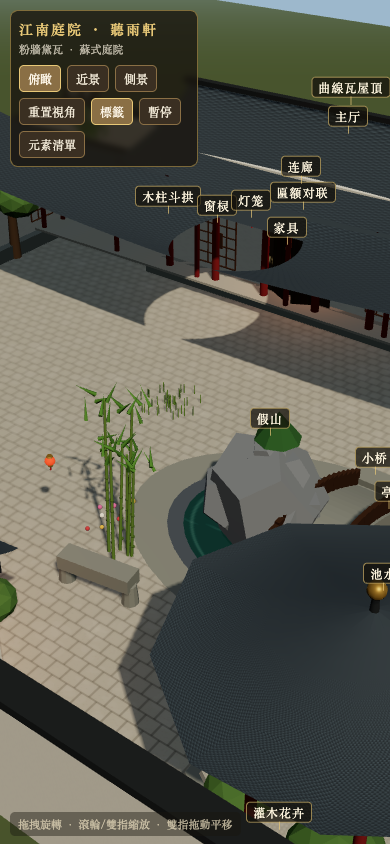

[Original screenshot pack](../../assets/evidence/cap-04-courtyard-splash-screenshots.zip)

#### Strata — 95/100

The clearest spatial organisation: entry garden and screen wall lead through a moon gate to the inner pond, bridge, pavilion and hall. Tiled roofs, joinery and lattice have the most detail. Labels and a long panel clutter the desktop, but can be hidden; mobile controls collapse.

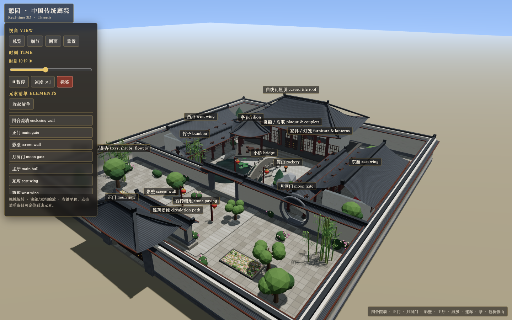

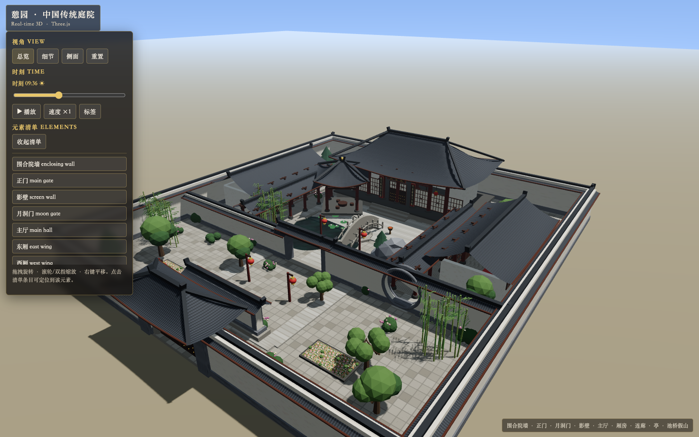

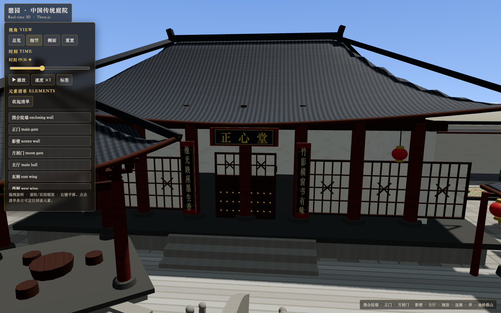

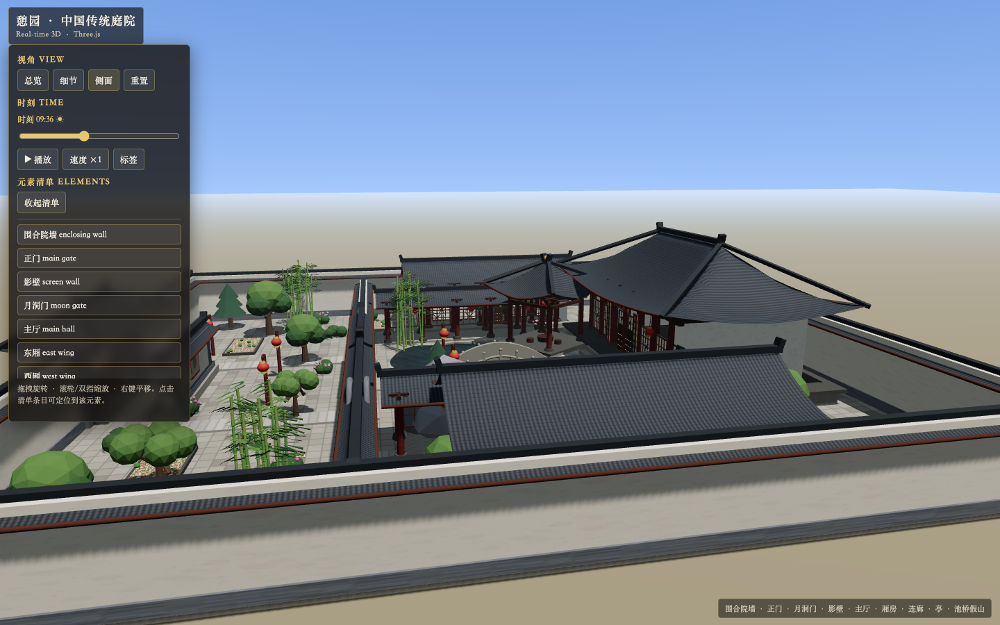

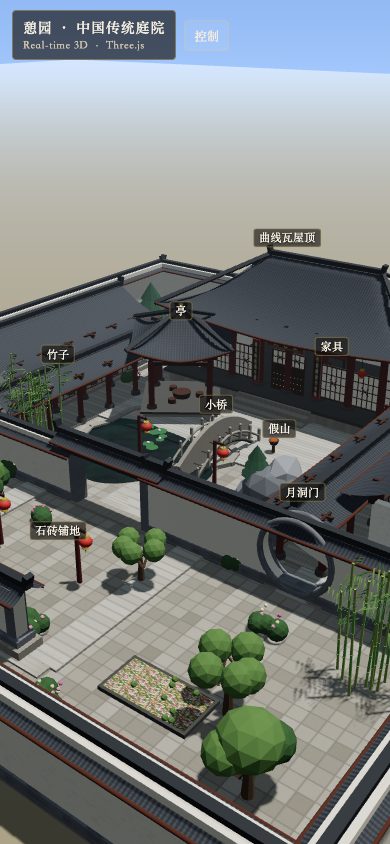

[Original screenshot pack](../../assets/evidence/cap-04-courtyard-strata-screenshots.zip)

All twenty elements can be identified across the captured suitable views, not merely read from checklist labels. Strata divides rendering, materials, nature, architecture, buildings and layout across six ES modules; MLTF/Splash mostly keep scene/UI in one HTML file. The modular separation is easier to extend, but it is not proof of hidden correctness. None is a historically validated architectural reconstruction. Pavilions, rockery and moon gates require orbiting when roofs obstruct the default view.

### 3D animation: birth of the Sun

**Content /40**

| Criterion | Max| MLTF | Splash | Strata |
| --- | --- | --- | --- | --- |
| C01 Gas and dust cloud around4.6Ga | 4 | 4 | 4 | 4 |
| C02 Gravitational collapse | 4 | 4 | 4 | 4 |
| C03 Rotation and flattening | 4 | 4 | 4 | 4 |
| C04 Central protostar | 4 | 4 | 4 | 4 |
| C05 Accretion disk and infall | 4 | 4 | 4 | 4 |
| C06 Increasing core heat and density | 4 | 4 | 4 | 4 |
| C07 Hydrogen-to-helium fusion | 4 | 4 | 4 | 4 |
| C08 Young Sun clears remaining gas and dust | 4 | 4 | 4 | 4 |
| C09 Stable main-sequence Sun | 4 | 4 | 4 | 4 |
| C10 Coherent scientific evolution, captions and compressed scale/time | 4 | 2 | 2 | 4 |

**Visual craft /25**

| Criterion | Max| MLTF | Splash | Strata |
| --- | --- | --- | --- | --- |
| V01 Composition | 5 | 3 | 4 | 4 |
| V02 Shape and material detail | 5 | 2 | 3 | 4 |
| V03 Lighting and color | 5 | 3 | 4 | 4 |
| V04 Spatial depth or2D layer readability | 5 | 3 | 4 | 4 |
| V05 Coherence and storytelling | 5 | 3 | 4 | 5 |

**Usability /20**

| Criterion | Max| MLTF | Splash | Strata |
| --- | --- | --- | --- | --- |
| U01 Autoplay and progress | 2 | 2 | 2 | 2 |
| U02 Pause freezes scene | 2 | 2 | 2 | 2 |
| U03 Resume progresses | 2 | 2 | 2 | 2 |
| U04 Replay resets | 2 | 2 | 2 | 2 |
| U05 Timeline scrub changes actual stage | 2 | 2 | 2 | 2 |
| U06 Speed selection works | 2 | 2 | 2 | 2 |
| U07 Synchronized captions | 2 | 2 | 2 | 2 |
| U08 Camera orbit works | 2 | 2 | 2 | 2 |
| U09 Mobile layout and controls | 2 | 1 | 1 | 2 |
| U10 Keyboard-accessible controls | 2 | 2 | 2 | 2 |

**Technical /10**

| Criterion | Max| MLTF | Splash | Strata |
| --- | --- | --- | --- | --- |
| T01 No fatal page errors | 2 | 2 | 2 | 2 |
| T02 Self-contained offline resource loads | 2 | 2 | 2 | 2 |
| T03 Stable resize | 2 | 2 | 2 | 2 |
| T04 Stable60-second run | 2 | 2 | 2 | 2 |
| T05 Credible actual2D or3D rendering | 2 | 2 | 2 | 2 |

**Handoff /5**

| Criterion | Max| MLTF | Splash | Strata |
| --- | --- | --- | --- | --- |
| H01 README launch | 1 | 1 | 1 | 1 |
| H02 Controls documentation | 1 | 1 | 1 | 1 |
| H03 Coverage documentation | 1 | 1 | 1 | 1 |
| H04 Limitations documentation | 1 | 1 | 1 | 1 |
| H05 Reproducible local entry | 1 | 1 | 1 | 1 |

#### MLTF — 86/100

All major stages animate and controls work. Soft oversized particles and a bright band across the core weaken physical form; much of the frame is empty. The 4.6-billion-years-to-90-seconds wording ambiguously mixes the age of the Sun with the duration of formation.

C10: The stages and caveats are present, but 4.6 billion years to 90 seconds ambiguously confuses formation duration and age.

U09: Mobile controls and captions work, but the early cloud is strongly cropped horizontally.

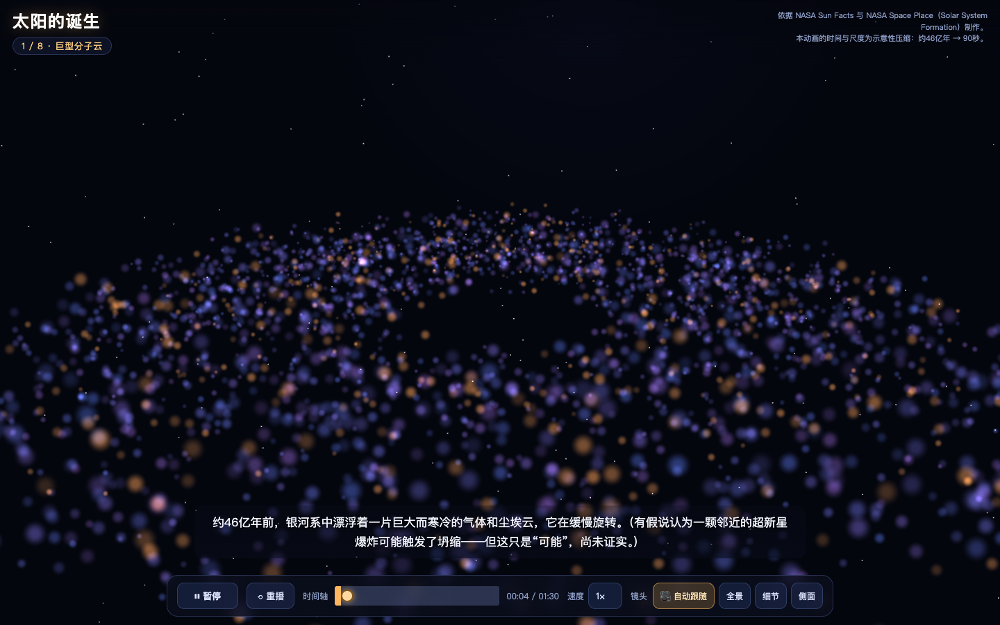


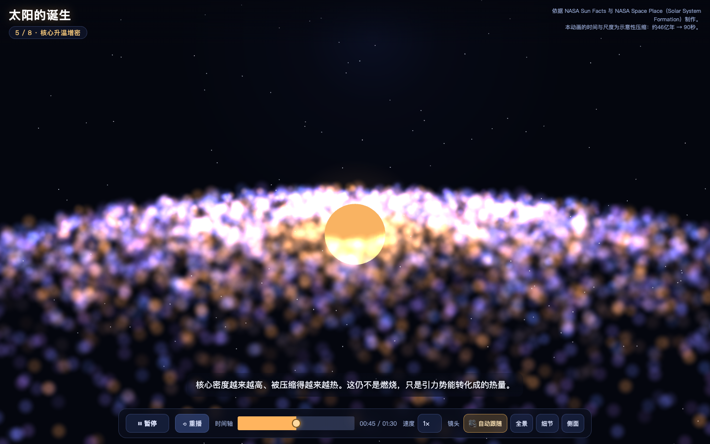

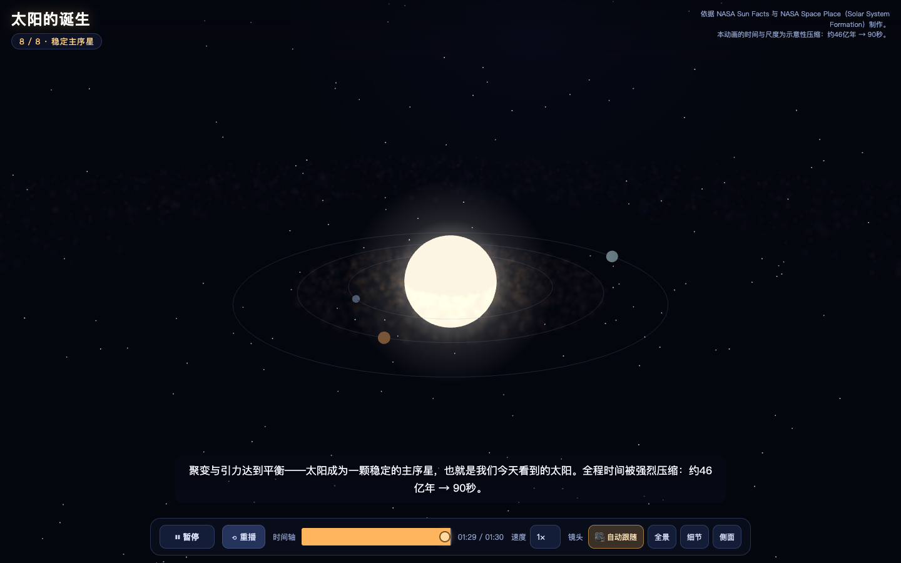


[Original screenshot pack](../../assets/evidence/cap-04-sun-mltf-screenshots.zip)

#### Splash — 91/100

A strong cinematic approach with a large protostar, warm disk and clear clearing-to-stable-star transition. The fusion stage is heavily overexposed. The footer incorrectly describes the real formation process as spanning about 4.6 billion years.

C10: The footer explicitly calls the real formation process about 4.6 billion years. That is the Sun's age, not its formation duration.

U09: Mobile controls work, but the early cloud lies low and is cropped by the lower interface.

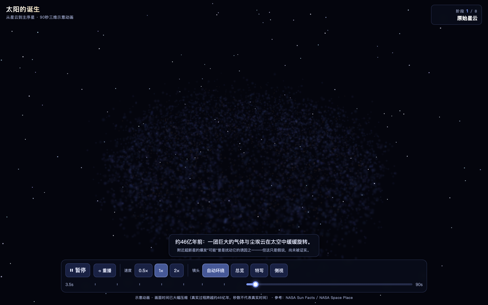

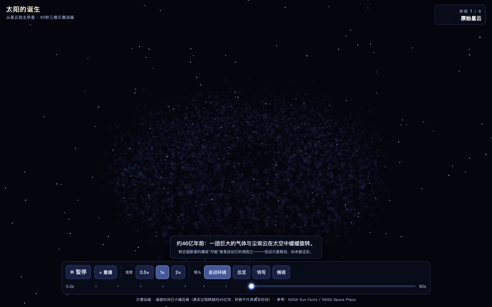

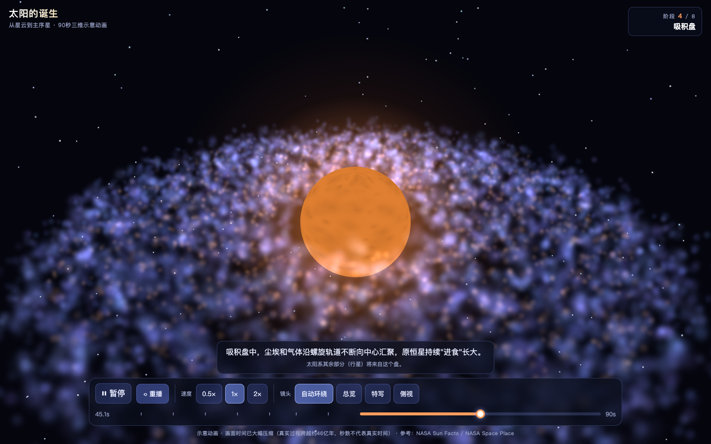

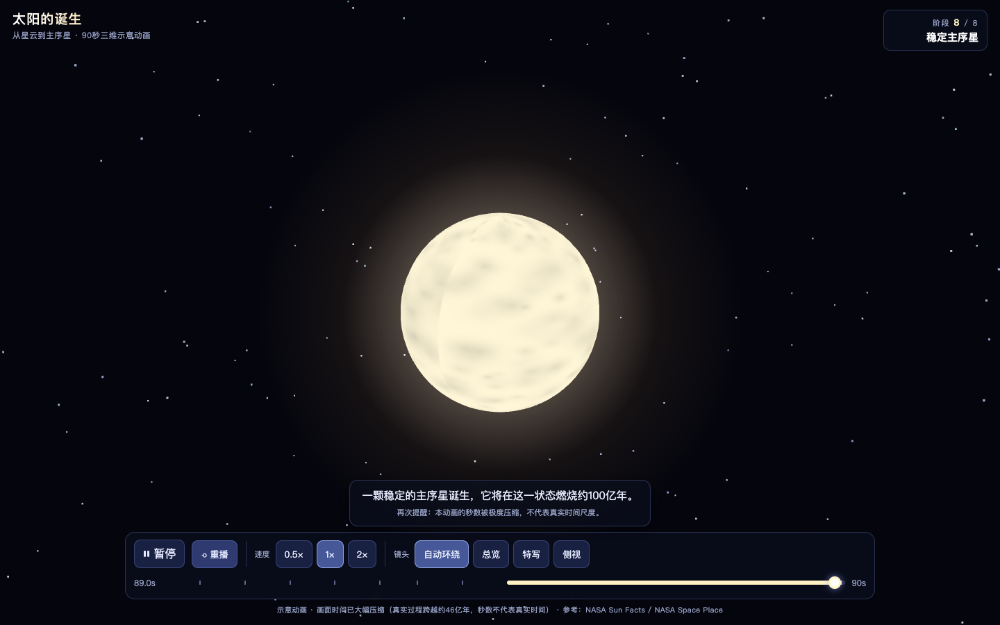

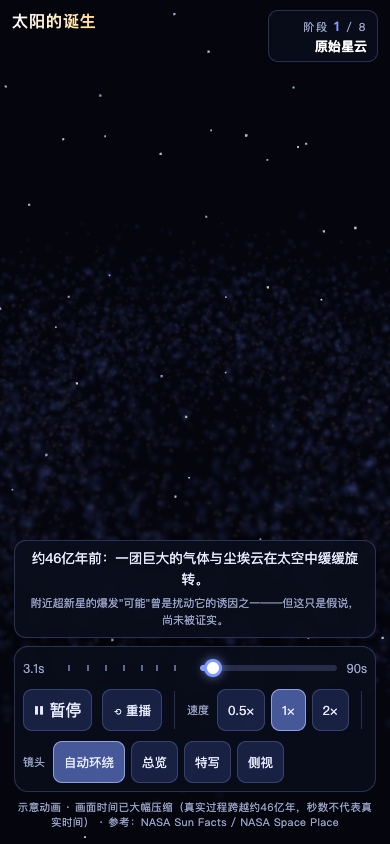

[Original screenshot pack](../../assets/evidence/cap-04-sun-splash-screenshots.zip)

#### Strata — 96/100

The clearest educational sequence, including a core cutaway, readable chapter titles and a stage navigator. Fine particles, a textured star and restrained colour transitions are coherent. It remains a stylised illustration, not an astrophysical simulation.

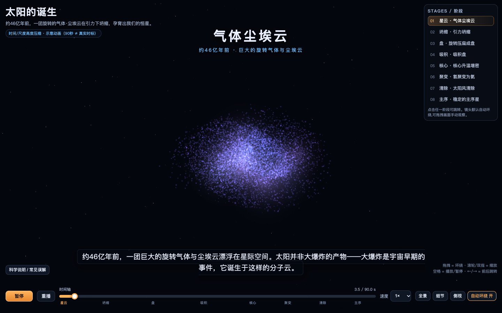


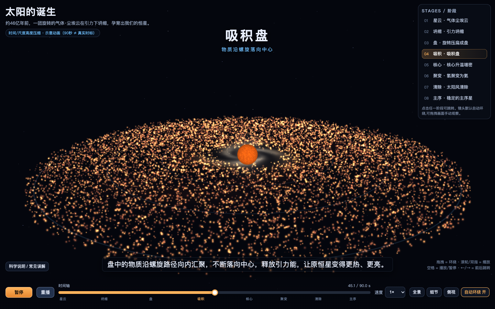

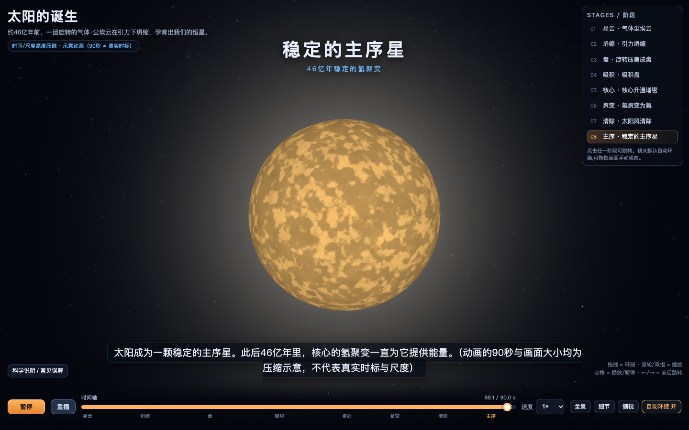

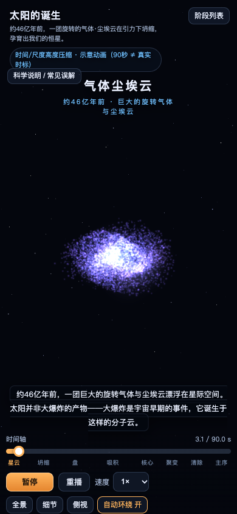

[Original screenshot pack](../../assets/evidence/cap-04-sun-strata-screenshots.zip)

The seven real-playback timestamps are0/15/30/45/60/75/89s. They are aligned by wall/timeline time, not semantic stage: at45s MLTF is in core heating while the other two are in the disk stage. All show evolving3D matter and a clearing-to-main-sequence transition. Particle positions, stage updates and camera controls live primarily in index.html. The deterministic/time-driven seek implementation is useful for replay, but visual particles are not a hydrodynamic, radiative-transfer or nuclear-physics calculation.

Scientific wording: [NASA Sun Facts](https://science.nasa.gov/sun/facts/) places formation about4.6billion years ago; [NASA Stars](https://science.nasa.gov/universe/stars/) describes stellar formation over millions of years. Splash’s footer says the real process spans about4.6billion years, a misleading duration. MLTF’s “4.6billion years →90seconds” can describe a history through today, but does not make that distinction clearly. Each loses only2 points in C10; the correctly stated epoch is still credited in C01. Strata explicitly says “during the subsequent4.6billion years”, separating formation from later history. All correctly distinguish fusion from chemical burning and treat a supernova trigger as a hypothesis.

## MLTF courtyard timeout and interventions

The model started an untimed Bash/Node/Chromium self-test at2008.24s. Its code contained `const bb=new (Object.getPrototypeOf(it.group).constructor==='Object'?0:0); // noop`, which tries to construct0 and throws TypeError. Browser close was only on the success path; catch printed the error and set process.exitCode without closing the active browser connection. The Bash call never returned. The supervisor let it wait until the common deadline and ended the owned process tree at3600.3937s (0.3937s polling latency). The waiting tail was1592.15s. No hint, source patch, extra time or hidden acceptance retry was given.

It completed0/3 settled phases, still attempting phase1, and delivered neither README nor VISUAL-NOTES. Its pre-existing frozen scene nevertheless passes independent rendering/interaction checks and earns87/100 as an artifact. That87 does not mean successful on-time agent delivery. The operational failure is a model-authored tool workflow bug, not evidence that the inference server ran out of memory. Diagnostics and outcome are retained in raw/courtyard-mltf/formal/selftest-hang-*.json.

## Source pins, reproducibility and evidence

| Case | Port| Frozen Git commit|
| --- | --- | --- |
| pelican-mltf | 4201 | 5f8b8e21944b504810e8f4bc40eb0a6615ddbb0a |
| pelican-splash | 4202 | b0466e9ce3a096c4ad60a7ce980ad7e6625532b3 |
| pelican-strata | 4203 | a2a56fde2762c58b728ccb9267484b107782bab5 |
| courtyard-splash | 4204 | 0cad523ac65333ea00ba8f8cdcbb9337af6cc636 |
| courtyard-strata | 4205 | be87304de4399612d1c45c0e8ddb4956da586b4a |
| courtyard-mltf | 4206 | c73d7fee98b16c3113c71f809a58717b28c2e1ed |
| sun-strata | 4207 | 783d6d411cdb5782887c2bc5212efb7defeec9ab |
| sun-mltf | 4208 | e2e4a227cd3312d02f99fbe53cd2f5762328693e |
| sun-splash | 4209 | f2db95d954ca49774466033d62b7af0c9195cdb4 |

Each artifact remains in its own local Git repository under `~/Code/qwen3.8_tests/2026-10-25-visual-triad/llm-test-2026-10-25-visual-{topic}-{engine}`. No artifact repository or demo URL was published. On this host, use the corresponding directory and its pinned commit, then run the static server below and open the loopback URL. The sample uses port4201; choose the matching port in the table. No package installation is required for the frozen scene.

```sh
python3 -m http.server 4201 --bind 127.0.0.1
# http://127.0.0.1:4201/
```

Before and after independent review, every original author worktree stayed clean, its HEAD matched its snapshot, and every frozen-copy file hash remained unchanged. Original input baseline/vendor integrity is retained in configs/seed-integrity.json. Reports show42 individually copied byte-identical screenshots; all original independent screenshots and export PNGs are in nine case packs. Every solar pack includes all seven live timestamps, and the metadata pack contains full criterion ratings, native/status/resource series, per-request usage/timing/sampling results, evaluator sources, source hashes, documentation, correction log and the timeout diagnosis. Four standalone Matplotlib figures include PNG/SVG and input/output hashes; plots use actual timestamps without resampling or zero-filling missing metrics.

Publication excludes full private Pi sessions/messages, full SSE streams, credentials, private configuration, weights, caches, runtime databases and complete product implementation. Account-home prefixes in text are generalised to `/Users/benchmark`; process rosters/full native instance state/phase message blobs are omitted, while selected capability/counters and scalar measurements are preserved. publication.json records transformations and hashes; manifest.json maps every member to an archive and verifies SHA256. Screenshots are unaltered; private contact sheets were only viewing aids and are not replacement evidence. All full raw material remains locally in the experiment evaluation directory.

## Interpretation limits

This is one observed project per topic/system, with identity-aware subjective craft ratings. Different models, parameter counts, quantisations, native engines, cache/draft/vision paths and self-selected strategies are bundled together; the result does not isolate engine causality or quantisation quality. The fixed order balances positions but does not remove background-load/time effects. Actual development times differ because agents can finish early. The full256K window was not saturated. There is no PPL/KL measurement, statistical confidence interval, human audience study or universal intelligence ranking. Responsive controls, a60Hz browser loop and checklist coverage do not by themselves establish professional visual quality, historical accuracy or scientific simulation.
