# CAP-05 — Splash 1.4.1 Metal vs Strata: the same Flash Next IQ3_S, three coding products

[English](2026-10-26-flash-next-iq3s-splash-strata-triad.md) | [简体中文](2026-10-26-flash-next-iq3s-splash-strata-triad_CN.md)

Test and independent review: 2026-10-26, America/Toronto. Local inference on the same M5 Max. All six model runs completed; local commits only, no push.

## Observed outcome

Splash 1.4.1 with resident experts/PLE was the fastest of the two Splash configurations actually tested. In the controlled cold-KV coding probe, it delivered 157.42 decode tokens/s versus Strata 83.36, about 1.89×; first generated event averaged 3.785s versus 7.796s. This required more whole-system memory. It is the best tested configuration here, not an exhaustive M5 Max optimum.

| Product / 100 | Splash | Strata | Principal acceptance limit |
|---|---|---|---|
| Movie website | 72 | 70.75 | Both incomplete online metadata; Splash hidden-result leak; Strata TMDB import fails. |
| Voxel game | 83 | 80 | Splash high edits invisible; Strata tested worlds have no water and enemy HP resets on load. |
| Qingming animated scroll | 63 | 61 | Both animated and browsable; original painting fidelity remains low. |

These are identity-aware assessor judgments under the 85 predeclared criteria, with one artifact per task/engine. Differences of a few points do not establish a general model or engine quality ranking. Native decode was faster for Splash in all three agent workloads; completion time and cached first-event latency did not improve uniformly. No product source was repaired by the reviewer.

[Structured scores](../../assets/evidence/cap-05-scores.json) · [Performance/resource/request evidence ZIP](../../assets/evidence/cap-05-evidence.zip) · [Code-review excerpts](../../assets/evidence/cap-05-source-review.txt)

## Hardware and fixed environment

| Item | Actual test condition |
|---|---|
| Inference and client | Same local MacBook Pro, Mac17,6; no remote inference |
| CPU | Apple M5 Max, 18 cores (6 Super + 12 Performance) |
| GPU | Apple M5 Max, 40 cores, Metal 4 |
| Memory | 128 GiB = 137,438,953,472 bytes |
| Test-time OS | macOS 27.0.1, build 26A434, arm64 |
| Snapshot | 2026-10-26T17:40:55Z |
| Power/thermal | AC power, automatic powermode 0; no power-mode change. No thermal warning recorded at the check; temperatures and watts unavailable. |
| Splash | 1.4.1, source 1744cfafee415fb463b289449cec59a864e768e9 |
| Strata | Terminal 0.2.6 / Control 0.1.51 / Metal engine 0.1.50 |
| Agent | Pi 1.4.0; Node v22.23.1 |
| Browser | Chromium 155.0.8051.0; /Applications/Chromium.app/Contents/MacOS/Chromium |
| Model context / output | 262,144 / 32,768 tokens |
| Requests | reasoning_effort=medium; temperature=1; top_p=0.95; top_k=20; concurrency=1 |
| Cache and state | Both INT8 KV; Splash FP32 recurrent state, 96GiB Metal cap; SSD prefix/KV cache off for formal runs. Prefix reuse within each agent session remains enabled. |
| Speculation | Splash DFlash2 BF16 draft/adaptive verification; Strata native MTP speculation 2. Different native execution paths. |
| Agent tools | read, bash, edit, write; no extensions, skills, MCP, other agents or model services supplied to candidates. |
| Viewport | 1440×900 desktop / 390×844 mobile, DPR1 |

Mobile results are Chromium touch/viewport emulation on this Mac, not measurements on a physical phone. Independent WebGL checks identify ANGLE Metal Renderer: Apple M5 Max. The 5s rAF samples are short, refresh-limited observations and do not measure input latency or prove sustained game frame rates.

## Installation, model equivalence and M5 Max tuning

The latest upstream release recorded at setup was Splash 1.4.1. A pinned clone was built with `make -j6`, followed by upstream `make install-environment`; tracked upstream files remained clean. The local repository layout was respected: runtime under `~/local_llms/splash`, target/draft/prepared models under `~/local_llms/models/splash`, and lifecycle wrappers `start.sh`, `stop.sh`, `status.sh`, `serve.sh`. Authentication was generated locally with 0600 permissions and is excluded from this archive. There is no autostart.

The two target GGUF shards and BF16 vision projector were APFS copy-on-write cloned into an independent Splash tree, with different inodes and no hardlink/symlink into Strata. Full SHA256 checks matched Hugging Face LFS. The public `install.local.prepare_local_model` API assembled the local split model with projector and draft. A smaller quantization, a Coder-pruned model, or the previous 27B 8-bit model was never substituted.

| File | Bytes | SHA256 |
|---|---|---|
| IQ3_S-00001-of-00002.gguf | 54,817,524,224 | 4c1eb2ceb4915e1192f4f386021897bde56a97f40a0bb78bb86465e0f7d2aca3 |
| IQ3_S-00002-of-00002.gguf | 28,800,138,432 | 316b46f3a2dbd68c900f43136ab9449f9dcc3725dfd8c794847c204bc161e113 |
| mmproj-Qwen3.8-Flash-Next-BF16.gguf | 907,543,008 | b1a82259702816a5330d7bd7607cd9676b11780e79ff7348c21103ff3ce49bd0 |
| DFlash2 BF16 model.safetensors | 1,206,140,008 | d6723f2a359eaf33ec0c95f22ae8edda896774020c552296a85e1913b4d3186f |

Target: `ISTA-DASLab/Qwen3.8-Flash-Next-GSQ-RCO-GGUF`, revision `ed59f92082b1e93c0e96d60a8b11aab089b52f09`. Draft: `incoai/Qwen3.8-Flash-Next-DFlash2`, revision `a22a1744e85c17364dcc54a6a420af7135d4c7f6`. Local assembly metadata has null Hub revision fields because it was prepared from local files; these separately captured source revisions are the provenance, rather than invented assembly fields.

“IQ3_S” is the publisher’s mixed-format quantization label. Header inspection found 20 IQ3_S tensors alongside BF16, F32, IQ4_XS, IQ2_S, IQ3_XXS, Q6_K and other formats. A large PLE table makes a single overall bits-per-weight claim misleading. Splash documents IQ3_S storage padding from 3.44 to 4.06 bits without requantizing those values, and conversion of BF16/F16 hyper-connection projections to Q8_0 during load; 290 BF16 HC projection tensors are present in this source model. Strata’s pack-conversion record lists no converted tensors and compat_bf16=false, but this is not a bitwise numerical audit. This is a same-source-IQ3_S engine comparison with documented native layout/conversion/speculation differences.

| Setting | Chosen configuration and reason |
|---|---|
| expert_memory / ple_memory | auto / auto; logs confirm full expert and PLE residency on 128GiB. |
| Metal | Native Apple Family 10 / 40-core policy, 96GiB budget; no speculative undocumented environment overrides. |
| KV / recurrent state | INT8 / FP32 |
| context | 262144 native; no static YaRN |
| SSD cache | off for controlled single-session measurement; a production reuse/cache tradeoff was not benchmarked. |
| idle_release | off to avoid unload/reload contamination within a trial. |
| ANE | Not enabled for Flash Next; the upstream 27B ANE path is a different feature. |

First weight load took 14.34s, followed by about 3 minutes of first-time Metal compute-pipeline compilation; MTLCompilerService samples are retained. Later ready starts were about 17s. These startup stages are separate from request TTFT. A setup pretrial sent before readiness failed and was preserved, then excluded from the valid nine probes. Initial wrapper executable/model-ID mistakes were corrected before formal trials.

```sh
~/local_llms/strata/stop.sh
~/local_llms/splash/start.sh
~/local_llms/splash/status.sh
# after use
~/local_llms/splash/stop.sh
~/local_llms/strata/start.sh
```

Only one large inference service should be resident at once. Wrappers validate owner/PID/kernel start identity before signals. At the end the original Strata service is restored, Splash is stopped, and global Pi defaults are unchanged. The local Splash README documents installation and the pinned model tree.

## Controlled performance probe and selected mode

Before product development, run the same 8,851-input-token coding prompt for 512 output tokens, three repetitions per mode: Splash resident, Splash with a 512MiB PLE cache, and existing Strata native mode. All nine valid probes have cache_n=0, temperature=0 and reasoning=none. The native speculation paths remain different.

| Engine / mode | n | Mean first event / s | Cold prefill / tok·s⁻¹ | Decode / tok·s⁻¹ | Input / output |
|---|---|---|---|---|---|
| splash/resident | 3 | 3.785 | 2,346.63 | 157.42 | 26,553 / 1,536 |
| splash/ple512m | 3 | 4.085 | 2,173.68 | 151.83 | 26,553 / 1,536 |
| strata/native | 3 | 7.796 | 1,139.03 | 83.36 | 26,553 / 1,536 |

Resident mode reduced mean TTFT by 0.300s and increased pooled decode by 3.68% over Splash’s 512MiB PLE alternative. Against Strata, resident prefill is about 2.06× and decode about 1.89×, with mean first-event latency about 51.4% lower in this probe. The test did not search every memory budget, compiler version, thermally steady regime or draft policy.

## Task protocol and supervision

The original protocol/rubric was committed as 1df8949, instrumentation as 9ea1614, and chosen mode as dfb9ebc before the first formal run. Each product starts from the same topic baseline except its assigned port; baseline equivalence hashes are included. There are six fresh Pi RPC sessions, each with a 3,600s total budget and the same three prompts. Early completion is allowed. Order: movie Splash→Strata; voxel Strata→Splash; Qingming Splash→Strata. The native service restarts before each cell, including adjacent same-engine cells. One write/read/context smoke per engine was followed by another restart and excluded from scoring.

| Task | Fixed scope |
|---|---|
| Movie | External metadata and honestly stated provider scope; multiuser backend, watched library, personal ratings/reviews and averages; admin hiding, lock, deletion and audit; login and responsive UI. Explicitly labelled demo mode allowed when a key is required. |
| Voxel | All three axes 0..511; generated water/mountains/resources, first person, mining/crafting/combat/HP/weather; no artificial menu/background pause; full single save and regenerate. Limited render distance allowed. |
| Qingming | Original Northern Song Zhang Zeduan composition, ink/earth palette and timber bridge; many people, boats, caravans, shops; real autoplay, browsing/replay/speed. Museum URL shared; no downloaded painting backdrop or AI images. |

Both candidates could use metadata network access for the movie task, ordinary package dependencies, the same bundled Three.js and screenshot helper, and the museum reference for Qingming. They could not read sibling/historical implementations, evaluators or another model. Exact Chinese BRIEFs, common constraints, port matrix and original prompts are preserved in the evidence ZIP.

| Phase | Fixed instruction |
|---|---|
| 1 | Read BRIEF/RUN, build from zero, launch, screenshot, read images and self-test. Finish normally without waiting out the budget. |
| 2 | Independently self-review real desktop/mobile behavior. Movie: accounts/admin/averages; game: gather/craft/fight/save/regenerate; scroll: continuous motion/detail/browsing. Repair only self-discovered defects and document REVIEW. |
| 3 | Final acceptance/polish within remaining budget; verify launch, UI, mobile, README and honest completion/limits; local Git allowed, no push. |

Autoretry was disabled. Compaction was enabled with reserve 32,768/keep 16,000, but no cell compacted. No candidate was restarted or selected from multiple attempts. All sources were frozen before independent evaluation; all review copies retained the tracked-file hashes.

A disclosed post-start amendment is essential: the first movie-Splash browser bash tool hung. A common 300s bash-tool cap was introduced while that cell was running, committed later as 63cc368 and applied to all later cells. Exactly one watchdog intervention occurred at 2026-10-26T18:02:08Z, age 300.650s, killing only verified tool descendants. No app edit or defect hint was supplied; the lost time and failed tool remain counted. This was not pre-registered in the original protocol and limits the wall-time comparison.

## Measurement definitions and integrity

A recording proxy captured request-forward time, timestamped SSE, native timing fields, usage, status and failures. TTFT here is the first nonempty reasoning_content, content or tool_calls delta; it includes a thought/tool event and is not necessarily readable final-answer text. First body content is a separate conditional statistic: only 20/66, 30/61, 34/149, 3/182, 16/92 and 22/64 requests contain such content in the table’s order. Do not rank user-visible answer latency from these different small subsets.

A critical normalization: Splash timings.prompt_n is total prompt tokens; Strata timings.prompt_n is uncached processed tokens. For both, total=usage.prompt_tokens, cached=cache_n, new=total−cached. Strata source serve/server.py:5662–5675 and test_server.py:3801 assert the relationship; Splash server/metrics.py:235–335 exposes its definitions. An initial analysis subtracted cache from Strata’s already-uncached field; that observer error was corrected with raw results unchanged.

Native pooled prefill sums the backend token/time numerators; it is not the mean of per-request rates. Splash native decode excludes its first emitted batch, whereas Strata uses predicted_n over predicted_ms. The observer quotient uses full output divided by the interval from first generated event to final SSE; it is approximate, since the first event may contain multiple tokens. Native and observer values are therefore both shown. Native prefill can exclude frontend vision work; observed TTFT includes the whole forwarded HTTP path.

All 614 formal requests returned HTTP 200 with usage/native timings and normal SSE completion (18 stop, 596 tool_calls, no length finish), with 644,413 output tokens and 55,841,686 API total tokens. The latter includes 55,197,273 cumulative input tokens and repeatedly counts conversation history; it is not unique context or newly computed tokens. Reasoning is included in output. Strata does not expose a separate reasoning count, recorded as null/—, never zero. The validation suite passed 10,486/10,486 measurement/integrity checks; this is not an application feature pass rate.

The nominal 1Hz collector recorded 11,366 formal resource samples including a 10s pre-development baseline per cell; no inter-sample gap exceeded 2s. Actual per-case mean interval is about 1.004–1.008s. Safety abort thresholds were 15 consecutive critical-pressure samples, native footprint/tree RSS >115GiB, or swap growth >8GiB; none triggered. Unknown measurements remain null/blank. Temperature, energy, per-kernel GPU occupancy and ANE utilization were not measured.

## Development and token use

| Task / engine | Three-phase time / min | Requests | Tools | Image reads | Tool errors | Compactions | Largest request input |
|---|---|---|---|---|---|---|---|
| movie-splash | 18.79 | 66 | 74 | 17 | 3 | 0 | 70,543 |
| movie-strata | 13.68 | 61 | 69 | 13 | 1 | 0 | 67,552 |
| voxel-strata | 52.02 | 149 | 161 | 21 | 8 | 0 | 180,625 |
| voxel-splash | 50.27 | 182 | 179 | 15 | 4 | 0 | 200,541 |
| qingming-splash | 26.46 | 92 | 115 | 25 | 2 | 0 | 170,037 |
| qingming-strata | 28.46 | 64 | 80 | 24 | 1 | 0 | 145,625 |

| Task / engine | Cumulative input | Cache reuse | New prefill input | Output incl. reasoning | Reasoning separately | API total tokens |
|---|---|---|---|---|---|---|
| movie-splash | 2,650,681 | 2,578,752 | 71,929 | 46,178 | 10,809 | 2,696,859 |
| movie-strata | 2,652,738 | 2,620,680 | 32,058 | 51,177 | — | 2,703,915 |
| voxel-strata | 15,160,103 | 15,114,291 | 45,812 | 145,845 | — | 15,305,948 |
| voxel-splash | 18,585,633 | 18,381,280 | 204,353 | 149,059 | 52,361 | 18,734,692 |
| qingming-splash | 9,903,511 | 9,731,552 | 171,959 | 133,957 | 67,112 | 10,037,468 |
| qingming-strata | 6,244,607 | 6,214,466 | 30,141 | 118,197 | — | 6,362,804 |

Total model-development wall time is 11,380.900s, about 3h 9m 41s, with 678 tool calls, 115 image reads and 19 tool error events. Tool errors include shell checks, timeouts and failed self-tests; they are not 19 inference failures. The single 300s intervention explains most of the movie wall-time difference, and remains included. All cells finished before the 60-minute limit.

## Request latency and throughput

| Task / engine | First event P50 / s | First event P95 / s | First event mean / s | Body text P50 / s (n) | Mixed native prefill | Native decode | Observer decode quotient |
|---|---|---|---|---|---|---|---|
| movie-splash | 0.478 | 2.171 | 0.785 | 3.114 (20) | 1,477.93 | 111.02 | 111.17 |
| movie-strata | 0.552 | 2.248 | 0.830 | 2.821 (30) | 721.98 | 82.20 | 82.33 |
| voxel-strata | 0.523 | 1.724 | 0.663 | 10.821 (34) | 570.15 | 83.01 | 83.12 |
| voxel-splash | 0.579 | 1.605 | 0.783 | 2.089 (3) | 1,618.52 | 115.65 | 115.79 |
| qingming-splash | 0.804 | 2.617 | 1.316 | 22.053 (16) | 1,544.34 | 99.79 | 99.85 |
| qingming-strata | 0.654 | 2.232 | 0.935 | 3.789 (22) | 700.93 | 78.15 | 78.20 |

Formal decode gains are approximately 35.1% for movie, 39.3% for voxel and 27.7% for Qingming. These are different evolving agent histories, prompts, image counts and cache states, so the controlled probe is the cleaner engine-speed comparison. Cached median first-event latency is lower for Splash only in the movie task; body-text subsets differ substantially. Faster decode does not guarantee fewer edits, fewer tool failures or faster finished products.

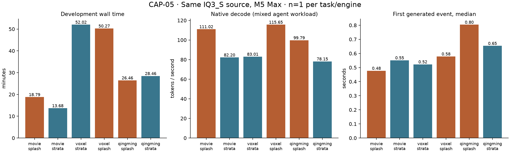

## GPU, CPU, unified memory and swap

| Task / engine | GPU whole-run mean / % | GPU request-interval mean / % | GPU peak / % | System CPU mean / % | Native CPU mean / % | Native CPU peak / % | Samples | Max collector duration / s |
|---|---|---|---|---|---|---|---|---|
| movie-splash | 43.46 | 95.01 | 100.00 | 6.99 | 1.31 | 4.88 | 1129 | 0.095 |
| movie-strata | 77.72 | 94.42 | 100.00 | 7.30 | 6.22 | 88.97 | 826 | 0.089 |
| voxel-strata | 59.59 | 93.41 | 100.00 | 15.59 | 4.54 | 91.08 | 3112 | 0.104 |
| voxel-splash | 45.45 | 95.18 | 100.00 | 7.07 | 1.45 | 4.66 | 3002 | 0.105 |
| qingming-splash | 85.49 | 92.79 | 100.00 | 5.98 | 2.57 | 6.09 | 1586 | 0.101 |
| qingming-strata | 87.61 | 95.39 | 100.00 | 9.23 | 5.33 | 90.01 | 1711 | 0.313 |

| Task / engine | Native RSS peak / GiB | Native footprint peak / GiB | System used peak / GiB | GPU driver in-use peak / GiB | Swap start / GiB | Max swap growth / GiB | Pressure normal/warn/critical |
|---|---|---|---|---|---|---|---|
| movie-splash | 36.58 | 91.04 | 106.03 | 92.28 | 2.44 | 0.00 | 1129/0/0 |
| movie-strata | 69.94 | 25.81 | 87.45 | 63.76 | 2.44 | 0.00 | 826/0/0 |
| voxel-strata | 70.20 | 26.07 | 88.94 | 64.28 | 2.44 | 0.00 | 3112/0/0 |
| voxel-splash | 40.95 | 95.50 | 107.81 | 95.71 | 2.44 | 0.00 | 2996/6/0 |
| qingming-splash | 39.82 | 95.36 | 107.02 | 94.86 | 2.44 | 0.00 | 1581/5/0 |
| qingming-strata | 73.52 | 30.34 | 93.39 | 63.96 | 2.44 | 0.00 | 1711/0/0 |

GPU utilization is whole-device, including browser rendering and background work. Request-interval means restrict samples to an active forwarded HTTP interval, but still do not isolate the inference process. System CPU is whole-machine percent; native CPU uses 100% for one fully used core, so it must not be directly compared with system percent. Mac native RSS, physical footprint, GPU driver in-use and system-used memory overlap and have different accounting semantics. Never add them or interpret Strata’s roughly 26–30GiB footprint as its total memory need.

Splash’s system-used peaks were 106.03–107.81GiB versus Strata 87.45–93.39GiB. Splash had 6 warning samples in voxel and 5 in Qingming; no critical samples. All cells started with about 2.44GiB existing swap and had 0.00GiB growth. This proves no additional measured swap use, not an empty-swap machine. Resource summaries include tools and idle gaps; per-request GPU means around 92.79–95.39% show why whole-run averages are not engine occupancy rankings.

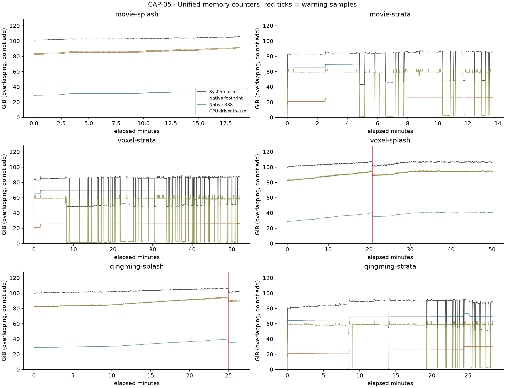

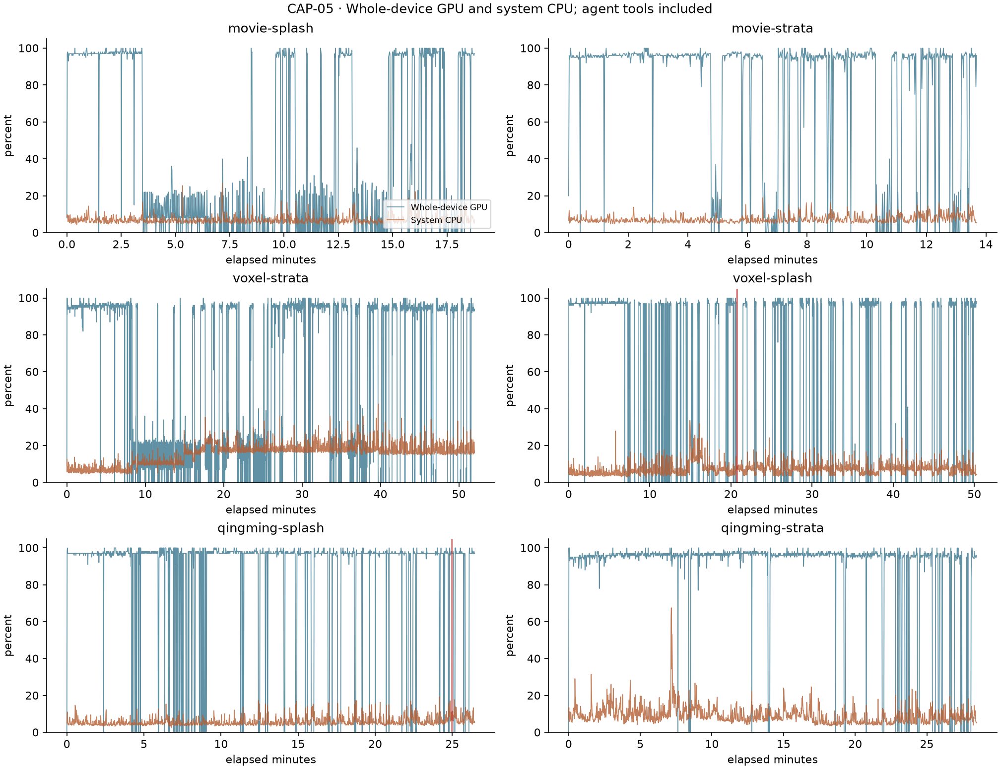

## Independent acceptance method

All six final commits were archived into separate review copies before any acceptance score. Actual browser controls, keyboard/mouse/touch actions, HTTP multiuser/negative tests, server restart and source review were used. Static source alone earns no functional/aesthetic acceptance; source-only risks are labelled. The reviewer knew engine identities. Scores use the predeclared weights, with 0 absent/failing, half partial, full demonstrated, and explicitly justified intermediate fractions. No score threshold or weight was changed.

Observer corrections are retained in evaluator-change-log.md: wrong Python/psutil server setup, asynchronous movie typing/logout waits, early optional Splash hook readiness, a wrong Strata recipe-button selector, wood-scout aiming and a menu-overlay screenshot. They did not cause model reruns or candidate fixes. Corrected observations supersede those harness mistakes, while the failed attempts remain available.

The six 60s entry/resize captures had no page exceptions or horizontal overflow. Strata voxel emitted two console 404 diagnostics, including the normal empty-slot /api/save response; its empty-slot branch handled that state. Subsequent gameplay and movie negative tests produce intentional failed HTTP responses, which are retained rather than hidden.

## Movie website: actual use and scores

Both sites launched without dependencies and offered honest demo banners, login and private SQLite-backed libraries. The browser flow logged in as Alice, searched/opened a film, added it, scored it, posted a literal HTML test comment, opened the library, then used admin movie/log views and a 390px detail/admin view. The comment remained literal text and did not execute. API tests registered independent users with attempted role escalation, exercised 8/4→10/4 averages, cross-user comment visibility/deletion rejection, locks, hiding and admin deletion/logs. Verified server restarts preserved movie/library/log snapshots exactly.

No live TMDB key was supplied. Controlled provider responses tested the unchanged adapter/HTTP handler, and are labelled fixtures. Splash stored title/year/poster URL/synopsis but blank director/cast; no producer was implemented. Its online search returned a hidden row to an anonymous viewer. Strata details+credits reached SQL with 9 placeholders and 10 parameters, returned None and could not import an online film. Demo success therefore receives only partial provider credit.

The browser same-site/different-origin experiment used an authenticated candidate cookie and a text/plain POST from another 127.0.0.1 port. Strata changed a rating from no score to 1 despite the browser reporting a CORS read error. Splash rejected the mutation by Origin. This demonstrates a local same-site cross-origin write, not an asserted arbitrary internet-origin exploit. Strata additionally allows ratings on hidden movies and omits each commenter’s individual rating; Splash allows scoring unwatched films and lets admins comment under a global lock. Both need explicit backend session-expiry policy.

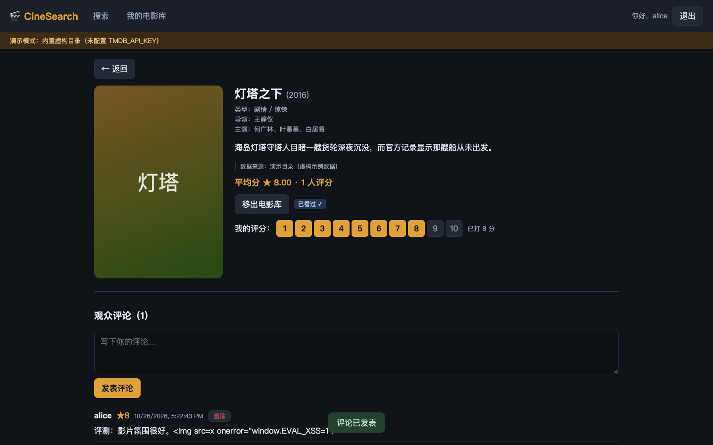

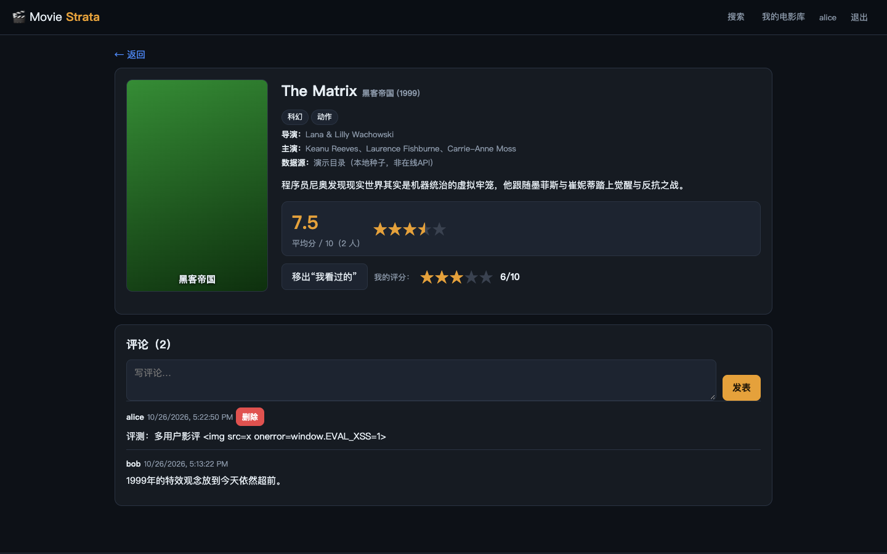

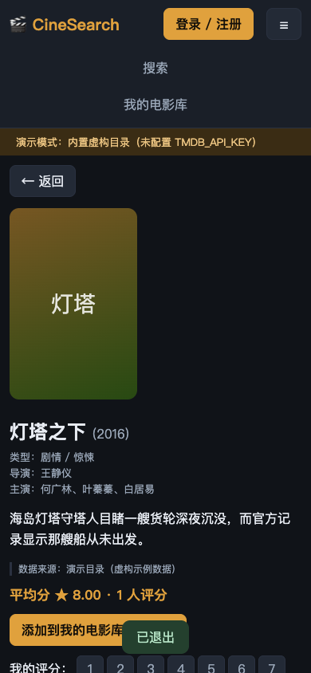

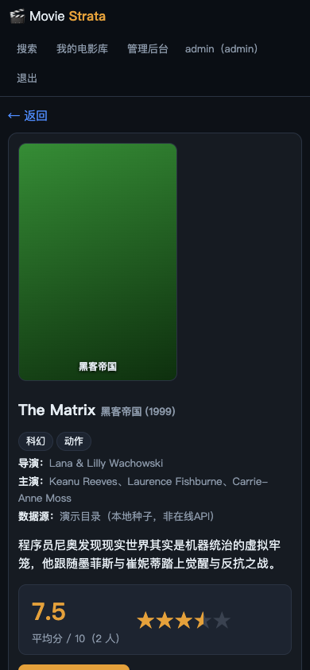

### Functional behavior — 35.5 / 35.25 / 45

Subheading numbers: Splash / Strata / maximum.

| ID / criterion | Max | Splash | Strata | Evidence and deduction |
|---|---|---|---|---|
| M01 External metadata search | 3 | 1.5 | 0.75 | Controlled provider IO exercised original handlers; no live key. Strata search cannot complete import. |
| M02 Poster, title and synopsis | 3 | 1.5 | 1.5 | Readable demo title/synopsis and placeholder posters; real poster download not verified. |
| M03 Producer, director and cast | 3 | 1 | 1 | Demo director/cast exist; producer missing. Splash online credits empty; Strata import fails. |
| M04 Registration, login, logout | 3 | 3 | 3 | New users, wrong privileges and logout exercised via HTTP; browser login works. |
| M05 Server identity and private libraries | 3 | 3 | 3 | Role escalation ignored; anonymous library 401, normal admin route 403, separate users. |
| M06 Add watched films and persist | 3 | 3 | 2 | Both demo libraries persist restart; Strata cannot add provider films because import returns None. |
| M07 Create/update/validate ratings | 3 | 2 | 2 | Updates and range checks work. Splash permits unwatched scores; Strata nonnumeric score yields 500. |
| M08 Cross-user reviews and individual scores | 3 | 3 | 2 | Cross-user text works and HTML is escaped. Splash includes reviewer score; Strata omits it. |
| M09 Server average and updates | 3 | 3 | 3 | 8 and 4, then 10 and 4 produce 7; actual HTTP values match server aggregation. |
| M10 Admin authorization | 3 | 3 | 3 | User cannot access admin or delete another user review; admin moderation succeeds. |
| M11 Global hiding across paths | 3 | 1.5 | 2 | Demo paths reject hidden films. Splash provider search leaks hidden row; Strata hidden rating write succeeds. |
| M12 Comment lock, information retained | 3 | 2 | 3 | Normal users blocked while detail remains. Splash admin can still comment under lock. |
| M13 Admin deletes comments | 3 | 3 | 3 | Soft deletion disappears from public detail and remains traceable in admin records. |
| M14 Attributable persistent audit | 3 | 2 | 3 | Actor/action/time survive restart; Splash action commit and audit insert are separate transactions. |
| M15 Database survives server restart | 3 | 3 | 3 | Verified process restart preserved exact movies/library/log response snapshots. |

### User experience — 13 / 12 / 20

Subheading numbers: Splash / Strata / maximum.

| ID / criterion | Max | Splash | Strata | Evidence and deduction |
|---|---|---|---|---|
| M16 Desktop search/detail hierarchy | 4 | 3 | 3 | Clear dark layouts and working search/detail flow; conventional and visually sparse. |
| M17 Mobile layout and inputs | 4 | 3 | 3 | 390px views have no page overflow; tall detail and dense admin tables require scrolling. |
| M18 Metadata, loading and errors | 4 | 2 | 2 | Honest demo banner and visible errors; placeholders and unverified online failure UX limit completeness. |
| M19 Keyboard, labels and accessibility | 4 | 2 | 1 | Splash has labelled login and score buttons; both result cards lack keyboard semantics; Strata scores are mouse spans. |
| M20 Library/review/admin workflow | 4 | 3 | 3 | Visible controls complete common tasks; basic table moderation rather than refined workflow. |

### Code and runtime — 14.5 / 14.5 / 25

Subheading numbers: Splash / Strata / maximum.

| ID / criterion | Max | Splash | Strata | Evidence and deduction |
|---|---|---|---|---|
| M21 Password and session security | 5 | 3.5 | 3.5 | Salted PBKDF2, random HttpOnly SameSite cookies and backend roles; no server-enforced session expiry. |
| M22 Authorization, XSS and input validation | 5 | 3 | 2 | Cross-user deletion blocked and XSS escaped; Strata accepts demonstrated same-site cross-origin writes. |
| M23 Schema and transactions | 5 | 2.5 | 4 | SQLite parameterization; Strata audit shares transaction, Splash audit can diverge from mutation. |
| M24 Readable maintainable modules | 5 | 3 | 3 | Small stdlib stacks, readable functions, but large HTTP dispatchers and ad hoc client state. |
| M25 Meaningful tests and provider failures | 5 | 2.5 | 2 | Substantial self-tests exist; neither caught important provider path defects. |

### Handoff — 9 / 9 / 10

Subheading numbers: Splash / Strata / maximum.

| ID / criterion | Max | Splash | Strata | Evidence and deduction |
|---|---|---|---|---|
| M26 Exact launch command | 2 | 2 | 2 | README launch succeeded unchanged. |
| M27 Accounts and configuration | 2 | 2 | 2 | Demo accounts and environment key documented. |
| M28 Dependencies | 2 | 2 | 2 | Python stdlib, no install surprises. |
| M29 Honest limitations and provenance | 2 | 1.5 | 1.5 | Demo is honest, but operational online defects remain undisclosed. |
| M30 Clean runnable delivery | 2 | 1.5 | 1.5 | Runnable separate repo; many diagnostic screenshots/scripts retained. |

## Voxel game: actual play and scores

Independent real-input checks moved each character about 5 units, changed yaw with the mouse, jumped, mined four blocks, opened crafting, changed weather, observed autonomous enemies/contact damage, saved/reloaded, regenerated and tapped mobile controls. Initial Splash mining collected dirt/sand; initial Strata mining dropped items outside pickup range, then a later approach collected two logs. A corrected Splash trunk-aim check also collected wood. Real UI crafting consumed inputs and produced wooden pickaxes and swords; real right-clicks placed blocks. Real attacks killed enemies. Both menus continued the clock.

Assistance is deliberately explicit: crafting subtests granted materials, combat subtests positioned/spawned enemies, and terrain/wood showcase checks used read-only scouts and teleports. These verify mechanisms, not an unassisted survival completion. Original failures and disabled recipes remain in JSON; a disabled stone pickaxe when only one stick remains is correct. Short active rAF means were 16.58ms Splash and 16.65ms Strata, under the recorded Metal renderer.

Two failures determine much of the score. Strata’s complete water scans for seeds 1373851094 and 7654321 each inspected 262,144 columns and found zero water; both minimum surfaces were y=73, above SEA=72. Splash’s audit-play sampled grid had 628 wet columns out of 3,844, heights 40–320. In a same-shaped saved-state fixture, both worlds stored a 7×7 stone platform at y=400 and held the player at y=401. Splash showed only the selection wireframe: its renderer iterates the original terrain-height envelope and omits high edits. Strata rendered the platform. This earns only partial full-world credit for Splash despite valid logical storage/collision.

Small save/load trials retained seed, edits, inventory and weather. Strata’s damaged enemy restored to 20 HP instead of the saved 1; its loader ignores hp when calling spawnAt. Splash restored 1 HP correctly. Splash nevertheless silently truncates serialized edits after 60,001 entries; this is a direct source finding, not a claimed live 60,002-edit stress test. Both omit some transient movement/AI timers, and background dt clamping does not catch up real elapsed time. Neither is certified to save every conceivable simulation state.

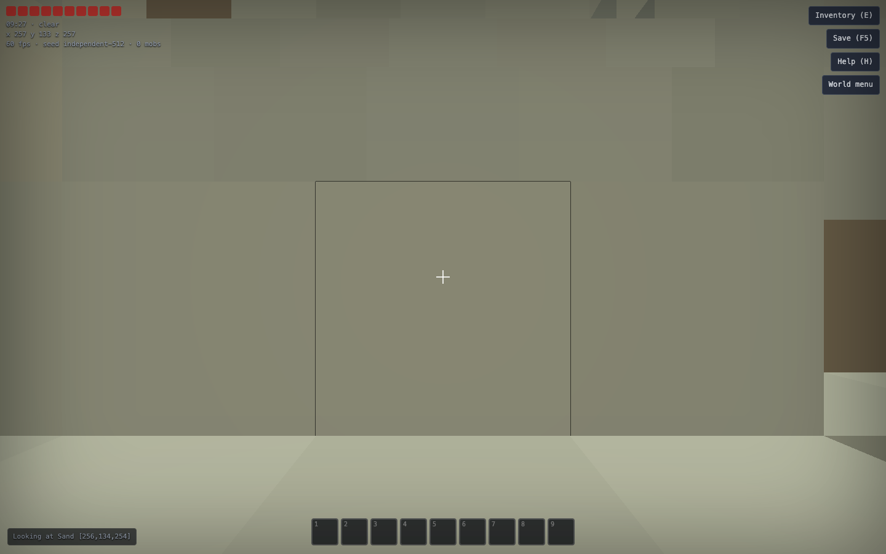

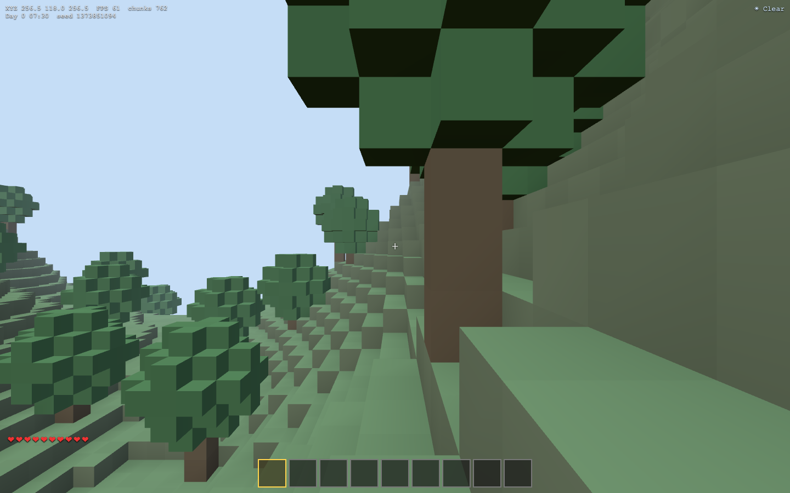

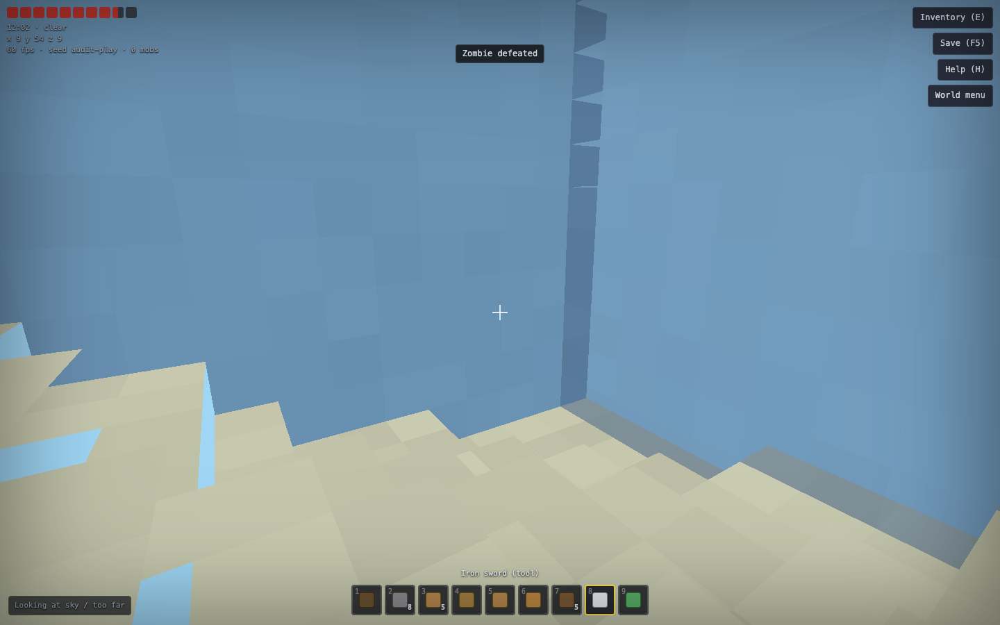

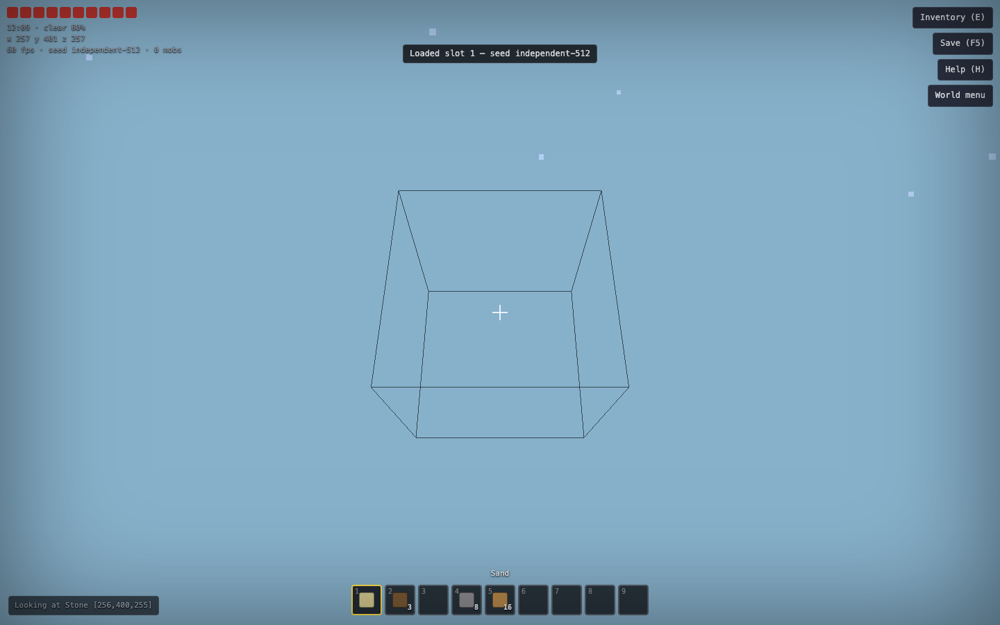

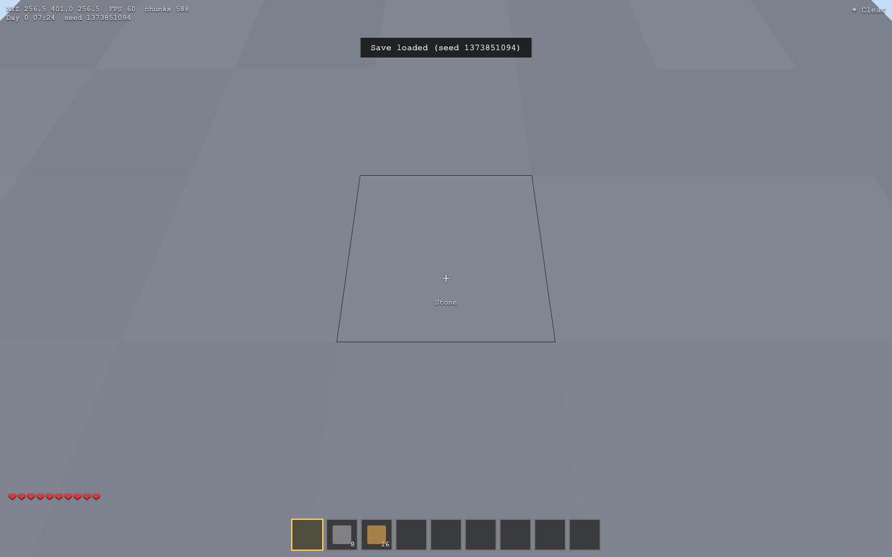

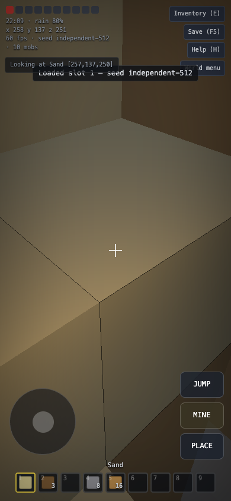

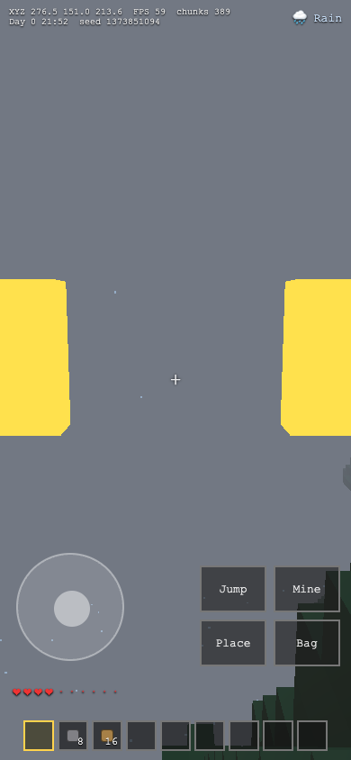

### Functional behavior — 42.5 / 42 / 45

Subheading numbers: Splash / Strata / maximum.

| ID / criterion | Max | Splash | Strata | Evidence and deduction |
|---|---|---|---|---|
| V01 512³ logical coordinates | 3 | 1.5 | 3 | Both hold a y=400 platform and support collision; Splash does not render it because meshes only cover the original terrain envelope. |
| V02 Random reproducible terrain | 3 | 3 | 3 | Seeded generation, seed preserved in save, regenerate changes terrain. |
| V03 Mountains and generated water | 3 | 3 | 1.5 | Splash sampled 628/3844 wet columns; Strata complete 512² scans of both tested seeds found zero water. |
| V04 Resources and interactive props | 3 | 3 | 3 | Wood/dirt/stone resources, tools and placeable blocks are functional; ore tiers are present. |
| V05 First-person movement and look | 3 | 3 | 3 | Real keys move about 5 units; mouse changes yaw; jump and touch UI exercised. |
| V06 Collision and gravity | 3 | 3 | 3 | Walking, slopes, jumping and settling visibly interact with solid terrain. |
| V07 Mining changes world | 3 | 3 | 3 | Real hold-mouse mining produces four edits in each initial trial. |
| V08 Inventory and collection | 3 | 3 | 3 | Splash directly collects mined dirt/sand; Strata collected two logs after approaching drops. |
| V09 Real recipes and crafting | 3 | 3 | 3 | UI consumes logs/planks/sticks and produces wooden pickaxe and sword; insufficient recipes disabled. |
| V10 Attack, damage and enemy death | 3 | 3 | 3 | Real attacks damage and kill fixture-positioned enemies; helper use explicitly recorded. |
| V11 Enemy spawn and behavior | 3 | 3 | 3 | Enemies spawn, move and damage player; capped populations observed. |
| V12 Player HP and survival | 3 | 3 | 3 | Contact damage lowers HP; state/HUD and survival controls exist. |
| V13 Weather changes | 3 | 3 | 3 | Clock and rendered rain respond to weather state and continue over time. |
| V14 Complete single-slot save/load | 3 | 2 | 1.5 | Seed/edits/inventory/weather persist; Strata resets enemy HP, Splash silently caps saved edits at 60001. |
| V15 Regenerate and replay | 3 | 3 | 3 | New seed clears edits and inventory in actual new-world test. |

### Play and visuals — 16.5 / 16 / 25

Subheading numbers: Splash / Strata / maximum.

| ID / criterion | Max | Splash | Strata | Evidence and deduction |
|---|---|---|---|---|
| V16 Readable Minecraft-like scene | 5 | 3.5 | 3.5 | Recognizable voxel hills/trees, simple flat materials and limited environmental polish. |
| V17 Responsive first-person controls | 5 | 4 | 4 | Metal renderer and roughly 60Hz rAF in short active samples; real input works. |
| V18 Gather/craft/combat enjoyment | 5 | 3 | 3 | Components work; assisted subtests do not establish an unassisted complete progression run. |
| V19 Coherent terrain and exploration | 5 | 2.5 | 2.5 | Splash offers water and biome variation but invisible high edits and awkward initial cliff; Strata tested worlds lack water. |
| V20 Desktop/mobile HUD and controls | 5 | 3.5 | 3 | Visible touch controls and compact hotbars work; dense labels and basic feedback reduce usability. |

### Code and runtime — 16 / 14 / 20

Subheading numbers: Splash / Strata / maximum.

| ID / criterion | Max | Splash | Strata | Evidence and deduction |
|---|---|---|---|---|
| V21 Bounded generation and chunk memory | 4 | 4 | 4 | Splash streams/evicts chunks; Strata dense 128MiB world plus visible chunk meshes is bounded. |
| V22 Reliable state serialization | 4 | 2 | 1 | Small saves work, but edit cap and enemy HP restore defects violate full-state guarantees. |
| V23 Module/input/state maintainability | 4 | 3 | 2 | Splash separates world/player/weather/save; Strata concentrates generation, UI and state in main.js. |
| V24 No pause and robust boundaries | 4 | 3 | 3 | Menus advance time; bounds exist, but background clamping is not wall-clock catch-up. |
| V25 Stability and runtime frames | 4 | 4 | 4 | No candidate page errors after observer readiness correction; short active samples near 16.6ms. |

### Handoff — 8 / 8 / 10

Subheading numbers: Splash / Strata / maximum.

| ID / criterion | Max | Splash | Strata | Evidence and deduction |
|---|---|---|---|---|
| V26 Exact launch command | 2 | 2 | 2 | Documented local stdlib servers launch. |
| V27 Seed/save/control configuration | 2 | 2 | 2 | Controls and slot documented with real UI. |
| V28 Dependencies | 2 | 2 | 2 | Bundled Three.js and stdlib server. |
| V29 Honest limitations | 2 | 1 | 1 | Browser throttling disclosed; full-save defects and missing water cases not disclosed. |
| V30 Clean runnable delivery | 2 | 1 | 1 | Runnable, but numerous debugging scripts/screenshots and environment-specific tests remain. |

## Qingming scroll: viewing and fidelity scores

Both are original Canvas2D drawings with continuous autoplay, pan/zoom, speed and replay. Splash exposes 153 moving agents and 63 static entities in a 12,000×1,500 world; Strata has 230 figure/vehicle entities, 12 boats and 17 props in 6,400×1,400. Independent clocks advanced 3s over 3s and about 4s over 2s at 2×; fixed-camera images changed. Desktop/mobile resize, real dragging/wheel and visible controls worked without page exceptions.

The museum reference used by the reviewer is a bridge detail from the original Zhang Zeduan work, not a full-scroll raster and not a pixel-comparison template. Both candidates received the same museum URL and textual target, with permission to research it. The evaluation uses original visual language—interwoven timber bridge, oblique architecture, varied activity, ink/earth palette, river and urban narrative—rather than object counts alone. No original painting image is embedded behind the candidate art.

The main weakness is shared: long straight river bands, front-facing repeated shops, stick-figure anatomy and limited depth. Splash draws more architectural lines and bridge braces but has broad empty water and a mechanically bent bridge. Strata has denser market crowds and convenient region buttons, but repeated groups overlap; its static bridge is flattened before boats are painted, making boats cover bridge geometry. Neither approaches the original timber construction or detailed crowd narratives. More entities and output tokens did not produce high historical-painting fidelity.

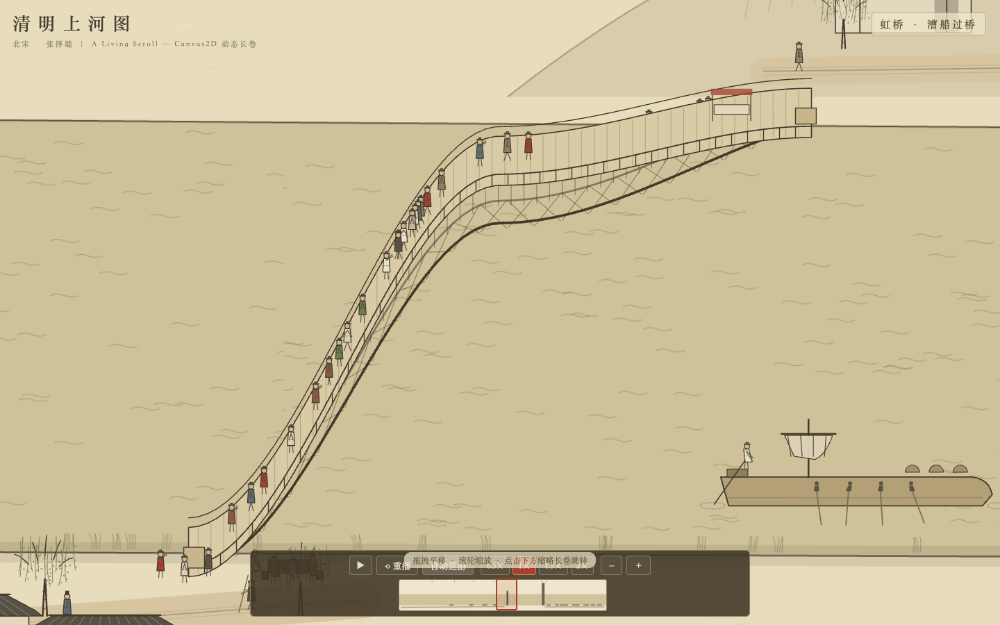

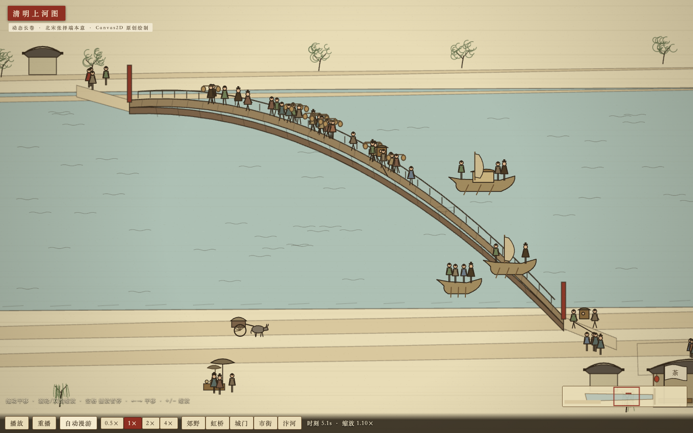

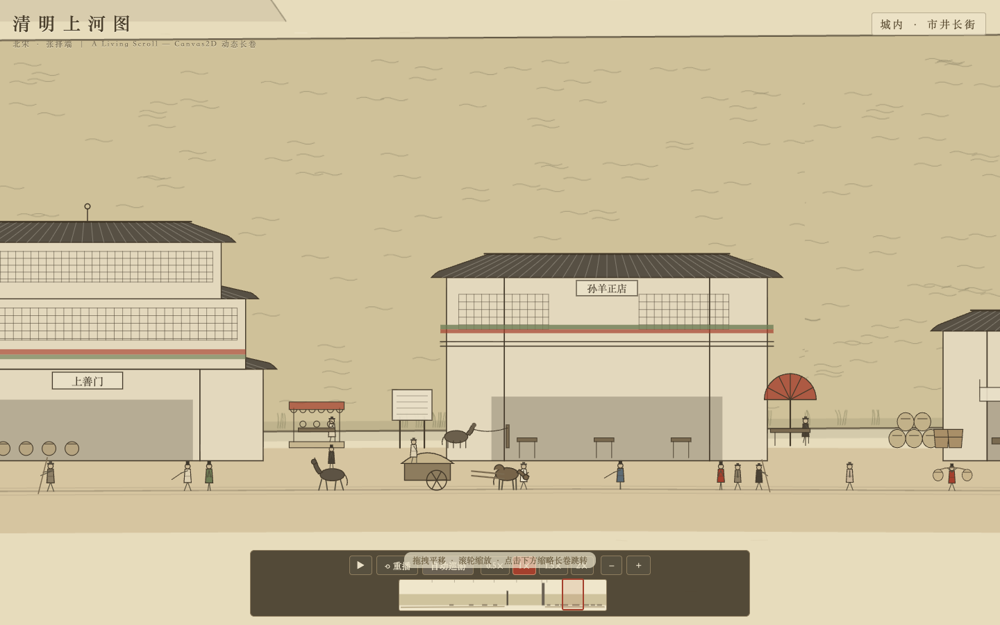

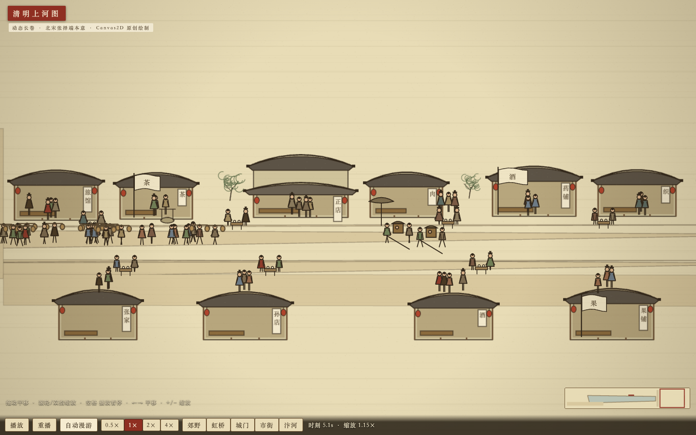

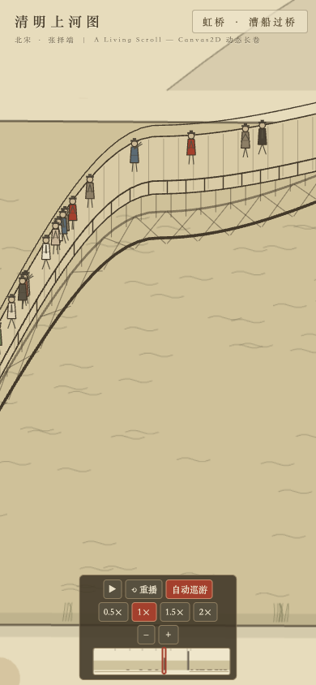

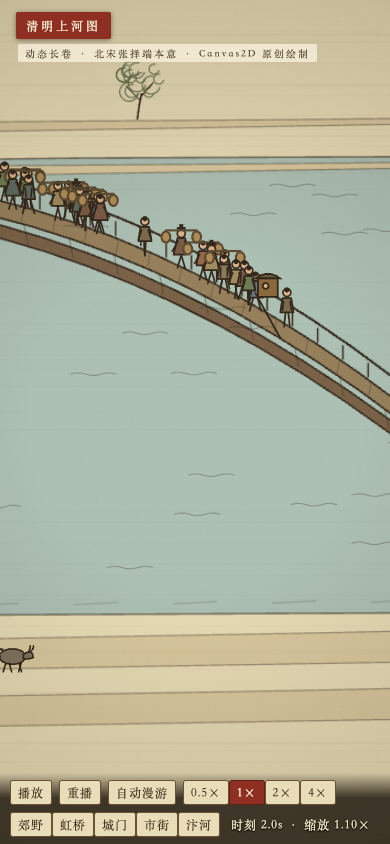

### Original-painting fidelity — 22 / 21 / 50

Subheading numbers: Splash / Strata / maximum.

| ID / criterion | Max | Splash | Strata | Evidence and deduction |
|---|---|---|---|---|
| Q01 Continuous rural/river/city scroll | 5 | 2.5 | 2.5 | All regions exist, but composition is mostly horizontal bands and broad empty areas. |
| Q02 Timber rainbow bridge | 5 | 1.5 | 1 | Splash adds braces; both bridges lack the original interwoven timber structure and perspective. |
| Q03 River, boats and wharf | 5 | 3 | 2.5 | Visible crew/cargo/boats; river is simplified and Strata boats paint above bridge. |
| Q04 Caravans and pack animals | 5 | 3 | 3 | Moving donkeys/carts/carriers visible, with highly simplified anatomy. |
| Q05 Song shops, signs and buildings | 5 | 2.5 | 2.5 | Signs and shop types recognizable; flat repeated facades instead of architectural depth. |
| Q06 Many varied human activities | 5 | 2.5 | 2.5 | 153 agents versus 230 figures; different props but repetitive stick figures/clusters. |
| Q07 Fine linework, ink and earth palette | 5 | 2.5 | 2.5 | Muted palette resembles aged silk; clean vector outlines lack original brush/detail richness. |
| Q08 Oblique perspective, scale and depth | 5 | 1 | 1 | Front-facing buildings, straight river and scale jumps dominate. |
| Q09 Narrative vignettes and crowd ecology | 5 | 2 | 2 | Porters, stalls and boating gestures exist, but few convincing connected narratives. |
| Q10 Overall resemblance to original | 5 | 1.5 | 1.5 | An animated schematic town, visibly far from the museum bridge detail and original scroll language. |

### Motion and interaction — 17 / 17.5 / 25

Subheading numbers: Splash / Strata / maximum.

| ID / criterion | Max | Splash | Strata | Evidence and deduction |
|---|---|---|---|---|
| Q11 Autoplay and temporal change | 5 | 5 | 5 | Clocks advance 3s over 3s; fixed-camera images change; 60s stability passed. |
| Q12 Plausible human walk paths | 5 | 3 | 3 | People follow roads/bridge; repeated groups and overlaps limit natural movement. |
| Q13 Boats/caravans and occlusion | 5 | 2.5 | 1.5 | Movement exists; Splash depth keys are approximate, Strata always draws boats above static bridge. |
| Q14 Pan, zoom, speed and replay | 5 | 4 | 5 | Real drag/wheel/buttons work; Strata visible region presets improve discovery. |
| Q15 Desktop/mobile composition and accessibility | 5 | 2.5 | 3 | No overflow and touch controls work; narrow crops and small controls, no rich canvas alternative text. |

### Code and runtime — 14.5 / 13 / 15

Subheading numbers: Splash / Strata / maximum.

| ID / criterion | Max | Splash | Strata | Evidence and deduction |
|---|---|---|---|---|
| Q16 Readable architecture | 3 | 3 | 1.5 | Splash separates scene/agents/world/util; Strata is a long monolithic script. |
| Q17 Reproducible animation state | 3 | 2.5 | 2.5 | Time, presets and replay can restore scenes; not a complete persistent animation checkpoint. |
| Q18 Bounded drawing and frame cost | 3 | 3 | 3 | Static caching/culling and short rAF samples near 60Hz. |
| Q19 Resize and error handling | 3 | 3 | 3 | Desktop→390px→desktop retained canvas with no page errors. |
| Q20 60-second animation stability | 3 | 3 | 3 | Independent timed capture completed, no fatal errors. |

### Handoff — 9.5 / 9.5 / 10

Subheading numbers: Splash / Strata / maximum.

| ID / criterion | Max | Splash | Strata | Evidence and deduction |
|---|---|---|---|---|
| Q21 Exact launch command | 2 | 2 | 2 | Documented Python/Node servers work. |
| Q22 Controls and configuration | 2 | 2 | 2 | Controls, state hooks and presets documented. |
| Q23 Dependencies | 2 | 2 | 2 | Canvas2D with no network asset dependency. |
| Q24 Honest artistic limitations | 2 | 2 | 2 | READMEs acknowledge stylization and simplified bridge/faces. |
| Q25 Clean runnable delivery | 2 | 1.5 | 1.5 | Runnable local artifact with test material retained. |

## Code review: reproduced findings and proposed remedies

| ID | Priority | Candidate / source | Finding | Evidence class |
|---|---|---|---|---|
| F01 | P1 | movie-splash/server.py:183 | Hidden TMDB search result leak | Reproduced + source |
| F02 | P1 | movie-strata/server.py:171 | TMDB import has nine placeholders and ten bindings | Reproduced + source |
| F03 | P2 | movie-strata/server.py:271 | Same-site cross-origin state mutation accepted | Reproduced + source |
| F04 | P2 | movie-strata/server.py:363 | Hidden film can still be rated and nonnumeric score becomes 500 | Reproduced + source |
| F05 | P2 | movie-splash/server.py:293 | Rating does not require watched membership | Reproduced + source |
| F06 | P2 | voxel-strata/js/main.js:570 | Reload discards saved enemy HP | Reproduced + source |
| F07 | P1 | voxel-splash/js/main.js:195 | High edited blocks omitted from terrain-envelope rendering | Reproduced + source |
| F08 | P2 | voxel-strata/js/main.js:50 | Two tested complete worlds contain no generated water | Reproduced + source |
| F09 | P2 | voxel-splash/js/main.js:534 | Save silently stops at 60001 modifications (source finding) | Source only |
| F10 | P2 | qingming-strata/main.js:815 | Boats draw over the already flattened bridge image | Reproduced + source |

Remedies were reviewed, not applied: filter hidden provider results before returning them; fix the TMDB INSERT placeholders and add a provider fixture regression; enforce Origin/content-type or a CSRF token for authenticated writes; centralize movie availability and watched-membership checks; load enemy HP and remaining AI/transient state; include edited/near-player vertical chunks in the render set; ensure terrain generation actually produces water for accepted seeds; reject/explicitly handle oversized saves instead of truncating; and draw bridge/boats in a shared depth/occlusion system. Make admin audit insertion atomic with the action and add explicit session expiry.

[Exact source excerpts with original line numbers and file hashes](../../assets/evidence/cap-05-source-review.txt). Priority denotes review urgency, not an additional undisclosed scoring weight.

## Artifacts, evidence and reproduction

| Case / repository | Pinned final commit | Local port / launch |
|---|---|---|
| movie-splash / llm-test-2026-10-26-site-movie-splash | 486321ae60e31872b4771316efb1494f7a09de41 | 4301 / python3 server.py |
| movie-strata / llm-test-2026-10-26-site-movie-strata | f8c1885ec32516a1a696c816af6278a3cf367b9b | 4302 / python3 server.py |
| voxel-strata / llm-test-2026-10-26-game-voxel-strata | 053f7446db1f2aacb6381485f145aad6da0baf1b | 4303 / python3 server.py |
| voxel-splash / llm-test-2026-10-26-game-voxel-splash | 82190ac9dbd788396fd092f121c57f19369a9d13 | 4304 / python3 server.py |
| qingming-splash / llm-test-2026-10-26-art-qingming-splash | 1836ce05f65bc25114e50a52e98579c48a7f9f36 | 4305 / python3 server.py |
| qingming-strata / llm-test-2026-10-26-art-qingming-strata | 6175bcb490c7195ed0c00fb22a40c2da358e98c7 | 4306 / node server.cjs |

Each product remains in its own local Git repository under `~/Code/qwen3.8_tests/2026-10-26-flash-next-iq3s/`. Full source tarballs and Git bundles are saved in that experiment’s `artifacts/` directory. The report repository contains the report, hashes, reviewer excerpts and sanitized evidence, not a combined product-source monorepo. Nothing was pushed or deployed; there is no public artifact URL.

[Evidence ZIP](../../assets/evidence/cap-05-evidence.zip) · [Request CSV](../../assets/evidence/cap-05-requests.csv) · [Resource CSV](../../assets/evidence/cap-05-resources.csv) · [Metrics JSON](../../assets/evidence/cap-05-metrics.json) · [Scores JSON](../../assets/evidence/cap-05-scores.json) · [Publication transformation/ZIP hash](../../assets/evidence/cap-05-publication.json) · [Localization audit](../../assets/evidence/cap-05-localization-audit.json) · [Archive build/browser checks](../../assets/evidence/cap-05-archive-checks.json)

The ZIP includes exact task/prompts/protocol, selected setup/model provenance, per-trial probe timings, per-request timing/usage CSV, 1Hz resource CSV, analysis/acceptance harnesses, all independent raw PNGs and result JSON, source hashes/findings and observer corrections. Full private Pi conversations, request bodies/SSE, credentials, runtime DBs, model weights/caches, full process command lists and complete product sources are excluded from the report repository. Original local traces remain retained. User paths are generalized to /Users/benchmark; numeric observations and screenshot pixels are unchanged. A per-file manifest and ZIP read-back verify the packaged bytes.

Reproduce a product from its pinned local repo/archive using the table’s command, then run the matching independent harness from the experiment. Standard browser dependency paths are environment-specific and must be adjusted after path generalization. To reproduce inference, prepare the pinned target/projector/draft, one ready engine at a time, restore the recorded sampling/cache settings, then use the frozen matrix and phase prompts. Running these scripts again creates a new trial, not a replacement for this record.

## Limitations and practical interpretation

There is one stochastic coding run per task/engine, no blinding, no confidence interval for quality, and no controlled numerical-equivalence test after engine conversion. Alternating order reduces but does not remove time/background/thermal confounds. The 300s post-start tool cap affects movie wall time. Agent histories and cache/image work diverge. All six completed artifacts remain in the denominator. Provider fixtures are not live TMDB acceptance; physical-phone performance and a long unassisted survival run remain untested. The museum reference raster is a detail, and aesthetic points are assessor judgments.

For this 128GiB M5 Max, the installed Splash resident configuration offers a clear measured throughput benefit when roughly 106–108GiB whole-system peaks are acceptable. Keep the original Strata service available for a lower observed system-memory footprint and fallback workflow. Neither runtime choice removes the need to review generated backend authorization, external adapters, full game state or visual fidelity. These six artifacts show working mechanisms and specific failures; the scores describe this run only.

## Primary references and archive verification

Setup sources: [Splash releases](https://github.com/incoai/splash/releases), [pinned Splash development documentation](https://github.com/incoai/splash/blob/1744cfafee415fb463b289449cec59a864e768e9/DEVELOPMENT.md), [target model revision](https://huggingface.co/ISTA-DASLab/Qwen3.8-Flash-Next-GSQ-RCO-GGUF/tree/ed59f92082b1e93c0e96d60a8b11aab089b52f09), [draft revision](https://huggingface.co/incoai/Qwen3.8-Flash-Next-DFlash2/tree/a22a1744e85c17364dcc54a6a420af7135d4c7f6). Art target: [Palace Museum original Zhang Zeduan scroll](https://www.dpm.org.cn/collection/paint/228226.html). Local source/runtime/header evidence is packaged separately from these external references.

Archive acceptance requires npm run build and npm run check, then Chromium checks of English/Chinese report selection, language preservation, search with combined filters, images/download links and 390px overflow. Results are recorded in cap-05-archive-checks.json. The report pair uses shared numeric/score sources and identical original PNGs; localization checks record that correspondence. Local archive commit only; no push.
