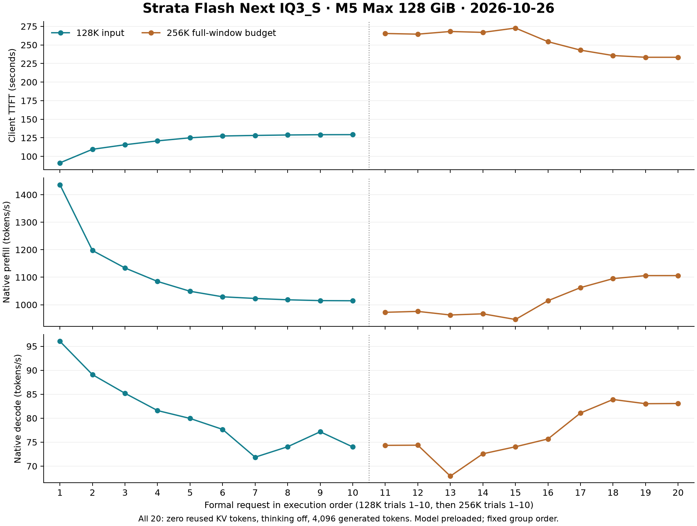

# PERF-13：Strata十次128K输入与十次256K满窗压力测试

[English](2026-10-26-strata-cold-kv-128k-256k.md) | [简体中文](2026-10-26-strata-cold-kv-128k-256k_CN.md)

开始日期2026-10-26，America/Toronto。新实测，非CAP-04首事件平均值；本机M5 Max18CPU/40GPU/128GiB，Terminal0.2.6/Control0.1.51/Metal0.1.50，原Flash Next GSQ-RCO IQ3_S。

## 汇总

| 组别 | 尝试/计划 | 机械通过 | 冷KV/无思考有效样本 | TTFT均值秒 | TTFT中位秒 | P95秒 | pooled prefill tok/s | pooled decode tok/s | 4096输出 | 五键正确 |
|---|---|---|---|---|---|---|---|---|---|---|
| 128k | 10/10 | 10 | 10 | 120.530 | 126.225 | 129.262 | 1087.986 | 80.060 | 10/10 | 50/50 |
| 256k | 10/10 | 10 | 10 | 253.769 | 259.465 | 272.749 | 1017.203 | 76.651 | 10/10 | 50/50 |

有效样本汇总只纳入机械完成、cache_n与usage cached_tokens均为0、实际无思考的行；全部原始尝试保留在下表及summary.json。样本P95采用nearest-rank，n=10时就是最慢样本，不视为充分统计估计。

## 每次记录

| ID | HTTP | 输入tokens | 输出tokens | TTFT秒 | 正文TTFO秒 | prefill tok/s | decode tok/s | 缓存tokens | 结束原因 | 五键 | 机械通过 |
|---|---|---|---|---|---|---|---|---|---|---|---|
| 128k-01 | 200 | 131072 | 4096 | 91.301 | 91.301 | 1436.481 | 96.036 | 0 | length | 5 | True |
| 128k-02 | 200 | 131072 | 4096 | 109.537 | 109.537 | 1197.220 | 89.085 | 0 | length | 5 | True |
| 128k-03 | 200 | 131072 | 4096 | 115.672 | 115.672 | 1133.665 | 85.195 | 0 | length | 5 | True |
| 128k-04 | 200 | 131072 | 4096 | 120.887 | 120.887 | 1084.774 | 81.595 | 0 | length | 5 | True |
| 128k-05 | 200 | 131072 | 4096 | 125.006 | 125.006 | 1049.033 | 79.949 | 0 | length | 5 | True |
| 128k-06 | 200 | 131072 | 4096 | 127.444 | 127.444 | 1028.928 | 77.663 | 0 | length | 5 | True |
| 128k-07 | 200 | 131072 | 4096 | 128.199 | 128.199 | 1022.888 | 71.865 | 0 | length | 5 | True |
| 128k-08 | 200 | 131072 | 4096 | 128.811 | 128.811 | 1018.029 | 74.049 | 0 | length | 5 | True |
| 128k-09 | 200 | 131072 | 4096 | 129.180 | 129.180 | 1015.077 | 77.168 | 0 | length | 5 | True |
| 128k-10 | 200 | 131072 | 4096 | 129.262 | 129.262 | 1014.482 | 74.004 | 0 | length | 5 | True |
| 256k-01 | 200 | 258040 | 4096 | 265.420 | 265.420 | 972.551 | 74.335 | 0 | length | 5 | True |
| 256k-02 | 200 | 258040 | 4096 | 264.523 | 264.523 | 975.839 | 74.369 | 0 | length | 5 | True |
| 256k-03 | 200 | 258040 | 4096 | 268.118 | 268.118 | 962.751 | 67.913 | 0 | length | 5 | True |
| 256k-04 | 200 | 258040 | 4096 | 266.924 | 266.924 | 967.053 | 72.574 | 0 | length | 5 | True |
| 256k-05 | 200 | 258040 | 4096 | 272.749 | 272.749 | 946.421 | 74.038 | 0 | length | 5 | True |
| 256k-06 | 200 | 258040 | 4096 | 254.407 | 254.407 | 1014.645 | 75.668 | 0 | length | 5 | True |
| 256k-07 | 200 | 258040 | 4096 | 243.007 | 243.007 | 1062.273 | 81.080 | 0 | length | 5 | True |
| 256k-08 | 200 | 258040 | 4096 | 235.753 | 235.753 | 1094.952 | 83.902 | 0 | length | 5 | True |
| 256k-09 | 200 | 258040 | 4096 | 233.399 | 233.399 | 1106.002 | 83.024 | 0 | length | 5 | True |
| 256k-10 | 200 | 258040 | 4096 | 233.395 | 233.395 | 1106.017 | 83.062 | 0 | length | 5 | True |

## 口径与边界

128K组是131072输入＋最多4096输出，原生服务始终保持262144窗口；不是原生容量128K的重启对照。256K组是258040输入＋4096输出＋8内部预留＝262144。提前EOS保留并单列，不以配置上限冒充实际满窗。

同一五键档案检索＋长SQLite生成负载；每次更换前导nonce和五键，20个first32-ID hash不同。temperature0、top_p.95/top_k20、thinking none/enable_thinking false。模型已加载，KV冷不代表OS权重页缓存冷；首轮亦不含模型加载。

TTFT从客户端HTTPConnection.request前（序列化已完成）到首个非空文本/思考SSE到达，收行后立即打时间戳，早于解析/写盘。空role/keepalive/usage不计。TTFO到首个正文，实际无思考时应与TTFT一致。预先只做本地精确计数，服务端count-only在测量之后，usage再次核对。

prefill=本请求SSE prompt_n÷prompt_ms，decode=predicted_n÷predicted_ms，毫秒均先换算为秒，均为原生速率；pooled以总token/总对应秒计算，不是请求速率算术平均。summary另保留每次速率的均值/中位/范围，不用全历史token或陈旧全局计时。

每请求900秒上限；无失败替换/重试。一个短warmup和一个最终recovery是另列控制，不计入20请求汇总。固定先128K后256K、后台负载、MTP接受率及重复SQL题型可能影响结果，不作单因素引擎/通用能力因果判断。

## 资源与恢复

| 组别 | 采样数 | RSS峰GiB | footprint峰GiB | 全局GPU内存峰GiB | GPU忙均值% | swap增长峰GiB | 压力 |
|---|---|---|---|---|---|---|---|
| 128k | 1706 | 62.164 | 21.873 | 62.477 | 98.357 | 0.000 | {'normal': 1706} |
| 256k | 3055 | 62.180 | 21.887 | 62.966 | 98.620 | 0.000 | {'normal': 3055} |

1Hz目标、实际时间戳与采样间隔保留；RSS/footprint/globalGPU有重叠，不相加。没有摄氏温度，不声称没有降频。临界压力15样本、native footprint/树RSS>115GiB或swap增>8GiB只取消本测试连接并停止后续，不重启模型挽救结果。

最终状态/进程身份见run-complete.json：尝试20/20，abort=False，同一进程身份=True。

源数据：packets/manifest.json及原请求/IDhash、records/*/stream.jsonl/result.json/output.txt、resources.jsonl、results.csv、summary.json。协议和执行器在正式请求前Git冻结，host.json记录其commit。

最终恢复：{"pass": true, "identity_unchanged": true}

## 完成后的独立核对

本次总耗时79.83分钟，2026-10-26本地10:31开始、11:51完成。正式请求20/20均HTTP 200，无重试、替换、提前EOS或缓存污染；最终短请求恢复通过，服务保持原有进程、262144窗口及视觉能力。五键100/100正确只证明本合成检索负载，不作为通用推理或代码质量分数；长SQL全部因4096输出上限结束，不声称完成题目要求的全部SQL。

离线逐行重放20份SSE，重新核对TTFT/TTFO、输出、usage、原生timings、请求/输出SHA、输入后验计数、窗口预算、五键、配置及二进制SHA、组统计，共275/275项通过。本机原始记录保留核对脚本与机器结果；公开证据包包含整理后的audit.json。正式执行器与协议无改动，冻结commit为`8aa16f9`。

全程4762次采样全部normal，无遥测错误或采样器异常；平均间隔1.006秒、最大1.038秒。swap同一sysctl来源的首值和峰值均为2935163453.44 bytes，观测增长为0。原始swap_delta_bytes因psutil基线与sysctl四舍五入混用，保留约2621.44 bytes固定偏移；上表显示0.000 GiB，不将该舍入差当成实际swap增长，原始数据未修改。

逐轮走势显示128K组TTFT由91.30秒升至129.26秒，256K组后段则由约265–273秒降至233.40秒。固定执行顺序、后台负载和未取得温度等限制仍适用，不能仅凭趋势断言热降频或引擎加速原因。

图表可导出：[PNG](../../assets/figures/perf-13-latency-throughput.png)、[SVG](../../assets/figures/perf-13-latency-throughput.svg)。逐轮原始数值另见[results.csv](../../assets/evidence/perf-13-results.csv)，完整统计见公开[证据包中的summary.json](../../assets/evidence/perf-13-evidence.zip)。

## 实验时系统与推理配置

推理在本机Mac运行，客户端为直接Python HTTP/SSE而非Pi。实验时host.json记录macOS 27.0.1（26A434）、arm64；Apple M5 Max、18 CPU / 40 GPU核心、137438953472 bytes（128 GiB）统一内存。AC供电、模型预加载、单服务槽，普通后台应用未关闭。视觉保持开启，本次负载仅文本。

模型：ISTA-DASLab/Qwen3.8-Flash-Next-GSQ-RCO-GGUF，IQ3_S，固定revision `ed59f92082b1e93c0e96d60a8b11aab089b52f09`。复用安装器已校验权重清单，本轮未重新全量哈希所有权重。原生二进制SHA256：`3fb8c8c8fabfcdc89446a1a0eb02cbc49bcd1a9123fc98aaa0c361af2912669d`。Terminal 0.2.6 / Control 0.1.51 / released Metal 0.1.50；MTP spec 2、INT8 KV；完整启动参数及tokenizer/权重清单见证据包。

## 发布说明与证据下载

[逐轮CSV](../../assets/evidence/perf-13-results.csv) · [整理后证据ZIP](../../assets/evidence/perf-13-evidence.zip) · [发布收据与源SHA](../../assets/evidence/perf-13-publication-receipt.json)

本机中文原报告经全文翻译与链接迁移归档，全部数值、失败与边界保留。证据包包含冻结协议、20份输入元数据与哈希、20份结果与合成输出、SSE事件摘录、全部4762份选定资源/状态采样、完整summary及整理后审计、控制请求、配置与模型来源。私人账号路径泛化，电池标识与进程清单不公开，完整输入请求/SSE流保留本机。源文件与公开成员SHA256记录转换；原始PNG/SVG及CSV字节不变。发布未重跑推理，未改历史CAP-04结论。测量时协议记载不公开上传，用户随后单独授权本次发布。
