# One Christmas globe brief, two delivered worlds: Snow Globe Kingdom and Noël Atelier

[English](2026-11-20-snowglobe-park-vs-noel-globe.md) | [简体中文](2026-11-20-snowglobe-park-vs-noel-globe_CN.md)

Evaluation date: 2026-11-20, America/Toronto (UTC−5). Archive ID: CLOUD-03. The date is the start of this artifact evaluation; original generation start times were not independently established. Publication commits were made on the same date.

## Question and success criteria

The user requested a joint Codex-mbp / Claude-mbp evaluation of two public implementations of a JavaScript Christmas snow globe containing a theme park. The shared task asks for weather and time controls, continuous zoom, miniature photography, a complete Disney park and a working viewing link.

**The comparison concerns these two delivered artifacts.** Their READMEs reproduce the same five-line task verbatim, but the original full messages have different framing; generation tools, reasoning settings, self-repair and publication work were not held constant. This is not a controlled one-shot model benchmark.

At review setup, before exchanging independent verdicts, reviewers agreed to assess: (1) the core task, (2) default and close-up visuals, (3) interaction and the complete photo workflow, (4) stability and performance, and (5) reproducibility, maintainability and accessibility. This is an artifact-review rubric, not a preregistered scoring experiment. Judgments use leads and trade-offs, without a weighted total or invented precision. Visual preferences are subjective. No human aesthetic rating was supplied.

| Artifact | README model attribution | Setting | Frozen source | Viewing link |
|---|---|---|---|---|
| Snow Globe Kingdom (`snowglobe-park`) | Claude Opus 5.5; builder confirms `claude-opus-5-5` | max | [`2eee3d5`](https://github.com/leoli-dev/snowglobe-park/tree/2eee3d5c4110dde4a351b758975f480594875684) | [Live globe](https://leoli-dev.github.io/snowglobe-park/) |
| Noël Atelier (`noel-globe`) | GPT-6.2-Astra; explicitly named by user in original publication request | High | [`239e9bb`](https://github.com/leoli-dev/noel-globe/tree/239e9bba12bb20a01513e7a9189d422905ed1232) | [Live globe](https://leoli-dev.github.io/noel-globe/) |

The existing artifact repository names are preserved. They predate this evaluation and do not follow this archive's preferred `llm-test-YYYY-MM-DD-{type}-{name}` naming scheme. They were not renamed or copied into the report repository.

## Hardware, system and fixed conditions

| Item | Actual configuration and evidence |
|---|---|
| Inference location | Cloud. Snowglobe's original builder confirms Anthropic API inference. Noël is attributed to the GPT cloud service through its model/agent record; the inference host was not observed. Local source folders are not inference-host evidence. |
| Inference hardware and OS | Server CPU/GPU, memory, architecture, OS/build and serving revision: **not recorded** for both. |
| Generation models and settings | Opus `claude-opus-5-5` / max versus GPT-6.2-Astra / High, as attributed above. Exact serving revisions, context/output limits, sampling, concurrent requests, KV/prefix cache and quantization: **not recorded**. The two effort labels are not calibrated equivalents. |
| Generation clients and agents | Snowglobe: Orca Claude Agent SDK / Claude Code session; original builder reports session environment `darwin`, `Darwin 27.2.0`, with no build number. Noël: Orca Codex session; generation client OS/build not recorded in inspected messages. Exact generation agent/SDK versions and historic hardware configuration: **not recorded**. |
| Evaluation host | MacBook Pro, Apple M5 Max, 18 CPU cores, 40 GPU cores, 128 GiB unified memory (`137438953472` bytes), arm64. These are current evaluation observations, not substituted historical generation conditions. |
| Test-time OS | Evaluation: macOS 27.2, build 26B123, arm64; captured 2026-11-20T13:57:06Z with `sw_vers`, `uname` and `sysctl`. Evidence: [environment.json](../../assets/cloud-03/evidence/environment.json). |
| Power and thermal evidence | AC power, battery 100%; `pmset -g therm` reported no recorded thermal/performance warning. No continuous temperature/power telemetry; background load was not isolated. |
| Browser and automation | Thorium 156.0.8078.28, headless, ANGLE Metal / Apple M5 Max. Playwright-core 1.65.1 is only the driver library; executable path explicitly selects Thorium. Google Chrome and its channel were not used. |
| Runtime/dependencies | Node v22.23.1 / npm 10.9.8; Three.js 0.187.0 both. Snowglobe: esbuild 0.28.2. Noël: Vite 8.3.8 / Lucide 1.76.0. Versions and lockfile SHA256 are in environment evidence. |
| Viewports | Functional/visual: 1440×900, DPR 1. Portrait: 390×844 browser viewport, plus resize stress. Real phone hardware was not tested. Performance conditions are stated separately below. |

The dated [workstation reference](../../environment.md) is a separate historical document. This report captures its own environment rather than silently updating earlier reports or substituting their OS versions.

## Task and generation provenance

Both pinned READMEs contain this original-language task. Its UTF-8 text with one terminal newline hashes to `f208903be06a3b179ae920dabbfd773876a27c32be23104cf7126dccb45be062` in both copies:

```
用 js 来构建一个 3D 圣诞玻璃球
玻璃球里面的天气状况可以通过UI控制，昼夜光阴也可以控制
玻璃球内有一个完整的迪士尼乐园，可以无级放大缩小观察，可以进入缩微模式拍照
迪士尼乐园该有的项目、人物一个不能少
做好了给我一个可以看的link
```

### What “same prompt” establishes

The original Snowglobe builder supplied a task-specific statement during review: its first line included a folder-creation instruction. Codex inspected Noël's original Orca message history read-only; it returned the complete message list, but not the full tool execution bodies. Noël included that same folder instruction plus an introductory challenge:

```
Snowglobe original task first line:
在本folder下新建一子文件夹，在里面用 js 来构建一个 3D 圣诞玻璃球

Noël additional opening:
听说你3D建模能力很厉害，来给我展示一个DEMO

Noël original task first line:
在本folder下新建一子文件夹，在里面用 js 来构建一个 3D 圣诞玻璃球
```

The remaining four task lines match. Later user requests specified the shorter README wording and public GitHub/Pages publication. Thus the **task body and README prompt match; full conversational input and execution conditions do not**. Hidden instructions, context, tools and skills were not normalized.

Snowglobe's builder reports repeated self-directed screenshot/debug/rebuild iterations without user intervention during the initial build. A later publication round moved the Duffy family away from a pillar and added metadata/favicon, serving/media tools and publication documentation. It used Artifact publication/download capabilities and an automatic design hook. These are model/agent changes present in the evaluated snapshot, not edits by the reviewers.

Noël's messages describe iterative construction, Thorium screenshots, photo/download/offline checks, a mixed park based on eight Hong Kong Disneyland theme areas, and then public publication. The history contains failed shell-tool statuses. Tool bodies were not fully audited, so no first-attempt success, exact repair count or generation failure rate is claimed. No user source edits appear in the inspected messages. Exact skill versions and full execution traces are unavailable.

Neither side has reliable generation wall time, token usage or cost evidence. File mtimes and commit times are not inference latency. No model generation was rerun for this report. [Generation provenance](../../assets/cloud-03/evidence/generation-provenance.json) separates directly inspected messages from the original builder's statements.

## Joint review procedure and conflicts

1. Freeze both public HEAD commits, export with `git archive`, and test scratch builds. Original candidate repositories remained clean; no candidate source was repaired for this review.
2. First smoke used existing installed dependencies through scratch-only symlinks. Both were then independently installed from lockfiles with `npm ci --ignore-scripts` and rebuilt successfully. The clean builds matched the live Pages HTML byte for byte.
3. Codex wrote its independent observations before reading Claude's review; Claude independently inspected the same snapshots before reading Codex's conclusions. Identities were known from the READMEs, so this was not blind.
4. Claude-mbp is the original authoring agent for Snowglobe. This is a direct creator conflict, beyond belonging to the Claude family. Codex-mbp is a GPT-family evaluator, and Noël came from another Codex session. Independent notes and reproducible checks reduce bias but do not remove it.
5. Findings were exchanged and reconciled. Raw observer mistakes, disagreements and evidence limits remain recorded. Neither reviewer changed the artifacts to improve their scores.

The public bundle contains task-specific provenance, independent review notes and the consensus record. Full private conversations, agent credentials and local service identifiers are excluded.

## Results and evidence

### Core task and scope

| Requirement/check | Snowglobe | Noël | Interpretation |
|---|---|---|---|
| JavaScript real-time 3D globe | Pass: Three.js scene, room, glass and park | Pass: Three.js scene, glass and compact park | Both are rendered scenes, not screenshots posing as 3D. |
| Weather UI | 8 presets: clear, cloudy, snow, blizzard, rain, storm, fog, aurora | 4 presets: sun, snow, rain, cloud | Every available weather button was exercised. More presets are a scope advantage, not proof of realistic meteorology. |
| Time control | Minute slider, automatic time flow, speed and pause controls; scheduled shows | Minute slider; selected time remains fixed; night fireworks | Both satisfy the explicit manual control requirement; automatic progression is extra. |
| Park inventory | 60 attraction/group entries, 82 character entries | 47 attraction/facility/show entries, 62 named character entries | UI counts verified against READMEs. Categories include groups, shows and variants, so they are not comparable counts of fully unique rides or independently recognizable models. |
| Continuous zoom | Wheel/pinch implementation and UI rail, pan, double-click fly-to, guide focus/follow | OrbitControls wheel/pinch implementation, zoom buttons, guide focus and reset | Desktop wheel and controls tested; touch/pinch code inspected, not verified on a real phone. |
| Miniature photography | Adjustable tilt-shift focus/band/blur/saturation/toy speed, timer and decorative date stamp | First-person street view, WASD/arrows and on-screen movement, JPEG capture | The prompt does not define “miniature”; both are reasonable different interpretations. Noël has no tilt-shift processing; Snowglobe has no equivalent dedicated first-person walking mode. |
| Photo view/download | Pass; JPEG 1440×900 in tested DPR 1 desktop run | Pass; JPEG 890×522 in tested default desktop canvas | Actual image content was inspected. Capture sizes follow rendering canvas, not common export resolution. |
| Album after reload | 0 photos retained; memory-only session album | 1 photo retained in IndexedDB | Persistence is Noël's extra product advantage; it was not an explicit task requirement. |
| Live link | HTTP 200, rendered, rain button worked | HTTP 200, rendered, rain button worked | Live HTML matches each clean frozen build. |
| Literal “every attraction/character” | Not established | Not established | No park location/date/finite roster was specified. Neither can claim exhaustive real-world coverage. |

Counts were corrected using actual UI selectors: `#guideList button.g-item` and `.catalog button`. Search for Mickey and LinaBell and no-result states worked. Claude additionally sampled representative attraction and character focus views; detailed scope and framing limitations follow below.

### Default visual experience — subjective

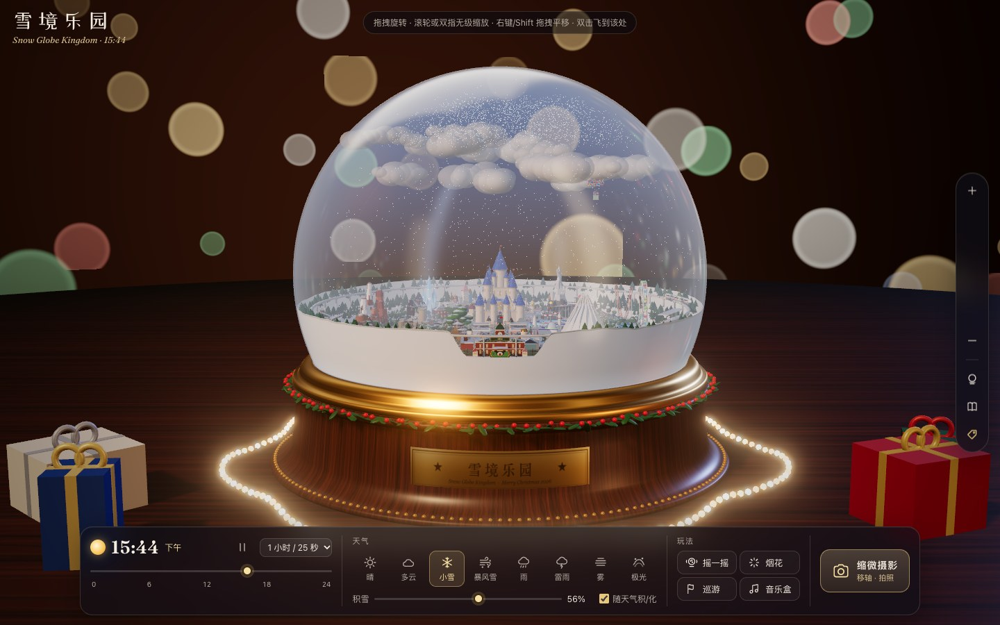
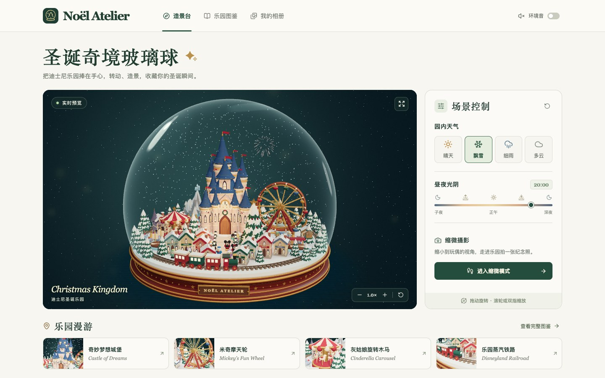

At the same 1440×900 viewport, Snowglobe occupies the whole browser with a warm room, presents, light strings, a walnut/brass music box and a large glass shell. It conveys a physical Christmas object and a large world to explore. Its low default viewpoint, high snowy rim, substantial empty sky and large background bokeh make the actual park read small and partly hidden. Richness becomes clear after zooming rather than immediately.

Noël has a cream/green studio interface and a smaller 890×522 live canvas. A tall, clearly articulated castle, wheel, village and train form a readable composition at first glance. The globe is more immediately shareable as a finished miniature ornament. The trade-off is a compressed park with less spatial breathing room and some close-up occlusion. This judgment concerns default composition, not proof that one has better geometry in every view.

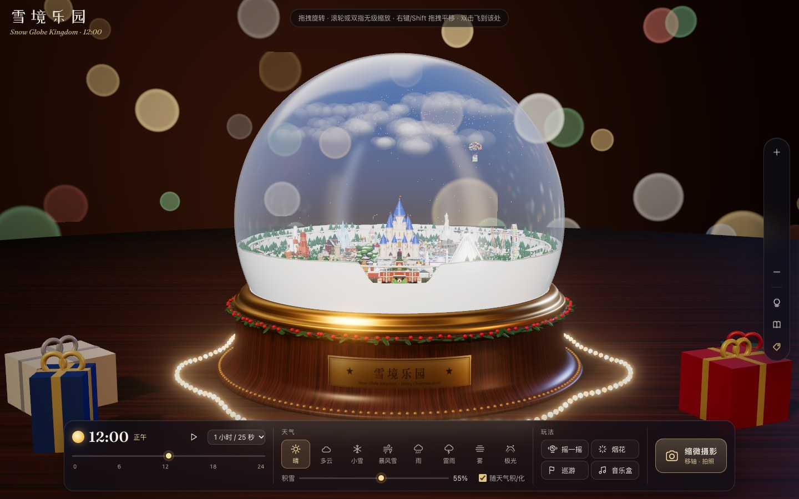
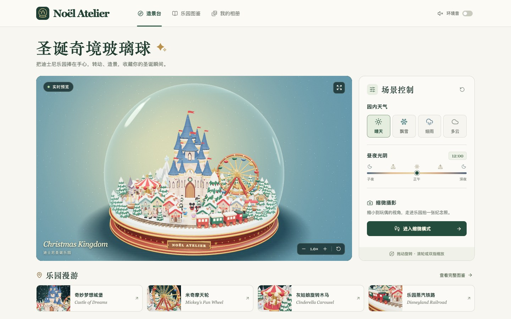

Both change illumination and sky with time. Noël keeps its night park strongly lit; dawn/evening differences are subtle in the sampled default views. This favors legibility over dramatic day/night contrast, rather than making the time control nonfunctional. Snowglobe offers more atmospheric systems, including gradual snow/wetness and aurora/storm presets; Noël offers a narrower, consistent toy aesthetic. Neither is physically faithful glass/meteorology or an exact reconstruction of a real Disney park. Primitive-based characters remain stylized in both.

### Characters, attractions and navigation

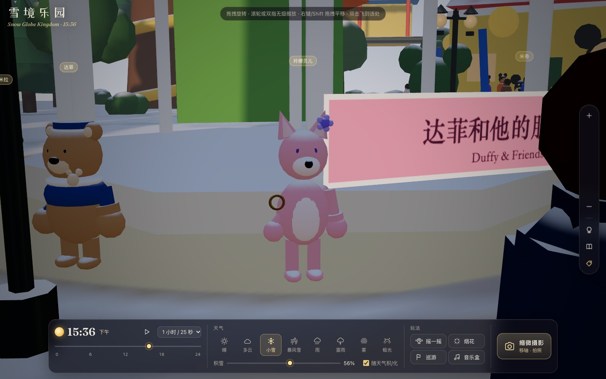
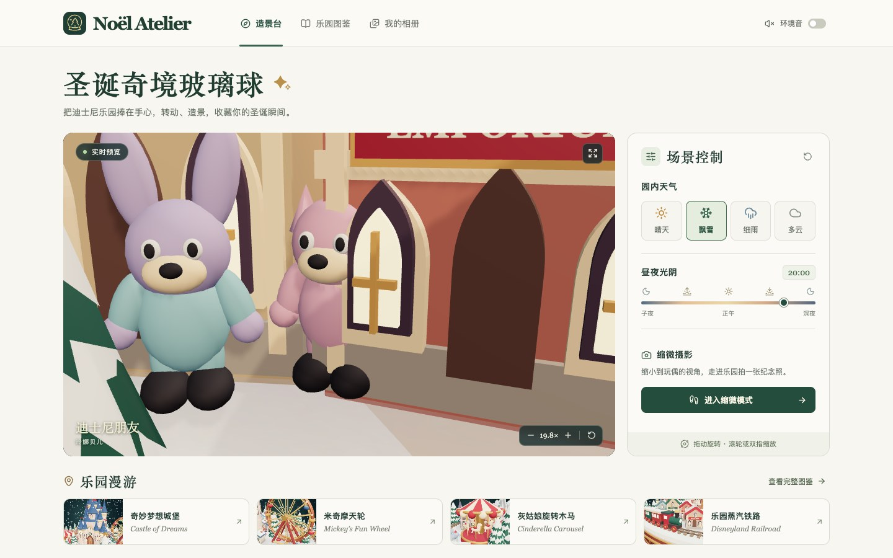

Both implement recognizable mouse ears, costume colors and animal silhouettes rather than merely putting names on empty locations. LinaBell is visibly modeled in both; Snowglobe's settled view places her clearly by the Duffy gazebo, whereas Noël's selected view places part of her behind foreground architecture beside StellaLou. Counts do not establish character likeness across the entire roster. Shared body families and color variants are used by both implementations.

Snowglobe's larger layout, visitors, multiple ride systems, rails and parade create a stronger sense of a functioning park. Its guide supports bilingual name search and following moving subjects. Noël uses a compact mixed layout, themed filtering, a searchable dialog and four prominent preview shortcuts. It emphasizes quick discovery and attractive architectural silhouettes. Neither ships the interiors or full ride experiences of the named attractions; many are exterior miniatures or symbolic representations.

Claude sampled 12 aligned subject categories: castle, wheel, teacups, mine coaster, space ride, small-world attraction, Mickey, Minnie, Elsa, Woody, LinaBell and Stitch. Claude judged Snowglobe's subject clear in 11 views, with Stitch behind a tree; for Noël, 4 views were materially obstructed or inside geometry (mine coaster, small world, teacups and Minnie), with LinaBell additionally partly overlapped. These are subjective visibility classifications on a purposive sample, not full-catalog pass rates. Codex independently reproduced the mine-coaster and small-world problems after waiting 5 s at the final camera pose. Snowglobe's desktop guide also remains open after selection and covers part of the view, whereas Noël closes its dialog.


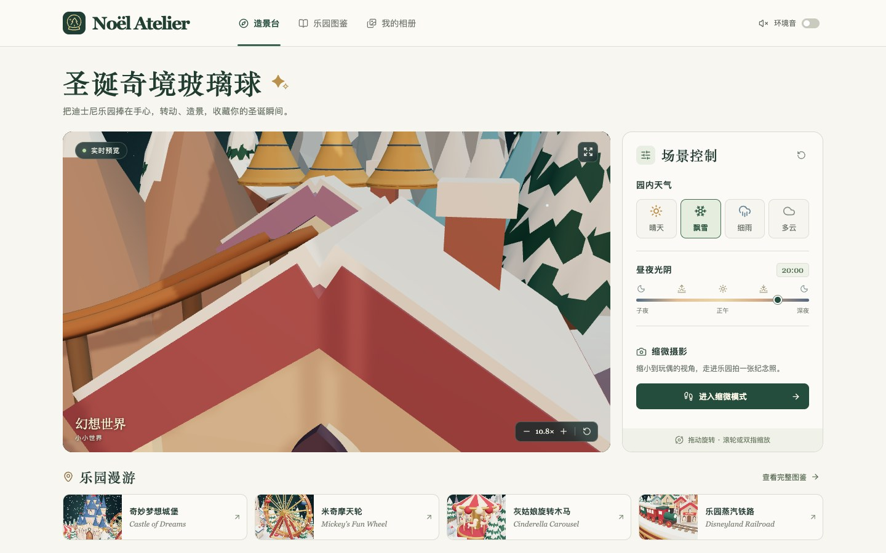

Using home distance / current distance as a zoom indicator, Snowglobe's 1440×900 home distance of 760 and code limits 1700–1.6 correspond to about 0.45×–475×. Claude observed Noël's indicator from 0.5× to 27.8× in its wheel sequence. The former is derived from control bounds; the latter is an observed sequence, not a guaranteed hard limit. Zoom-to-cursor versus zoom-to-target also changes the experience; neither number measures model quality.

Follow-up show checks confirmed Snowglobe's parade floats on Main Street after 28 s and Noël's small white fireworks in a night overview burst sequence. Noël's fireworks-guide framing missed the burst area; its parade was present in code but remained visually unconfirmed in the reviewer captures. That uncertainty is retained, not converted into a claim that the parade is unimplemented. Snowglobe's running fireworks can continue after setting daylight; its already-running parade button does not reframe the camera. These are low-level show-state/framing limitations, separate from startup or download failures.


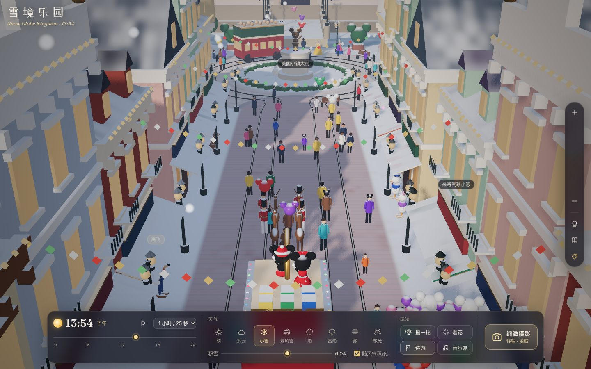
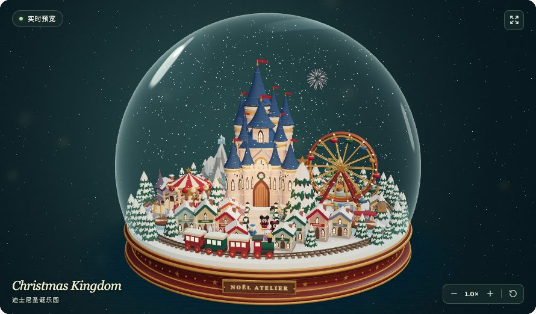

### Two meanings of miniature

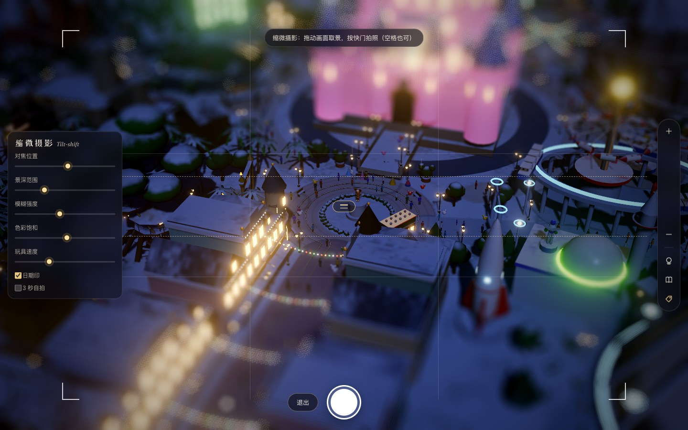
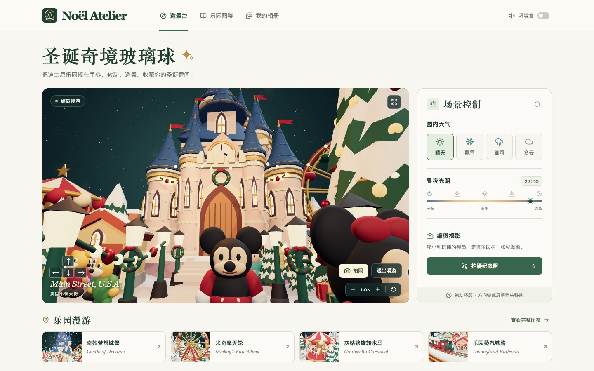

Snowglobe implements a real adjustable screen-space blur band, stronger grading and accelerated toy motion. The band is not an optically accurate depth-of-field simulation; subjects outside it blur even when at similar world depth. Controls allow deliberate miniature compositions, but default blur can hide architecture and the settings cover part of the frame. The date imprint is a decorative fixed Christmas date, not capture-date evidence.

Noël puts the camera at toy height with direct walking and looking. Mickey/Minnie and the castle are immediately tangible, and the photo is a clean renderer capture. There is no tilt-shift lens control. Movement is bounded by the park radius but has no building/character collision system in the inspected code; this is a simple fly/walk toy, not a navigable physical simulation.

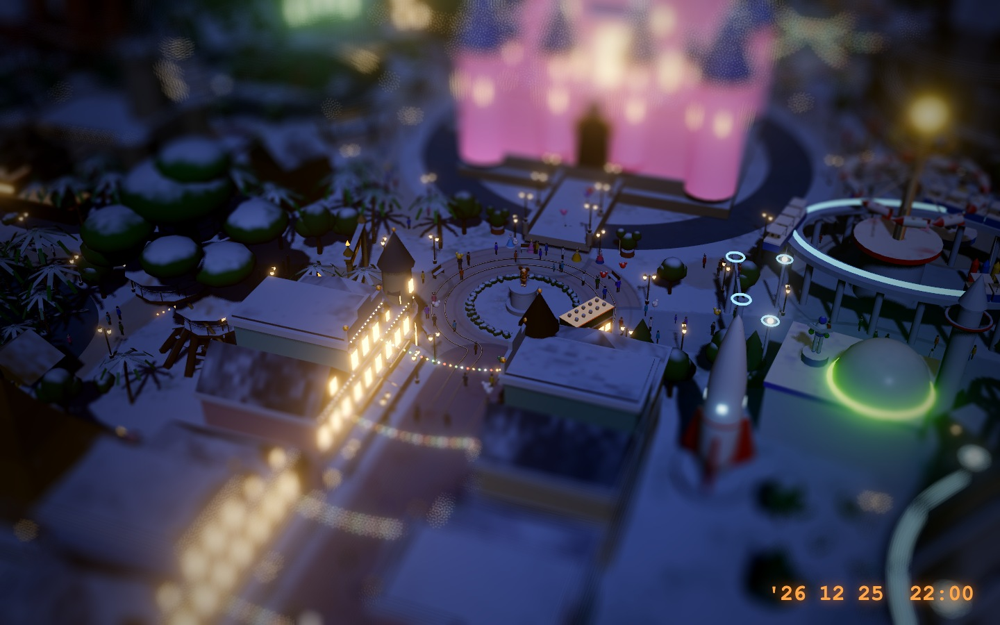
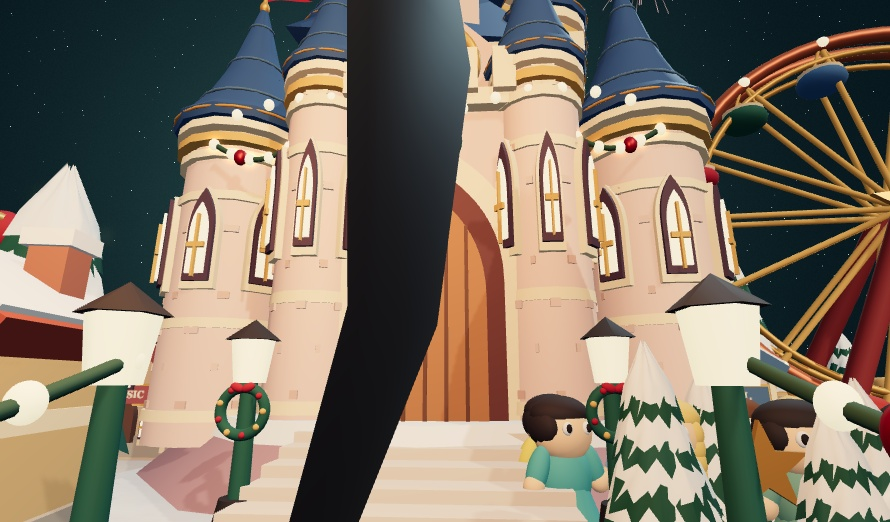

Both photos exclude the HTML control panels. Snowglobe captures after the next rendered frame and adds its date stamp to a 2D canvas. Noël renders on demand before encoding and stores the data URL plus title/time in IndexedDB. The actual desktop downloads were 225934 and 168035 bytes respectively; these animated captures are examples, not compression benchmarks. Neither requires a backend for photo capture.

### Portrait experience

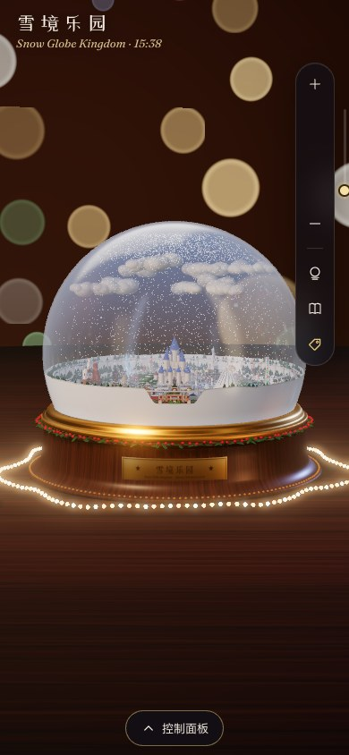
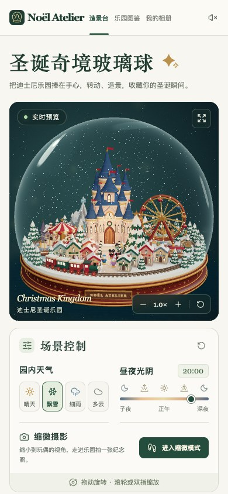
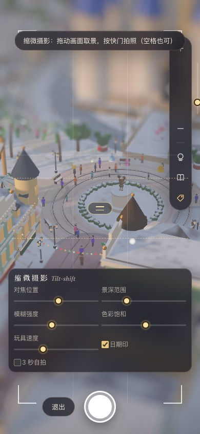
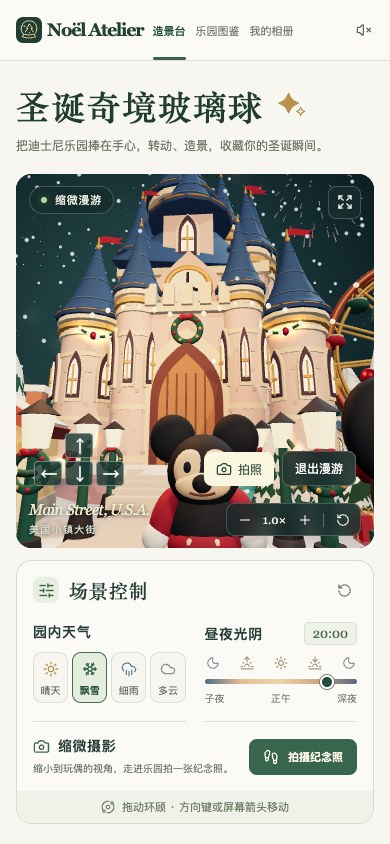

At 390×844 both fit the page width and complete actual photo downloads through visible controls. Snowglobe starts its control panel collapsed, preserving the view; opening controls or miniature settings consumes substantial space. Its default globe also leaves much vertical room unused. Noël preserves a readable small globe above stacked controls in a scrollable page; the miniature canvas is only about 358×374 CSS pixels. Dense controls and short touch targets remain limitations. These are desktop-browser viewport checks; real touch ergonomics, battery, phone GPU and iOS behavior are unmeasured.

### Defects and limitations

Severity here means impact on this toy's usage, not a formal security severity. “Static” findings were identified from source and are not measured failures.

| Finding | Artifact / severity | Evidence and reproduction | Consequence / suggested action |
|---|---|---|---|
| Labels block wheel zoom | Snowglobe / moderate, independently reproduced by both reviewers | At 1440×900, paused noon, wheel −260 every 300 ms at (720,495). Distance stalls at 111.421291 on the tree label. Moving to (40,450), a canvas pixel, and wheeling again reduces distance to 76.005987. Wheel handler is on canvas; interactive `.lbl` overlays receive the input instead. | Forward wheel/pointer interaction appropriately or delegate controls to the container. The UI rail or moving the pointer provides a workaround. |
| Guide landing frames hide the subject | Noël / moderate; Snowglobe / low, sampled | Noël has 4 materially poor views among the 12-category sample; Codex independently confirmed 2. Snowglobe's Stitch is behind a tree, and its desktop drawer overlaps the view. | Validate camera visibility, store subject-specific poses and make the drawer easy to dismiss. Not evidence that all guide entries fail. |
| Extreme zoom can enter geometry | Both / low, reproduced by Claude | Snowglobe's extreme zoom yields a flat wall, Noël's a castle wall; source does not implement obstacle-aware orbit zoom. | Add a near-surface limit if interior exploration is not intended. This is distinct from a bad predefined guide landing. |
| Space hijacks a focused action button | Snowglobe / low–moderate, reproduced | Focus `#miniBtn`, press Space: miniature remains false and shake timer starts. [UI key handler](https://github.com/leoli-dev/snowglobe-park/blob/2eee3d5c4110dde4a351b758975f480594875684/src/ui/ui.js#L222) excludes text fields but not buttons/ranges. Noël enters miniature normally. | Respect native control activation; users can currently use Enter or pointer. |
| Photos disappear after reload | Snowglobe / product limitation, reproduced | Photo array lives only in [Photo](https://github.com/leoli-dev/snowglobe-park/blob/2eee3d5c4110dde4a351b758975f480594875684/src/ui/photo.js#L13); tested count becomes 0. | Add persistent storage or clearly label session-only storage. Download before leaving. |
| Captured blobs and object URLs are retained without an album limit or revocation | Snowglobe / low, static retention risk | Each capture appends a blob and `URL.createObjectURL`; only 10 thumbnails are shown, the underlying array is unbounded. | Add deletion/cap and revoke removed URLs. Long-session heap growth was not measured. |
| No global animation pause/reduced-motion handling | Both / accessibility limitation, static | Snowglobe only suppresses CSS motion. Noël reads reduced-motion in `shows.js` to disable fireworks, but other continuous scene motion remains active. Snowglobe's pause stops clock progression, not the whole scene. | Add an explicit scene-motion pause and honor the preference in JS. No WCAG certification is claimed. |
| Miniature traversal can pass through scene objects | Noël / scope limitation, static | [Scene movement](https://github.com/leoli-dev/noel-globe/blob/239e9bba12bb20a01513e7a9189d422905ed1232/src/scene.js#L470) clamps radius and moves camera; no collision solver. | Add simple bounds around key structures if physical walking is intended. |
| No shipped assertion-based tests | Both / engineering gap | Neither package defines a test script or includes a test suite. Snowglobe ships screenshot/geometry tools; Noël includes a test-driver dependency without a rerunnable QA suite. | Add high-value photo/persistence, focus and resize smoke checks. Reviewer scripts are separate evidence, not original deliverables. |
| External fonts and bundle warning | Snowglobe / offline typography limit; Noël / build advisory | Offline Snowglobe attempts Google Fonts but renders with fallback; Noël clean build warns about a JS chunk larger than 500 kB. | Both still start offline; these are not startup failures. |

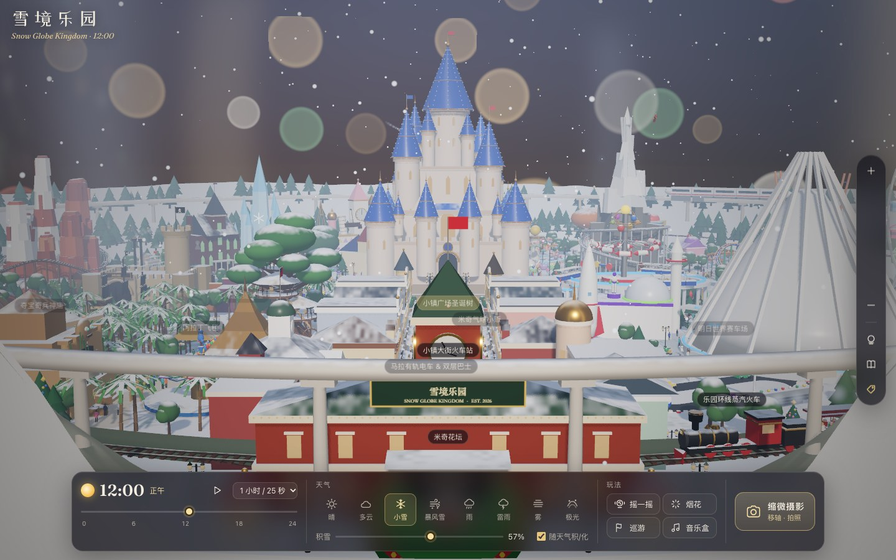

No blocking startup or photo-download defect was found under the tested desktop/portrait conditions. That does not certify every feature, device or future long session.

## Performance and measurement

### Builds, size and stability

| Measurement | Snowglobe | Noël |
|---|---|---|
| Clean lockfile install / production build | Pass / pass | Pass / pass, with chunk-size warning |
| Built standalone HTML, bytes | 1063950 | 845285 |
| gzip of standalone HTML, bytes | 297357 | 289544 |
| Source JS files / physical lines | 38 / 8323 | 9 / 3258 |
| Local readiness, ms, single samples (Codex / Claude) | 659 / 540 | 1749 / 459 |
| Default canvas pixels, DPR 1 | 1440×900 | 890×522 |
| Default rAF FPS, 3 s sample | 60.00 | 60.00 |
| Default p95 frame interval, ms | 16.70 | 16.80 |
| Default intervals above 33.34 ms | 0 | 0 |
| Functional page errors / console warnings | 0 / 0 | 0 / 0 |
| Offline `file://` startup | Pass; external font request fails | Pass; no failed request observed |
| WebGL2-disabled startup | Readable fallback | Readable fallback |

Build times in logs are local packaging observations and are not model generation speed. The reviewers’ single readiness samples give opposite orderings, include browser/application startup and external-font behavior, and are not a reliable startup ranking. Readiness was `SG.ready` / `body.ready` for Snowglobe and `#loading.hidden` for Noël. Default frame rates are vsync-capped, and canvas sizes differ by about 2.8× in pixel area; this table does not prove equal rendering cost.

For bounded resource stability, an observer wrapped WebGL2 create/delete APIs, warmed 8 weather/time cycles, ran 20 further cycles, then resized through 6 viewport widths. Live counts stayed unchanged across the last three checkpoints:

| Live WebGL resource | Snowglobe | Noël |
|---|---|---|
| Buffer | 1736 | 1263 |
| Texture | 49 | 35 |
| Program | 101 | 26 |
| Framebuffer | 62 | 40 |
| Renderbuffer | 6 | 0 |

No unhandled page error occurred during this stress run. These are live GL object counts, not GPU memory bytes; no general leak-free claim follows. The loop does not exercise unlimited photographs or all guide entries. Snowglobe's camera values were additionally finite; Noël exposes no camera debug handle, so that particular internal assertion was not applied to Noël.

### Equal-canvas throughput

After Claude closed the visual-test browser, Codex ran **ABBA×2**, four fresh-page samples per artifact, sequentially on the same evaluation host. Viewport and actual drawing buffer were **1280×800, DPR 1** for both. Noël's stage was temporarily made full-viewport with observer CSS after weather/time were set; this is a synthetic size-normalization test, not its delivered layout. Both used clear noon, 6.5 s settling, 1.5 s warm-up and a 4 s rAF interval sample. Browser flags disabled frame-rate/vsync limits.

| Artifact | Samples | Mean rAF FPS | Min–max FPS | Per-run p95 interval, ms |
|---|---|---|---|---|
| Snowglobe | 4 | 445.43 | 430.44–470.79 | 3.60 / 3.60 / 3.20 / 3.40 |
| Noël | 4 | 540.22 | 520.44–575.99 | 3.30 / 3.10 / 3.40 / 3.40 |

Noël's mean was **1.21×** Snowglobe's in this specific clear-noon scene. These are uncapped **rAF throughput estimates**, not GPU timestamp measurements or observed 540 FPS display output. Both already met the default 60 FPS sample. Work differs: Snowglobe renders a larger park and the room, composites room/world/glass render passes with bloom, output and grade passes, and updates shadow maps every frame (its tilt-shift pass is off outside miniature mode); Noël uses its own scene and shadow-update strategy. Equal pixels do not equal equal visual work. No general model-efficiency or universal performance multiplier follows; storm, miniature mode, high DPR and phone throughput were not benchmarked.

The first performance attempt placed the synthetic full-screen layer before clicking Noël's controls, so the observer blocked its own click. Its log and single incomplete Snowglobe sample are retained as observer error and excluded from this table. The corrected **complete** ABBA×2 was restarted from the beginning. See the raw performance and observer-error files in the bundle.

### What was not measured

There is no inference TTFT, prefill/decode throughput, cache warm/cold comparison, model token count, generation cost or reliable generation wall time. Browser frame intervals are not any of those metrics. GPU timestamp queries, CPU/GPU power, thermals over time and real-phone performance were not measured.

## Per-dimension judgment and joint conclusion

These are negotiated reviewer judgments, not measurements or a general model ranking.

| Dimension | Judgment | Basis |
|---|---|---|
| Core task | Snowglobe leads in breadth; Noël leads in immediate park legibility | More weather/time systems, a larger inventory and adjustable tilt-shift versus a compact readable ornament. Neither establishes exhaustive coverage. |
| Default / close-up visuals | Trade-off | Noël has a clearer default composition and stronger page polish; Snowglobe has a more immersive physical setting, night atmosphere and larger explorable world. Close-up focus has defects in both, more material in the sampled Noël guide views. |
| Interaction and photos | Trade-off | Snowglobe has richer controls and lens settings but label-wheel/keyboard defects; Noël has simpler controls, street walking and persistent photos. |
| Stability and performance | Both passed bounded stability; Noël ahead in the specific equal-canvas throughput run | No page errors or growing GL counts in the tested loop; mean uncapped rAF throughput 1.21× in one normalized clear-noon workload, not a universal multiplier. |
| Engineering / accessibility | Mixed | Snowglobe ships capture tooling and a modular simulation; Noël has native dialogs, a persistent album and third-party notices. Both lack assertion suites and complete motion controls. |

**Choose Noël for an immediately readable, polished shareable globe and a photo album that survives reload. Choose Snowglobe for a larger park sandbox, broader weather/day-night controls, dramatic atmosphere and adjustable tilt-shift photography.** Snowglobe's label-wheel and keyboard handling should be fixed; Noël's guide camera poses need attention. Both interpretations of miniature are valid under the supplied brief. No overall numerical champion is assigned, because that would require weights the task never specified.

Claude initially categorized Noël's lack of tilt-shift and small canvas as deficiencies; discussion reclassified them as explicit implementation trade-offs. Claude rated the Space issue moderate, Codex low; the final label is low–moderate depending on keyboard reliance. The report distinguishes a weak visual effect from a nonfunctional control, and a missed screenshot from an absent feature. These reconciliations are preserved in the joint record.

## Limits, observer corrections and publication provenance

- One delivered snapshot per model and one task. No repeated generation, matched budget, normalized tools or human visual panel. The effort settings differ and are not equivalent units.
- The broad “every attraction/character” demand has no finite acceptance list. Counts and representative checks support breadth, not exhaustiveness, licensed accuracy or complete park simulation.
- Known creator/model-family conflicts remain. Agreement between these two AI reviewers is not independent human acceptance.
- Browser coverage is Thorium on one Mac. No Safari, Firefox, actual iOS/Android, low-end GPU or touch-device validation. Portrait and offline tests use desktop browser contexts.
- The first observer harness mistakenly counted Snowglobe `.poi` elements, producing 0/0. Actual selector correction gives 60/82. Original JSON and correction JSON are both preserved; the zero counts are not candidate failures.
- An initial mobile follow-up timed out trying to click a control inside Snowglobe's intentionally collapsed dock. The corrected test opened the panel normally and completed the photo download. The original failure log remains labeled as observer error.
- An initial LinaBell screenshot at 1.8 s caught Snowglobe's camera in flight, in front of the castle. A 5 s recheck showed the character clearly, `flight=null`, and the center ray first hit the character mesh. This is not an occlusion defect. Only the settled figure is used for character judgment. Clear-weather figures were also retaken after a 6.5 s settling period.
- Product code stayed in its own pinned public repositories. The archive contains report text, unchanged screenshot copies, selected measurement files, small observer scripts and an evidence ZIP. Local absolute paths in published observer scripts/logs are generalized and the battery identifier is omitted; original literal Chinese task and code evidence retain their language. Numbers and figures are not redrawn to alter outcomes.
- Full original message histories were read only for relevant provenance and are not published. No credentials, private endpoints, complete personal sessions, dependencies, weights or runtime caches are included. No artifact source edits were made to “fix” review findings.

## Evidence and reproduction

- [Structured environment and artifact hashes](../../assets/cloud-03/evidence/environment.json), [generation provenance](../../assets/cloud-03/evidence/generation-provenance.json), [joint review record](../../assets/cloud-03/evidence/consensus.md).
- [Complete selected evidence bundle](../../assets/cloud-03/cloud-03-evidence.zip), [SHA256 manifest](../../assets/cloud-03/evidence-manifest.json). Includes independent notes, functional/raw correction results, build/install logs, GL stress and performance scripts/results, live-page verification and source figure hashes. Full candidate code is retrieved from the pinned repositories.
- To reproduce, export the pinned commits to separate directories, run `npm ci --ignore-scripts && npm run build` in each, serve the scratch parent locally, and use Thorium with the included observer scripts. The bundle README explains portable dependency/browser-path configuration and the intentional synthetic full-canvas performance setup.
- Report publication verification is distinct from model evaluation; [publication-checks](../../docs/publication-checks.md) records archive build, bilingual pairing, downloads, images and repository-subpath reader checks.
