# 同一圣诞玻璃球任务，两种交付世界：雪境乐园与 Noël Atelier

[English](2026-11-20-snowglobe-park-vs-noel-globe.md) | [简体中文](2026-11-20-snowglobe-park-vs-noel-globe_CN.md)

评测日期：2026-11-20，America/Toronto（UTC−5）。归档编号：CLOUD-03。日期表示本次作品评测开始日；原始生成开始时间未独立确证。公开提交也在当天完成。

## 问题与成功标准

用户要求 Codex-mbp 与 Claude-mbp 联合评测两个公开实现：用 JavaScript 构建包含主题乐园的圣诞玻璃球，支持天气与昼夜控制、无级缩放、缩微拍照，要求完整的迪士尼乐园并提供可观看链接。

**本报告比较的是两份最终交付作品。** 两份 README 逐字保留同一段五行任务，但原始完整消息的开场不同；生成工具、思考档位、自修与发布整理没有保持一致。这不是受控的一次性模型基准。

在评审准备阶段、交换独立结论之前，双方约定从五方面评价：（1）核心需求，（2）默认与近景视觉，（3）交互及完整拍照流程，（4）稳定性与性能，（5）可复现性、可维护性和无障碍。这是作品评议维度，并非预注册评分实验。各维度给出领先与取舍，不设加权总分或伪精确数值。视觉判断具有主观性，未获得人类审美评分。

| 作品 | README 模型归属 | 档位 | 固定源码 | 观看链接 |
|---|---|---|---|---|
| 雪境乐园（`snowglobe-park`） | Claude Opus 5.5；原作者确认 `claude-opus-5-5` | max | [`2eee3d5`](https://github.com/leoli-dev/snowglobe-park/tree/2eee3d5c4110dde4a351b758975f480594875684) | [在线玻璃球](https://leoli-dev.github.io/snowglobe-park/) |
| Noël Atelier（`noel-globe`） | GPT-6.2-Astra；原始发布请求中由用户明确指定 | High | [`239e9bb`](https://github.com/leoli-dev/noel-globe/tree/239e9bba12bb20a01513e7a9189d422905ed1232) | [在线玻璃球](https://leoli-dev.github.io/noel-globe/) |

作品仓库名保持现状。这些仓库先于本次评测，未采用档案建议的 `llm-test-YYYY-MM-DD-{type}-{name}` 命名；本次没有改名，也没有把产品源码搬入报告仓库。

## 硬件、系统与固定条件

| 项目 | 实际配置与证据 |
|---|---|
| 推理位置 | 云端。Snowglobe 原作者确认使用 Anthropic API 推理。Noël 根据模型及代理记录归属 GPT 云服务，未直接观察推理主机。本地源码文件夹不构成推理主机证据。 |
| 推理主机硬件与系统 | 双方服务端 CPU/GPU、内存、架构、OS/build、服务修订：**未记录**。 |
| 生成模型与参数 | 如上所述，Opus `claude-opus-5-5` / max 对 GPT-6.2-Astra / High。准确服务修订、上下文与输出上限、采样、并发请求、KV/前缀缓存和量化：**未记录**。两个 effort 标签不是校准过的等价尺度。 |
| 生成客户端与代理 | Snowglobe：Orca Claude Agent SDK / Claude Code 会话；原作者报告会话环境为 `darwin`、`Darwin 27.2.0`，无 build 号。Noël：Orca Codex 会话；所检查消息中没有生成时客户端 OS/build。生成时准确代理/SDK 版本和历史硬件配置：**未记录**。 |
| 评测主机 | MacBook Pro，Apple M5 Max，18 核 CPU、40 核 GPU、128 GiB 统一内存（`137438953472` 字节），arm64。这些是本次评测的当前观测，不回填历史生成条件。 |
| 实验时系统 | 评测：macOS 27.2，build 26B123，arm64；于 2026-11-20T13:57:06Z 用 `sw_vers`、`uname`、`sysctl` 采集。证据：[environment.json](../../assets/cloud-03/evidence/environment.json)。 |
| 供电与温度证据 | 接交流电，电池 100%；`pmset -g therm` 未报告已记录的温度/性能警告。没有持续温度/功耗遥测，未隔离背景负载。 |
| 浏览器与自动化 | Thorium 156.0.8078.28，无头模式，ANGLE Metal / Apple M5 Max。Playwright-core 1.65.1 仅作驱动库，通过可执行文件路径明确选择 Thorium。未使用 Google Chrome 或其 channel。 |
| 运行时与依赖 | Node v22.23.1 / npm 10.9.8；双方 Three.js 0.187.0。Snowglobe：esbuild 0.28.2。Noël：Vite 8.3.8 / Lucide 1.76.0。版本与锁文件 SHA256 见环境证据。 |
| 视口 | 功能/视觉：1440×900，DPR 1。竖屏：390×844 浏览器视口，另有尺寸切换压力测试。未测真实手机硬件。性能条件在下文单列。 |

带日期的[工作站参考](../../environment_CN.md)是独立历史文档。本报告自行记录环境，不静默更新早期报告或替换它们的 OS 版本。

## 任务与生成来源

两份固定 README 都包含以下原语言任务。文本使用 UTF-8 并保留一个末尾换行，两份 SHA256 均为 `f208903be06a3b179ae920dabbfd773876a27c32be23104cf7126dccb45be062`：

```
用 js 来构建一个 3D 圣诞玻璃球
玻璃球里面的天气状况可以通过UI控制，昼夜光阴也可以控制
玻璃球内有一个完整的迪士尼乐园，可以无级放大缩小观察，可以进入缩微模式拍照
迪士尼乐园该有的项目、人物一个不能少
做好了给我一个可以看的link
```

### “相同 prompt”能证明什么

Snowglobe 原作者在本次评审中提供了任务相关说明：原始首行包含创建子文件夹的要求。Codex 只读检查了 Noël 的原始 Orca 消息历史；返回完整消息列表，但没有获得完整工具执行正文。Noël 也有相同的文件夹要求，并额外加了一句能力展示的开场：

```
Snowglobe original task first line:
在本folder下新建一子文件夹，在里面用 js 来构建一个 3D 圣诞玻璃球

Noël additional opening:
听说你3D建模能力很厉害，来给我展示一个DEMO

Noël original task first line:
在本folder下新建一子文件夹，在里面用 js 来构建一个 3D 圣诞玻璃球
```

其余四行任务相同。后续用户请求指定了缩短后的 README 写法，并要求 GitHub/Pages 公开发布。因此，**任务正文与 README prompt 相同，完整对话输入及执行条件不同**；隐藏指令、上下文、工具与技能没有统一。

Snowglobe 原作者报告，初始构建过程中没有用户插话，模型自行多次截图、调试和重建。后续发布轮将达菲一家从门柱附近挪开，并补充 metadata/favicon、服务/配图工具和发布文档；使用了 Artifact 发布/下载能力及一次自动设计 hook。这些是被评快照中的模型/代理改动，不是评审者为提高成绩而修源码。

Noël 消息描述了迭代建模、Thorium 截图、拍照/下载/离线检查，以香港迪士尼八个主题区为骨架的混合乐园，以及随后公开发布。历史中存在失败的 shell 工具状态。由于工具正文未完整审计，本报告不声称一次成功、不统计准确修复次数或生成失败率。所检查消息中未出现用户修改源码；准确技能版本及完整执行轨迹不可得。

双方均缺乏可靠的生成墙钟时间、token 用量与成本证据。文件 mtime 和提交时间不是推理延迟。本次没有重跑模型生成。[生成来源记录](../../assets/cloud-03/evidence/generation-provenance.json)区分了直接查看的消息和原作者自述。

## 联合评审过程与利益冲突

1. 固定两个公开 HEAD 提交，用 `git archive` 导出临时副本测试。原候选仓库始终干净；本次没有修复候选源码。
2. 初次冒烟通过临时目录内的软链接复用已有依赖；随后双方均从锁文件独立执行 `npm ci --ignore-scripts` 并成功重建。干净构建与线上 Pages HTML 逐字节一致。
3. Codex 在阅读 Claude 评议前写下独立观察；Claude 也先检查同一快照再读 Codex 结论。README 已暴露模型身份，因此不是盲评。
4. Claude-mbp 正是 Snowglobe 的原始构建代理，存在直接创作者利益冲突，而不只是同属 Claude 模型家族。Codex-mbp 属于 GPT 模型家族，Noël 来自另一个 Codex 会话。独立笔记和可复现检查能降低偏差，不能消除偏差。
5. 双方交换发现并核对。观察脚本错误、分歧及证据边界均保留；没有为提高分数而改候选作品。

公开证据包包含任务相关来源、独立评议和共识记录，不包含完整私人会话、代理凭据或本地服务标识。

## 结果与证据

### 核心任务与范围

| 需求/检查 | Snowglobe | Noël | 解释 |
|---|---|---|---|
| JavaScript 实时 3D 玻璃球 | 通过：Three.js 场景、房间、玻璃与园区 | 通过：Three.js 场景、玻璃与紧凑园区 | 双方都是真实渲染场景，不是用截图冒充 3D。 |
| 天气 UI | 8 种：晴、多云、小雪、暴风雪、雨、雷雨、雾、极光 | 4 种：晴、雪、雨、多云 | 已操作所有天气按钮。预设更多体现范围优势，不证明气象模拟真实。 |
| 昼夜控制 | 分钟滑杆、自动时间流逝、速度及暂停；定时演出 | 分钟滑杆；选定时间保持不变；夜间烟花 | 双方均满足明确的手动控制要求；自动流逝属于额外功能。 |
| 园区图鉴 | 60 个景点/组合条目，82 个人物条目 | 47 个景点/设施/演出条目，62 个具名角色条目 | UI 数量与 README 相符。口径含组合、演出及变体，不能当作完全独立的游乐设施或独立可辨认模型数量横比。 |
| 无级缩放 | 滚轮/捏合实现和 UI 滑轨、平移、双击飞行、图鉴定位/跟随 | OrbitControls 滚轮/捏合实现、缩放按钮、图鉴定位与复位 | 已测桌面滚轮与控件；触控/捏合代码已检查，未在真机验证。 |
| 缩微拍照 | 可调移轴对焦/范围/模糊/饱和度/玩具速度、自拍与装饰日期印 | 第一人称街景、WASD/方向键及屏幕移动按钮、JPEG 拍摄 | prompt 未定义“缩微”，两种解释均合理。Noël 无移轴处理；Snowglobe 无同等专用第一人称步行模式。 |
| 照片查看/下载 | 通过；所测桌面 DPR 1 下 JPEG 1440×900 | 通过；所测默认桌面画布 JPEG 890×522 | 已实际查看图像内容。尺寸跟随渲染画布，并非统一导出分辨率。 |
| 刷新后的相册 | 保留 0 张；仅会话内存相册 | IndexedDB 保留 1 张 | 持久化是 Noël 的额外产品优势，原任务未明确要求。 |
| 在线链接 | HTTP 200，可渲染，雨按钮有效 | HTTP 200，可渲染，雨按钮有效 | 线上 HTML 与各自干净固定构建相同。 |
| 字面“项目、人物一个不能少” | 未确立 | 未确立 | 未指定园区地点、日期或有限名单，双方均不能宣称覆盖现实完整全集。 |

计数已按真实 UI 选择器 `#guideList button.g-item` 和 `.catalog button` 更正。米奇、玲娜贝儿搜索与空结果状态均有效。Claude 还抽查了代表景点和人物的定位视角；具体范围及取景限制见下文。

### 默认视觉体验——主观判断

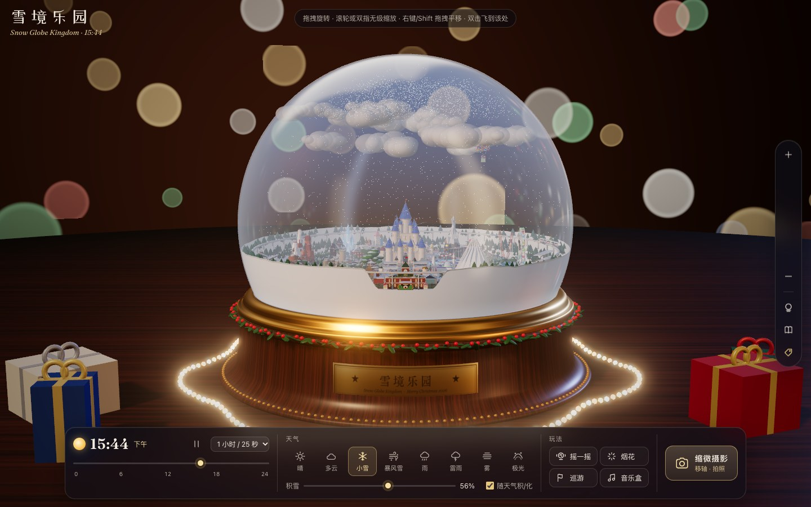
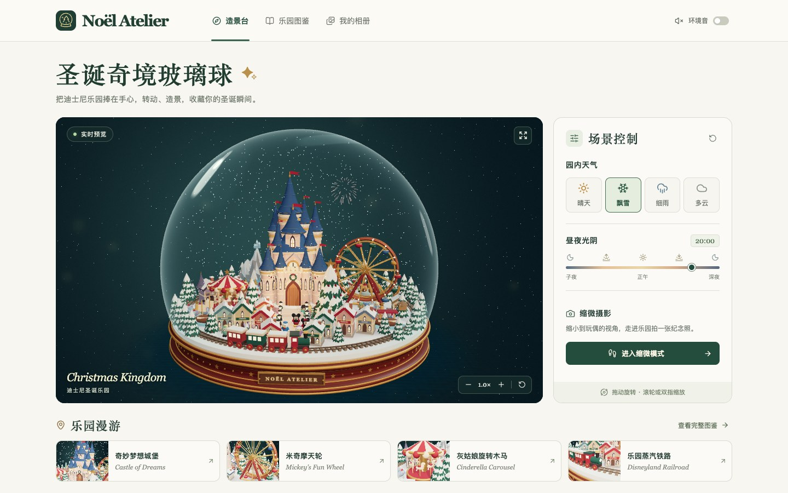

同为 1440×900 视口，Snowglobe 用暖色房间、礼物、灯串、胡桃木/黄铜音乐盒和大型玻璃外壳占据全屏，更像摆在桌上的圣诞实物，也更像一个可深入探索的大世界。默认机位偏低、积雪边沿较高、天空留白较多，加上巨大的背景散景光斑，实际园区显得较小且有遮挡；丰富度主要在放大后显现。

Noël 采用奶油白/深绿色造景台界面，实时画布较小，为 890×522。高大且轮廓明确的城堡、摩天轮、村庄与火车形成一眼可读的构图，更像可以直接分享的完整微缩摆件。代价是园区压缩，空间更拥挤，近景存在遮挡。这是默认构图判断，不表示一方在所有角度的几何质量都更好。

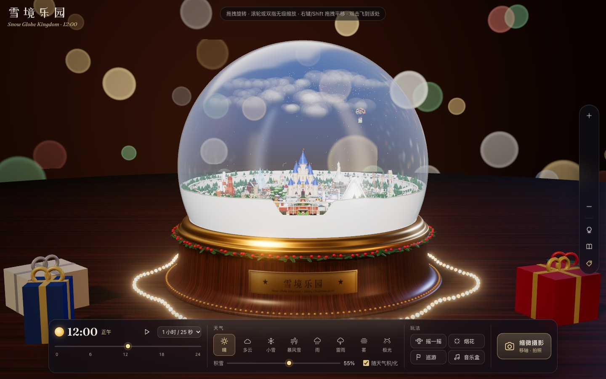
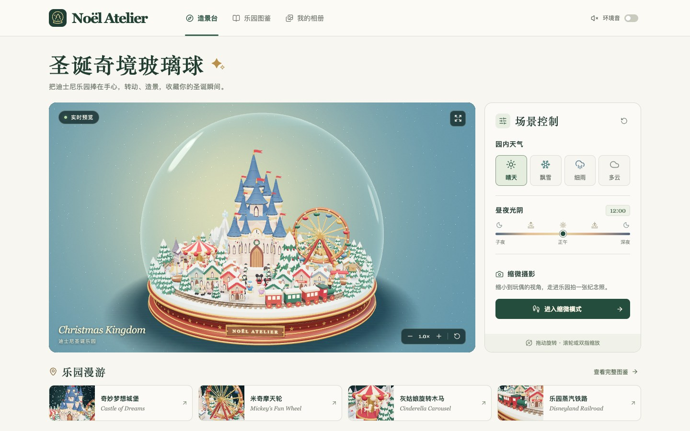

双方都能随时间改变光照和天空。Noël 夜间园区仍保持强照明，默认视角下所抽查的黎明/傍晚差异较弱；它偏重可读性而非戏剧性昼夜对比，不是时间控件失效。Snowglobe 提供更多氛围系统，包括渐变积雪/湿润、极光和雷雨；Noël 范围更窄，玩具审美更统一。双方均不是物理准确的玻璃/气象系统，也不是现实某座迪士尼乐园的精确复刻；人物均保持基础几何组成的风格化造型。

### 人物、设施与导航

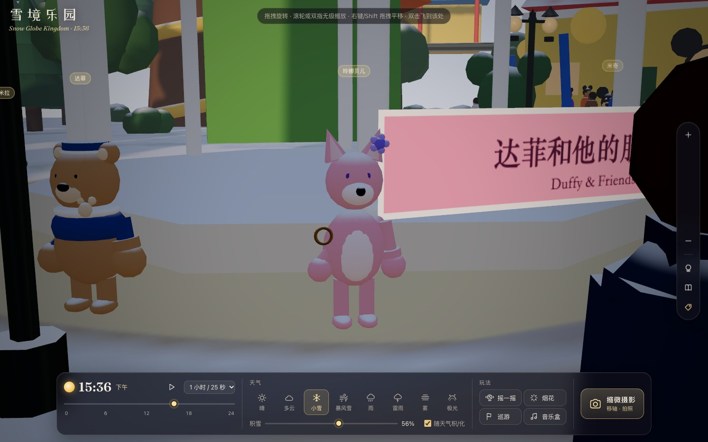
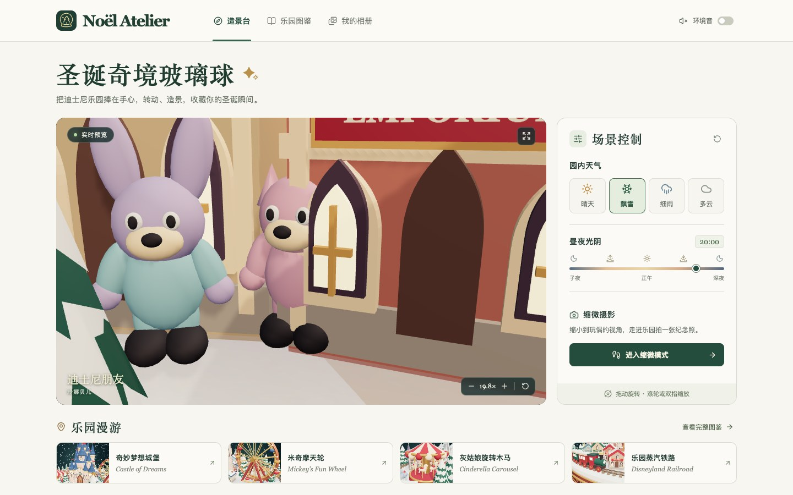

双方都实际绘制了可辨识的米奇耳朵、服装颜色和动物轮廓，并非只给空坐标挂名字。两边都能看到玲娜贝儿：Snowglobe 稳定视角中位于达菲凉亭前，Noël 定位视角中部分身体被前景建筑遮住，旁边可见星黛露。条目数不能证明整份名单的还原度；双方都复用了体型家族和配色变体。

Snowglobe 更大的布局、游客、多套游乐设施、轨道与巡游，较能营造一个持续运转的乐园；图鉴支持中英文名字搜索及移动主体跟随。Noël 使用紧凑混合布局、主题区筛选、搜索对话框和四个醒目的预览入口，强调快速发现与清晰建筑轮廓。双方均未实现所列项目的完整内部空间和实际乘坐体验；很多是外观微缩或象征性表示。

Claude 按 12 类对应主体抽样：城堡、摩天轮、茶杯、矿山过山车、太空类项目、小小世界、米奇、米妮、艾莎、胡迪、玲娜贝儿、史迪奇。Claude 判断 Snowglobe 有 11 个视角主体清楚，史迪奇被树挡；Noël 有 4 个视角严重遮挡或进入几何体（矿山车、小小世界、茶杯、米妮），另有玲娜贝儿局部重叠。这是有目的抽样下的主观可见性分类，不是全图鉴通过率。Codex 在最终机位等待 5 s 后独立复现了矿山车和小小世界问题。Snowglobe 桌面图鉴选中后还会保持展开并遮住部分画面，Noël 则关闭对话框。


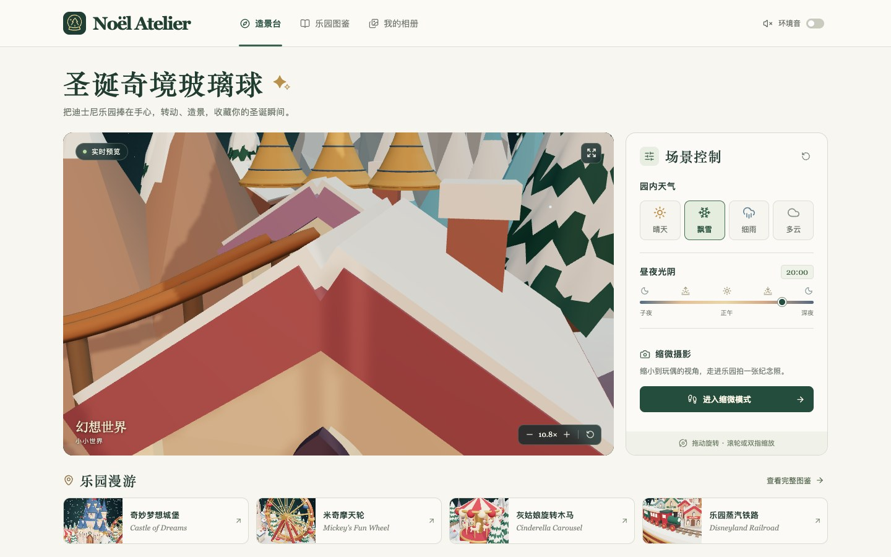

以“首页相机距离/当前距离”为缩放指示，Snowglobe 在 1440×900 下首页距离为 760，代码边界为 1700–1.6，约对应 0.45×–475×。Claude 在滚轮序列观察 Noël 指示从 0.5× 到 27.8×。前者来自控件边界推导，后者是实际序列观测，不是保证的硬上限；朝光标缩放与朝目标缩放的体验也不同，数字不衡量模型质量。

演出补测确认，Snowglobe 在 28 s 后可见大街花车；Noël 夜间全景连拍中确实有小型白色烟花。Noël 的烟花图鉴取景没有对准爆点区域；其巡游代码存在，但评审截图中仍未视觉确认。保留这一不确定性，不把它写成未实现。Snowglobe 已在运行的烟花会在拨回白天后继续，巡游已运行时按钮不重新取景；这是低级演出状态/取景限制，区别于启动或下载失败。


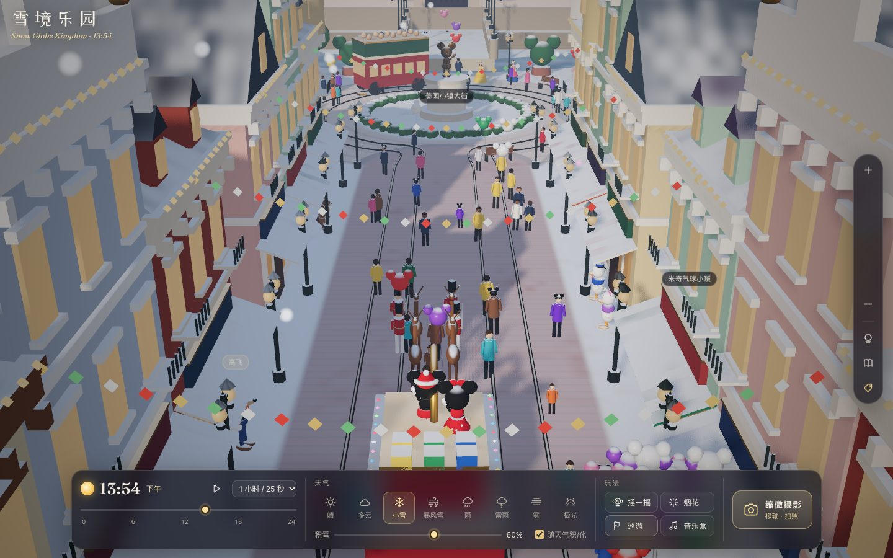
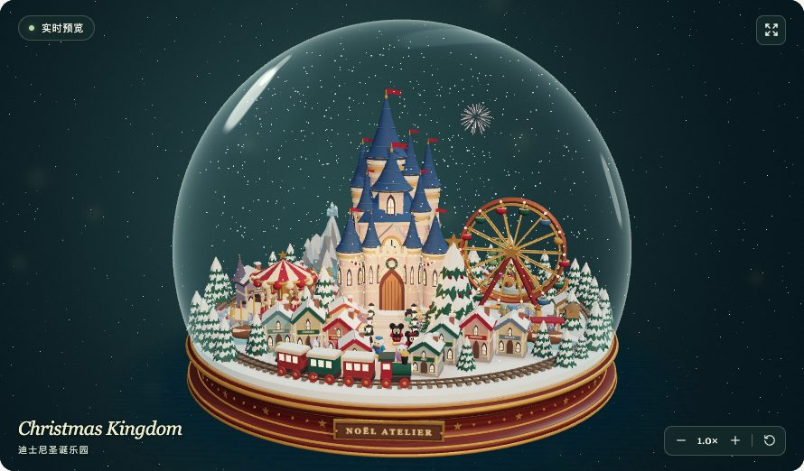

### 两种“缩微”解释

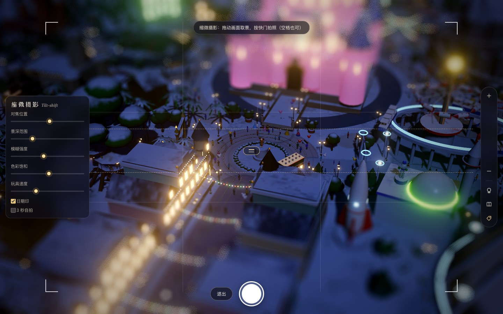
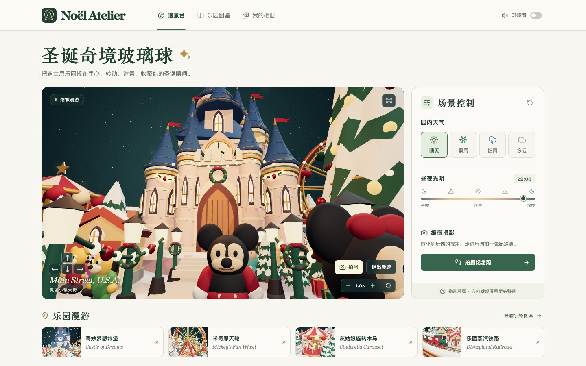

Snowglobe 实现了真正可调的屏幕空间模糊带、增强调色和加速玩具运动。它并非光学准确的景深：即使世界深度相近，落在清晰带外的主体也会被模糊。控件能帮助有意识地创作微缩构图，但默认模糊可能遮掉建筑细节，设置面板也占据部分画面。日期印是固定的圣诞装饰日期，不是拍摄日期证据。

Noël 将相机放在玩具身高处，可直接行走和环顾；米奇/米妮与城堡触手可及，照片是干净的渲染器截图。它没有移轴镜头控制。移动受到园区半径约束，但所检查代码没有建筑/角色碰撞系统；这是简化的漫游玩具，不是物理步行模拟。

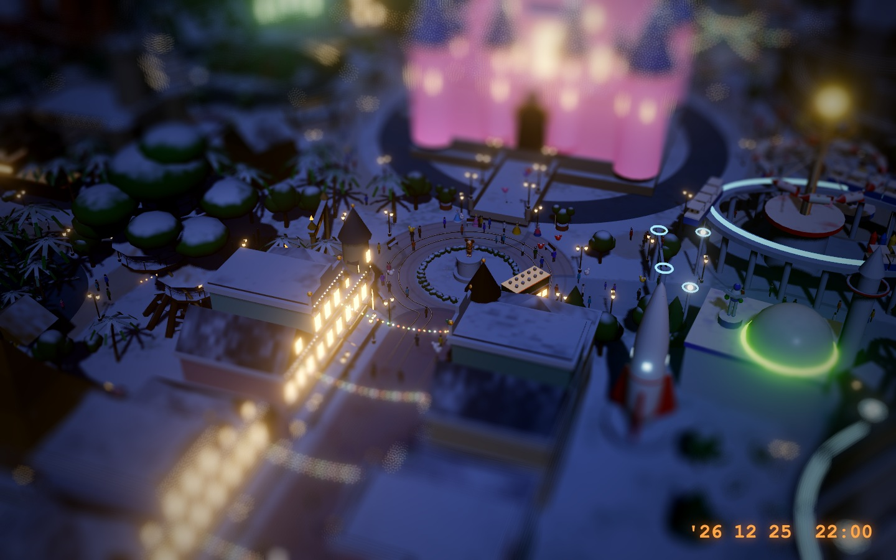
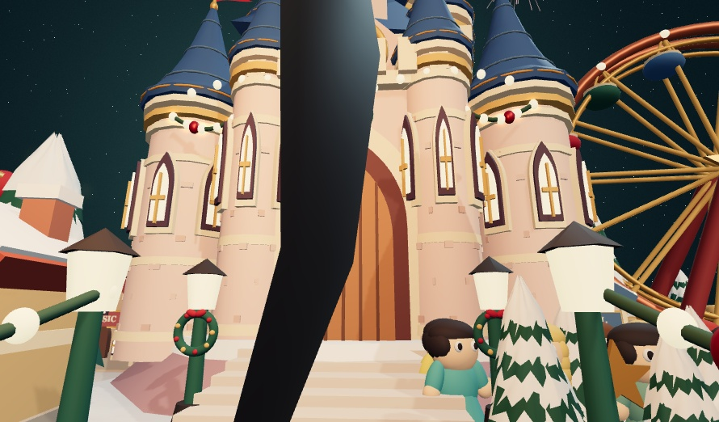

双方照片均不包含 HTML 控制面板。Snowglobe 在下一渲染帧后捕获，再在 2D canvas 上叠加日期；Noël 在编码前主动渲染，将 data URL 与标题/时间写入 IndexedDB。本次桌面实际下载分别为 225934 和 168035 字节；动画时刻不同，这些只是样片，不是压缩率基准。双方拍照都不需要后端。

### 竖屏体验


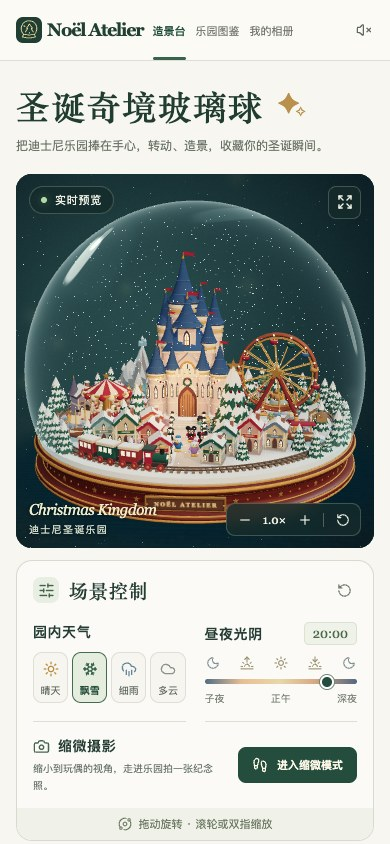
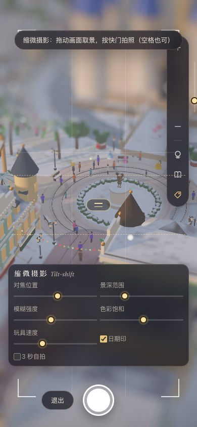
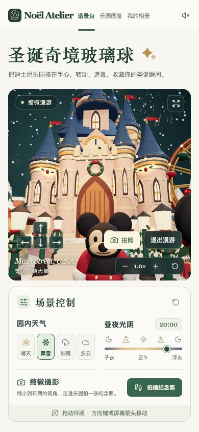

390×844 下双方均无页面横向溢出，可通过可见控件实际完成照片下载。Snowglobe 初始收起控制面板以保留视野；打开控件或缩微设置后会占据大量空间，默认玻璃球也留下较多纵向空白。Noël 在可滚动页面上方保留易读的小玻璃球，下方堆叠控制面板；缩微画布仅约 358×374 CSS 像素。控件密集和部分触摸目标偏矮仍是局限。这是桌面浏览器视口检查，未测真实触控手感、电池、手机 GPU 或 iOS 行为。

### 缺陷与限制

这里的严重性表示对玩具使用的影响，不是正式安全等级。“静态”表示来自源码检查，未当作实测失败。

| 发现 | 作品/严重性 | 证据与复现 | 影响/建议 |
|---|---|---|---|
| 名称标签阻断滚轮缩放 | Snowglobe / 中，双方独立复现 | 1440×900、暂停正午，在 (720,495) 每 300 ms 滚轮 −260。距离停在树标签处的 111.421291；移到 (40,450) 的 canvas 像素再滚动，降为 76.005987。滚轮处理绑在 canvas，交互 `.lbl` 覆盖层接收了输入。 | 正确转发滚轮/指针，或在容器代理相机输入；可临时移动光标或用 UI 滑轨绕过。 |
| 图鉴落点看不到主体 | Noël / 中；Snowglobe / 低，抽样 | Noël 在 12 类样本中有 4 个明显不良视角，Codex 独立确认其中 2 个。Snowglobe 的史迪奇被树挡，桌面抽屉还遮住画面。 | 检查相机可见性、保存专用机位，并方便关闭抽屉；不代表所有条目均失败。 |
| 极限缩放会进入几何体 | 双方 / 低，Claude 已复现 | Snowglobe 最远放大得到平墙，Noël 得到城堡墙；源码均未实现避障 orbit 缩放。 | 若不打算支持内部探索，可限制相机贴近表面的程度；与预设图鉴机位不良是不同问题。 |
| 空格劫持聚焦的操作按钮 | Snowglobe / 低到中，已复现 | 聚焦 `#miniBtn` 后按 Space，缩微仍为 false，摇晃计时启动。[UI 键盘处理](https://github.com/leoli-dev/snowglobe-park/blob/2eee3d5c4110dde4a351b758975f480594875684/src/ui/ui.js#L222)排除了文本输入，没有排除按钮/滑杆；Noël 正常进入缩微。 | 尊重原生控件激活；目前可用 Enter 或指针操作。 |
| 刷新后照片消失 | Snowglobe / 产品限制，已复现 | [Photo](https://github.com/leoli-dev/snowglobe-park/blob/2eee3d5c4110dde4a351b758975f480594875684/src/ui/photo.js#L13)仅存内存数组；实测刷新后为 0。 | 增加持久化，或明确标注仅当前会话保存；离开前下载。 |
| 照片 blob/object URL 没有数量上限或撤销 | Snowglobe / 低，静态保留风险 | 每次拍照追加 blob 和 `URL.createObjectURL`；仅显示 10 个缩略图，但底层数组无上限。 | 增加删除/上限并撤销 URL；未测长会话堆增长。 |
| 无全局动画暂停/减少动态处理 | 双方 / 无障碍限制，静态 | Snowglobe 仅关闭 CSS 动态；Noël 在 `shows.js` 读取减少动态偏好以关闭烟花，其余持续场景运动仍活跃。Snowglobe 的暂停只停止时钟流逝，不暂停整个场景。 | 在 JS 中尊重该偏好并提供全场景暂停；本报告不声称通过 WCAG 认证。 |
| 缩微移动可穿过场景对象 | Noël / 范围限制，静态 | [移动代码](https://github.com/leoli-dev/noel-globe/blob/239e9bba12bb20a01513e7a9189d422905ed1232/src/scene.js#L470)只约束半径并移动相机，无碰撞求解。 | 若要真实步行，可给重点建筑加简单边界。 |
| 未交付带断言的测试 | 双方 / 工程缺口 | package 均未定义 test 脚本，也无测试套件。Snowglobe 有截图/几何统计工具；Noël 有测试驱动依赖，但无可重跑 QA 套件。 | 优先补拍照/持久化、定位及 resize 冒烟；本次评审脚本属于新增证据，不算原交付。 |
| 外部字体及包体警告 | Snowglobe / 离线字体限制；Noël / 构建提示 | Snowglobe 离线请求 Google Fonts 失败后回退；Noël 干净构建提示 JS chunk 超过 500 kB。 | 两者均可离线启动，不是启动失败。 |

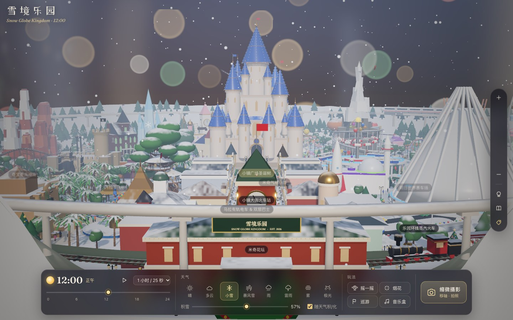

所测桌面/竖屏条件下，未发现阻断启动或照片下载的缺陷。这不认证所有功能、设备或未来长会话。

## 性能与测量

### 构建、体积与稳定性

| 测量 | Snowglobe | Noël |
|---|---|---|
| 干净锁文件安装/生产构建 | 通过/通过 | 通过/通过，含 chunk 体积警告 |
| 独立 HTML，字节 | 1063950 | 845285 |
| 独立 HTML 的 gzip，字节 | 297357 | 289544 |
| 源 JS 文件/物理行数 | 38 / 8323 | 9 / 3258 |
| 本地就绪，ms，单次样本（Codex / Claude） | 659 / 540 | 1749 / 459 |
| 默认画布像素，DPR 1 | 1440×900 | 890×522 |
| 默认 rAF FPS，3 s 样本 | 60.00 | 60.00 |
| 默认 p95 帧间隔，ms | 16.70 | 16.80 |
| 默认超过 33.34 ms 的间隔数 | 0 | 0 |
| 功能流程页面错误/控制台警告 | 0 / 0 | 0 / 0 |
| 离线 `file://` 启动 | 通过；外部字体请求失败 | 通过；未观察到失败请求 |
| 禁用 WebGL2 后启动 | 可读提示 | 可读提示 |

日志中的构建时间是本地打包观察，不是模型生成速度。双方评审的单次就绪样本排序相反，还受浏览器/应用启动和外部字体行为影响，不能可靠排序启动速度。Snowglobe 判据为 `SG.ready` / `body.ready`，Noël 为 `#loading.hidden`。默认帧率受 vsync 限制，画布像素面积相差约 2.8×；本表不能证明渲染成本相同。

有界资源稳定性测试通过观察脚本包装 WebGL2 的 create/delete API，先预热 8 次天气/时间切换，再切换 20 次，最后经过 6 次视口宽度变化。最后三个检查点的存活计数不变：

| 存活 WebGL 资源 | Snowglobe | Noël |
|---|---|---|
| Buffer | 1736 | 1263 |
| Texture | 49 | 35 |
| Program | 101 | 26 |
| Framebuffer | 62 | 40 |
| Renderbuffer | 6 | 0 |

压力测试中无未处理页面错误。这是存活 GL 对象数，不是 GPU 内存字节，不能推导为完全无泄漏；循环没有覆盖无限拍照或全部图鉴。另检查了 Snowglobe 相机值均有限；Noël 未暴露相机调试句柄，因此未对其应用这一内部断言。

### 等大画布吞吐

Claude 关闭视觉测试浏览器后，Codex 在同一评测主机上串行执行 **ABBA×2**，每作品四个全新页面样本。双方视口和实际绘图缓冲均为 **1280×800，DPR 1**。先设天气/时间，再用观察脚本 CSS 将 Noël 的 stage 临时铺满视口；这是人为统一尺寸的合成测试，不是原始交付布局。双方均为晴天正午，等待 6.5 s 稳定、预热 1.5 s、采样 4 s rAF 间隔，浏览器参数取消帧率/vsync 限制。

| 作品 | 样本 | 平均 rAF FPS | 最小–最大 FPS | 各轮 p95 间隔，ms |
|---|---|---|---|---|
| Snowglobe | 4 | 445.43 | 430.44–470.79 | 3.60 / 3.60 / 3.20 / 3.40 |
| Noël | 4 | 540.22 | 520.44–575.99 | 3.30 / 3.10 / 3.40 / 3.40 |

在这一个晴天正午场景，Noël 均值为 Snowglobe 的 **1.21×**。这是取消限帧后的 **rAF 吞吐估计**，不是 GPU timestamp 测量，也不是显示器实际输出 540 FPS；双方在默认条件都已满足约 60 FPS。工作量也不同：Snowglobe 渲染更大的园区和房间，合成房间、球内、玻璃三层渲染，再加泛光、输出和调色 pass，阴影贴图每帧更新（移轴 pass 只在缩微模式开启，本场景没有运行），Noël 有自己的场景及阴影更新策略。像素相等不代表视觉工作相等，不能推导通用模型效率或固定性能倍数；未基准测试雷雨、缩微、高 DPR 或手机吞吐。

首轮性能尝试先放了合成全屏层，再点击 Noël 控件，导致观察脚本挡住自己的点击。失败日志与一个未完成序列中的 Snowglobe 样本保留为观察错误，不计入此表；修正后从头重跑了**完整** ABBA×2。原始性能及观察错误文件见证据包。

### 没有测量什么

没有推理 TTFT、prefill/decode 吞吐、缓存冷热对比、模型 token、生成成本或可靠生成墙钟时间。浏览器帧间隔不是这些指标。没有 GPU timestamp 查询、CPU/GPU 功耗、全程温度或真机性能测量。

## 分维度判断与联合结论

以下是双方协商后的评审判断，不是测量分数或模型总体排名。

| 维度 | 判断 | 依据 |
|---|---|---|
| 核心任务 | Snowglobe 广度领先；Noël 即时园区辨识领先 | 更多天气/昼夜系统、更大图鉴及可调移轴，对比紧凑易读的摆件。双方均未确立全集覆盖。 |
| 默认/近景视觉 | 取舍 | Noël 默认构图清晰、页面完成度强；Snowglobe 实物环境、夜间氛围和可探索世界更强。双方近景定位都有问题，所抽查 Noël 图鉴视角更明显。 |
| 交互与拍照 | 取舍 | Snowglobe 控件和镜头设置丰富，但有标签滚轮/键盘缺陷；Noël 操作简单、可街道漫游并持久保存照片。 |
| 稳定性与性能 | 双方通过有界稳定性；Noël 在特定等画布吞吐中领先 | 所测循环无页面错误或增长的 GL 计数；统一尺寸晴天正午下平均无限帧 rAF 吞吐为 1.21×，不是通用倍数。 |
| 工程/无障碍 | 各有长短 | Snowglobe 交付截图工具、模拟系统分模块；Noël 有原生对话框、持久相册和第三方声明。双方均缺断言测试与完整运动控制。 |

**重视一眼可读、页面完成度、分享摆件和刷新后仍在的相册，选 Noël；重视大园区沙盒、天气昼夜范围、戏剧性氛围和可调移轴摄影，选 Snowglobe。** Snowglobe 应修标签滚轮及键盘处理；Noël 应改进图鉴相机位。原 brief 下两种缩微理解均成立。任务没有指定权重，因此不强行给出总分冠军。

Claude 初评将 Noël 没有移轴、画布小列作不足，讨论后改为明确的实现取舍。空格问题 Claude 给中，Codex 给低，最终写为低到中，取决于对键盘的依赖程度。报告区分视觉效果弱和控件失效，也区分没拍到与未实现；这些修订保留于联合记录。

## 限制、观察纠错与公开来源

- 每模型只有一个交付快照、一个任务，没有重复生成、等预算、统一工具或人类视觉评审组。思考档位不同，也不是等价单位。
- “项目、人物一个不能少”没有有限验收名单。计数及代表性检查支持范围较广，不支持穷尽性、授权准确性或完整乐园模拟。
- 创作者及模型家族利益冲突仍存在；两名 AI 评审一致不等于独立人类验收。
- 浏览器只覆盖一台 Mac 上的 Thorium，未测 Safari、Firefox、真实 iOS/Android、低端 GPU 或触控设备。竖屏/离线均是桌面浏览器上下文。
- 首轮观察脚本误数 Snowglobe 的 `.poi` 元素，得出 0/0；实际选择器纠正后为 60/82。原 JSON 与纠正 JSON 均保留，零计数不是候选失败。
- 首次手机补测尝试点击 Snowglobe 有意收起的面板内部控件而超时。纠正后正常打开面板并完成下载；原失败日志保留并标为观察错误。
- 首张玲娜贝儿截图在 1.8 s 拍到 Snowglobe 移镜途中，城堡挡在前方。5 s 后复查角色清晰，`flight=null`，中心射线先命中角色网格；这不是遮挡缺陷。人物判断只使用稳定截图，晴天天气图也在等待 6.5 s 后重拍。
- 产品代码保留于各自固定公开仓库。本档案仅含报告、未改绘的截图副本、精选测量文件、小型观察脚本和证据 ZIP；公开脚本/日志中的本地绝对路径已泛化，电池标识已省略，原始中文任务和代码证据保留源语言。未改数字或重绘图片以改变结果。
- 原始完整消息历史只为核实相关来源而读取，不公开。证据不包含凭据、私有端点、完整个人会话、依赖目录、权重或运行时缓存。未修改候选源码以“修好”发现。

## 证据与复现

- [结构化环境及作品哈希](../../assets/cloud-03/evidence/environment.json)、[生成来源](../../assets/cloud-03/evidence/generation-provenance.json)、[联合评审记录](../../assets/cloud-03/evidence/consensus_CN.md)。
- [完整精选证据包](../../assets/cloud-03/cloud-03-evidence.zip)、[SHA256 清单](../../assets/cloud-03/evidence-manifest.json)：含独立笔记、功能原始/纠正结果、安装/构建日志、GL 压力与性能脚本/结果、线上验证和源图片哈希。完整候选代码请从固定仓库取得。
- 复现时将固定提交分别导出，在各目录执行 `npm ci --ignore-scripts && npm run build`，为临时父目录启动本地静态服务，再用附带脚本驱动 Thorium。包内 README 说明依赖/浏览器路径配置以及有意构造的等大画布性能场景。
- 报告发布验收与模型评测分开；[publication-checks](../../docs/publication-checks_CN.md)记录档案构建、双语配对、下载、图片及仓库子路径阅读器检查。
