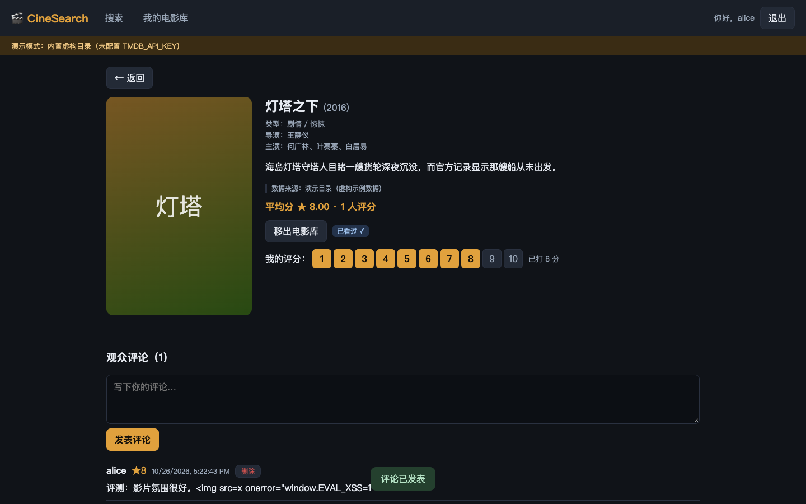
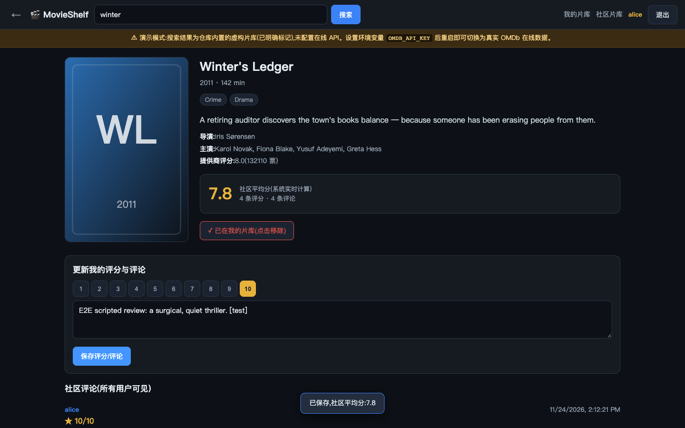
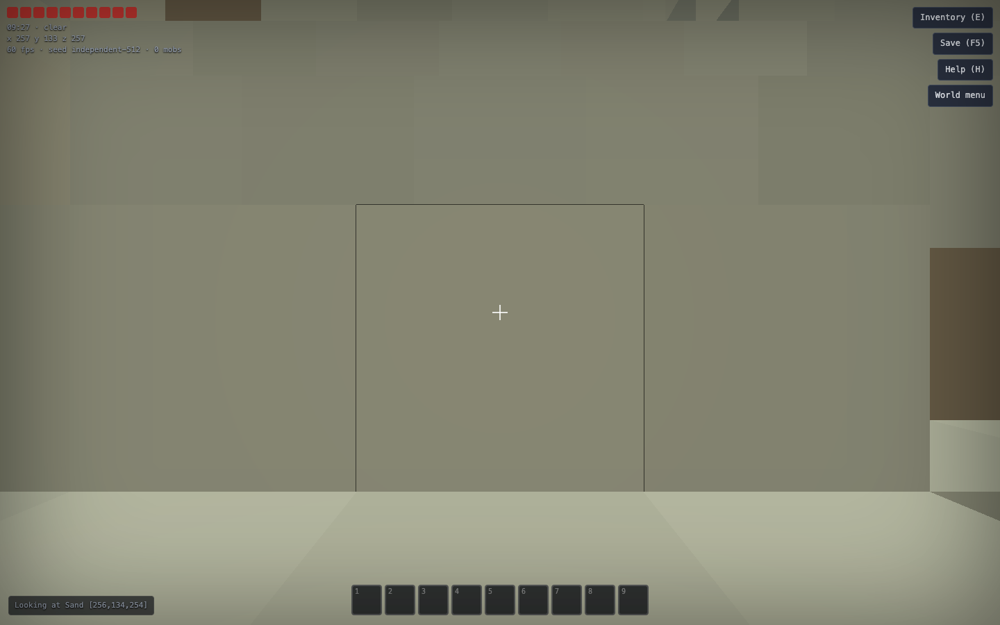
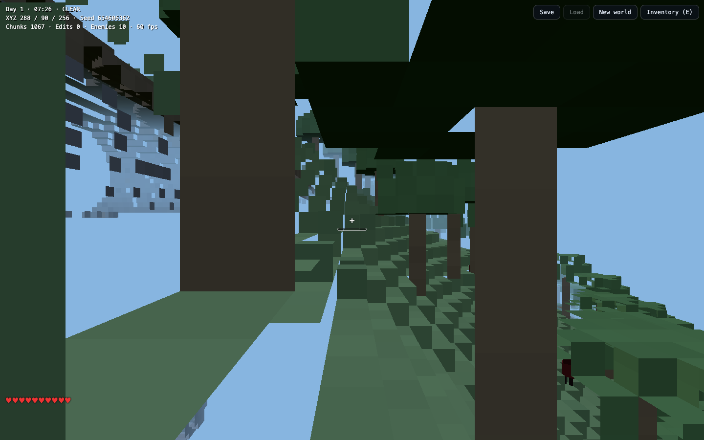
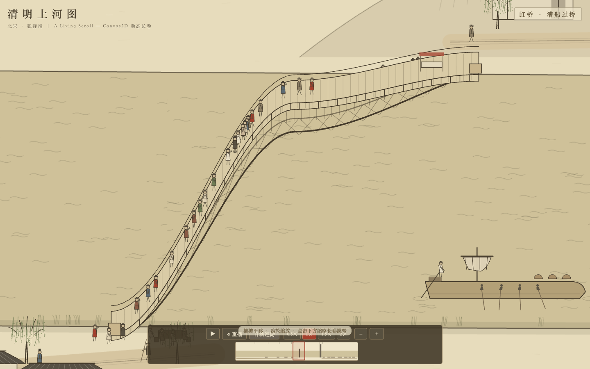
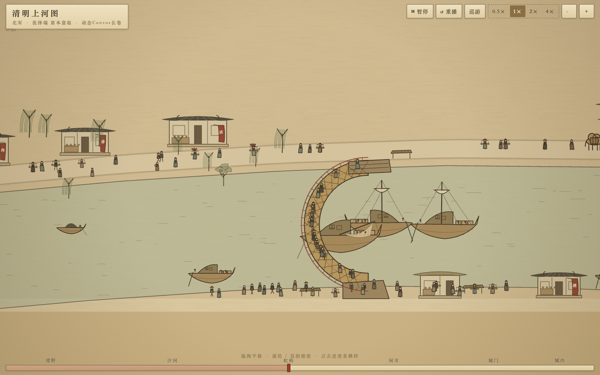

# CAP-05-IQ4 — Flash Next UD-IQ4_XS CAP-05 replay on Splash

[English](2026-11-24-flash-next-iq4xs-splash-cap05-replay.md) | [简体中文](2026-11-24-flash-next-iq4xs-splash-cap05-replay_CN.md)

Local test starting November 24, 2026, America/Toronto.

The downloaded Unsloth build reached Ready at 262,144 tokens using the existing 96 GiB budget. The original cold probe was reproduced at exactly 8,851 uncached input and 512 output tokens per trial. The three CAP-05 tasks were run once per topic on the IQ4 model, with 2/3 finishing all three phases.

## What changed from IQ3_S to IQ4_XS?

**On Splash 1.7.0, IQ4_XS started streaming 0.241 seconds earlier on average, decoded about 3% more slowly, and used 8.68 GiB more peak memory.** The clearest product difference was the voxel game. Historical IQ3_S finished all three phases in 50.27 minutes. IQ4_XS reached the 60-minute limit in phase 2.

| Matched Splash 1.7.0 · PLE auto | IQ3_S | UD-IQ4_XS | IQ4 vs. IQ3 |
|---|---:|---:|---:|
| Mean time to first event | 4.258 s | 4.017 s | −5.6% |
| Cold prefill | 2,084.44 tok/s | 2,210.61 tok/s | +6.1% |
| Native decode | 163.20 tok/s | 157.88 tok/s | −3.3% |
| Peak Splash allocation | 55.71 GiB | 64.39 GiB | +8.68 GiB |

Three trials per build used the same 8,851 input and 512 output tokens. The first-event ranges overlap (3.940–4.445 s for IQ3 and 3.722–4.302 s for IQ4), as do the decode-rate ranges. The small speed differences describe these trials. Memory figures are the peaks recorded for this probe.

| Product | Historical IQ3_S · Splash 1.4.1 | Replay IQ4_XS · Splash 1.7.0 | Observed difference |
|---|---|---|---|
| Movie site | Finished three phases in 18.79 min. Library, reviews, rating aggregation, moderation and restart persistence passed. A TMDB response fixture exposed incomplete credits. | Finished three phases in 11.80 min. Two-user ratings, comment lock, hiding and restart persistence passed. Testing used the OMDb demo catalog. | Both completed the core workflow. The replay was about 7 minutes shorter, and the historical time included a 300-second stalled tool. Online metadata coverage was evaluated differently. |
| Voxel game | Finished three phases in 50.27 min. Mining, placement, crafting, combat and reload were exercised. The high-altitude platform had collision and its geometry was invisible. | Reached the 60-minute limit in phase 2. Movement, assisted crafting and inventory restoration passed on the frozen build. The terrain capture showed visible gaps. | IQ3 had higher task completion and broader verified gameplay. Independent mining, combat and high-altitude rendering checks are unavailable for IQ4. |
| Qingming scroll | Finished three phases in 26.46 min. Autoplay, navigation and mobile worked. The bridge was stiff and the riverbanks straight. | Finished three phases in 25.88 min. Comparable controls passed and the scene changed with the camera fixed. Riverbanks and figures remained simplified. | The runs were about 35 seconds apart. The available reviews do not establish which version was more faithful to the original scroll. |

Each product was run once per build. The historical and replay runs used different Splash, Pi, macOS and browser versions, along with different review coverage. The table records differences between the delivered products. A matched, identically scored pair is still needed to isolate the quality difference. The images below show each build's recorded test scene.

## Historical tests and replay scope

The direct baseline is [CAP-05](2026-10-26-flash-next-iq3s-splash-strata-triad.md), which used Flash Next IQ3_S on Splash and Strata for the cold coding probe and three product tasks. [CAP-03](2026-10-25-pi-strata-splash-repairdesk.md), [CAP-04](2026-10-25-pi-visual-triad-three-engines.md), and [PERF-13](2026-10-26-strata-cold-kv-128k-256k.md) also contain IQ3_S, on Strata. This replay follows the Splash branch of CAP-05. PERF-13 used a separate Strata protocol for full-window stress.

## Environment and configuration

| Item | Value |
|---|---|
| Inference and client | Local MacBook Pro Mac17,6 · Apple M5 Max 18 CPU / 40 GPU · Metal 4 · 128 GiB |
| Test-time OS | macOS 27.2.1 (26B131), arm64 |
| Engine | Splash 1.7.0 · `61f6d51643a2cf8b3ed868dcb4bcda176ae578ec` |
| Target | Unsloth Qwen3.8-Flash-Next-GGUF `UD-IQ4_XS` · `f5d175de2cf7f720d45d6064019a81fcf056e986` |
| Draft and vision | IncoAI BF16 DFlash2 `a22a1744e85c17364dcc54a6a420af7135d4c7f6` · target-side BF16 projector |
| Engine settings | 262,144 context · 96 GiB · INT8 KV · FP32 state · SSD KV cache off · idle release off · expert/PLE auto |
| Pi and browser | Pi 1.5.2 · Node v22.23.1 · Thorium 156.0.8078.28 |
| Task requests | Medium reasoning · temperature 1 · top_p 0.95 · top_k 20 · 32,768 output cap · one session at a time |

The running IQ3_S service was stopped before the original workspace's Splash launch scripts started IQ4_XS. Each product used a fresh service process and a fresh Pi session, with the same three phases, 3,600 seconds per product, auto retry off, and compaction enabled (32,768 reserved / 16,000 retained). The archived three briefs and phase prompts were adapted for Thorium and local paths. The voxel framing specified an original first-person survival game. Three.js 0.186.1 and a reconstructed screenshot helper were used because the archive carried prior seed hashes without the original vendor files. The tools were read, bash, edit and write. The supervisor did not edit the product source.

Splash 1.4.1 previously loaded the PLE table under auto. Splash 1.7.0 streams it from SSD; this run's auto budget capped the row cache at 237 MiB and held the routed experts in memory. Idle ready Metal peak for IQ4 at initial startup was about 64.4 GiB. The two quantization builds also use different publisher recipes and target projectors.

## Cold-cache playback

Same three archived SQL/JavaScript coding requests, serial SSE, temperature 0, reasoning none, 8,851 input tokens, 512 output tokens and zero matched prefix tokens per trial. The native decode pool excludes the first emitted batch, as in CAP-05. TTFT is measured to the first nonempty streamed generation delta.

| Profile | n | Mean TTFT s | Cold prefill tok/s | Native decode tok/s | Splash peak GiB |
|---|---:|---:|---:|---:|---:|
| IQ3_S · CAP-05 resident | 3 | 3.785 | 2,346.63 | 157.42 | — |
| IQ3_S · CAP-05 512 MiB | 3 | 4.085 | 2,173.68 | 151.83 | — |
| IQ3_S · auto | 3 | 4.258 | 2,084.44 | 163.20 | 55.71 |
| UD-IQ4_XS · auto | 3 | 4.017 | 2,210.61 | 157.88 | 64.39 |
| UD-IQ4_XS · 512 MiB | 3 | 4.480 | 1,981.03 | 144.24 | 64.39 |
| UD-IQ4_XS · resident (off) | 3 | 4.733 | 1,875.63 | 140.04 | 91.21 |

On Splash 1.7.0 in auto mode, IQ4 first-event latency fell 5.6% and cold prefill rose 6.1% versus IQ3. Decode was 3.3% lower and peak Splash allocation was 8.68 GiB higher. For IQ4, auto was the fastest of the three profiles observed in this test. Each profile had three trials in fixed order.

## Product throughput and memory

Minutes and decode rates show IQ4 on Splash 1.7.0 first and historical IQ3 on Splash 1.4.1 second. Request counts, errors, outputs and TTFT belong to the IQ4 runs. Product outputs and their tool paths vary between runs.

| Task | End | Minutes IQ4 / old | Requests / errors | Output tokens | TTFT P50 s | Decode tok/s IQ4 / old |
|---|---|---:|---:|---:|---:|---:|
| Movie site | Three phases complete | 11.80 / 18.79 | 66 / 0 | 63,983 | 0.756 | 110.89 / 111.02 |
| Voxel game | 60-minute limit, phase 2 | 60.01 / 50.27 | 82 / 0 | 104,756 | 0.532 | 104.76 / 115.65 |
| Qingming scroll | Three phases complete | 25.88 / 26.46 | 87 / 0 | 118,781 | 0.716 | 103.65 / 99.79 |

| Task | Longest input | Tools / errors | Samples | System used peak GiB | Native footprint peak GiB | Max swap increase GiB | Memory normal / warn / critical |
|---|---:|---:|---:|---:|---:|---:|---:|
| Movie site | 96,499 | 76 / 6 | 714 | 93.40 | 68.35 | 0.00 | 714 / 0 / 0 |
| Voxel game | 137,879 | 88 / 8 | 3591 | 97.43 | 69.48 | 0.00 | 3591 / 0 / 0 |
| Qingming scroll | 159,319 | 98 / 2 | 1556 | 95.84 | 71.75 | 0.00 | 1556 / 0 / 0 |

Whole-system memory and native footprint overlap. Tool failures are separate from inference errors. Context configuration is 256K, while the largest actual request is reported in the table. Product runs do not establish full-window capacity.

| Task | Frozen local commit | Bash timeout interventions | Compactions |
|---|---|---:|---:|
| Movie site | `576d0600bb1c35401374438e03a6ae39579355af` | 0 | 0 |
| Voxel game | `e0d91daeb8460d38963ab50e613105d6211e837b` | 3 | 0 |
| Qingming scroll | `3f4c92ad7c33c6436b6d51298cb2bbac52ef54e3` | 0 | 0 |

## Frozen product review

**MovieShelf.** The original README command started the frozen site and the Thorium browser rerun passed 25 checks. Independent local API verification used two new test accounts. Ratings 8 and 4, then an update to 10, produced the expected 7.5 average over four ratings including two demo scores. A regular user received 403 at the admin screen endpoint. The admin hide and comment lock affected ordinary user-facing paths, and watched state, review state and five audit entries persisted after restart. At 390 px the document fit its viewport. The runtime used its explicitly labeled demo catalog and placeholder posters. Live OMDb, full credits and the privacy of shared community libraries were outside the passed acceptance evidence.

| IQ3_S (historical CAP-05) | IQ4_XS (replay) |
|---|---|
|  |  |

**Voxel Isle.** The 60-minute wall budget expired in phase 2, with only phase 1 settled. The 300-second Bash watchdog intervened three times. The frozen snapshot was still launched and separately inspected in Thorium. Normal keyboard input moved 4.60 units, inventory stayed live, and real crafting buttons made a wooden pickaxe after a test fixture granted wood. Save, new seed, reload and inventory restoration passed. The 60-second clock check and 390 px touch controls passed. The desktop capture shows visible terrain gaps. The evaluator first hit pointer lock and a test-grant UI refresh issue, then used the documented E key and granted wood before opening inventory. These are review-harness corrections. Independent acceptance covered the listed behaviors and left mining, combat and high-altitude rendering unscored.

| IQ3_S (historical CAP-05) | IQ4_XS (replay) |
|---|---|
|  |  |

**Qingming scroll.** The frozen 8,600 × 1,150 Canvas2D scene advanced automatically and its rendered pixels changed with the camera held fixed. Independent visible inputs verified seek, drag, zoom, speed, pause, replay and mobile touch seek. At 2× the clock advanced 119.995 seconds over 60 wall seconds, and the camera advanced 1,488.9 units. No page errors were observed. The scene reports 143 general figures and 28 bridge walkers, 16 boats and 20 buildings. These are program counts. The matte earth tones, timber bridge and shop signs are readable, while the straight shoreline, repetitive figures and flat buildings remain stylized compared with the source scroll.

| IQ3_S (historical CAP-05) | IQ4_XS (replay) |
|---|---|
|  |  |

## Evidence and comparison limits

The same-engine cold pair is the closest quantization comparison in this replay. It still compares different quantization recipes. The historical comparison additionally spans different Splash, Pi, macOS and browser versions. The product samples are single runs and the original 85-item historical scorecard remains attached to CAP-05.

[Numeric evidence (JSON)](../../assets/evidence/cap-05-iq4-replay.json) · [Per-request timing (CSV)](../../assets/evidence/cap-05-iq4-replay-requests.csv) · [Independent product checks (JSON)](../../assets/evidence/cap-05-iq4-review.json). Private prompts, sessions, authentication, endpoints and caches are excluded.
