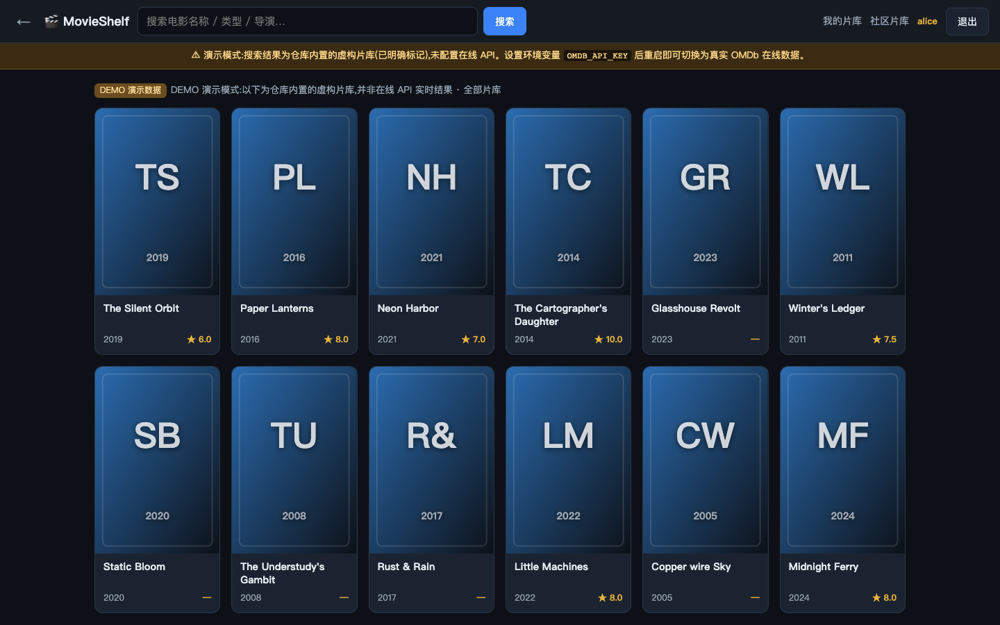
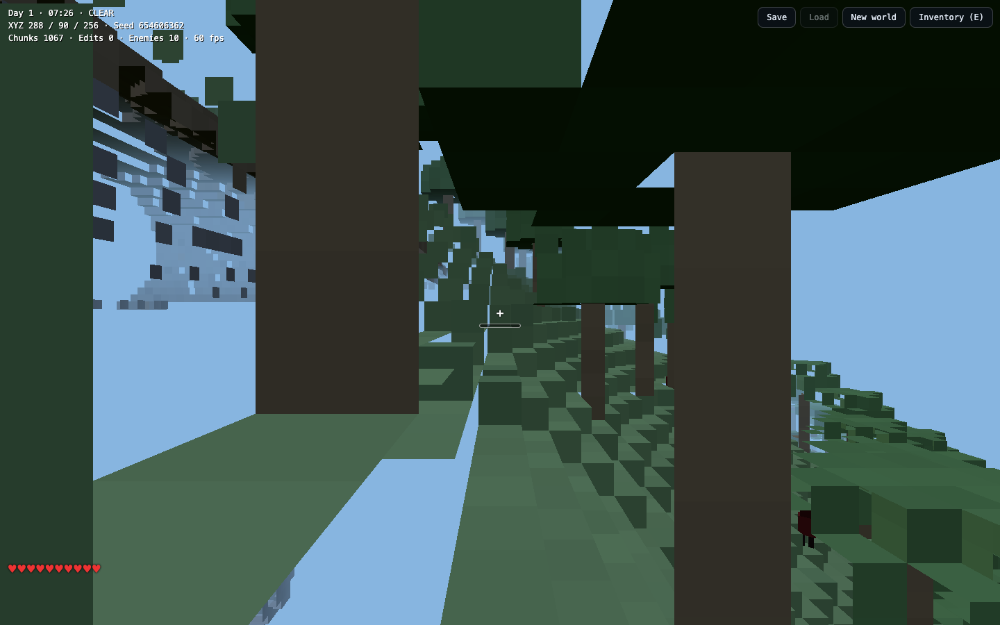
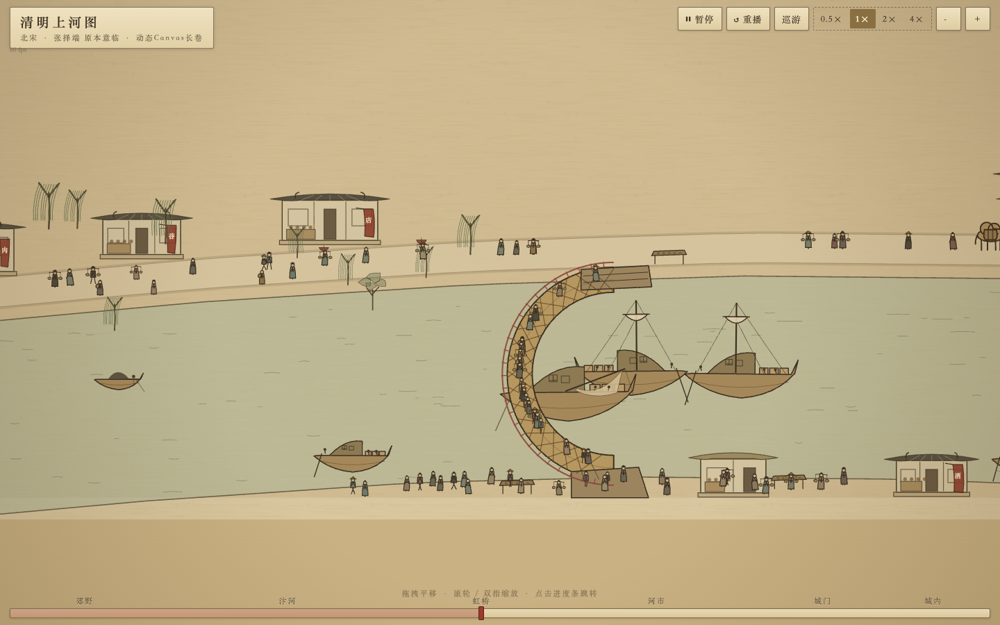

# CAP-05-IQ4 — Splash 上的 Flash Next UD-IQ4_XS 复测

[English](2026-11-24-flash-next-iq4xs-splash-cap05-replay.md) | [简体中文](2026-11-24-flash-next-iq4xs-splash-cap05-replay_CN.md)

本地测试始于 2026-11-24，America/Toronto。

已下载的 Unsloth 版本在原有 96 GiB 预算内以 262,144 token 上下文就绪。原冷缓存探针逐次复现了 8,851 未缓存输入和 512 输出 token。IQ4 每题跑一次，2/3 题完成全部三轮。

## 历史测试与复测范围

直接基准是 [CAP-05](2026-10-26-flash-next-iq3s-splash-strata-triad_CN.md)，在 Splash 和 Strata 上使用 Flash Next IQ3_S 跑了冷缓存编程探针及三个产品任务。[CAP-03](2026-10-25-pi-strata-splash-repairdesk_CN.md)、[CAP-04](2026-10-25-pi-visual-triad-three-engines_CN.md) 和 [PERF-13](2026-10-26-strata-cold-kv-128k-256k_CN.md) 也包含 IQ3_S，使用的是 Strata。这轮复跑 CAP-05 的 Splash 分支。PERF-13 的满窗压力属于独立 Strata 协议。

## 环境与配置

| 项目 | 实测值 |
|---|---|
| 推理与客户端 | 本机 MacBook Pro Mac17,6 · Apple M5 Max 18 核 CPU / 40 核 GPU · Metal 4 · 128 GiB |
| 实验时系统 | macOS 27.2.1 (26B131)，arm64 |
| 推理引擎 | Splash 1.7.0 · `61f6d51643a2cf8b3ed868dcb4bcda176ae578ec` |
| 目标权重 | Unsloth Qwen3.8-Flash-Next-GGUF `UD-IQ4_XS` · `f5d175de2cf7f720d45d6064019a81fcf056e986` |
| 草稿和视觉 | IncoAI BF16 DFlash2 `a22a1744e85c17364dcc54a6a420af7135d4c7f6` · 目标仓库 BF16 投影 |
| 服务参数 | 262,144 上下文 · 96 GiB · INT8 KV · FP32 状态 · SSD KV 缓存关闭 · idle release off · 专家与 PLE auto |
| Pi 与浏览器 | Pi 1.5.2 · Node v22.23.1 · Thorium 156.0.8078.28 |
| 产品请求 | medium 推理 · temperature 1 · top_p 0.95 · top_k 20 · 32,768 输出上限 · 逐项单会话 |

先停掉正在运行的 IQ3_S，再用原工作区 Splash 脚本启动 IQ4_XS。每题重启服务、新开 Pi 会话，沿用三轮流程和每题 3,600 秒预算，关闭自动重试，压缩启用（预留 32,768 / 保留 16,000）。归档题面及各轮提示适配 Thorium 和本机路径，方块题指定原创第一人称生存游戏。旧包有 vendor 文件的哈希，本轮用 Three.js 0.186.1 和重建的截图工具。候选工具为 read、bash、edit、write。监督方没有修改产品源码。

Splash 1.4.1 当时在 auto 下驻留 PLE 表。Splash 1.7.0 的 auto 下从 SSD 读取 PLE，本轮行缓存上限 237 MiB，路由专家驻留。IQ4 初次就绪时 Metal 峰值约 64.4 GiB。两个量化包也使用了不同发布方的量化配方与视觉投影。

## 冷缓存探针

沿用归档中的三个 SQL/JavaScript 编程请求，串行 SSE、temperature 0、reasoning none，每次 8,851 输入、512 输出和 0 前缀命中。原生解码池化沿用 CAP-05 口径，排除首个生成批次。TTFT 量到首个非空生成事件。

| 模式 | n | 平均首事件 秒 | 冷 prefill tok/s | 原生 decode tok/s | Splash 峰值 GiB |
|---|---:|---:|---:|---:|---:|
| IQ3_S · CAP-05 resident | 3 | 3.785 | 2,346.63 | 157.42 | — |
| IQ3_S · CAP-05 512 MiB | 3 | 4.085 | 2,173.68 | 151.83 | — |
| IQ3_S · auto | 3 | 4.258 | 2,084.44 | 163.20 | 55.71 |
| UD-IQ4_XS · auto | 3 | 4.017 | 2,210.61 | 157.88 | 64.39 |
| UD-IQ4_XS · 512 MiB | 3 | 4.480 | 1,981.03 | 144.24 | 64.39 |
| UD-IQ4_XS · resident (off) | 3 | 4.733 | 1,875.63 | 140.04 | 91.21 |

同为 Splash 1.7.0 的 auto，IQ4 相较 IQ3 的首事件耗时低 5.6%，冷 prefill 高 6.1%，解码低 3.3%，Splash 峰值分配多 8.68 GiB。本轮 IQ4 的三个实测模式中，auto 最快。每个模式固定顺序跑三轮。

## 产品吞吐与内存

耗时和解码速率按 IQ4（Splash 1.7.0）/ 历史 IQ3（Splash 1.4.1）显示。请求、错误、输出和 TTFT 是 IQ4 本轮数据。两轮产物和工具路径会随模型生成分化。

| 任务 | 结束状态 | 耗时分钟 IQ4 / 旧 | 请求 / 错误 | 输出 token | 首事件 P50 秒 | Decode tok/s IQ4 / 旧 |
|---|---|---:|---:|---:|---:|---:|
| 电影站 | 三轮完成 | 11.80 / 18.79 | 66 / 0 | 63,983 | 0.756 | 110.89 / 111.02 |
| 方块游戏 | 第二轮达到 60 分钟上限 | 60.01 / 50.27 | 82 / 0 | 104,756 | 0.532 | 104.76 / 115.65 |
| 清明长卷 | 三轮完成 | 25.88 / 26.46 | 87 / 0 | 118,781 | 0.716 | 103.65 / 99.79 |

| 任务 | 最长输入 | 工具 / 错误 | 采样 | 全机用量峰值 GiB | 原生 footprint 峰值 GiB | Swap 最大增长 GiB | 正常 / 告警 / 严重 |
|---|---:|---:|---:|---:|---:|---:|---:|
| 电影站 | 96,499 | 76 / 6 | 714 | 93.40 | 68.35 | 0.00 | 714 / 0 / 0 |
| 方块游戏 | 137,879 | 88 / 8 | 3591 | 97.43 | 69.48 | 0.00 | 3591 / 0 / 0 |
| 清明长卷 | 159,319 | 98 / 2 | 1556 | 95.84 | 71.75 | 0.00 | 1556 / 0 / 0 |

全机内存与原生 footprint 统计范围重叠。工具失败与推理错误分别记录。服务配置为 256K，实际最长请求见表。产品任务的运行结果不能外推为满窗容量验证。

| 任务 | 冻结本地提交 | Bash 超时干预 | 会话压缩 |
|---|---|---:|---:|
| 电影站 | `576d0600bb1c35401374438e03a6ae39579355af` | 0 | 0 |
| 方块游戏 | `e0d91daeb8460d38963ab50e613105d6211e837b` | 3 | 0 |
| 清明长卷 | `3f4c92ad7c33c6436b6d51298cb2bbac52ef54e3` | 0 | 0 |

## 冻结产物验收

**电影站 MovieShelf。** README 启动命令能拉起冻结版，Thorium 浏览器脚本复跑 25 项通过。独立本地 API 验证用两个新测试账号先打 8 和 4，随后把 8 更新为 10，连同两个内置评分共四条，均分正确为 7.5。普通用户访问后台接口返回 403。管理员隐藏和禁评对普通用户路径生效，服务重启后片库、评论状态和 5 条审计日志均保留。390 px 页面宽度正常。实测使用明确标记的演示目录和占位海报，真实 OMDb、完整演职员资料和社区片库可见范围未纳入通过项。

**方块游戏 Voxel Isle。** 60 分钟上限在第二轮触发，只完成了第一轮，300 秒 Bash 看门狗干预三次。冻结版仍单独启动并在 Thorium 验收，键盘实测移动 4.60 格，打开背包时游戏时钟继续。测试辅助投放木材后，实际制作按钮做出木镐。存档、重开新种子、读回种子和背包均通过。60 秒时钟连续性与 390 px 触控通过。桌面截图可见地形空洞。验收工具先遇到指针锁定和测试投放物品后 UI 未刷新的问题，随后改用文档里的 E 键，并在打开背包前投放木材。两次修订仅涉及验收器。独立验收覆盖以上行为，采集、战斗和高空渲染没有独立计分。

**清明长卷。** 冻结版 8,600 × 1,150 Canvas2D 场景自动推进，镜头固定时画面像素也会随时间变化。实际控件验证了跳转、拖拽、缩放、速度、暂停、重播和手机触摸跳转。2× 下 60 秒墙钟内动画时间推进 119.995 秒，镜头推进 1,488.9 单位，未观测到页面错误。程序计数为 143 个普通人物、28 个桥上行人、16 艘船、20 栋建筑。土色、木桥和店招清楚可辨，河岸偏直、人物重复和建筑扁平，离原卷的丰富构图仍有差距。

## 证据与对比边界

同版引擎的冷缓存配对是本轮最接近量化对照的结果，仍涉及不同发布方的量化配方。与历史比较还跨 Splash、Pi、macOS 和浏览器版本。每题仅单次运行，旧实验的 85 项评分继续随 CAP-05 保留。

[数值证据（JSON）](../../assets/evidence/cap-05-iq4-replay.json) · [逐请求计时（CSV）](../../assets/evidence/cap-05-iq4-replay-requests.csv) · [独立产物验收（JSON）](../../assets/evidence/cap-05-iq4-review.json)。完整会话、请求正文、凭据、私有端点和缓存留在本机实验目录。
