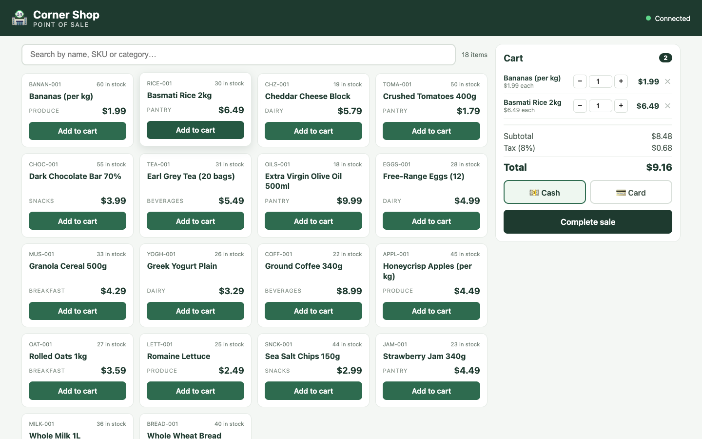
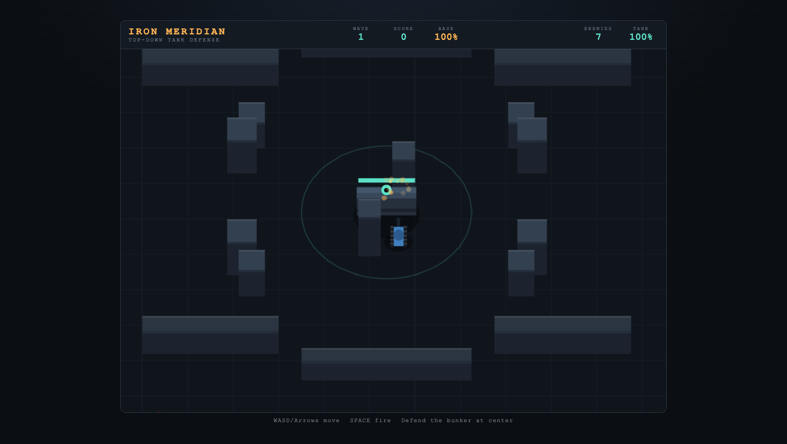
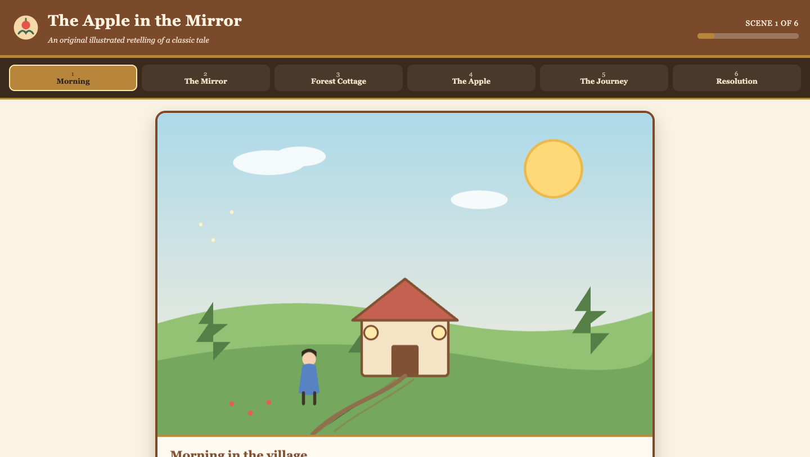
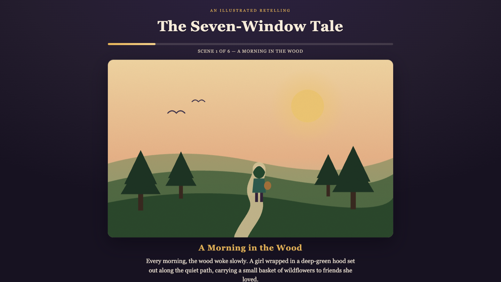

# Inkling 2 Mini on Splash at 256K: three paired coding tasks

[English](2026-11-26-inkling-2-mini-splash-q8.md) | [简体中文](2026-11-26-inkling-2-mini-splash-q8_CN.md)

On November 26, 2026, Inkling 2 Mini replayed three software briefs on one local Splash instance. All three `low` runs wrote source files. At `medium`, only Snow White did, taking about 3.7 times as long as its `low` run. The original briefs come from [CAP-IQ4-ENGINE](2026-11-26-iq4-engine-triad.md).

Inference and Pi ran on the same MacBook Pro with an Apple M5 Max (18 CPU cores, 40 GPU cores, 128 GiB unified memory). Test-time OS was macOS 27.2.1 (26B131), arm64. Splash 1.7.3 and Pi 1.5.2 used Unsloth UD-Q8_K_XL, a BF16 vision projector and DFlash2, a 262,144-token context, INT8 KV, FP32 state, a 96 GiB Metal budget, one concurrent request and SSD prefix caching disabled.

The run order was POS, tanks and Snow White, with `low` followed by `medium` for each task. Each run used the same original task and system prompts for its pair, an empty directory and a fresh Pi session. The original test's controls carried over: temperature 1, top-p 0.95, top-k 20, a 16,384-token output limit per request, a 40-minute task limit, and read/write/edit tools.

## Throughput and execution

| Task | Thinking | Elapsed s | Requests / failures | Input / cached tokens | Largest request input | Output / reasoning tokens | Prefill tok/s | Decode tok/s | Draft token acceptance | Tool calls / errors | Output limits hit | Process result |
| --- | --- | --- | --- | --- | --- | --- | --- | --- | --- | --- | --- | --- |
| Retail POS | low | 187.2 | 26 / 0 | 295,568 / 290,048 | 20,403 | 19,589 / 1,282 | 1,455.5 | 106.9 | 51.1% | 25 / 4 | 0 | Exit 0 |
| Retail POS | medium | 28.5 | 1 / 0 | 1,140 / 0 | 1,140 | 1,933 / 1,875 | 2,026.8 | 69.8 | 34.1% | 0 / 0 | 0 | Exit 0 |
| 3D tank arcade | low | 150.0 | 6 / 0 | 49,413 / 38,016 | 14,561 | 13,693 / 1,308 | 1,432.8 | 96.5 | 51.2% | 5 / 0 | 0 | Exit 0 |
| 3D tank arcade | medium | 218.5 | 1 / 0 | 1,074 / 0 | 1,074 | 16,384 / 16,382 | 2,217.2 | 75.2 | 35.3% | 0 / 0 | 1 | Exit 0 |
| Snow White | low | 125.8 | 7 / 0 | 86,221 / 84,864 | 15,371 | 14,429 / 331 | 1,400.4 | 115.7 | 51.8% | 6 / 0 | 0 | Exit 0 |
| Snow White | medium | 469.2 | 30 / 0 | 852,849 / 829,568 | 48,991 | 43,782 / 11,221 | 1,237.1 | 97.3 | 47.2% | 29 / 4 | 1 | Exit 0 |

## Request latency

| Task | Thinking | First-request TTFT s | TTFT median / peak s | First text or tool call median s | Request duration median / peak s |
| --- | --- | --- | --- | --- | --- |
| Retail POS | low | 0.38 | 0.14 / 1.67 | 0.18 | 1.92 / 71.07 |
| Retail POS | medium | 0.61 | 0.61 / 0.61 | 27.90 | 28.25 / 28.25 |
| 3D tank arcade | low | 0.66 | 0.21 / 7.06 | 2.74 | 12.75 / 101.43 |
| 3D tank arcade | medium | 0.53 | 0.53 / 0.53 | — | 218.34 / 218.34 |
| Snow White | low | 0.47 | 0.17 / 0.47 | 0.30 | 3.74 / 91.33 |
| Snow White | medium | 0.51 | 0.21 / 5.55 | 1.44 | 8.83 / 178.36 |

## Resources (mean / sampled peak)

| Task | Thinking | Samples | Splash footprint (GiB) | Splash RSS (GiB) | Host memory (GiB) | Swap (GiB) | GPU (%) | Host CPU (%) | Splash CPU (%) |
| --- | --- | --- | --- | --- | --- | --- | --- | --- | --- |
| Retail POS | low | 93 | 21.6 / 22.3 | 2.9 / 3.4 | 58.0 / 58.9 | 3.4 / 3.4 | 98.9 / 99.0 | 15.9 / 31.7 | 3.2 / 4.6 |
| Retail POS | medium | 14 | 22.3 / 22.3 | 3.5 / 3.5 | 58.8 / 59.0 | 3.4 / 3.4 | 99.0 / 99.0 | 14.6 / 16.7 | 2.9 / 3.1 |
| 3D tank arcade | low | 74 | 22.8 / 23.4 | 3.9 / 4.3 | 59.2 / 60.2 | 3.4 / 3.4 | 99.0 / 99.0 | 14.6 / 20.4 | 2.8 / 3.5 |
| 3D tank arcade | medium | 108 | 23.5 / 23.7 | 4.5 / 4.6 | 60.0 / 60.3 | 3.4 / 3.4 | 98.8 / 99.0 | 6.8 / 40.4 | 2.9 / 4.1 |
| Snow White | low | 62 | 24.0 / 24.3 | 4.8 / 5.2 | 60.4 / 60.8 | 3.4 / 3.4 | 98.9 / 99.0 | 6.0 / 36.3 | 2.6 / 3.4 |
| Snow White | medium | 234 | 25.5 / 27.7 | 6.2 / 7.7 | 63.4 / 66.7 | 3.4 / 3.4 | 99.0 / 99.0 | 12.2 / 48.4 | 2.7 / 4.2 |

## Artifact verification

All 71 formal API requests returned HTTP 200 and carried the assigned thinking level. The largest input to a single request was 48,991 tokens. The 262,144-token setting was confirmed by server status and model metadata.

| Task | low | medium |
| --- | --- | --- |
| Retail POS | 18 files. All 5 Go race tests passed, covering checkout, stock, search and persistence. Compose omitted the loopback host binding. Using local Go and Vite, the browser loaded products and the cart, and the backend recorded a mock sale. The receipt did not render because the frontend reads `it.line` and the API returns `line_total`. | 0 files. Tool markers and JSON arrived as plain text, and Pi executed 0 tool calls. |
| 3D tank arcade | 4 files. Thorium verified launch, movement with arrow keys, projectile rendering and restarting during play. JavaScript syntax passed. | 0 files. The first request reached the 16,384-token cap, with 16,382 reasoning tokens and no visible response or tool call. |
| Snow White | 4 files. Thorium verified six scenes, arrow-key and next-button navigation to the ending, and no horizontal overflow at 390 px. JavaScript syntax passed. | 4 files. Pi continued to call tools after the first request hit the output limit. The result passed the same six-scene and navigation checks, taking about 3.7 times as long as `low`. |

Product verification followed timed inference. The tank check covered launch and manual restart. Each task and effort pair ran once.

[Go race tests](../../assets/2026-11-26-inkling-2-mini-splash-q8/validation/pos-go-test.log) · [Compose port configuration](../../assets/2026-11-26-inkling-2-mini-splash-q8/validation/pos-compose-ports.json) · [POS mock checkout](../../assets/2026-11-26-inkling-2-mini-splash-q8/validation/pos-thorium.json) · [Thorium interaction evidence](../../assets/2026-11-26-inkling-2-mini-splash-q8/validation/thorium.json)

## Artifact screenshots

Thorium captured the original generated artifacts after inference timing ended.

### Retail POS · low

The catalog and cart ran on loopback using local Go and Vite services and isolated demo data.

### 3D tank arcade · low

Gameplay after deployment. The [deployment screen](../../assets/2026-11-26-inkling-2-mini-splash-q8/screenshots/tank-menu.png) is also available.

### Snow White · low

Opening scene on desktop. See the [ending on mobile](../../assets/2026-11-26-inkling-2-mini-splash-q8/screenshots/story-low-mobile.png).

### Snow White · medium

Opening scene on desktop. See the [ending on mobile](../../assets/2026-11-26-inkling-2-mini-splash-q8/screenshots/story-medium-mobile.png).

## Measurement and evidence

- TTFT starts when the local relay accepts the request and ends at the first reasoning, visible-text or tool delta. Prefill uses uncached tokens and native prefill time. Decode is weighted by native decode duration. Output counts include reasoning and tool arguments. Input totals include history sent again across turns.
- Resource samples are taken at two-second intervals. Host CPU and GPU utilization include other processes, and memory measures overlap. Elapsed task time includes Pi and its tools. Single-run sampling and the fixed order can affect generated output and prefix reuse.
- The archive retains seven unchanged screenshots, the original prompts, per-request metrics and two-second resource samples. The evidence package excludes private paths, endpoints, process identifiers and full Pi sessions. Generated source remains with the original local test.

[Summary CSV](../../assets/2026-11-26-inkling-2-mini-splash-q8/metrics.csv) · [Prompts and telemetry ZIP](../../assets/2026-11-26-inkling-2-mini-splash-q8/telemetry.zip) · [Model revisions and SHA-256](../../assets/2026-11-26-inkling-2-mini-splash-q8/model-provenance.json) · [Served model and context](../../assets/2026-11-26-inkling-2-mini-splash-q8/server-models.json)
