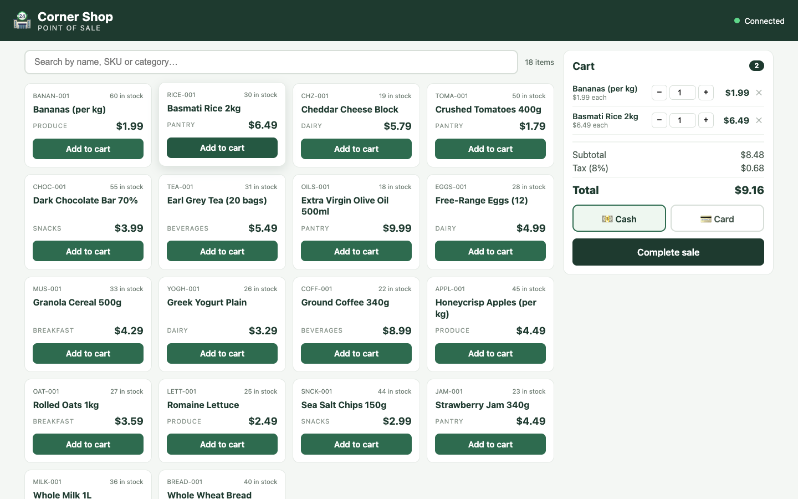
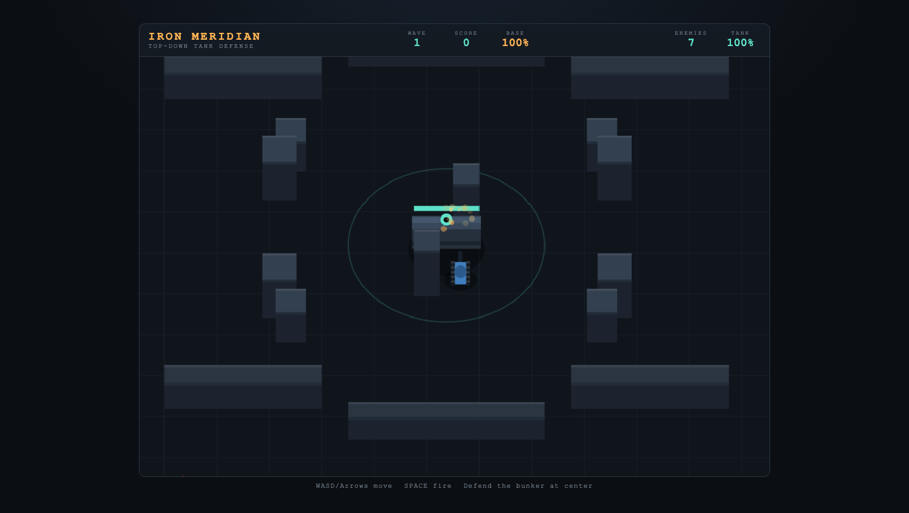
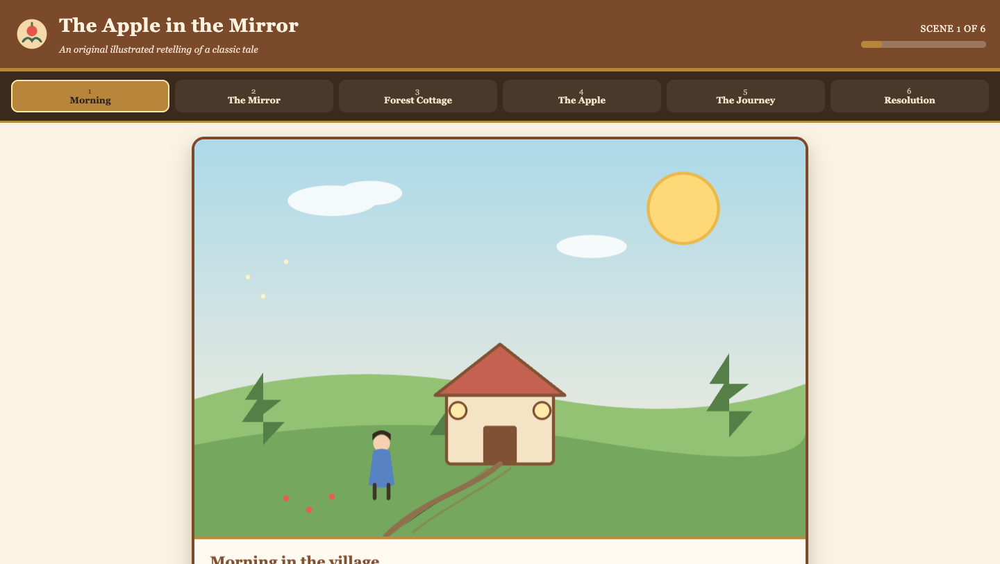

# Inkling 2 Mini 在 Splash 256K 上的三题复测

[English](2026-11-26-inkling-2-mini-splash-q8.md) | [简体中文](2026-11-26-inkling-2-mini-splash-q8_CN.md)

2026-11-26，Inkling 2 Mini 在同一个本地 Splash 实例上重跑了三道软件题。`low` 三题都写出源码，`medium` 只有《白雪公主》写出源码，耗时约为该题 `low` 的 3.7 倍。原题来自 [CAP-IQ4-ENGINE](2026-11-26-iq4-engine-triad_CN.md)。

推理与 Pi 均运行在同一台 MacBook Pro（Apple M5 Max，18 核 CPU、40 核 GPU、128 GiB 统一内存）。实验时系统为 macOS 27.2.1（26B131），arm64。Splash 1.7.3，Pi 1.5.2，Unsloth UD-Q8_K_XL、BF16 视觉投影、DFlash2，262,144-token context，INT8 KV，FP32 state，96 GiB Metal 预算，单并发，SSD prefix cache 关闭。

按 POS、坦克、白雪公主的顺序，每题先 low 后 medium。每轮使用相同原题和系统提示、空项目目录与新 Pi 会话。沿用原测试的 temperature 1、top-p 0.95、top-k 20、每请求最多 16,384 输出 token、每题最多 40 分钟和 read/write/edit 工具。

## 吞吐与交付

| 题目 | Thinking | 耗时 s | 请求 / 失败 | 输入 / 缓存 token | 单请求最大输入 | 输出 / 推理 token | Prefill tok/s | Decode tok/s | 草稿接受率 | 工具 / 错误 | 触顶请求 | 进程结果 |
| --- | --- | --- | --- | --- | --- | --- | --- | --- | --- | --- | --- | --- |
| 零售 POS | low | 187.2 | 26 / 0 | 295,568 / 290,048 | 20,403 | 19,589 / 1,282 | 1,455.5 | 106.9 | 51.1% | 25 / 4 | 0 | 退出码 0 |
| 零售 POS | medium | 28.5 | 1 / 0 | 1,140 / 0 | 1,140 | 1,933 / 1,875 | 2,026.8 | 69.8 | 34.1% | 0 / 0 | 0 | 退出码 0 |
| 3D 坦克街机 | low | 150.0 | 6 / 0 | 49,413 / 38,016 | 14,561 | 13,693 / 1,308 | 1,432.8 | 96.5 | 51.2% | 5 / 0 | 0 | 退出码 0 |
| 3D 坦克街机 | medium | 218.5 | 1 / 0 | 1,074 / 0 | 1,074 | 16,384 / 16,382 | 2,217.2 | 75.2 | 35.3% | 0 / 0 | 1 | 退出码 0 |
| 《白雪公主》 | low | 125.8 | 7 / 0 | 86,221 / 84,864 | 15,371 | 14,429 / 331 | 1,400.4 | 115.7 | 51.8% | 6 / 0 | 0 | 退出码 0 |
| 《白雪公主》 | medium | 469.2 | 30 / 0 | 852,849 / 829,568 | 48,991 | 43,782 / 11,221 | 1,237.1 | 97.3 | 47.2% | 29 / 4 | 1 | 退出码 0 |

## 请求延迟

| 题目 | Thinking | 首请求 TTFT s | TTFT 中位 / 峰值 s | 可见回复或工具调用中位 s | 请求耗时中位 / 峰值 s |
| --- | --- | --- | --- | --- | --- |
| 零售 POS | low | 0.38 | 0.14 / 1.67 | 0.18 | 1.92 / 71.07 |
| 零售 POS | medium | 0.61 | 0.61 / 0.61 | 27.90 | 28.25 / 28.25 |
| 3D 坦克街机 | low | 0.66 | 0.21 / 7.06 | 2.74 | 12.75 / 101.43 |
| 3D 坦克街机 | medium | 0.53 | 0.53 / 0.53 | — | 218.34 / 218.34 |
| 《白雪公主》 | low | 0.47 | 0.17 / 0.47 | 0.30 | 3.74 / 91.33 |
| 《白雪公主》 | medium | 0.51 | 0.21 / 5.55 | 1.44 | 8.83 / 178.36 |

## 资源（均值 / 采样峰值）

| 题目 | Thinking | 采样点 | Splash footprint (GiB) | Splash RSS (GiB) | 系统内存 (GiB) | Swap (GiB) | GPU (%) | 系统 CPU (%) | Splash CPU (%) |
| --- | --- | --- | --- | --- | --- | --- | --- | --- | --- |
| 零售 POS | low | 93 | 21.6 / 22.3 | 2.9 / 3.4 | 58.0 / 58.9 | 3.4 / 3.4 | 98.9 / 99.0 | 15.9 / 31.7 | 3.2 / 4.6 |
| 零售 POS | medium | 14 | 22.3 / 22.3 | 3.5 / 3.5 | 58.8 / 59.0 | 3.4 / 3.4 | 99.0 / 99.0 | 14.6 / 16.7 | 2.9 / 3.1 |
| 3D 坦克街机 | low | 74 | 22.8 / 23.4 | 3.9 / 4.3 | 59.2 / 60.2 | 3.4 / 3.4 | 99.0 / 99.0 | 14.6 / 20.4 | 2.8 / 3.5 |
| 3D 坦克街机 | medium | 108 | 23.5 / 23.7 | 4.5 / 4.6 | 60.0 / 60.3 | 3.4 / 3.4 | 98.8 / 99.0 | 6.8 / 40.4 | 2.9 / 4.1 |
| 《白雪公主》 | low | 62 | 24.0 / 24.3 | 4.8 / 5.2 | 60.4 / 60.8 | 3.4 / 3.4 | 98.9 / 99.0 | 6.0 / 36.3 | 2.6 / 3.4 |
| 《白雪公主》 | medium | 234 | 25.5 / 27.7 | 6.2 / 7.7 | 63.4 / 66.7 | 3.4 / 3.4 | 99.0 / 99.0 | 12.2 / 48.4 | 2.7 / 4.2 |

## 交付验证

本轮 `low` 三题均写出源码，`medium` 仅《白雪公主》写出源码。71 个正式推理请求均返回 HTTP 200，各请求使用对应的 thinking 档位。六轮中，单请求最大实际输入为 48,991 tokens。262,144 是通过服务状态和模型接口确认的配置窗口。

| 题目 | low | medium |
| --- | --- | --- |
| 零售 POS | 18 个文件。5 项 Go race 测试通过，涵盖结账、库存、搜索和持久化。Compose 端口发布省略了 loopback 地址。用本地 Go 和 Vite 验证了商品、购物车和模拟交易写入。前端取 `it.line`，后台返回 `line_total`，收据未显示。 | 0 文件。响应把工具标记和 JSON 作为普通文本发送，Pi 收到 0 次工具调用。 |
| 3D 坦克 | 4 个文件。Thorium 验证启动、方向键移动、发射绘制和游戏中的重启。JS 语法检查通过。 | 0 文件。首请求在 16,384 token 触顶，16,382 个是推理 token，无可见回复或工具调用。 |
| 《白雪公主》 | 4 个文件。Thorium 验证六幕、方向键与下一幕按钮可以到达结尾，390 px 下无横向溢出。JS 语法检查通过。 | 4 个文件。首请求触顶后继续调用工具，最终通过与 low 相同的六幕和导航检查。耗时为 low 的约 3.7 倍。 |

产物验证在推理计时结束后进行。坦克检查覆盖开局和主动重启。每题每档只跑一轮，结果适用于这批任务。

[Go race 测试](../../assets/2026-11-26-inkling-2-mini-splash-q8/validation/pos-go-test.log) · [Compose 配置](../../assets/2026-11-26-inkling-2-mini-splash-q8/validation/pos-compose-ports.json) · [POS 模拟结账](../../assets/2026-11-26-inkling-2-mini-splash-q8/validation/pos-thorium.json) · [Thorium 交互结果](../../assets/2026-11-26-inkling-2-mini-splash-q8/validation/thorium.json)

## 产物截图

截图取自生成产物在 Thorium 中的实际运行，采集时间在推理计时之后。

### 零售 POS · low

商品与购物车。截图使用回环地址上的本地 Go 和 Vite 服务以及临时测试数据。

### 3D 坦克街机 · low

进入关卡后的游戏画面。另附[部署画面](../../assets/2026-11-26-inkling-2-mini-splash-q8/screenshots/tank-menu.png)。

### 《白雪公主》· low

桌面开场。另附[移动端结尾](../../assets/2026-11-26-inkling-2-mini-splash-q8/screenshots/story-low-mobile.png)。

### 《白雪公主》· medium

桌面开场。另附[移动端结尾](../../assets/2026-11-26-inkling-2-mini-splash-q8/screenshots/story-medium-mobile.png)。

## 口径与证据

- TTFT 从本机中继收到请求算起，首个推理、可见文本或工具增量均计入。Prefill 按未缓存 token 与 native prefill 时间汇总。Decode 以 native decode 时间加权，API 输出 token 含 thinking 和工具参数。输入汇总含每轮重送的历史。
- 每两秒采样。CPU 与 GPU 系统指标含其他进程。不同内存口径有重叠。每组只有一次，任务耗时包含 Pi 及工具，模型输出和前缀复用可能随顺序而变。
- 归档保留 7 张原始截图、原题、逐请求指标和两秒资源采样。证据包保留性能字段，移除私有路径、端点、进程标识和完整 Pi 会话。截图保持原样，生成源码保存在原测试目录。

[汇总 CSV](../../assets/2026-11-26-inkling-2-mini-splash-q8/metrics.csv) · [原题和遥测 ZIP](../../assets/2026-11-26-inkling-2-mini-splash-q8/telemetry.zip) · [模型来源与 SHA-256](../../assets/2026-11-26-inkling-2-mini-splash-q8/model-provenance.json) · [服务模型与上下文](../../assets/2026-11-26-inkling-2-mini-splash-q8/server-models.json)
