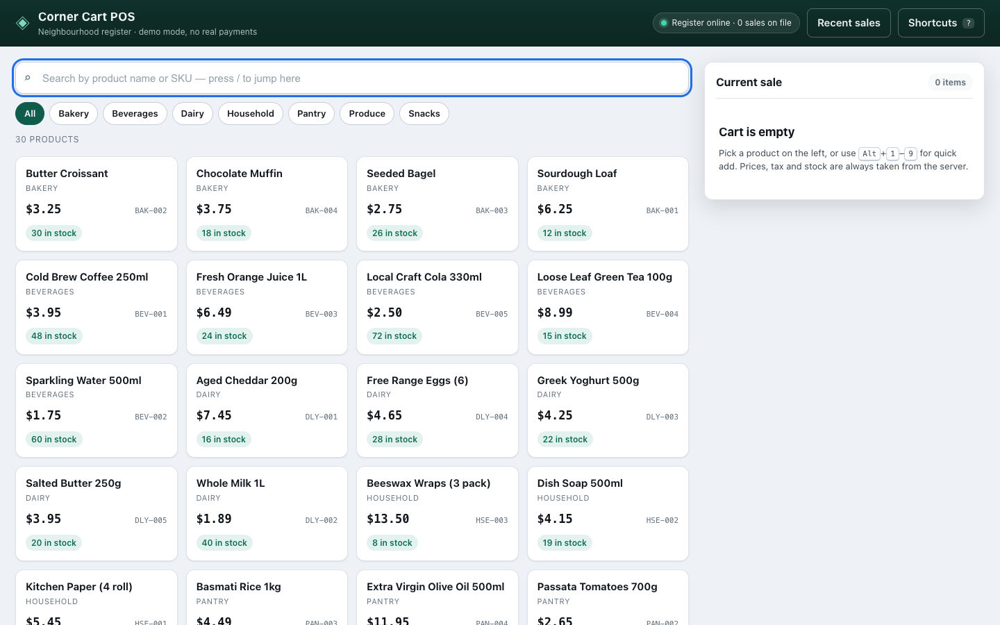
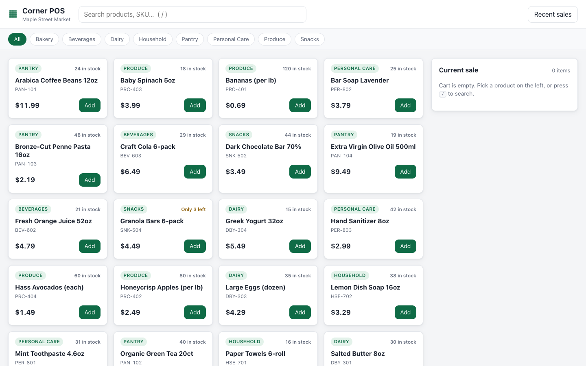
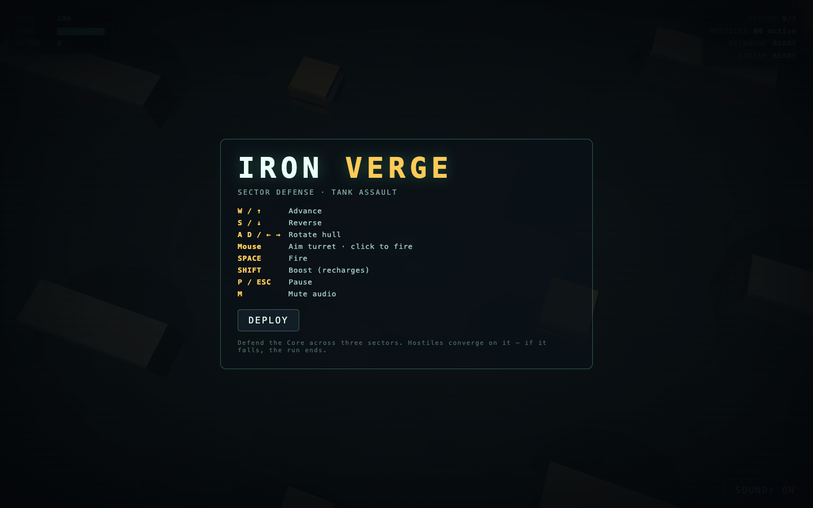
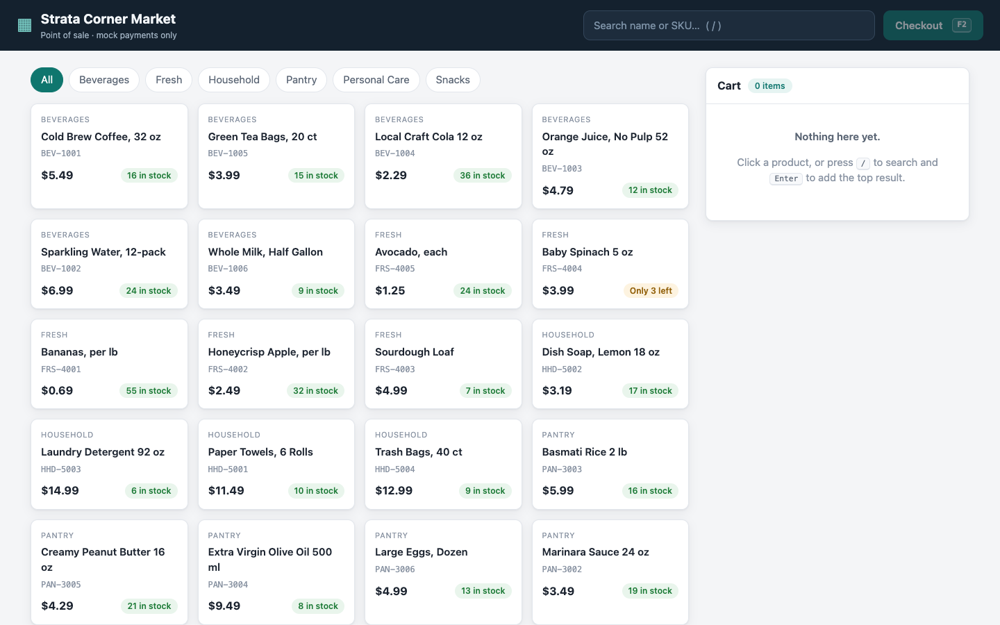
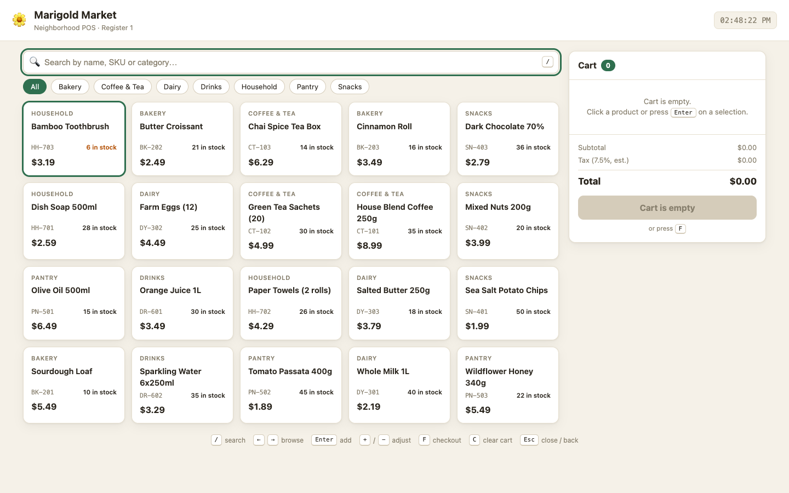
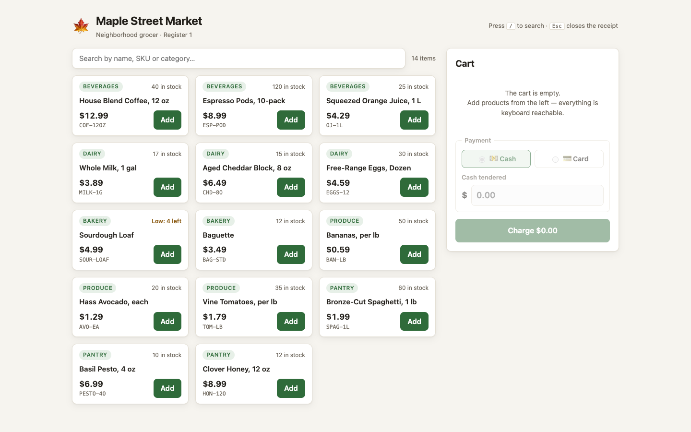

# Strata and Splash on shared IQ4 weights

[English](2026-11-26-iq4-engine-triad.md) | [简体中文](2026-11-26-iq4-engine-triad_CN.md)

Splash's generation rate was approximately **2.1×, 2.0× and 2.6×** Strata's for POS, story and the thinking-off tank pair, respectively. Task duration also depends on request count, thinking and tool output. Both POS versions took about 12–13 minutes. Story generation took **10m 33s versus 25m 33s**. Both formal tank outcomes fell short of playable. In the paired rerun, Strata alone completed deployment, play, loss and restart in the browser.

Strata's mean native footprint across the three comparable tasks was about 19–24 GiB, versus 66–68 GiB for Splash. Mean host memory ran slightly higher for Strata in all three pairs. Both scopes matter because mapped weights and system caching extend beyond process footprint.

[Request telemetry and prompts](../../assets/2026-11-26-iq4-engine-triad/telemetry.zip) · [Summary CSV](../../assets/2026-11-26-iq4-engine-triad/metrics.csv) · [Verification evidence](../../assets/2026-11-26-iq4-engine-triad/evaluation.zip) · [Screenshot archive](../../assets/2026-11-26-iq4-engine-triad/screenshots.zip)

## Method

November 26, 2026, America/Toronto. Inference and Pi 1.5.2 ran on the same MacBook Pro with Apple M5 Max, 18 CPU cores, 40 GPU cores, and 128 GiB of unified memory. Test-time OS was arm64 macOS 27.2.1 (26B131). AC power was confirmed during the run. Background system activity and thermals were uncontrolled. [Hardware, software and shard evidence](../../assets/2026-11-26-iq4-engine-triad/telemetry.zip)

| Setting | Splash | Strata |
|---|---|---|
| Version | 1.7.3 | Terminal 0.2.22, Control / Metal 0.1.69 |
| Target | Four Unsloth Qwen3.8 Flash Next UD-IQ4_XS GGUF shards | Metal repack and pack derived from the same shards, with the source PLE shard read at runtime |
| Runtime | Resident routed experts, PLE streamed from SSD, DFlash2 | Mapped experts, Metal expert cache, observed suffix drafting, MTP and DFlash2 disabled |
| Context and KV | 262144 tokens, INT8 | 262144 tokens, INT8 |

The four GGUF download records identify Unsloth revision `f5d175de2cf7f720d45d6064019a81fcf056e986` and their recorded SHA-256 values match Splash's installation manifest. Tasks ran in POS, tanks, story order. Splash ran first and stopped before Strata started. Each formal task started in an empty directory with a fresh Pi session, temperature 1, top-p 0.95, top-k 20, at most 16,384 output tokens per request, medium thinking, a 40-minute task ceiling, and read/write/edit tools. One Pi request stream ran at a time. User and system prompt hashes match within each pair. Project context and extensions were disabled. Task elapsed time includes the Pi session and its file operations. The comparison uses the existing deployments, whose caching and internal reasoning budgets can differ. [Prompts and per-request settings](../../assets/2026-11-26-iq4-engine-triad/telemetry.zip)

When telemetry was requested, an unfinished Splash POS pilot was stopped and a fresh formal run started. Sampling began before each formal session. A no-source delivery in the formal tank test triggered a paired rerun in empty folders with the original prompt, Pi thinking off, and explicit API `reasoning_effort: none`. The original outcomes and reruns are retained.

Prefill is pooled as effective tokens divided by the sum of reported prefill intervals. Splash's `prompt_n` includes cached tokens, which are subtracted. Strata already reports the processed count. Generation pools effective token counts reconstructed from native reported rates and durations. Engine timer boundaries differ. Splash's decode interval begins after the first emission. Output tokens include reasoning and tool arguments. Summed input counts include history resubmitted across turns. Native request timing, client stream rates and per-metric sample coverage are in the telemetry bundle.

Resources were sampled every two seconds. The report shows arithmetic mean and sampled maximum during each task. Native process memory is macOS physical footprint. Host memory adds active, wired and compressor-occupied pages. The measures overlap. GPU utilization is the system-wide IOAccelerator counter, host CPU comes from Mach busy ticks, and native CPU uses process CPU time, where 100% equals one logical core. Host values include other processes and sampled maxima depend on the sampling interval.

## Inference rates and elapsed time

| Engine | Task | Task seconds | Requests | Input / cached tokens | Output tokens | Prefill tok/s | Generation tok/s | Tool calls / errors |
|---|---|---:|---:|---:|---:|---:|---:|---:|
| Splash | Retail POS | 737.6 | 44 | 1,921,741 / 1,841,248 | 71,310 | 1,205.1 | 106.6 | 56 / 1 |
| Strata | Retail POS | 766.9 | 15 | 411,183 / 400,418 | 38,342 | 587.4 | 51.3 | 35 / 1 |
| Splash | 3D tanks | 251.2 | 1 | 1,106 / 0 | 16,384 | 2,012.2 | 65.5 | 0 / 0 |
| Strata | 3D tanks | 1,305.4 | 15 | 515,197 / 481,500 | 47,622 | 782.2 | 37.8 | 15 / 1 |
| Splash | Snow White | 632.5 | 16 | 592,936 / 538,272 | 58,378 | 1,295.7 | 99.0 | 15 / 1 |
| Strata | Snow White | 1,533.0 | 11 | 354,945 / 329,047 | 76,306 | 936.8 | 50.7 | 14 / 2 |
| Splash | 3D tanks (rerun) | 1,363.7 | 113 | 12,459,349 / 12,293,056 | 180,774 | 1,233.7 | 147.5 | 112 / 12 |
| Strata | 3D tanks (rerun) | 1,717.3 | 77 | 6,067,865 / 5,999,910 | 92,838 | 849.2 | 56.9 | 76 / 8 |

## Resources (mean / sampled maximum)

| Engine | Task | Samples | Native footprint GiB | Host memory GiB | GPU % | Host CPU % | Native CPU % |
|---|---|---:|---:|---:|---:|---:|---:|
| Splash | Retail POS | 368 | 65.6 / 66.9 | 105.1 / 108.5 | 48.6 / 100.0 | 61.9 / 100.0 | 17.9 / 40.1 |
| Strata | Retail POS | 382 | 19.2 / 21.1 | 110.5 / 114.0 | 92.1 / 100.0 | 45.6 / 83.1 | 84.3 / 105.3 |
| Splash | 3D tanks | 125 | 67.0 / 67.1 | 106.0 / 108.6 | 59.8 / 99.0 | 69.2 / 97.8 | 23.0 / 28.1 |
| Strata | 3D tanks | 649 | 22.3 / 22.5 | 112.3 / 116.9 | 81.6 / 100.0 | 58.1 / 95.3 | 50.4 / 106.7 |
| Splash | Snow White | 315 | 67.8 / 68.7 | 107.7 / 109.5 | 85.8 / 100.0 | 28.6 / 96.0 | 14.3 / 26.3 |
| Strata | Snow White | 764 | 23.9 / 24.1 | 109.3 / 113.5 | 90.9 / 100.0 | 49.2 / 78.1 | 68.0 / 103.9 |
| Splash | 3D tanks (rerun) | 680 | 66.5 / 70.7 | 103.1 / 104.9 | 85.9 / 100.0 | 35.6 / 87.0 | 12.9 / 35.4 |
| Strata | 3D tanks (rerun) | 856 | 20.0 / 21.2 | 107.2 / 110.8 | 89.9 / 100.0 | 53.6 / 100.0 | 65.1 / 104.8 |

## Scores from both reviewers

| Task | Engine | Codex code | Codex UI | Claude code | Claude UI |
|---|---|---:|---:|---:|---:|
| Retail POS | Splash | 8 | 9 | 9 | 9 |
| Retail POS | Strata | 9 | 9 | 10 | 9 |
| Tanks, formal | Splash | 0 | 0 | 0 | 0 |
| Tanks, formal | Strata | 4 | 1 | 3 | 2 |
| Tanks, rerun | Splash | 5 | 5 | 3 | 5 |
| Tanks, rerun | Strata | 8 | 8 | 7 | 7 |
| Snow White | Splash | 8 | 8 | 8 | 8 |
| Snow White | Strata | 8 | 9 | 9 | 9 |

## Codex code and UI review

Each candidate was frozen as a local Git snapshot. The evaluator kept the source as delivered. Go checks used `go test -race -count=1 -v ./...`. Static candidates received JavaScript syntax checks. UI verification used Thorium 156.0.8078.28 at 1440 × 900 desktop and 390 × 844 mobile, with the static originals served directly over local HTTP. Failures and diagnostic reruns are retained. Code and UI each use five criteria, scored 0–2 for a total of 10. [Source snapshots](../../assets/2026-11-26-iq4-engine-triad/source-snapshots.json) · [36 original screenshots](../../assets/2026-11-26-iq4-engine-triad/screenshots.zip)

### Retail POS

Both Compose projects built and ran, with web/API ports 18101/18102 and 18201/18202 bound to loopback. The first launches hit the host's exhausted Docker address pool. Both were retried using equivalent evaluator-only subnet overrides while preserving generated source and application settings.

- **Runtime.** Both completed search, quantity changes, cash checkout and a readable receipt. Each passed 8/8 independent API checks covering zero quantity, insufficient stock, cash and card, inventory decrement and state across restart. The Splash Go test package fails to compile because `backend/checkout_test.go:33` passes a method returning an error to `t.Cleanup`. All 10 Strata Go tests passed. Both application images built. [Splash API evidence](../../assets/2026-11-26-iq4-engine-triad/splash-pos-api.json) · [Strata API evidence](../../assets/2026-11-26-iq4-engine-triad/strata-pos-api.json)
- **Code.** Splash's server quote shares checkout logic. The store uses locking and syncs a temporary file before atomic rename, with best-effort directory sync. Strata also calculates and saves sales on the backend. Its temporary-file rename passes a normal restart, with no explicit disk sync in the save path. Both Vue/Vite manifests use dependency ranges, with no lockfile in the generated project.
- **UI.** Splash's entire product card is an add target, with compact labels and visible stock. At 390px the document reaches 494px and the header overflows. Strata's page remains 390px wide and the independent payment modal makes the small-screen register readable. It sets initial payment-modal focus, with an incomplete Tab focus cycle in the source. [Splash UI evidence](../../assets/2026-11-26-iq4-engine-triad/splash-pos-browser.json) · [Strata UI evidence](../../assets/2026-11-26-iq4-engine-triad/strata-pos-browser.json)

[Splash receipt](../../assets/2026-11-26-iq4-engine-triad/splash-pos-desktop-receipt.png) · [Strata receipt](../../assets/2026-11-26-iq4-engine-triad/strata-pos-desktop-receipt.png) · [Splash mobile](../../assets/2026-11-26-iq4-engine-triad/splash-pos-mobile-register.png) · [Strata mobile](../../assets/2026-11-26-iq4-engine-triad/strata-pos-mobile-register.png)

### 3D tanks

- **Formal.** Splash consumed the full 16,384-token cap in one reasoning response, with zero file operations. Strata delivered IRONVALE, with separate world, projection and game logic. The first frame reads an uninitialized camera basis vector at `js/engine.js:239` and stops the render loop on desktop and mobile. Only the HUD and banner appear. The truncated first write call is also retained. [Strata formal render failure](../../assets/2026-11-26-iq4-engine-triad/strata-tank-formal-desktop-render-failure.png)
- **Splash rerun, IRON VERGE.** The menu, deployment, pause, mobile controls and first spawned shell were observed. Firing with default audio throws on non-finite gain at `js/audio.js:92`. One panner return path omits the attenuation later consumed by the sound function. Muting bypasses this error, then the first enemies hit missing `g.targetFor` at `js/entities.js:241`, stopping the loop again. The generated Node harness also fails its scout check. The custom 3D renderer and three maps are substantive, and the complete gameplay loop remains blocked.
- **Strata rerun, RIFTBREAK RUMBLE.** Thorium verified deployment, movement/fire keys, pause, resume, loss and restart. Real touch events in the mobile viewport exposed and activated FIRE. The menu, debrief and HUD share a cohesive style. The narrow viewport shows a limited part of the arena, and the projected scale and occlusion can make enemy direction harder to read. All eight waves were not played.

[Splash muted diagnostic](../../assets/2026-11-26-iq4-engine-triad/splash-tank-muted-desktop-muted-battle.png) · [Strata loss and restart screen](../../assets/2026-11-26-iq4-engine-triad/strata-tank-rerun-desktop-game-over.png) · [Strata mobile controls](../../assets/2026-11-26-iq4-engine-triad/strata-tank-rerun-mobile-arena.png)

### Snow White

Each version draws six scenes with inline SVG, covering the mirror, forest, cottage, apple, coffin and resolution. Both passed button, arrow-key, Home and mobile dot navigation checks, with no horizontal mobile overflow or attempted external requests.

- **Splash.** Warm paper, a framed stage and dark illustrations create a consistent storybook. The apple scene uses striking storm lighting. Desktop captions overlay the lower image and dim some of the smaller figures. The mobile layout moves the caption under the illustration for clearer reading. Semantic labels and live announcements are more developed.
- **Strata.** A dark frame and a separate light caption card keep both picture and text clear. The cottage and ending use distinct palettes. The mobile picture gets narrower. Its controller writes the changing progress value to the element inside the semantic progress bar. Visual progress works and the assistive reading can be improved.

[Splash mobile story](../../assets/2026-11-26-iq4-engine-triad/splash-story-mobile-apple.png) · [Strata mobile story](../../assets/2026-11-26-iq4-engine-triad/strata-story-mobile-apple.png)

## Independent Claude review and joint findings

Codex completed its code and Thorium UI review first. Orca then launched Claude Opus 5.5 with anonymized A/B source snapshots, browser evidence and local previews. Claude independently reproduced representative flows using fresh Thorium 156 profiles. It ran the Go tests and Splash's bundled Node tank harness on temporary copies. Docker build, port and restart coverage came from Codex's evidence. The independent review created two and one mock sales in the respective POS test volumes. The written review, component scores and alias map are archived with the evidence. [Original review and verification evidence](../../assets/2026-11-26-iq4-engine-triad/evaluation.zip)

- **POS.** Both reviewers gave Strata a one-point code lead and tied the UI. Its delivered tests run and its mobile view fits. Splash has stronger file durability measures, quotes and keyboard interaction. Claude reproduced a working receipt focus trap in Splash and focus escaping to the page background in Strata. After a one-line change in a temporary copy, Claude ran all 14 Splash tests successfully and awarded partial test credit. The delivered test package still fails to compile.
- **Tanks.** Both reviewers reproduced the Strata formal first-frame error and both Splash rerun crashes. Claude additionally observed a kill, damage, loss and restart in the Strata rerun. It rated battlefield readability lower because of the large translucent faces and the single effective map. Both saw clearer overhead geometry and map presentation in the Splash rerun. The firing and enemy-update failures block a complete match.
- **Story.** UI scores agree. Claude tested Strata's endpoint behavior and swipe and measured about 35% desktop illustration coverage by Splash's caption. It preferred the atmosphere and mobile composition of individual Splash illustrations and credited its live announcements. Codex judged both controllers readable. Claude gave Strata more edge-handling credit for stopping at the story boundaries.

### Coverage

Each task/configuration pair was sampled once. Eight sessions yielded 292 inference requests and 4,139 within-task resource samples. Splash ran first in the formal round. File cache, internal reasoning budgets and thermals could affect the outcome. Reported speed, resource footprint and product outcomes have separate evidence. The tank rerun uses its own common thinking configuration. Browser and Docker checks ran after generation for resource isolation. Game coverage reached the first loss and restart, and POS used mock products and payments.

The local source archive is `qwen3.8-tests/2026-11-26-iq4-engine-triad/`, with a separate Git repository for each product.

## 2026-11-26 update · Strata POS rerun with DFlash2

Strata generated **35.6%** faster and Pi finished **18.3%** sooner while generating **10.7%** more tokens. The new product passed its Go tests, but fresh-volume permissions blocked the first startup and made the delivery weaker than the original Strata POS.

The rerun used the same local M5 Max with 128 GiB, macOS 27.2.1 (26B131), and Pi 1.5.2. It reused the original POS and system prompts, tools, sampling parameters, medium thinking and 40-minute limit in a fresh directory and session. `drafting` was the only inference setting changed in the default `UD-IQ4_XS-v31 256K` preset. The Metal engine loaded the tuned IQ4 DFlash2 pack with `spec 6` and `draft-conf 0.7` and kept the default prefill chunk of 2048. Splash figures are historical. Background load and the model's sampled trajectory varied between runs. [Rerun evidence and per-request telemetry](../../assets/2026-11-26-iq4-engine-triad/pos-dflash2/evidence.zip)

| POS run | Wall time, s | Requests | Input / cached tokens | Output tokens | Prefill tok/s | Generation tok/s | Tool calls / errors |
|---|---:|---:|---:|---:|---:|---:|---:|
| Splash original | 737.6 | 44 | 1,921,741 / 1,841,248 | 71,310 | 1,205.1 | 106.6 | 56 / 1 |
| Strata original | 766.9 | 15 | 411,183 / 400,418 | 38,342 | 587.4 | 51.3 | 35 / 1 |
| Strata DFlash2 | 626.6 | 18 | 542,876 / 533,155 | 42,457 | 636.2 | 69.6 | 37 / 0 |

First-request generation rose from 50.2 to 65.1 tok/s. First-request prefill was 692.5 and 689.2 tok/s, and the aggregate prefill change includes differences in later requests. Splash's historical generation throughput remained higher. The rerun finished 111.0 seconds sooner than Splash and emitted 28,853 fewer tokens, so wall time and generation throughput describe different outcomes.

| POS run | Samples | Native process footprint GiB | Host memory GiB | GPU % | Host CPU % | Native process CPU % |
|---|---:|---:|---:|---:|---:|---:|
| Splash original | 368 | 65.6 / 66.9 | 105.1 / 108.5 | 48.6 / 100.0 | 61.9 / 100.0 | 17.9 / 40.1 |
| Strata original | 382 | 19.2 / 21.1 | 110.5 / 114.0 | 92.1 / 100.0 | 45.6 / 83.1 | 84.3 / 105.3 |
| Strata DFlash2 | 312 | 20.0 / 22.0 | 107.9 / 110.2 | 91.9 / 100.0 | 56.3 / 100.0 | 55.1 / 92.5 |

Resource values are mean / sampled maximum with the same two-second cadence and definitions. Swap was about 7.7 GiB in the rerun and 3.4 GiB in the original Strata POS run.

### POS product acceptance

Both images built. Docker's automatic network address pool was exhausted, so the evaluation applied a dedicated subnet as in the original review. The fresh volume was then mounted with root ownership. The `pos` user selected on line 16 could not write the `/data` volume declared in `backend/Dockerfile:14`, and the service exited while writing `/data/db.json.tmp`. The evaluator initialized ownership on the isolated test volume and preserved the generated source and runtime user.

Follow-up checks used configurable web and API ports 18301 / 18302. All 11 Go race tests passed, and `go vet` produced no diagnostics. All 8 API checks passed, covering cash and mock card, server pricing, stock decrement, rejection of invalid quantities and insufficient stock, and persistence of inventory and sales after an API restart. On source inspection, `backend/checkout.go:128` mutates in-memory inventory and sales before writing the file. Its error path leaves those memory changes in place if saving fails.

Thorium 156.0.8078.28 passed 36 of 37 checks. The desktop path used `/` to search, Enter to add, quantity editing and F2 to check out, with a $11.91 cash receipt. The 390px mobile viewport had no horizontal overflow and completed a card checkout by touch. The receipt opened with the intended focus, which left the dialog on Tab. Page, console and HTTP errors were all 0. Codex scores were **8/10** for code and **9/10** for UI. [Acceptance scripts, logs and screenshot evidence](../../assets/2026-11-26-iq4-engine-triad/pos-dflash2/evidence.zip)

[Desktop cash receipt](../../assets/2026-11-26-iq4-engine-triad/pos-dflash2/desktop-cash-receipt.png) · [Mobile register](../../assets/2026-11-26-iq4-engine-triad/pos-dflash2/mobile-register.png) · [Mobile card receipt](../../assets/2026-11-26-iq4-engine-triad/pos-dflash2/mobile-card-receipt.png)

Claude Opus 5.5 independently scored the candidate **7/10** for code and **8/10** for UI through Orca. It reran the Go tests in a disposable copy, completed two mock sales in Thorium and confirmed that focus leaves the dialog. It also reproduced Enter on the focused Cancel button submitting a sale, and a payment dialog that labeled $7.58 as server-confirmed while the backend receipt showed $7.57, a 1-cent difference. Codex gathered the cold-start and restart evidence. Both reviewers credited the core flow after the ownership setup and deducted for the fresh-volume startup and keyboard issues. Claude also deducted for out-of-box reproducibility and payment errors. The source snapshot is local commit `5cef14325226b39f4ecfbd760c3591932d555869`. [Independent review and screenshots](../../assets/2026-11-26-iq4-engine-triad/pos-dflash2/evidence.zip)

## 2026-11-26 addendum · Splash Qwen3.8-27B 4-bit POS

On the same M5 Max, 27B ended its POS run in **569.5 seconds**, **22.8%** sooner than the original Flash-Next run. Generation throughput was **30.8%** lower, it emitted **44.0%** fewer tokens, and the submitted Go code blocked the build. The faster session delivered a weaker product in this comparison.

### Configuration and controls

The client and inference host were the same Apple M5 Max Mac with 128 GiB, macOS 27.2.1 (26B131), Splash 1.7.3 and Pi 1.5.2. The 27B profile used Unsloth Dynamic v3.1 `UD-Q4_K_XL`, a 17.66 GB target, alongside a BF16 vision projector and Inco's Qwen3.8-27B DFlash2 draft. The choice prioritized quality within the 4-bit tier. The independent quantization comparison on AMD hardware measured lower KL divergence from Q8 for this target than for IQ4_XS. The downloaded target, projector and draft were pinned and verified against the publisher's SHA-256 checksums. [Unsloth release](https://huggingface.co/unsloth/Qwen3.8-27B-GGUF/discussions/143) · [Community quantization measurements](https://github.com/kr4ckhe4d/local-llm-benchmarks/blob/main/r9700%2Brx9070.md) · [Hashes and telemetry](../../assets/2026-11-26-iq4-engine-triad/pos-splash-27b/evidence.zip)

Both runs used **262,144 tokens of context**, Pi **medium** thinking, temperature 1, top-p 0.95, top-k 20, a 16,384-token limit per request and a 40-minute task limit. The POS and system prompt hashes matched, along with the read/write/edit tools and captured request settings. Splash retained INT8 KV, FP32 working state, the 96 GiB Metal budget, and no disk cache. Splash's automatic draft verification and Neural Engine prefill remained enabled. Startup calibration used an approximately 24% FFN split from 687 rows on 27B. Startup, calibration, Docker and browser evaluation were outside task timing. [Splash model support](https://github.com/incoai/splash/blob/1.7.3/docs/models.md) · [Runtime settings](https://github.com/incoai/splash/blob/1.7.3/docs/server.md)

### Performance

| Splash POS | Task seconds | Requests / API failures | Input / cache tokens | Output / thinking tokens | Prefill tok/s | Generation tok/s | Tool calls / errors |
|---|---:|---:|---:|---:|---:|---:|---:|
| Original Flash-Next UD-IQ4_XS | 737.6 | 44 / 0 | 1,921,741 / 1,841,248 | 71,310 / 18,004 | 1,205.1 | 106.6 | 56 / 1 |
| 27B UD-Q4_K_XL v3.1 | 569.5 | 15 / 0 | 425,207 / 407,712 | 39,946 / 13,181 | 627.5 | 73.8 | 29 / 0 |

Uncached first-request prefill was 1,992.8 and 1,140.0 tok/s, respectively, and client time to the first streamed delta was 0.60 and 1.05 seconds. Whole-task rates divide total effective tokens by the corresponding total native prefill or decode time. Prefill excludes cached input tokens. Model architecture, quantization, and sampled generation paths differ across the two runs. Each configuration has one trial.

| Splash POS | Samples | Native process footprint GiB | Host memory GiB | GPU % | Host CPU % | Native process CPU % | Swap GiB |
|---|---:|---:|---:|---:|---:|---:|---:|
| Original Flash-Next UD-IQ4_XS | 368 | 65.61 / 66.91 | 105.13 / 108.51 | 48.64 / 100.00 | 61.88 / 100.00 | 17.92 / 40.13 | 3.43 / 3.43 |
| 27B UD-Q4_K_XL v3.1 | 284 | 22.07 / 23.71 | 68.88 / 73.24 | 98.92 / 99.00 | 11.07 / 36.46 | 1.37 / 2.30 | 3.72 / 3.73 |

Resource columns show means and sampled peaks at two-second intervals, using the same collection method as the original run. The mean 27B native process footprint was about 66% lower. Host memory, CPU and GPU metrics also capture background activity. The Flash-Next baseline was collected earlier the same day. [Per-request and resource samples](../../assets/2026-11-26-iq4-engine-triad/pos-splash-27b/evidence.zip)

### POS product evaluation

The 23-file submission was frozen at local commit `e3cd696`. Go race tests, `go vet`, and the backend Compose build failed at the same blocker. The `Products` and `Sales` fields at `backend/internal/store/store.go:69–70` collide with methods on lines 118 and 154. The submitted Compose accepts custom ports and configures an nginx same-origin proxy. Its publication rules omit the loopback address and give both containers fixed names, impairing isolated deployments.

To evaluate the remaining features, the diagnostic copy renamed the colliding Go methods and their call sites. An evaluation Compose override bound web/API ports 18401/18402 to loopback on a dedicated subnet. The submitted frontend and business logic ran intact. The diagnostic copy booted on a clean volume and passed 11 of 12 top-level Go race tests. The search test failed because “coffee” also matches teas in the Coffee & Tea category. Eight API checks passed, including rejection of zero quantity and insufficient stock, server pricing despite a forged client price, cash and mock card checkout, stock decrement, and persistence after backend restart. Source inspection also found that stock and the sales ledger change in memory before persistence, and the error path has no rollback. [Source identifier, diagnostic patch and acceptance evidence](../../assets/2026-11-26-iq4-engine-triad/pos-splash-27b/evidence.zip)

Thorium 156.0.8078.28 passed 36 of 38 diagnostic checks, including desktop keyboard and 390px mobile touch checkout. Neither viewport overflowed and there were no page errors. Both failures were amount discrepancies. Go uses 750 per mille (75%), while the Vue UI displays 7.5%. The desktop cash preview showed **$19.33** and the receipt showed **$31.47**. The mobile card receipt showed **$4.36**, versus **$2.68** at the displayed rate. Codex scored the submission **4/10 code** and **0/10 runnable UI**, and the diagnostic UI **7/10**. The original Splash Flash-Next run scored **8/10 code** and **9/10 UI**. Both submitted Go suites failed as delivered, while the Flash-Next application itself built and processed sales.

[Desktop cash receipt](../../assets/2026-11-26-iq4-engine-triad/pos-splash-27b/desktop-cash-receipt.png) · [Mobile register](../../assets/2026-11-26-iq4-engine-triad/pos-splash-27b/mobile-register.png) · [Mobile card receipt](../../assets/2026-11-26-iq4-engine-triad/pos-splash-27b/mobile-card-receipt.png)

The local launcher defaults to Flash-Next and selects 27B with `start.sh 27b`, using the same service port. The Pi run exercised the explicit argument. The subsequent argument-free smoke test exposed the Flash-Next model at 256K context and returned `391` on an authenticated request. Inference was stopped afterward.

### Claude independent review

Claude Opus 5.5 ran through Orca and scored the submission **2/10 code** and **0/10 runnable UI**, with **6/10** for the diagnostic UI. It independently reproduced the original compile failure and confirmed the 75% tax in two mock transactions. The backend rejected cash tendered at the displayed exact total. Claude also reproduced a Print TypeError, cart shortcuts firing behind the checkout dialog, and focus escaping the dialog. A failure-injection test on a disposable copy confirmed that a write failure leaves memory and disk out of sync. A concurrent probe reproduced a race between stock writes and category reads. Both reviewers found the submitted build blocked and the tax incorrect once the code ran. Claude gave less credit for out-of-the-box execution, amount correctness and checkout interactions. [Independent review and screenshots](../../assets/2026-11-26-iq4-engine-triad/pos-splash-27b/evidence.zip)

## 2026-11-26 addendum · Splash Qwen3.8-27B Q8 POS rerun

The run used the same Apple M5 Max Mac with 128 GiB, macOS 27.2.1 (26B131), Splash 1.7.3 and Pi 1.5.2. The 27B target changed from `UD-Q4_K_XL` to the same Unsloth release's `UD-Q8_K_XL` (31.46 GB). This is the highest-precision 27B Q8 variant documented by Splash, retaining BF16 attention projections and output head. The target, reused DFlash2 draft and BF16 projector matched publisher SHA-256 checksums. After the Q8 alias was verified on the API, the old 17.66 GB 27B Q4 weights and installation were retired. The launcher defaults to Flash-Next, and `start.sh 27b` selects the Q8 profile registered in Pi. [Splash GGUF support](https://github.com/incoai/splash/blob/1.7.3/docs/models.md#gguf-targets) · [Pinned model revision](https://huggingface.co/unsloth/Qwen3.8-27B-GGUF/tree/4af51b3542f775b0a8e4b310bfb3f17e01c306c9)

Both 27B runs shared the POS and system prompts, tools, 262,144-token context, `medium` thinking, 16,384-token request limit, and 40-minute task limit. Requests used temperature 1, top-p 0.95 and top-k 20. Splash retained INT8 KV, FP32 working state, the 96 GiB Metal budget, automatic draft verification and Neural Engine prefill. Task timing started after readiness and acceptance testing followed generation. The two quantizations were sampled once each. The earlier Flash-Next run is included for historical context. [Configuration, request timings and resource samples](../../assets/2026-11-26-iq4-engine-triad/pos-splash-27b-q8/evidence.zip)

### Performance

Q8 ended the task in **553.5 seconds**, **2.8%** sooner than 27B Q4. Generation throughput was **22.6%** lower and the session emitted **23.3%** fewer tokens. Mean physical footprint increased **56.5%**, from **22.07 GiB** to **34.55 GiB**. Uncached first-request prefill rose from 1,140.0 to 1,193.0 tok/s and time to first streamed delta fell from 1.05 to 1.00 seconds. Q8's Neural Engine split passed startup calibration. Splash paused it on request 16 after measuring a slowdown and used the GPU for subsequent prefill.

| Splash POS | Task seconds | Requests / API failures | Input / cache tokens | Output / thinking tokens | Prefill tok/s | Generation tok/s | Tool calls / errors |
|---|---:|---:|---:|---:|---:|---:|---:|
| Original Flash-Next UD-IQ4_XS | 737.6 | 44 / 0 | 1,921,741 / 1,841,248 | 71,310 / 18,004 | 1,205.1 | 106.6 | 56 / 1 |
| 27B UD-Q4_K_XL | 569.5 | 15 / 0 | 425,207 / 407,712 | 39,946 / 13,181 | 627.5 | 73.8 | 29 / 0 |
| 27B UD-Q8_K_XL | 553.5 | 17 / 0 | 345,298 / 334,592 | 30,629 / 8,903 | 653.3 | 57.1 | 30 / 0 |

| Splash POS | Samples | Native footprint GiB | Host memory GiB | GPU % | Host CPU % | Native process CPU % | Swap GiB |
|---|---:|---:|---:|---:|---:|---:|---:|
| Original Flash-Next UD-IQ4_XS | 368 | 65.61 / 66.91 | 105.13 / 108.51 | 48.64 / 100.00 | 61.88 / 100.00 | 17.92 / 40.13 | 3.43 / 3.43 |
| 27B UD-Q4_K_XL | 284 | 22.07 / 23.71 | 68.88 / 73.24 | 98.92 / 99.00 | 11.07 / 36.46 | 1.37 / 2.30 | 3.72 / 3.73 |
| 27B UD-Q8_K_XL | 275 | 34.55 / 35.91 | 75.13 / 85.06 | 98.28 / 99.00 | 18.56 / 70.97 | 1.64 / 4.70 | 3.71 / 3.72 |

Rates use the original report's effective-token and native-time formulas. Resource figures are means and sampled peaks at two-second intervals. Host figures include background activity. [Per-request data and resource samples](../../assets/2026-11-26-iq4-engine-triad/pos-splash-27b-q8/evidence.zip)

### POS product evaluation

The 22-file Q8 submission was frozen at local commit `1bcc865`. Both Go and Vue images built and started from a fresh volume. The generated Compose file omitted loopback binding. The evaluation override supplied loopback binding, unique image tags and a dedicated subnet on web/API ports 18411/18412, running the frozen source. **12 of 12 API checks** passed, covering invalid quantities, stock limits including merged duplicate lines, authoritative prices, cash and mock card, correct 7.25% tax, and persisted sales and stock after backend restart. **12 of 13 generated Go race tests** passed and `go vet` passed. The failing test expects rejection for buying 3+3 against stock of 6. An independent API probe correctly rejected 5+2. Source inspection identified a persistence edge case. Checkout mutates in-memory state and then renames the catalog and sales JSON files separately, so a partial write can leave disk or memory state inconsistent. [Source snapshot, acceptance evidence and test logs](../../assets/2026-11-26-iq4-engine-triad/pos-splash-27b-q8/evidence.zip)

Thorium 156.0.8078.28 passed **43 of 44** checks on desktop and at 390px mobile width, with no horizontal overflow. The desktop preview and cash receipt both showed **$10.70**, with exact tender and $0.00 change. The mobile card preview and receipt both showed **$4.17**. The receipt's initial focus was correct, but Tab escaped the dialog. Codex scored the Q8 submission **7/10 code** and **9/10 UI**, compared with **4/10 code** and **0/10 runnable UI** for the submitted Q4 version. This Q8 run delivered a buildable product with correct checkout amounts. One run per quantization leaves its effect on the long-run pass rate unresolved.

[Desktop cash receipt](../../assets/2026-11-26-iq4-engine-triad/pos-splash-27b-q8/desktop-cash-receipt.png) · [Mobile register](../../assets/2026-11-26-iq4-engine-triad/pos-splash-27b-q8/mobile-register.png) · [Mobile card receipt](../../assets/2026-11-26-iq4-engine-triad/pos-splash-27b-q8/mobile-card-receipt.png)

### Claude independent review

Claude Opus 5.5 ran through Orca and scored Q8 **8/10 code** and **9/10 UI**, versus its **2/10 code** and **0/10 runnable UI** for the Q4 submission. Claude reran Go tests in a disposable copy and completed a desktop cash sale and a mobile card sale in Thorium. It independently confirmed the faulty generated stock assertion, the missing loopback binding, and Tab escaping the receipt dialog. It also measured the mobile cart at about 2,150px below the top on the unfiltered page and the quantity buttons at 30×30px. Both reviewers found the Q8 source buildable and the tested checkout amounts correct. [Independent review and screenshots](../../assets/2026-11-26-iq4-engine-triad/pos-splash-27b-q8/evidence.zip)
