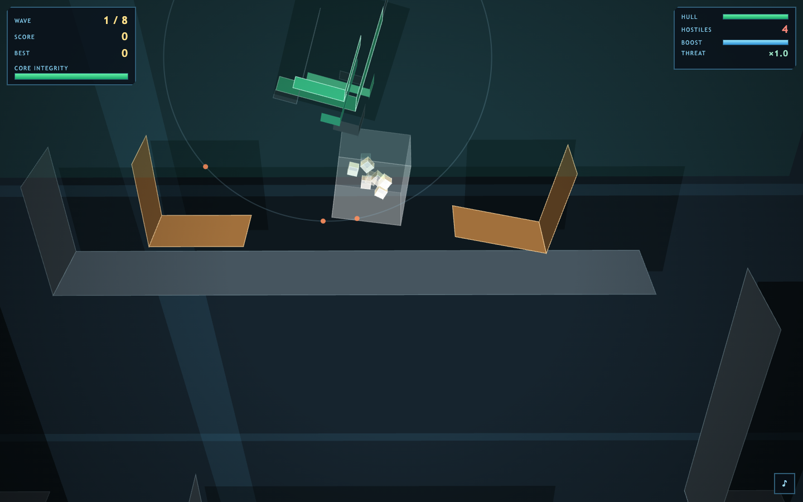
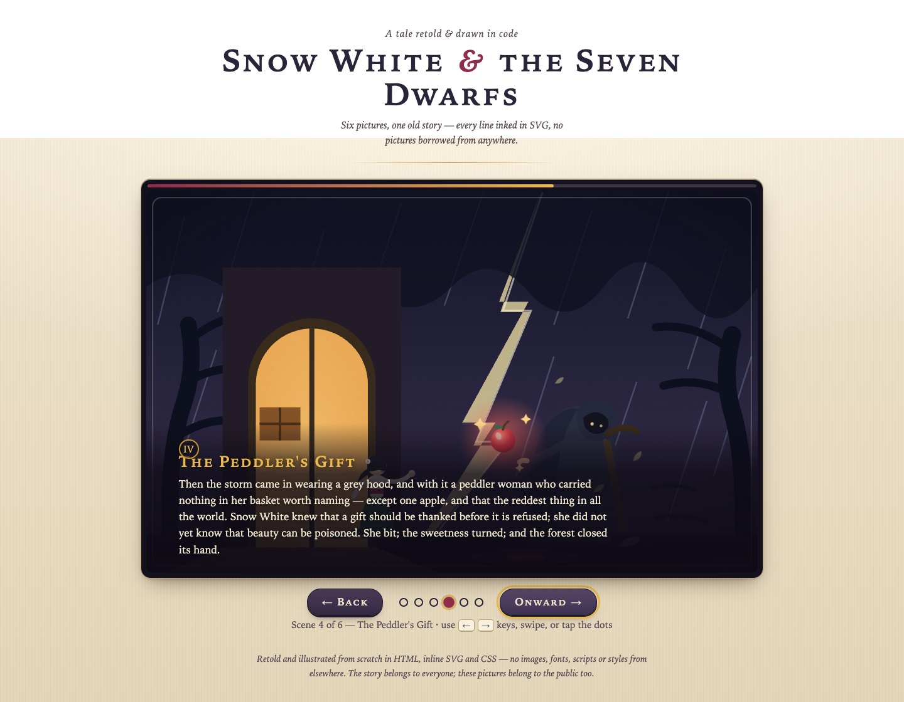
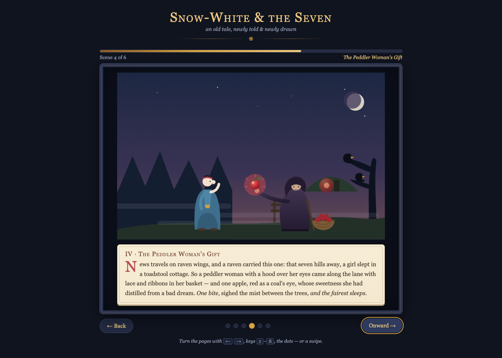

# Strata and Splash on shared IQ4 weights

[English](2026-11-26-iq4-engine-triad.md) | [简体中文](2026-11-26-iq4-engine-triad_CN.md)

Splash's generation rate was approximately **2.1×, 2.0× and 2.6×** Strata's for POS, story and the thinking-off tank pair, respectively. Task duration also depends on request count, thinking and tool output. Both POS versions took about 12–13 minutes. Story generation took **10m 33s versus 25m 33s**. Both formal tank outcomes fell short of playable. In the paired rerun, Strata alone completed deployment, play, loss and restart in the browser.

Strata's mean native footprint across the three comparable tasks was about 19–24 GiB, versus 66–68 GiB for Splash. Mean host memory ran slightly higher for Strata in all three pairs. Both scopes matter because mapped weights and system caching extend beyond process footprint.

[Request telemetry and prompts](../../assets/2026-11-26-iq4-engine-triad/telemetry.zip) · [Summary CSV](../../assets/2026-11-26-iq4-engine-triad/metrics.csv) · [Verification evidence](../../assets/2026-11-26-iq4-engine-triad/evaluation.zip) · [Screenshot archive](../../assets/2026-11-26-iq4-engine-triad/screenshots.zip)

## Method

November 26, 2026, America/Toronto. Inference and Pi 1.5.2 ran on the same MacBook Pro with Apple M5 Max, 18 CPU cores, 40 GPU cores, and 128 GiB of unified memory. Test-time OS was arm64 macOS 27.2.1 (26B131). AC power was confirmed during the run. Background system activity and thermals were uncontrolled. [Hardware, software and shard evidence](../../assets/2026-11-26-iq4-engine-triad/telemetry.zip)

| Setting | Splash | Strata |
|---|---|---|
| Version | 1.7.3 | Terminal 0.2.22, Control / Metal 0.1.69 |
| Target | Four Unsloth Qwen3.8 Flash Next UD-IQ4_XS GGUF shards | Metal repack and pack derived from the same shards, with the source PLE shard read at runtime |
| Runtime | Resident routed experts, PLE streamed from SSD, DFlash2 | Mapped experts, Metal expert cache, observed suffix drafting, MTP and DFlash2 disabled |
| Context and KV | 262144 tokens, INT8 | 262144 tokens, INT8 |

The four GGUF download records identify Unsloth revision `f5d175de2cf7f720d45d6064019a81fcf056e986` and their recorded SHA-256 values match Splash's installation manifest. Tasks ran in POS, tanks, story order. Splash ran first and stopped before Strata started. Each formal task started in an empty directory with a fresh Pi session, temperature 1, top-p 0.95, top-k 20, at most 16,384 output tokens per request, medium thinking, a 40-minute task ceiling, and read/write/edit tools. One Pi request stream ran at a time. User and system prompt hashes match within each pair. Project context and extensions were disabled. Task elapsed time includes the Pi session and its file operations. The comparison uses the existing deployments, whose caching and internal reasoning budgets can differ. [Prompts and per-request settings](../../assets/2026-11-26-iq4-engine-triad/telemetry.zip)

When telemetry was requested, an unfinished Splash POS pilot was stopped and a fresh formal run started. Sampling began before each formal session. A no-source delivery in the formal tank test triggered a paired rerun in empty folders with the original prompt, Pi thinking off, and explicit API `reasoning_effort: none`. The original outcomes and reruns are retained.

Prefill is pooled as effective tokens divided by the sum of reported prefill intervals. Splash's `prompt_n` includes cached tokens, which are subtracted. Strata already reports the processed count. Generation pools effective token counts reconstructed from native reported rates and durations. Engine timer boundaries differ. Splash's decode interval begins after the first emission. Output tokens include reasoning and tool arguments. Summed input counts include history resubmitted across turns. Native request timing, client stream rates and per-metric sample coverage are in the telemetry bundle.

Resources were sampled every two seconds. The report shows arithmetic mean and sampled maximum during each task. Native process memory is macOS physical footprint. Host memory adds active, wired and compressor-occupied pages. The measures overlap. GPU utilization is the system-wide IOAccelerator counter, host CPU comes from Mach busy ticks, and native CPU uses process CPU time, where 100% equals one logical core. Host values include other processes and sampled maxima depend on the sampling interval.

## Inference rates and elapsed time

| Engine | Task | Task seconds | Requests | Input / cached tokens | Output tokens | Prefill tok/s | Generation tok/s | Tool calls / errors |
|---|---|---:|---:|---:|---:|---:|---:|---:|
| Splash | Retail POS | 737.6 | 44 | 1,921,741 / 1,841,248 | 71,310 | 1,205.1 | 106.6 | 56 / 1 |
| Strata | Retail POS | 766.9 | 15 | 411,183 / 400,418 | 38,342 | 587.4 | 51.3 | 35 / 1 |
| Splash | 3D tanks | 251.2 | 1 | 1,106 / 0 | 16,384 | 2,012.2 | 65.5 | 0 / 0 |
| Strata | 3D tanks | 1,305.4 | 15 | 515,197 / 481,500 | 47,622 | 782.2 | 37.8 | 15 / 1 |
| Splash | Snow White | 632.5 | 16 | 592,936 / 538,272 | 58,378 | 1,295.7 | 99.0 | 15 / 1 |
| Strata | Snow White | 1,533.0 | 11 | 354,945 / 329,047 | 76,306 | 936.8 | 50.7 | 14 / 2 |
| Splash | 3D tanks (rerun) | 1,363.7 | 113 | 12,459,349 / 12,293,056 | 180,774 | 1,233.7 | 147.5 | 112 / 12 |
| Strata | 3D tanks (rerun) | 1,717.3 | 77 | 6,067,865 / 5,999,910 | 92,838 | 849.2 | 56.9 | 76 / 8 |

## Resources (mean / sampled maximum)

| Engine | Task | Samples | Native footprint GiB | Host memory GiB | GPU % | Host CPU % | Native CPU % |
|---|---|---:|---:|---:|---:|---:|---:|
| Splash | Retail POS | 368 | 65.6 / 66.9 | 105.1 / 108.5 | 48.6 / 100.0 | 61.9 / 100.0 | 17.9 / 40.1 |
| Strata | Retail POS | 382 | 19.2 / 21.1 | 110.5 / 114.0 | 92.1 / 100.0 | 45.6 / 83.1 | 84.3 / 105.3 |
| Splash | 3D tanks | 125 | 67.0 / 67.1 | 106.0 / 108.6 | 59.8 / 99.0 | 69.2 / 97.8 | 23.0 / 28.1 |
| Strata | 3D tanks | 649 | 22.3 / 22.5 | 112.3 / 116.9 | 81.6 / 100.0 | 58.1 / 95.3 | 50.4 / 106.7 |
| Splash | Snow White | 315 | 67.8 / 68.7 | 107.7 / 109.5 | 85.8 / 100.0 | 28.6 / 96.0 | 14.3 / 26.3 |
| Strata | Snow White | 764 | 23.9 / 24.1 | 109.3 / 113.5 | 90.9 / 100.0 | 49.2 / 78.1 | 68.0 / 103.9 |
| Splash | 3D tanks (rerun) | 680 | 66.5 / 70.7 | 103.1 / 104.9 | 85.9 / 100.0 | 35.6 / 87.0 | 12.9 / 35.4 |
| Strata | 3D tanks (rerun) | 856 | 20.0 / 21.2 | 107.2 / 110.8 | 89.9 / 100.0 | 53.6 / 100.0 | 65.1 / 104.8 |

## Scores from both reviewers

| Task | Engine | Codex code | Codex UI | Claude code | Claude UI |
|---|---|---:|---:|---:|---:|
| Retail POS | Splash | 8 | 9 | 9 | 9 |
| Retail POS | Strata | 9 | 9 | 10 | 9 |
| Tanks, formal | Splash | 0 | 0 | 0 | 0 |
| Tanks, formal | Strata | 4 | 1 | 3 | 2 |
| Tanks, rerun | Splash | 5 | 5 | 3 | 5 |
| Tanks, rerun | Strata | 8 | 8 | 7 | 7 |
| Snow White | Splash | 8 | 8 | 8 | 8 |
| Snow White | Strata | 8 | 9 | 9 | 9 |

## Codex code and UI review

Each candidate was frozen as a local Git snapshot. The evaluator kept the source as delivered. Go checks used `go test -race -count=1 -v ./...`. Static candidates received JavaScript syntax checks. UI verification used Thorium 156.0.8078.28 at 1440 × 900 desktop and 390 × 844 mobile, with the static originals served directly over local HTTP. Failures and diagnostic reruns are retained. Code and UI each use five criteria, scored 0–2 for a total of 10. [Source snapshots](../../assets/2026-11-26-iq4-engine-triad/source-snapshots.json) · [36 original screenshots](../../assets/2026-11-26-iq4-engine-triad/screenshots.zip)

### Retail POS

Both Compose projects built and ran, with web/API ports 18101/18102 and 18201/18202 bound to loopback. The first launches hit the host's exhausted Docker address pool. Both were retried using equivalent evaluator-only subnet overrides while preserving generated source and application settings.

- **Runtime.** Both completed search, quantity changes, cash checkout and a readable receipt. Each passed 8/8 independent API checks covering zero quantity, insufficient stock, cash and card, inventory decrement and state across restart. The Splash Go test package fails to compile because `backend/checkout_test.go:33` passes a method returning an error to `t.Cleanup`. All 10 Strata Go tests passed. Both application images built. [Splash API evidence](../../assets/2026-11-26-iq4-engine-triad/splash-pos-api.json) · [Strata API evidence](../../assets/2026-11-26-iq4-engine-triad/strata-pos-api.json)
- **Code.** Splash's server quote shares checkout logic. The store uses locking and syncs a temporary file before atomic rename, with best-effort directory sync. Strata also calculates and saves sales on the backend. Its temporary-file rename passes a normal restart, with no explicit disk sync in the save path. Both Vue/Vite manifests use dependency ranges, with no lockfile in the generated project.
- **UI.** Splash's entire product card is an add target, with compact labels and visible stock. At 390px the document reaches 494px and the header overflows. Strata's page remains 390px wide and the independent payment modal makes the small-screen register readable. It sets initial payment-modal focus, with an incomplete Tab focus cycle in the source. [Splash UI evidence](../../assets/2026-11-26-iq4-engine-triad/splash-pos-browser.json) · [Strata UI evidence](../../assets/2026-11-26-iq4-engine-triad/strata-pos-browser.json)

[Splash receipt](../../assets/2026-11-26-iq4-engine-triad/splash-pos-desktop-receipt.png) · [Strata receipt](../../assets/2026-11-26-iq4-engine-triad/strata-pos-desktop-receipt.png) · [Splash mobile](../../assets/2026-11-26-iq4-engine-triad/splash-pos-mobile-register.png) · [Strata mobile](../../assets/2026-11-26-iq4-engine-triad/strata-pos-mobile-register.png)

### 3D tanks

- **Formal.** Splash consumed the full 16,384-token cap in one reasoning response, with zero file operations. Strata delivered IRONVALE, with separate world, projection and game logic. The first frame reads an uninitialized camera basis vector at `js/engine.js:239` and stops the render loop on desktop and mobile. Only the HUD and banner appear. The truncated first write call is also retained. [Strata formal render failure](../../assets/2026-11-26-iq4-engine-triad/strata-tank-formal-desktop-render-failure.png)
- **Splash rerun, IRON VERGE.** The menu, deployment, pause, mobile controls and first spawned shell were observed. Firing with default audio throws on non-finite gain at `js/audio.js:92`. One panner return path omits the attenuation later consumed by the sound function. Muting bypasses this error, then the first enemies hit missing `g.targetFor` at `js/entities.js:241`, stopping the loop again. The generated Node harness also fails its scout check. The custom 3D renderer and three maps are substantive, and the complete gameplay loop remains blocked.
- **Strata rerun, RIFTBREAK RUMBLE.** Thorium verified deployment, movement/fire keys, pause, resume, loss and restart. Real touch events in the mobile viewport exposed and activated FIRE. The menu, debrief and HUD share a cohesive style. The narrow viewport shows a limited part of the arena, and the projected scale and occlusion can make enemy direction harder to read. All eight waves were not played.

[Splash muted diagnostic](../../assets/2026-11-26-iq4-engine-triad/splash-tank-muted-desktop-muted-battle.png) · [Strata loss and restart screen](../../assets/2026-11-26-iq4-engine-triad/strata-tank-rerun-desktop-game-over.png) · [Strata mobile controls](../../assets/2026-11-26-iq4-engine-triad/strata-tank-rerun-mobile-arena.png)

### Snow White

Each version draws six scenes with inline SVG, covering the mirror, forest, cottage, apple, coffin and resolution. Both passed button, arrow-key, Home and mobile dot navigation checks, with no horizontal mobile overflow or attempted external requests.

- **Splash.** Warm paper, a framed stage and dark illustrations create a consistent storybook. The apple scene uses striking storm lighting. Desktop captions overlay the lower image and dim some of the smaller figures. The mobile layout moves the caption under the illustration for clearer reading. Semantic labels and live announcements are more developed.
- **Strata.** A dark frame and a separate light caption card keep both picture and text clear. The cottage and ending use distinct palettes. The mobile picture gets narrower. Its controller writes the changing progress value to the element inside the semantic progress bar. Visual progress works and the assistive reading can be improved.

[Splash mobile story](../../assets/2026-11-26-iq4-engine-triad/splash-story-mobile-apple.png) · [Strata mobile story](../../assets/2026-11-26-iq4-engine-triad/strata-story-mobile-apple.png)

## Independent Claude review and joint findings

Codex completed its code and Thorium UI review first. Orca then launched Claude Opus 5.5 with anonymized A/B source snapshots, browser evidence and local previews. Claude independently reproduced representative flows using fresh Thorium 156 profiles. It ran the Go tests and Splash's bundled Node tank harness on temporary copies. Docker build, port and restart coverage came from Codex's evidence. The independent review created two and one mock sales in the respective POS test volumes. The written review, component scores and alias map are archived with the evidence. [Original review and verification evidence](../../assets/2026-11-26-iq4-engine-triad/evaluation.zip)

- **POS.** Both reviewers gave Strata a one-point code lead and tied the UI. Its delivered tests run and its mobile view fits. Splash has stronger file durability measures, quotes and keyboard interaction. Claude reproduced a working receipt focus trap in Splash and focus escaping to the page background in Strata. After a one-line change in a temporary copy, Claude ran all 14 Splash tests successfully and awarded partial test credit. The delivered test package still fails to compile.
- **Tanks.** Both reviewers reproduced the Strata formal first-frame error and both Splash rerun crashes. Claude additionally observed a kill, damage, loss and restart in the Strata rerun. It rated battlefield readability lower because of the large translucent faces and the single effective map. Both saw clearer overhead geometry and map presentation in the Splash rerun. The firing and enemy-update failures block a complete match.
- **Story.** UI scores agree. Claude tested Strata's endpoint behavior and swipe and measured about 35% desktop illustration coverage by Splash's caption. It preferred the atmosphere and mobile composition of individual Splash illustrations and credited its live announcements. Codex judged both controllers readable. Claude gave Strata more edge-handling credit for stopping at the story boundaries.

### Coverage

Each task/configuration pair was sampled once. Eight sessions yielded 292 inference requests and 4,139 within-task resource samples. Splash ran first in the formal round. File cache, internal reasoning budgets and thermals could affect the outcome. Reported speed, resource footprint and product outcomes have separate evidence. The tank rerun uses its own common thinking configuration. Browser and Docker checks ran after generation for resource isolation. Game coverage reached the first loss and restart, and POS used mock products and payments.

The local source archive is `qwen3.8-tests/2026-11-26-iq4-engine-triad/`, with a separate Git repository for each product.
