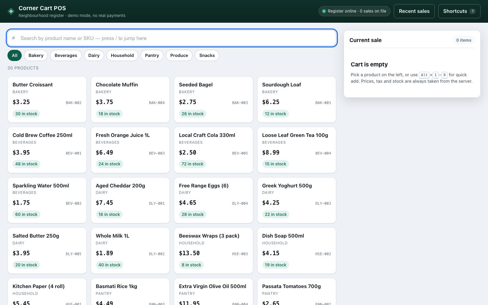
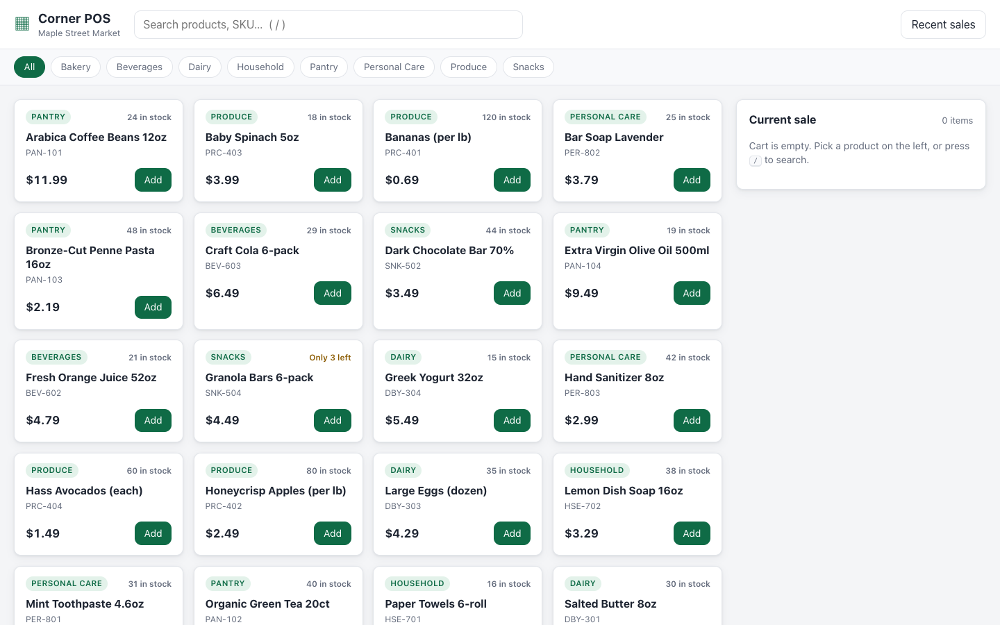
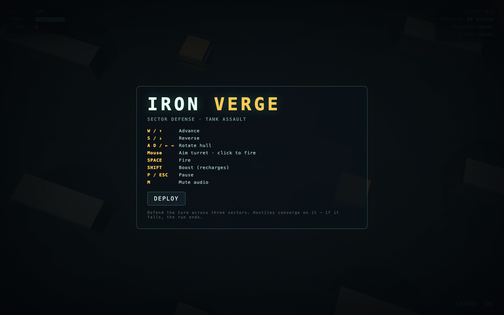
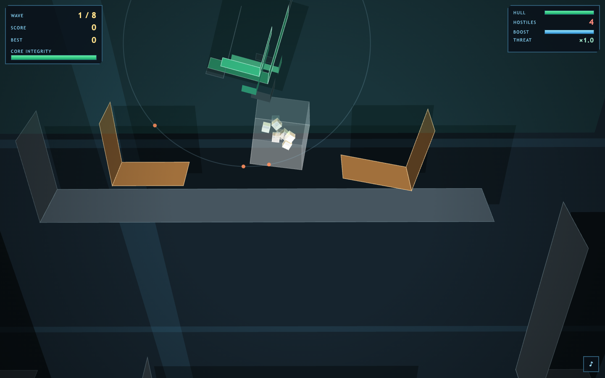
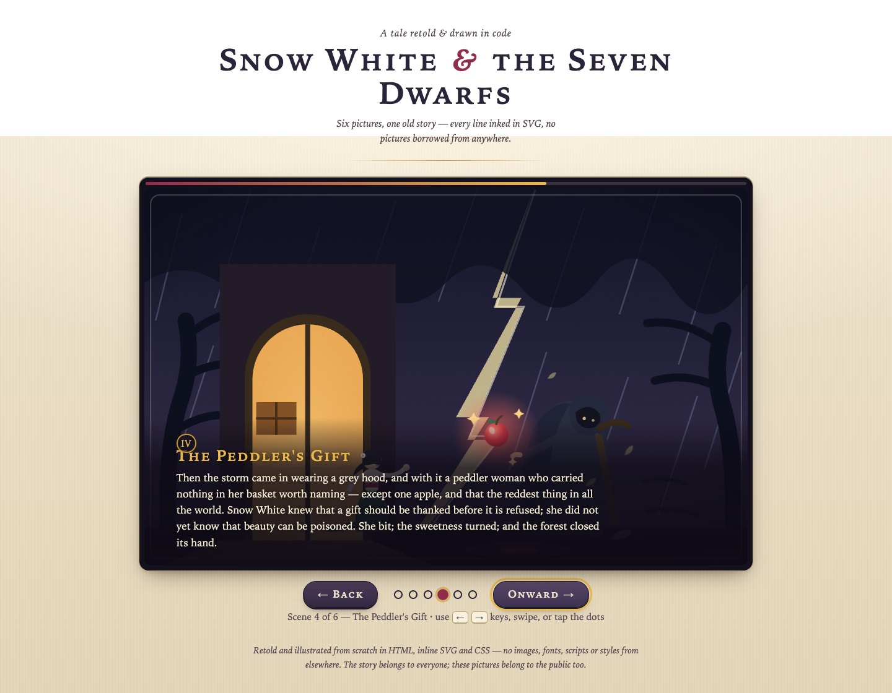
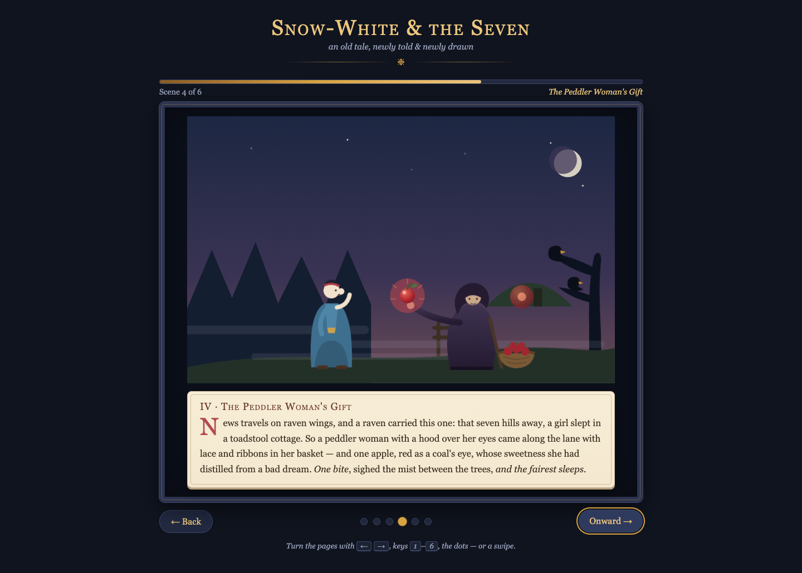
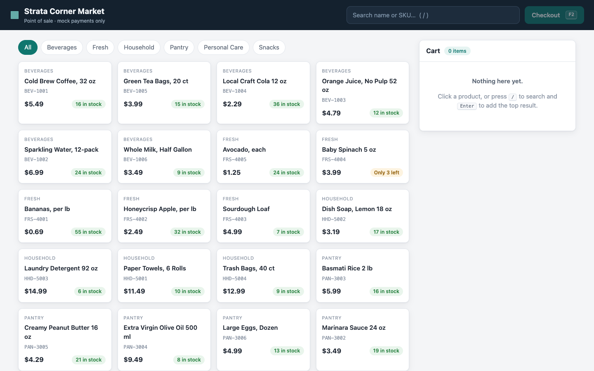
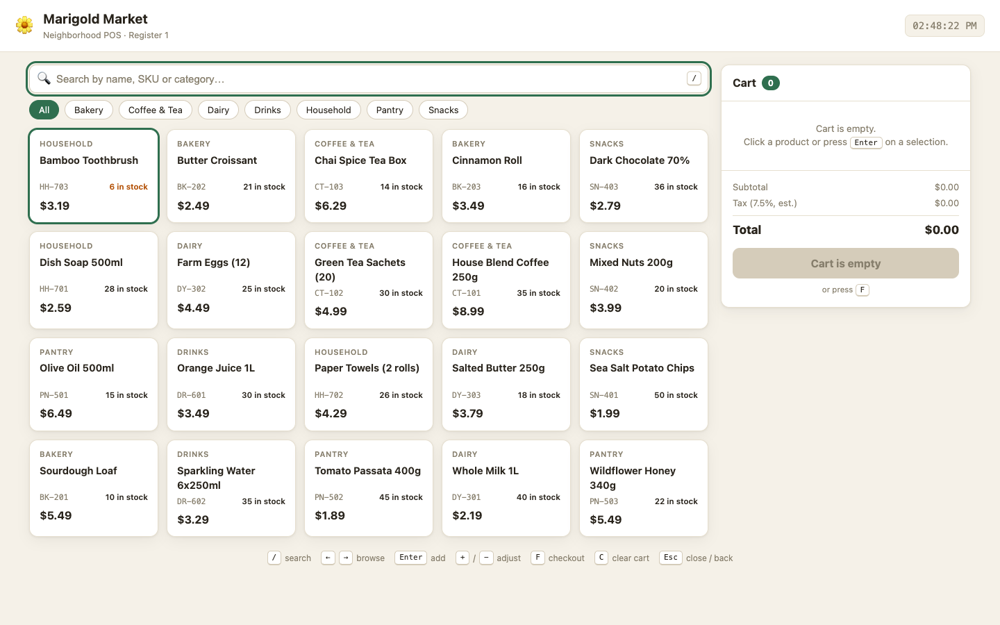

# 同一 IQ4 权重下的 Strata 与 Splash 三题对照

[English](2026-11-26-iq4-engine-triad.md) | [简体中文](2026-11-26-iq4-engine-triad_CN.md)

Splash 在 POS、故事和关闭思考后的坦克配对中，generation 约为 Strata 的 **2.1×、2.0×、2.6×**。整题耗时还受请求次数、思考和工具输出量影响。POS 两版都在约 12–13 分钟内交付，故事是 **10 分 33 秒对 25 分 33 秒**。坦克正式轮两版都未达到可玩，配对补跑中只有 Strata 完成了浏览器里的部署、对局、失败与重开。

Strata 三道可配对工作的原生进程平均 footprint 约 19–24 GiB，Splash 约 66–68 GiB。整机平均内存则是 Strata 在这三组均略高。两个统计口径都重要，因为映射权重和系统缓存会落在进程 footprint 之外。

[逐请求遥测与提示词](../../assets/2026-11-26-iq4-engine-triad/telemetry.zip) · [汇总 CSV](../../assets/2026-11-26-iq4-engine-triad/metrics.csv) · [验收记录](../../assets/2026-11-26-iq4-engine-triad/evaluation.zip) · [截图合集](../../assets/2026-11-26-iq4-engine-triad/screenshots.zip)

## 实验方法

2026-11-26，America/Toronto。本机 MacBook Pro，Apple M5 Max（18 核 CPU、40 核 GPU），128 GiB 统一内存。实验时系统为 arm64 macOS 27.2.1（26B131）。Pi 1.5.2 与推理引擎在同一台机器。实验中途确认使用交流电。系统后台活动与热状态未控制。[硬件、软件和分片记录](../../assets/2026-11-26-iq4-engine-triad/telemetry.zip)

| 设置 | Splash | Strata |
|---|---|---|
| 版本 | 1.7.3 | Terminal 0.2.22，Control / Metal 0.1.69 |
| 主模型 | Unsloth Qwen3.8 Flash Next UD-IQ4_XS 四分片 | 同一组源分片生成的 Metal 重排文件及 pack，运行读取原始 PLE 分片 |
| 执行模式 | 路由专家常驻，PLE 从 SSD 读取，DFlash2 | 映射专家，Metal 专家缓存，实测日志显示后缀草稿，MTP 和 DFlash2 关闭 |
| 上下文和 KV | 262144 tokens，INT8 | 262144 tokens，INT8 |

四片 GGUF 的下载记录均指向 Unsloth revision `f5d175de2cf7f720d45d6064019a81fcf056e986`，记录的 SHA-256 与 Splash 安装清单吻合。任务按 POS、坦克、故事顺序执行。Splash 先运行，停止后启动 Strata，任一时刻只运行一套引擎。正式轮每题新目录和新会话，温度 1、top-p 0.95、top-k 20，每次请求最多 16,384 个输出 token，Pi thinking 为 medium，每题 40 分钟上限，只开放读、写和编辑工具。本文的并发是一条 Pi 请求流。每对任务的用户提示词与系统提示词 SHA-256 一致。生成阶段禁用用户项目上下文和扩展，Pi 启动与写文件开销计入整题耗时。两套引擎按现有部署运行，推理缓存实现和内部思考预算可能不同。[提示词及逐请求参数](../../assets/2026-11-26-iq4-engine-triad/telemetry.zip)

收到遥测追加要求时，先中止尚未完成的 Splash POS 短试跑，再从空目录启动正式轮。遥测从每个正式会话开始前采样。坦克正式轮出现没有源码的交付失败后，双方用原题另开空目录补跑，Pi thinking 关闭，API 明确发送 `reasoning_effort: none`。原失败和补跑各自保留。

Prefill 用各引擎报告的已处理 token 数除以相应计时总和。Splash 的 `prompt_n` 包含缓存，计算时扣除，Strata 已扣除。Generation 用原生速度和时长还原有效计数再汇总。两套原生计时的边界有差异，Splash 的 decode 时段从首批 token 之后开始。输出 token 含思考与工具参数。整题输入 token 为逐请求累计值，其中包含多轮提交的历史。逐请求原始时间、客户端流式速度与每项的有效样本数在遥测包中。

资源每两秒采样一次，报告显示任务期间的算术平均与采样最大值。原生进程内存来自 macOS physical footprint，整机内存按活跃页、wired 页和压缩器占用相加。两者统计范围重叠。GPU 利用率来自系统级 IOAccelerator，整机 CPU 用 Mach 忙碌 tick，原生 CPU 按进程时间差计算，100% 表示一个逻辑核心。整机指标含其他进程。数值可用于比较这次部署，采样峰值受采样间隔影响。

## 推理速率和耗时

| 引擎 | 项目 | 任务秒数 | 请求 | 输入 / 缓存 token | 输出 token | Prefill tok/s | Generation tok/s | 工具调用 / 错误 |
|---|---|---:|---:|---:|---:|---:|---:|---:|
| Splash | 零售 POS | 737.6 | 44 | 1,921,741 / 1,841,248 | 71,310 | 1,205.1 | 106.6 | 56 / 1 |
| Strata | 零售 POS | 766.9 | 15 | 411,183 / 400,418 | 38,342 | 587.4 | 51.3 | 35 / 1 |
| Splash | 3D 坦克 | 251.2 | 1 | 1,106 / 0 | 16,384 | 2,012.2 | 65.5 | 0 / 0 |
| Strata | 3D 坦克 | 1,305.4 | 15 | 515,197 / 481,500 | 47,622 | 782.2 | 37.8 | 15 / 1 |
| Splash | 雪姑七友 | 632.5 | 16 | 592,936 / 538,272 | 58,378 | 1,295.7 | 99.0 | 15 / 1 |
| Strata | 雪姑七友 | 1,533.0 | 11 | 354,945 / 329,047 | 76,306 | 936.8 | 50.7 | 14 / 2 |
| Splash | 3D 坦克（补跑） | 1,363.7 | 113 | 12,459,349 / 12,293,056 | 180,774 | 1,233.7 | 147.5 | 112 / 12 |
| Strata | 3D 坦克（补跑） | 1,717.3 | 77 | 6,067,865 / 5,999,910 | 92,838 | 849.2 | 56.9 | 76 / 8 |

## 资源占用（平均 / 采样峰值）

| 引擎 | 项目 | 样本 | 原生进程 footprint GiB | 整机内存 GiB | GPU % | 整机 CPU % | 原生进程 CPU % |
|---|---|---:|---:|---:|---:|---:|---:|
| Splash | 零售 POS | 368 | 65.6 / 66.9 | 105.1 / 108.5 | 48.6 / 100.0 | 61.9 / 100.0 | 17.9 / 40.1 |
| Strata | 零售 POS | 382 | 19.2 / 21.1 | 110.5 / 114.0 | 92.1 / 100.0 | 45.6 / 83.1 | 84.3 / 105.3 |
| Splash | 3D 坦克 | 125 | 67.0 / 67.1 | 106.0 / 108.6 | 59.8 / 99.0 | 69.2 / 97.8 | 23.0 / 28.1 |
| Strata | 3D 坦克 | 649 | 22.3 / 22.5 | 112.3 / 116.9 | 81.6 / 100.0 | 58.1 / 95.3 | 50.4 / 106.7 |
| Splash | 雪姑七友 | 315 | 67.8 / 68.7 | 107.7 / 109.5 | 85.8 / 100.0 | 28.6 / 96.0 | 14.3 / 26.3 |
| Strata | 雪姑七友 | 764 | 23.9 / 24.1 | 109.3 / 113.5 | 90.9 / 100.0 | 49.2 / 78.1 | 68.0 / 103.9 |
| Splash | 3D 坦克（补跑） | 680 | 66.5 / 70.7 | 103.1 / 104.9 | 85.9 / 100.0 | 35.6 / 87.0 | 12.9 / 35.4 |
| Strata | 3D 坦克（补跑） | 856 | 20.0 / 21.2 | 107.2 / 110.8 | 89.9 / 100.0 | 53.6 / 100.0 | 65.1 / 104.8 |

## 两位评审评分

| 项目 | 引擎 | Codex 代码 | Codex UI | Claude 代码 | Claude UI |
|---|---|---:|---:|---:|---:|
| 零售 POS | Splash | 8 | 9 | 9 | 9 |
| 零售 POS | Strata | 9 | 9 | 10 | 9 |
| 坦克正式轮 | Splash | 0 | 0 | 0 | 0 |
| 坦克正式轮 | Strata | 4 | 1 | 3 | 2 |
| 坦克补跑 | Splash | 5 | 5 | 3 | 5 |
| 坦克补跑 | Strata | 8 | 8 | 7 | 7 |
| 雪姑七友 | Splash | 8 | 8 | 8 | 8 |
| 雪姑七友 | Strata | 8 | 9 | 9 | 9 |

## Codex 代码和界面评审

各候选先固定为一份本地 Git 快照，评审期间原源码保持原样。Go 用 `go test -race -count=1 -v ./...`，静态作品先检查 JavaScript 语法。然后在 Thorium 156.0.8078.28 运行界面，桌面视口为 1440 × 900，手机为 390 × 844。静态原稿直接由本机 HTTP 服务提供。逐项判断功能和交互，保留失败和排查重跑。评分分成代码和 UI，各五项，每项 0–2，总分各 10。[固定源码快照](../../assets/2026-11-26-iq4-engine-triad/source-snapshots.json) · [36 张原始截图](../../assets/2026-11-26-iq4-engine-triad/screenshots.zip)

### 零售 POS

两个 Compose 都成功构建，分别使用前端/API 端口 18101/18102 和 18201/18202，绑定到回环地址。首次启动时本机 Docker 的自动地址池耗尽，随后两版各加一份同结构的评审专用子网覆盖，源码和应用参数保持原样。

- **运行验证。** 两版都完成了搜索、数量修改、现金结账和可读小票。各自独立 API 检查 8/8，包括拒绝零数量和库存不足、现金与卡交易、库存扣减、重启后保存库存和销售记录。Splash 的 Go 测试包在 `backend/checkout_test.go:33` 把返回 error 的方法交给 `t.Cleanup`，编译失败。Strata 的 10 个 Go 测试均通过。两版的应用镜像都构建成功。[Splash API 证据](../../assets/2026-11-26-iq4-engine-triad/splash-pos-api.json) · [Strata API 证据](../../assets/2026-11-26-iq4-engine-triad/strata-pos-api.json)
- **代码。** Splash 的后端报价统一了购物车与结账逻辑，使用锁和同步临时文件后原子更名。目录同步为尽力而为。Strata 的交易同样由服务器定价和写入，临时文件更名可通过正常重启验收，代码缺少显式磁盘同步。两版都采用范围版本的 Vue/Vite 依赖。生成目录没有锁文件。
- **界面。** Splash 的整张商品卡可加购，标签和库存提示密，桌面操作效率好。390px 时文档宽 494px，页首溢出。Strata 的显示宽度保持 390px，小屏货架清楚，结账由独立模态承载。Strata 为付款框设置初始焦点，源码缺少完整的 Tab 焦点循环。[Splash UI 检查](../../assets/2026-11-26-iq4-engine-triad/splash-pos-browser.json) · [Strata UI 检查](../../assets/2026-11-26-iq4-engine-triad/strata-pos-browser.json)

[Splash 小票](../../assets/2026-11-26-iq4-engine-triad/splash-pos-desktop-receipt.png) · [Strata 小票](../../assets/2026-11-26-iq4-engine-triad/strata-pos-desktop-receipt.png) · [Splash 手机](../../assets/2026-11-26-iq4-engine-triad/splash-pos-mobile-register.png) · [Strata 手机](../../assets/2026-11-26-iq4-engine-triad/strata-pos-mobile-register.png)

### 3D 坦克

- **正式轮。** Splash 一次请求用完 16,384 个 token，全部记为思考，写文件调用为零。Strata 交付 IRONVALE，场景、投影、敌人和碰撞有独立模块，浏览器首帧在 `js/engine.js:239` 读尚未初始化的相机基向量，渲染循环退出。桌面与手机都复现，屏幕只剩 HUD 与横幅。首次写文件调用被截断也保留在运行日志中。[Strata 正式轮渲染失败](../../assets/2026-11-26-iq4-engine-triad/strata-tank-formal-desktop-render-failure.png)
- **Splash 补跑，IRON VERGE。** 菜单、部署、暂停、手机触控按钮和第一发炮弹均能出现。默认有声状态下，开火触发 `js/audio.js:92` 的非有限增益。声音模块在某个返回分支未给出后续使用的衰减值。静音绕开该异常后，首批敌人更新在 `js/entities.js:241` 调用缺失的 `g.targetFor`，渲染再次停滞。生成目录附带的 Node 测试也在斥候检查报错。手写 3D 渲染和三张地图有实质内容，游戏循环无法完整跑通。
- **Strata 补跑，RIFTBREAK RUMBLE。** Thorium 验证部署、移动/射击按键、暂停、恢复、失败和重开。用真实触控事件验证手机 FIRE 按钮出现并可点击。菜单、战报和 HUD 的视觉语言一致。窄屏可视战场有限，几何比例和遮挡让部分交战方向难以快速判断。未打完全部八波。

[Splash 静音诊断画面](../../assets/2026-11-26-iq4-engine-triad/splash-tank-muted-desktop-muted-battle.png) · [Strata 失败重开](../../assets/2026-11-26-iq4-engine-triad/strata-tank-rerun-desktop-game-over.png) · [Strata 手机触控](../../assets/2026-11-26-iq4-engine-triad/strata-tank-rerun-mobile-arena.png)

### 雪姑七友

两版均使用源码内的 SVG 画出六幕。魔镜、黑森林、小屋、毒苹果、玻璃棺和结局齐全。两版都通过按钮、方向键、Home 和手机进度点跳转检查，手机页面无横向溢出，浏览器没有外部资源请求。

- **Splash。** 暖纸底、舞台边框和深色画面形成连贯画册。毒苹果一幕的灯光和雷雨构图鲜明。桌面说明文字覆盖画面下方，小人物在部分场景被压暗。手机把说明移到图下，可读性改善。语义标签和 live region 完整度较高。
- **Strata。** 深色外框与独立浅色叙事卡让插画和文字同时保持清楚，林间小屋与结尾的场景色彩区分明显。手机画幅相对收窄。进度条值写到进度条角色的子元素，视觉进度正常，辅助技术读值值得修正。

[Splash 手机故事](../../assets/2026-11-26-iq4-engine-triad/splash-story-mobile-apple.png) · [Strata 手机故事](../../assets/2026-11-26-iq4-engine-triad/strata-story-mobile-apple.png)

## Claude 独立复核与双方结论

Codex 先完成代码和 Thorium UI 评审，再由 Orca 启动 Claude Opus 5.5。Claude 看到的是匿名的 A/B 源码快照、浏览器证据与本机预览。它使用全新的 Thorium 156 配置重跑代表性任务，在临时副本上运行 Go 测试及 Splash 坦克附带的 Node 测试。Compose 构建、端口和重启持久化引用了 Codex 记录。独立复核给两套演示 POS 各增加了 2 笔和 1 笔模拟交易。原始评审、各维度分数与别名映射随证据归档。[评审原文及验收证据](../../assets/2026-11-26-iq4-engine-triad/evaluation.zip)

- **POS。** 双方都给 Strata 的代码高一分，UI 打平。Strata 交付的测试可直接执行，手机无横向溢出。Splash 的文件耐久性措施、报价接口和键盘操作更完整。Claude 实测 Splash 的小票焦点留在弹窗内，Strata 的 Tab 焦点会跑到背景。Claude 在临时副本里用一行修复后确认 Splash 的 14 个测试可通过，因此对 Splash 的测试维度给了部分分。原交付测试仍编译失败。
- **坦克。** 双方都复现了 Strata 正式轮首帧退出、Splash 补跑的音频及敌人更新异常。Claude 在 Strata 补跑中额外观察到了击杀、掉血、结束和重开。它对战场可读性扣分更重，指出镜头下的半透明大面和单一实用地图削弱了试玩体验。双方都认为 Splash 补跑有更清楚的近俯视几何与地图表达，开火和敌人更新的错误使这些设计无法维持一局。
- **故事。** 双方的 UI 评分一致。Claude 实测 Strata 的首尾停留和滑动，发现 Splash 的桌面说明区遮住约 35% 的画面。它更喜欢 Splash 的单幅氛围和手机构图，也肯定其朗读播报。Codex 认为两版控制器均易读，Claude 在边界维度更喜欢 Strata 的首尾行为。

### 覆盖范围

每对配置只运行一次，八次会话共记录 292 个请求、4,139 个任务内资源样本。正式轮由 Splash 先跑，文件缓存、引擎内部思考预算和系统热状态都可能影响结果。速度、足迹与交付质量各自呈现。坦克补跑使用另一套共同思考配置。浏览器和 Docker 检查在生成结束后执行，避免将 UI 验收负载算入推理遥测。游戏验收覆盖到首次失败重开，POS 用模拟商品和支付。

源码保存在本机 `qwen3.8-tests/2026-11-26-iq4-engine-triad/` 的独立 Git 仓库中。

## 2026-11-26 追加 · Strata 启用 DFlash2 后重跑 POS

Strata 的生成速率提高 **35.6%**，Pi 整题用时缩短 **18.3%**，同时多生成了 **10.7%** 的 token。新产物的 Go 测试通过，但空卷权限阻止了首次启动，交付表现低于原 Strata POS。

复测在同一台本机 M5 Max 128 GiB、macOS 27.2.1（26B131）和 Pi 1.5.2 上进行。沿用原 POS 提示词、系统提示词、工具、采样参数、medium thinking 和 40 分钟上限，在空目录启动一轮新会话。Strata 默认预设 `UD-IQ4_XS-v31 256K` 的推理设置只改了 `drafting`。实际加载 IQ4 专用 DFlash2 草稿包，参数为 `spec 6` 和 `draft-conf 0.7`，Metal prefill 保留 2048 默认分块。Splash 使用此前测量。后台负载和模型采样路径在两轮间有差异。[复测证据与逐请求遥测](../../assets/2026-11-26-iq4-engine-triad/pos-dflash2/evidence.zip)

| POS 运行 | 整题秒数 | 请求 | 输入 / 缓存 token | 输出 token | Prefill tok/s | Generation tok/s | 工具调用 / 错误 |
|---|---:|---:|---:|---:|---:|---:|---:|
| Splash 原测 | 737.6 | 44 | 1,921,741 / 1,841,248 | 71,310 | 1,205.1 | 106.6 | 56 / 1 |
| Strata 原测 | 766.9 | 15 | 411,183 / 400,418 | 38,342 | 587.4 | 51.3 | 35 / 1 |
| Strata DFlash2 | 626.6 | 18 | 542,876 / 533,155 | 42,457 | 636.2 | 69.6 | 37 / 0 |

首请求生成速度由 50.2 升至 65.1 tok/s，prefill 为 692.5 和 689.2 tok/s，整体 prefill 的变化包含后续请求构成差异。Splash 原测的生成吞吐仍较高。复测整题比 Splash 原测提前 111.0 秒结束，输出少 28,853 个 token，因此整题耗时与生成吞吐回答的是两个问题。

| POS 运行 | 样本 | 原生进程 footprint GiB | 整机内存 GiB | GPU % | 整机 CPU % | 原生进程 CPU % |
|---|---:|---:|---:|---:|---:|---:|
| Splash 原测 | 368 | 65.6 / 66.9 | 105.1 / 108.5 | 48.6 / 100.0 | 61.9 / 100.0 | 17.9 / 40.1 |
| Strata 原测 | 382 | 19.2 / 21.1 | 110.5 / 114.0 | 92.1 / 100.0 | 45.6 / 83.1 | 84.3 / 105.3 |
| Strata DFlash2 | 312 | 20.0 / 22.0 | 107.9 / 110.2 | 91.9 / 100.0 | 56.3 / 100.0 | 55.1 / 92.5 |

各资源值为平均 / 采样峰值，沿用两秒采样和上文口径。复测的 swap 约 7.7 GiB，原 Strata POS 约 3.4 GiB。

### POS 产品验收

两张镜像均构建成功。Docker 的自动网络地址池耗尽，沿用原验收方法添加专用子网。随后空卷以 root 所有权挂载，后端 `backend/Dockerfile:14` 定义的 `/data` 无法由第 16 行指定的 `pos` 用户写入，服务在写 `/data/db.json.tmp` 时退出。评审仅为独立测试卷初始化所有权，保留生成源码和容器用户。

补充验证使用配置的前端和 API 端口 18301 / 18302。Go race 测试 11 项通过，`go vet` 无诊断。API 8 项通过，覆盖现金和模拟卡、服务器定价、库存扣减、无效数量和库存不足拒绝、后端重启后保存库存与交易。`backend/checkout.go:128` 先改内存库存和交易记录，再保存文件。若保存失败，错误路径没有回滚内存变更，此项来自源码检查。

Thorium 156.0.8078.28 通过 37 项中的 36 项。桌面使用 `/` 搜索、Enter 加购、修改数量和 F2 结账，收到 $11.91 的现金小票。390px 手机视口没有横向溢出，触控完成刷卡。小票初始焦点正确，Tab 后焦点离开弹窗。页面、控制台和 HTTP 错误均为 0。Codex 代码 **8/10**、UI **9/10**。[验收脚本、日志与截图证据](../../assets/2026-11-26-iq4-engine-triad/pos-dflash2/evidence.zip)

[桌面现金小票](../../assets/2026-11-26-iq4-engine-triad/pos-dflash2/desktop-cash-receipt.png) · [手机收银台](../../assets/2026-11-26-iq4-engine-triad/pos-dflash2/mobile-register.png) · [手机刷卡小票](../../assets/2026-11-26-iq4-engine-triad/pos-dflash2/mobile-card-receipt.png)

Orca 派发的 Claude Opus 5.5 独立给出代码 **7/10**、UI **8/10**。它在临时副本重跑 Go 测试，在 Thorium 完成两笔模拟销售，并确认焦点会离开弹窗。它另复现了在付款弹窗聚焦「取消」后按 Enter 反而提交交易，以及弹窗标注为服务器确认的金额 $7.58 与后端小票的 $7.57 相差 1 美分。冷启动和重启证据由 Codex 采集。两位评审都认可权限初始化后的核心路径，也都因空卷首次启动失败和键盘问题扣分。Claude 进一步因开箱复现性和付款差错扣分。源码快照为本机提交 `5cef14325226b39f4ecfbd760c3591932d555869`。[独立评审原文和截图](../../assets/2026-11-26-iq4-engine-triad/pos-dflash2/evidence.zip)

## 2026-11-26 追加 · Splash Qwen3.8-27B 4-bit POS

同一台 M5 Max 上，27B 跑完这一轮 POS 用了 **569.5 秒**，比 Flash-Next 原测短 **22.8%**。它的生成吞吐低 **30.8%**，输出少 **44.0%**，原稿还有 Go 编译阻塞。端到端用时较短和交付质量较低在这次测试中同时出现。

### 配置和可比性

客户端与推理主机为同一台 Apple M5 Max 128 GiB Mac，macOS 27.2.1（26B131），Splash 1.7.3，Pi 1.5.2。27B 选择 Unsloth Dynamic v3.1 的 `UD-Q4_K_XL`，目标权重 17.66 GB，另配 BF16 视觉投影和 Inco 的 Qwen3.8-27B DFlash2。选择依据是这一 4-bit 档的量化质量，社区对照显示该权重相对 Q8 的 KL 偏差低于 IQ4_XS。该社区对照使用 AMD 设备。目标、投影和草稿均固定版本并与发布方 SHA-256 核对。[Unsloth 发布](https://huggingface.co/unsloth/Qwen3.8-27B-GGUF/discussions/143) · [社区量化对照](https://github.com/kr4ckhe4d/local-llm-benchmarks/blob/main/r9700%2Brx9070.md) · [权重校验和遥测](../../assets/2026-11-26-iq4-engine-triad/pos-splash-27b/evidence.zip)

两轮均为 **262,144-token** 上下文，Pi **medium** thinking，温度 1、top-p 0.95、top-k 20、单请求上限 16,384 token、整题上限 40 分钟，复用了同一个 POS 提示词、系统提示词和 read/write/edit 工具。提示词哈希及实际请求字段已核对。运行沿用 INT8 KV、FP32 工作状态和 96 GiB Metal 上限，SSD 缓存关闭。保留 Splash 的自动草稿验证和长 prefill Neural Engine 分流。启动校准在 27B 的 687 行起启用约 24% 的 FFN 分流。启动、校准和后续 Docker/浏览器验收均在整题计时之外。[Splash 模型支持](https://github.com/incoai/splash/blob/1.7.3/docs/models.md) · [运行参数](https://github.com/incoai/splash/blob/1.7.3/docs/server.md)

### 性能

| Splash POS | 整题秒数 | 请求 / API 错误 | 输入 / 缓存 token | 输出 / 思考 token | Prefill tok/s | Generation tok/s | 工具调用 / 错误 |
|---|---:|---:|---:|---:|---:|---:|---:|
| Flash-Next UD-IQ4_XS 原测 | 737.6 | 44 / 0 | 1,921,741 / 1,841,248 | 71,310 / 18,004 | 1,205.1 | 106.6 | 56 / 1 |
| 27B UD-Q4_K_XL v3.1 | 569.5 | 15 / 0 | 425,207 / 407,712 | 39,946 / 13,181 | 627.5 | 73.8 | 29 / 0 |

首请求的未缓存 prefill 分别为 1,992.8 和 1,140.0 tok/s，客户端首个流式增量为 0.60 和 1.05 秒。整题 prefill 吞吐按各请求扣除已缓存输入后加权，generation 吞吐按原生生成耗时加权。温度、模型架构、量化和不同生成轨迹共同限定了此次对照的结论范围，每个配置一轮。

| Splash POS | 样本 | 原生进程 footprint GiB | 整机内存 GiB | GPU % | 整机 CPU % | 原生进程 CPU % | Swap GiB |
|---|---:|---:|---:|---:|---:|---:|---:|
| Flash-Next UD-IQ4_XS 原测 | 368 | 65.61 / 66.91 | 105.13 / 108.51 | 48.64 / 100.00 | 61.88 / 100.00 | 17.92 / 40.13 | 3.43 / 3.43 |
| 27B UD-Q4_K_XL v3.1 | 284 | 22.07 / 23.71 | 68.88 / 73.24 | 98.92 / 99.00 | 11.07 / 36.46 | 1.37 / 2.30 | 3.72 / 3.73 |

资源列为平均 / 采样峰值，沿用两秒采样。27B 的原生进程平均物理 footprint 低约 66%。整机内存、CPU 和 GPU 也包含当时的后台负载。Flash-Next 是当天较早一轮的原始基线。[逐请求与两秒资源数据](../../assets/2026-11-26-iq4-engine-triad/pos-splash-27b/evidence.zip)

### POS 产品验收

原稿已固定为本机提交 `e3cd696`，共 23 个文件。Go race 测试、`go vet` 和 Compose 的后端构建均因同一个错误失败。`backend/internal/store/store.go:69–70` 的 `Products`、`Sales` 字段与第 118、154 行的方法同名。生成的 Compose 接受端口变量，也配了 nginx 同源代理。两条发布规则缺少回环地址，容器名固定，会影响隔离部署。

为检查其余功能，评审只在独立副本改了冲突的方法名及调用点，并加 Compose 覆盖，使用回环前端/API 端口 18401/18402 和独立子网。前端及业务逻辑沿用生成版本。诊断副本从空卷启动成功，Go race 的 12 个顶层测试中通过 11 个，搜索测试因「coffee」还匹配 Coffee & Tea 分类中的茶品而失败。API 8/8 通过，覆盖拒绝零数量和超库存、忽略客户端伪造价格、现金和模拟卡结账、库存扣减及后端重启后的保存。另从源码确认，保存失败前内存库存和销售记录已改动，错误路径缺少回滚。[源码快照标识、诊断补丁和验收记录](../../assets/2026-11-26-iq4-engine-triad/pos-splash-27b/evidence.zip)

Thorium 156.0.8078.28 在诊断副本通过 36/38 项，桌面键盘和 390px 手机触控均完成模拟结账，无横向溢出或页面错误。两项失败都是金额不一致。Go 使用 750‰（75%），Vue 显示 7.5%。桌面现金流程从 **$19.33** 到小票 **$31.47**，手机刷卡小票为 **$4.36**，按显示税率应为 **$2.68**。Codex 对提交原稿给出代码 **4/10**、可运行 UI **0/10**，对解开编译阻塞后的诊断 UI 给 **7/10**。原 Splash Flash-Next 版为代码 **8/10**、UI **9/10**。两版自己的 Go 测试都未能原样通过，Flash-Next 的应用镜像可以构建并实际结账。

[桌面现金小票](../../assets/2026-11-26-iq4-engine-triad/pos-splash-27b/desktop-cash-receipt.png) · [手机收银台](../../assets/2026-11-26-iq4-engine-triad/pos-splash-27b/mobile-register.png) · [手机刷卡小票](../../assets/2026-11-26-iq4-engine-triad/pos-splash-27b/mobile-card-receipt.png)

本机启动脚本无参数时仍选择 Flash-Next，`start.sh 27b` 选择 27B，共用服务端口。Pi 跑 27B 已验证该参数。随后无参数启动成功，认证模型列表包含 Flash-Next，256K 上下文下的测试请求返回 `391`。推理服务已停止。

### Claude 独立复核

Orca 启动的 Claude Opus 5.5 为提交原稿给出代码 **2/10**、可运行 UI **0/10**，为诊断 UI 给出 **6/10**。它独立确认原稿编译失败，并用两笔模拟交易重现 75% 税率。按界面显示的精确现金金额结账会被后端拒绝。它还实测小票打印抛出 TypeError、付款弹窗打开时全局快捷键仍能清空购物车，以及焦点会离开弹窗。在临时副本中，故障注入复现了写入失败后内存和磁盘状态分离，并行测试复现了写库存与读分类之间的数据竞争。两位评审都确认原稿无法交付、修开编译后税率仍错误。分数差距来自 Claude 对开箱运行、货款错误和结账交互给了更少分数。[独立复核与截图](../../assets/2026-11-26-iq4-engine-triad/pos-splash-27b/evidence.zip)
