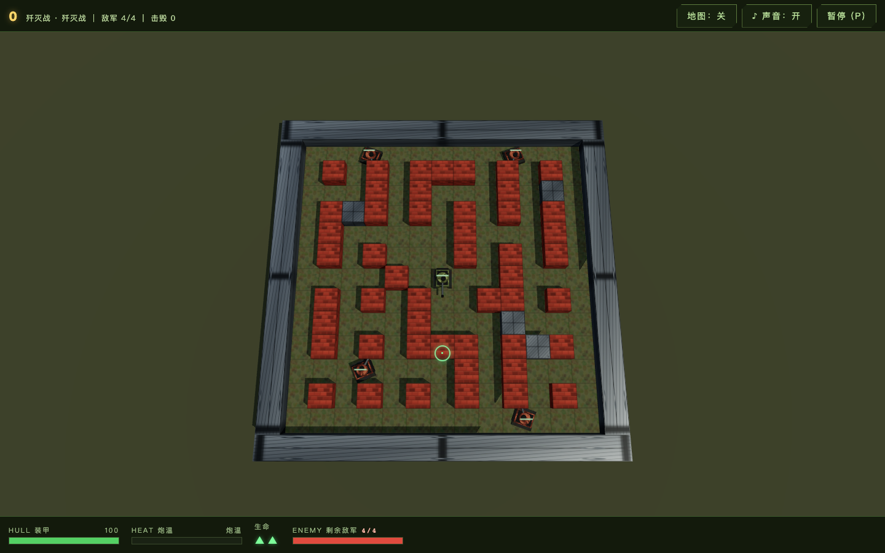
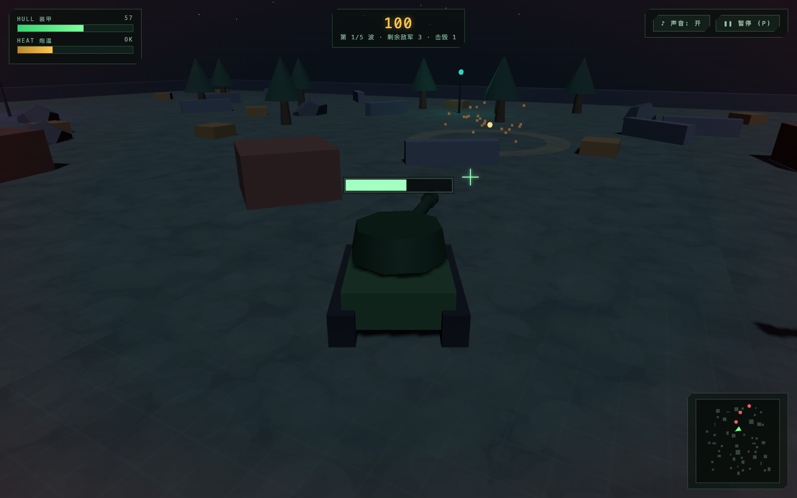
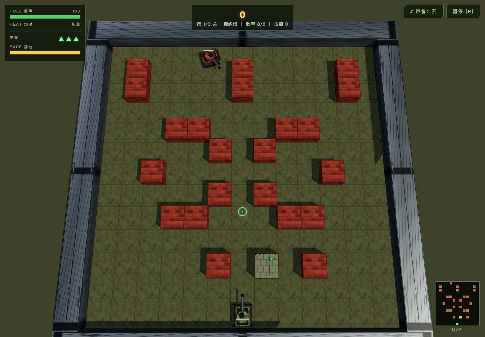

Archived on 2026-10-20, attributed to the existing **qwen3.8-test** project (actual test workspace located at `~/Code/qwen3.8-tests/`). The complete report, along with the 9 referenced images, user UI feedback screenshots, prompts, and organized performance evidence, has been copied to this devlog and does not rely on images saved in the original workspace.

Open standalone HTML report (historical local file, not published with this report) · Original Markdown snapshot (historical local file, not published with this report) · Archive verification checklist (historical local file, not published with this report) · Project progress (historical local file, not published with this report)

The rounds consist solely of four game requests for pi/Qwen3.8. User requests for supervisor report organization and devlog archiving do not belong to model test rounds and are not counted in inference data. GitHub publication and unverified boundaries are tracked only in the backlog (historical local file, not published with this report).

---

# Driving 8-bit Qwen3.8-27B with MLTF on M5 Max: A Four-Round Supervised Test of pi Building a 3D Tank Battle

[English](devlog-projects-qwen3-8-test-notes-mltf-pi-tank-battle-four-round-report-2026-10-20.md) | [简体中文](devlog-projects-qwen3-8-test-notes-mltf-pi-tank-battle-four-round-report-2026-10-20_CN.md)

<!-- environment-context:start -->

## Workstation and system (context added 2026-10-20)

| Item | Record and evidence boundary |
|---|---|
| Workstation role | Local inference workstation |
| Current hardware reference | MacBook Pro `Mac17,6`; Apple M5 Max; 18-core CPU; 40-core GPU; 128 GB unified memory (128 GiB / 137438953472 bytes) |
| Host explicitly recorded by the source | See original report; current snapshot does not fill missing historical configuration |
| Current system snapshot | macOS 27.0.1, build `26A434`, arm64, Metal 4; captured 2026-10-20 22:03:27 UTC |
| Test-time OS | macOS 27.0.1 |
| Historical limits | Without a separate test-time snapshot, detailed core counts are a current workstation reference. Mac specifications do not establish LAN PC or cloud inference hardware. |

[Full environment notes](../../environment.md). Model, quantization, engine, cache and request settings remain those recorded in this report. Original figures, source code and command output retain source-language evidence.

<!-- environment-context:end -->

Experiment date: 2026-10-20, America/Toronto (EDT). This article is intended for GitHub sharing and records how the user changed requirements round by round, what the local model actually changed via pi, which failures were retained, and measurement data for the inference engine and host. The game is an experimental artifact and remains a playable prototype.

**Inference engine: [MLTF / My Little Trie Forge](https://github.com/DT-HJ/my-little-trie-forge). Target model: [Ho-Jin-93/Qwen3.8-27B-MLTF-q8c](https://huggingface.co/Ho-Jin-93/Qwen3.8-27B-MLTF-q8c), 27B, 8-bit q8c quantization.** Code was written by the local model via pi; the supervisor organized prompts, observations, textual hints, independent tests, and report writing, without modifying the game implementation. Across four rounds, there were **430 requests, 461,939 output tokens, and 326.48 minutes of pi working time (approximately 5.44 hours)**, with a total of 29 directional hints. Waiting time between rounds is not counted in working time.

The final game is a fixed four-enemy annihilation battle in a 13×13 brick wall maze: enemies chase the player, all four appear at the start, with no reinforcements/auto-next-wave; it features two lives, health, wall destruction, textures and shadows, sound effects and music, a local leaderboard, and start/pause/resume/restart; the HUD and collapsible minimap are located outside the canvas. The final version does not retain the base defense and three-level spawning objectives from the second round.



## 1. Rounds are divided by user requests, not by test count

| Round | User-initiated request | pi's main changes | Round result and reason for next round |
|---|---|---|---|
| R1 | Build a browser 3D tank battle from scratch, actually play it, and record performance | Implemented open scene, player/enemies, GUI, audio, leaderboard, and five-wave loop | Basic playable, but lacking wall tactics, pacing, and material polish |
| R2 | Add truly destructible walls, correct group-attacking and rough art, let pi play itself | Tile walls, procedural textures/lighting, controlled concurrency, three levels, and base defense | Walls and visuals improved; base priority and continuous spawning deviated from user expectations |
| R3 | Enemies chase player; enemies appear all at once in a finite number; true maze | Removed base objective/reinforcements/auto-levels, fixed four enemies, player hunts AI, alley maze | Can naturally clear the field; narrow-screen HUD occlusion and clipping unresolved |
| R4 | Life bar blocks spawn point, minimap blocks bottom-right corner | HUD moved to top/bottom bars outside canvas, minimap collapsible, camera/mouse/resize linked | Four viewport independent checks passed, wide/narrow screen real input cleared the field |

R1–R4 all continued the same pi session and the same MLTF service. Supervisor hints within a round, pi self-tests, failure retries, context compression, and regressions are counted in that round and cannot be packaged as new user iterations. User's Chromium preferences and environment messages are constraints, not listed as separate game requirement rounds.

| Round | Start–pi wrap-up (EDT) | pi minutes | Inference requests | Output tokens (incl. thinking) | Supervisor hints |
|---|---|---|---|---|---|
| R1 | 00:38:17–01:24:15 | 45.97 | 66 | 82,551 | 3 |
| R2 | 07:27:25–09:48:06 | 140.67 | 186 | 180,564 | 12 |
| R3 | 09:58:25–11:43:41 | 105.27 | 125 | 145,772 | 12 |
| R4 | 11:50:04–12:24:38 | 34.57 | 53 | 53,052 | 2 |

The following quotes preserve the user's expression; subsequently, user requirements, the supervisor's translated task briefs to pi, and pi's autonomous design are clearly distinguished.

## 2. R1: Building a playable browser 3D tank battle from an empty directory

**User's original request:**

> I want to test the performance of local mltf (local llm)
> You go to other sessions to find the port and invocation method
>
> I ask you to act as a supervisor, through pi(local/Qwen3.8-27B-MLTF-q8c [mltf]), open a new sub folder in ~/Code/qwen3.8-tests
> The goal is to make a 3D tank battle that can be played directly in the browser
>
> It has GUI, enemies, health, environmental scene, sound effects, music, leaderboard, can start, pause, resume, restart
>
> pi can use browser visual checks, play and evaluate itself
>
> You are responsible for the init prompt to start the project
>
> Then you must continuously monitor, if you find the effect deviates too far, or pi is in a dead loop for a long time, you step in to help with hints, you cannot modify it yourself, only give him some suggestions
>
> You must record his process, error situations, and changes in local CPU GPU memory usage, and inference engine token generation speed prefill speed
>
> Finally give me a detailed report
>
> Review the capabilities and stability of this model and inference engine

**Acceptance criteria translated to pi:** Implement true 3D, complete game loop, and default browser audio unlock from scratch; must actually press keys, aim and shoot, read screenshots, check page exceptions, save/refresh scores in Chromium, cannot just run build; only pi modifies game/, no other coding models or sub-agents allowed. R1 task brief (historical local file, not published with this report). The API port was initially located from the historical session "Update mlx-dspark and related model libraries," then cross-verified by local configuration, listening processes, and authentication status.

**pi implementation:** Chose Three.js + Vite + native JavaScript, split scene, tanks, procedural audio, leaderboard, and game loop; built a low-poly night battle open field, ground/trees/crates/cover, player movement and mouse turret, enemy troops, five-wave progression, HUD/minimap, health feedback, death and victory settlement, localStorage leaderboard. The five waves in the first round were pi's autonomous design, not explicitly specified by the user.

**Key issues and improvements:** Initially missing npm dev script, pi self-fixed; turret local angle/world direction mixed, after turning about 76° the muzzle and trajectory deviated by about 76°, unified direction after supervisor hint; wave-clearing async callback swallowed progression during pause and could pollute new games after restart, pi changed to in-game loop timing; screenshot self-check found duplicate DOM IDs for pause and end titles, pi autonomously fixed. Also fixed browser input/API details, victory script only killed 5 enemies but incorrectly claimed five waves completed. Three supervisor hints targeted default Chromium/audio acceptance, muzzle direction, and wave-clearing state lifecycle. R1 hints (historical local file, not published with this report).

**Actual verification:** pi main E2E finally passed 28 items, but had issues with unconditional true, zero movement still PASS, and shell pipes masking failures, so quantity cannot be considered coverage. Supervisor real input fired 4 shots, 3 hits, 1 kill before being naturally destroyed, score saved and refresh persistence successful; under default audio policy AudioContext running, measured non-zero audio signal. The victory of five waves 40 kills/7,000 points included freeze/positioning fixtures, not a natural full clear at default difficulty. Basic loop existed, but wall tactics, level routes, and human-playable difficulty were not yet proven.



**Round judgment:** Limited supervision completed a playable prototype. Its simple geometry, scattered decorations, and opening enemy swarm did not meet the user's experience expectations for a tank battle, directly leading to R2; cannot claim a finished product just because basic tests passed.

## 3. R2: Wall tactics, pacing, textures, and lighting

**User feedback original text:**

> The map has no obstacles, tank battles have walls, you have to destroy walls to attack the opponent, and this game has only one player against all enemies, as soon as you enter the enemies swarm the player, the design has problems, think more about gameplay and improve
>
> Let pi play itself
>
> Also, the game lacks textures, only simple 3D modules, no textures no light and shadow, only simple molds, not a complete game
>
> You organize the prompt, then let pi continue, you continue to observe, collect data, summarize and update the report

The user's original "light and shadow" (time) was translated as "light and shadow" (Light and shadow) in the task brief according to context. The supervisor required pi to first play the old version, then implement real car-blocking/bullet-blocking/destructible brick walls, solvable routes, safe opening, enemy pacing, actual textures and lighting, and at least naturally complete the introductory section; state-assisted aiming was allowed, but freezing/modifying health to fake natural victory was not. R2 task brief (historical local file, not published with this report).

**pi's gameplay modifications:** 13×13 tile map, brick walls 2HP, destroyed by two shots, steel walls indestructible; added three levels, each level 8/12/16 enemies, concurrency limit 2/3/3, controlled entry, spawn hints and protection; three lives, base 6HP, protect base and clear enemies to progress. The three levels and base defense were autonomously selected by pi, an implementation attempt for fair pacing, the user did not explicitly require base defense.

**pi's visual modifications:** Used actual CanvasTexture; ground, brick, steel/metal, armor camouflage and track textures, combined with damage cracks, debris, bump, sun main light/fill light and projection; retained and adjusted WebAudio sound effects/music and full-map camera. Independent traversal once confirmed 8 different texture maps, 34 projection objects, and main light shadow enabled; they only prove mechanism activation, cannot prove art quality solely by quantity.

**Substantial faults and fixes:** tileMeshes not initialized caused runtime crash; old menu covered battle; rendering wall array was compressed storage, but damage logic indexed by dense grid, causing real 6 shots to result in 114 wall destructions, wall HP=-60, and 126 exceptions, after fix the same 6 shots normally removed two bricks along the line; muzzle/trajectory reversed again, dot product fixed from -1 to +1; reload sorting error, base 2D target coordinate error led enemies to the top of the map, LOS blocked the entity target itself, all corrected after supervisor observation. Old tests not migrated caused 300 seconds of invalid waiting, precise replacement, port, truncated logs, and shell return code handling also repeatedly errored. Total 12 supervisor hints. R2 hints (historical local file, not published with this report).

**Results from pi playing itself:** Retained multiple intermediate versions and strategies such as s1–s5, n1–n3, p1–p3, cannot be mixed into a fixed version win rate. Finally under the same base AI, the enemy-chasing group n1–n3 all lost, the base-defending group p1–p3 also all lost, three-level full win **0/6**; the base-defending group introductory level **3/3** cleared, two games reached the third level before the base was destroyed. Another intermediate version s4 reached the 240-second time limit but did not end, belonging to an AI failure version, cannot be considered "long survival, good balance." pi once called failure after reaching the third level "three-level clear," corrected by supervisor.

**Independent evidence:** Complete wall blocking cars, one shot HP1, two shots removed, then passable; in the wall-behind target fixture, the first two shots only broke the wall, the third shot hurt the enemy. Final AI real input cleared the introductory level in about 38.956 seconds, 8 kills, 44 shots, 16 enemy hits, player not hit and entered the second level; another real instance stayed far from the base, base 6→0, player still 100HP, proving the base threat actually exists. Fixtures only verify physical/state branches, not natural clears.



**Round judgment:** Walls and visuals had substantial improvements, but "continuous batch enemy arrival + base priority" turned the experience into point defense, the requirement for ordinary finite annihilation was not understood. R2 is a round where product direction deviation still existed after rework; the win/loss and version attribution in the model's self-evaluation also need review, cannot mask unplayability with zero page errors.

## 4. R3: Finite enemy group, truly chasing player, and alley maze

**User feedback original text:**

> Enemy AI only attacks the base, does not attack the player, and enemies should come out all at once in a finite number, not wave after wave, how can you win this, not fun
>
> Enemies do not chase the player, only accuse the player's base attack, not fun at all, bricks do not generate maze style, too simple
>
> Continue to let pi improve

The supervisor explicitly revoked the old base/three-level direction, requiring a small number of enemies to appear all at once in one game, no subsequent reinforcements, clearing all means victory; enemies chase player position changes and turns, hit bricks or detour; walls form alleys, turns, loops, and forks; real input naturally wins one game, verify survival+kills equals initial quantity, and retain failures. R3 task brief (historical local file, not published with this report).

**pi's rule and AI improvements:** Fixed four basic enemy tanks, placed at four corner entries, all enter at once; no pending queue, next wave, or auto-next level; removed base objective and base failure condition, HUD displays N/4; player two lives, 100HP per life. Enemies get player position and re-path as player changes grid, aim and shoot when there is a ray, lateral movement at close range, detour or break bricks if walls block the way. R3 basic enemy parameters are HP24, damage 10, speed 4.6m/s, shooting interval 1.8s; player speed 7m/s. These parameters have winnability evidence, but have not been fine-tuned for humans.

**pi's map improvements and rework:** Initially C-shaped wall map, then four isolated long walls were still not the maze the user expected, supervisor rejected twice based on the full map. pi then wrote a generator and solidified the alley map: 13×13 grid, 49 bricks + 4 steel, the real open subgraph has 20 loops, four entry initial route lengths at least 12 grids with multiple turns; 4m channel fits about 2.3m collision diameter. Turn criteria once counted straight lines as turns; generator forgot to dig target nodes but first mistakenly modified the outer ring, both required supervisor hints. Also fixed the issue where burst fire cooldown only decreased when held, short press three times changed from only one shot to three shots.

**Testing and supervision cost:** Total 12 hints, including requirement deviation, map generation, burst fire, pre-waiting, still sending keydown after releasing key, comparing enemies array with number 4 causing permanent false waiting, documentation mixed with old results. Multiple waiting timeouts cannot be automatically attributed to GPU or MLTF. Final build/test:all returned 0, old suite 36 PASS and natural game passed, but previous failures and return code masking were retained. R3 hints (historical local file, not published with this report).

**Natural trial play:** pi's first group of three games all won, including two subsequent regressions totaling 9 games all cleared four enemies, total game time about 9.4–9.5s, remaining 80–90HP; they used the same map and state-assisted aiming strategy, not 9 independent human samples. Supervisor's final maze independent two games won in about 11.41s/11.26s, remaining 90/100HP; another real instance moved but did not shoot, enemies caused 20 hits and exhausted two lives, proving chasing and damage actually work. Recorded enemy object IDs, subsequent IDs are all subsets of the initial set, survival+kills=4, waiting after settlement still no reinforcements; UI score save refresh retained. Walls, pause/resume, restart, and audio path were additionally checked with annotated fixtures.


**Round judgment:** All three requirements have empirical evidence, but with state-assisted aiming it was extremely short and all won, only proving it can be completed, not proving mature tactical depth and difficulty curve. Narrow-screen full-map/HUD was not sufficiently verified, finally revealed by R4's actual screenshots.

## 5. R4: Life bar and minimap blocking the battlefield

**User feedback original text:**

> UI completely blocks the view, life bar blocks the enemy respawn point, map blocks the bottom-right corner

User attached screenshots. Although the images still had the old base/three levels, the supervisor independently reproduced similar issues on the current R3 service: 900×1000 active period life bar intersected with battlefield about 8,013px², minimap about 18,176px²; bottom spawn tank partially out of frame. 768×1024 four spawn models all had partial clipping. Wide-screen baseline had no similar active period coverage, indicating old acceptance missed responsive boundaries.

**pi improvements:** Top bar placed score, enemy number, buttons, and short opening hints; bottom bar placed armor/gun temperature/life/enemy bar and minimap; middle stage only placed rendering canvas. Minimap default off, expansion still in bottom bar. Camera aspect, renderer size, ground mouse intersection, projectToScreen all calculated with real canvas rectangle; window resize and ResizeObserver linked, solving the case where bottom bar open/close does not trigger window resize. Narrow screen only omits stage name, no longer loses remaining enemy/kill numbers. R4 task brief (historical local file, not published with this report).

**Two supervisor hints and errors:** First pointed out 900-wide opening banner still intersected with buttons about 560px², and hid enemy numbers for the whole segment; pi corrected in-bar layout. Its self-written inter() expected l/t/r/b but received native DOMRect (left/top/right/bottom), causing two rounds of false positives; model continued to modify CSS, write debug scripts based on this, /tmp scripts could not parse Playwright again. Second hint checked data fields and corrected assertions. Merged regression first old smoke time progression timeout, two single runs passed, after adding limited frame capture/top retry the whole chain returned 0; root cause undetermined, cannot be called GPU failure. README precise text editing also failed once, recovered after read-back. R4 hints (historical local file, not published with this report), test outputs each time (historical local file, not published with this report).

**Final verification:** pi layout 46 items, trial play 8 items passed; final merged 90 lines PASS, exit 0, previous failure logs retained. pi itself used 1280×800 real input naturally cleared the field (20 shots/8 hits, 90HP, two lives, 925 points, about 9.5s), 900×1000 real combat 27 shots/8 hits, 12s cleared the field, 768-wide real click pause/resume and read screenshots. Supervisor independent 1440×900/900×1000 respectively about 11.63/11.60s cleared the field, remaining 70/90HP; portrait screen leaderboard save refresh still present, 5 seconds after clearing no new wave.

| Viewport | Final map closed canvas (CSS pixels) | Spawn tank model fully in frame | HUD and battlefield intersection |
|---|---|---|---|
| 1440×900 | 1440×788, y52 | 4/4 | 0 |
| 1280×800 | 1280×688, y52 | 4/4 | 0 |
| 900×1000 | 900×888, y52 | 4/4 | 0 |
| 768×1024 | 768×895, y69 | 4/4 | 0 |

Each tier checked opening, active period, map expansion, no HUD group overlap, no horizontal overflow, no page exceptions; independent projection real mesh vertex bounding range, not just checking center points. Another 23 scaling/real mouse fixtures: switching six window/map states, renderer/aspect, four ground point mouse intersections, actual movement, pause freeze, resume, restart all passed; this group froze AI, only isolated UI/projection, not faking natural victory. Layout raw measurements (historical local file, not published with this report), scaling fixtures (historical local file, not published with this report), independent wide-screen game (historical local file, not published with this report), independent portrait-screen game (historical local file, not published with this report).


**Still self-reported errors:** pi record wrote trial play 8 items as 7 items; some canvas heights and 768 top bar height did not match; calling bounding sphere conservative framing "maximum zoom" lacked basis. This report adopts independent measurements. Camera framing conservative, wide-screen has much whitespace, is space for subsequent art/framing polish. Self-report check (historical local file, not published with this report).


## 6. MLTF project, model address, fixed version, and quantization identity

### 6.1 Project address and version

| Item | Explicit address / identity |
|---|---|
| MLTF current GitHub | [https://github.com/DT-HJ/my-little-trie-forge](https://github.com/DT-HJ/my-little-trie-forge) |
| Local original Git remote | [hojin12312/my-little-trie-forge](https://github.com/hojin12312/my-little-trie-forge), redirected to DT-HJ when checked |
| Locally saved source code commit | [873d5574d903f5c1685e286c9cd59b79475a49f6](https://github.com/DT-HJ/my-little-trie-forge/tree/873d5574d903f5c1685e286c9cd59b79475a49f6), working tree unmodified |
| Actual service version | MLTF0.1.2; local wheel installed Python entry + native Metal engine |
| Running kernel build ID | `src-ddca31101abcdea9199c6c79a27b2d329509c06b66d69af627725212bf53a4c6`; this is a service state value, cannot be replaced by Git commit number |
| Code license/source | Apache-2.0; derived from [Splash](https://github.com/incoai/splash), inherited mechanisms and independent extensions see UPSTREAM |
| Project support scope | Upstream verified M5 Max40GPU/128GiB; installation documentation requires necessary GPU features and macOS26.4+; other machines not guaranteed same speed based on this |

The above links were verified online at the time of report compilation; the actual experimental identity is determined by the local package, manifest, and the /status snapshot of the current round. The latest README of public repositories is subject to change; for reproducing technical details, prioritize pinned commits. [Pinned README](https://github.com/DT-HJ/my-little-trie-forge/blob/873d5574d903f5c1685e286c9cd59b79475a49f6/README.md), [UPSTREAM](https://github.com/DT-HJ/my-little-trie-forge/blob/873d5574d903f5c1685e286c9cd59b79475a49f6/UPSTREAM.md), [Installation](https://github.com/DT-HJ/my-little-trie-forge/blob/873d5574d903f5c1685e286c9cd59b79475a49f6/docs/INSTALL.md), [Verification Scope](https://github.com/DT-HJ/my-little-trie-forge/blob/873d5574d903f5c1685e286c9cd59b79475a49f6/docs/VALIDATION.md).

### 6.2 Model and All Asset Sources

**This test uses the 8-bit target weights of Qwen3.8-27B, packaged as MLTF prepared q8c for execution; it is not the 4-bit target, nor is it the 27B full-precision weights resident in memory.** The 27B parameter names, weight bit-width, prefill activation bit-width, decode activation bit-width, and KV cache bit-width of the model are distinct concepts.

| Role | Repository Address | Local Pinned Revision / Description |
|---|---|---|
| Qwen Base Model | [Qwen/Qwen3.8-27B](https://huggingface.co/Qwen/Qwen3.8-27B) | Source of architecture/model identity |
| Actual Prepared Package | [Ho-Jin-93/Qwen3.8-27B-MLTF-q8c](https://huggingface.co/Ho-Jin-93/Qwen3.8-27B-MLTF-q8c) | `524209960111b8c6a3d79f7c68a6f04c0a6dca91`; third-party checkpoint converted via MLTF, not a separately released version by Qwen |
| 8-bit Target Source | [mlx-community/Qwen3.8-27B-8bit](https://huggingface.co/mlx-community/Qwen3.8-27B-8bit/tree/815b83c0df8ffd1d1b5244cf75fd6ef14fca9ef9) | `815b83c0df8ffd1d1b5244cf75fd6ef14fca9ef9` |
| DFlash2 Draft Source | [incoai/Qwen3.8-27B-DFlash2](https://huggingface.co/incoai/Qwen3.8-27B-DFlash2/tree/dedf8df68adfb1afeaf7b7480c0a0243108177b4) | `dedf8df68adfb1afeaf7b7480c0a0243108177b4` |
| Tokenizer / Vision Source | [mlx-community/Qwen3.8-27B-4bit](https://huggingface.co/mlx-community/Qwen3.8-27B-4bit/tree/3e6447f082e89cc7f0bc6e5441afd38dfce760ff) | `3e6447f082e89cc7f0bc6e5441afd38dfce760ff`; only these two asset roles, not the source of 27B target weights |
| Template / Package Reference | [incoai/Qwen3.8-27B-Splash](https://huggingface.co/incoai/Qwen3.8-27B-Splash/tree/9d27070b71f7142c6b6025f03ac011d70a73cb48) | `9d27070b71f7142c6b6025f03ac011d70a73cb48` |

The source chain was cross-verified using the upstream field in the local manifest, public model cards, and [MLTF MODEL_ASSETS](https://github.com/DT-HJ/my-little-trie-forge/blob/873d5574d903f5c1685e286c9cd59b79475a49f6/MODEL_ASSETS.md). The wording in MODEL_ASSETS regarding "code does not include weights / no model package released with code candidates" must be understood separately from the now-existing independent HF prepared repository: the engine code package and the separate model repository are two distinct artifacts; the local prepared package indeed corresponds to the pinned HF revisions listed in the table above. The model card and source code provide descriptions of the licenses for their respective assets; the engine's Apache license alone cannot cover all asset roles.

| Verifiable details of the q8c package | Actual values |
|---|---|
| manifest schema / format | 5 / `splash-packed-q8c` |
| Weight bit-width / group size | `q8_bits=8` / `q8_group_size=64` |
| Quantization parameters / storage geometry | `bf16-scale-zero` / `q8_storage_n=256` |
| File segment alignment | 16,384 bytes |
| manifest SHA-256 | `e2c7919947a1784b18bf67323de786e500e53d1e47798aede1c38667c388760e` |
| artifact set SHA-256 | `2d5414df4eac12ad1e9dbd5ab770a650f5e418782c4a5c523e8d3ff2155f5f95` |
| Asset count / total file bytes | 78 / 30,848,996,049 (approx. 28.73 GiB) |
| /status target weight estimate | 28,625,977,344 bytes (approx. 26.66 GiB); draft 1,266,040,832, vision 930,250,752 bytes |

28.73 GiB is the sum of asset files including target, draft, vision, and tokenizer; it is not the total runtime memory, nor should it be confused with the final engine allocation of approximately 95 GiB. The dtypes used by the package manifest and the runtime kernel must be examined separately: target weights are 8-bit group64 with BF16 scale/zero; KV uses a separate symmetric INT8/FP32 scale design. [Public prepared file tree](https://huggingface.co/Ho-Jin-93/Qwen3.8-27B-MLTF-q8c/tree/524209960111b8c6a3d79f7c68a6f04c0a6dca91), simplified identity JSON (historical local file, not released with this report).

## 7. MLTF implementation for M5 Max + Qwen3.8-27B and the scope enabled in this run

The following is a technical explanation of source code/release profile and local state support, **not independently measured speedup factors obtained by ablating each optimization**. This experiment did not use other engines or FP16/4bit modes as a fair control.

### 7.1 Dedicated Metal matrix kernels and q8c layout

MLTF uses group64, StorageN256 packed q8c blocks for the QKV/MLP projections of this model. The source code shifts affine UINT8 codes by -128 to signed INT8 and folds the corresponding offset into the bias, matching its signed matrix operation path; BF16 scale/zero can reconstruct the folded bias within the kernel. MPP `mpp::tensor_ops`, cooperative tensor, `matmul2d`, and explicit SIMD group/tile organization correspond to the GPU capabilities required by M5, reducing the overhead of general framework scheduling/general layouts. This is an interpretation of usage derived from the code structure, not a causal benefit measured independently in this experiment. [q8 public tile source code](https://github.com/DT-HJ/my-little-trie-forge/blob/873d5574d903f5c1685e286c9cd59b79475a49f6/runtime/metal/kernels/common/q8_mpp_tiles.h), [decode q8 kernel](https://github.com/DT-HJ/my-little-trie-forge/blob/873d5574d903f5c1685e286c9cd59b79475a49f6/runtime/metal/kernels/decode/linear_q8.metal).

**prefill W8A8 / decode-verify W8A16:** W8 is always 8-bit target weights; A8 prefill performs symmetric INT8 quantization on activations per group64, followed by integer dot products and reassembly by scale/bias; A16 decode/target verification retains BF16 activations. W8A16 must not be miswritten as weights being restored to 16-bit. The implementation also fixes the FMA combination order to reduce rounding differences across different tiles/slots; `split2-rounded` splits the quantization group into two segments to compute partials before reduction, preserving an explicit numerical strategy. [prefill kernel](https://github.com/DT-HJ/my-little-trie-forge/blob/873d5574d903f5c1685e286c9cd59b79475a49f6/runtime/metal/kernels/prefill/linear_q8.metal), [release profile](https://github.com/DT-HJ/my-little-trie-forge/blob/873d5574d903f5c1685e286c9cd59b79475a49f6/RELEASE_PROFILE.json).

Local /status actually shows `q8_prefill_activation=a8`, `q8_residual_decode_policy=split2-rounded`, `q8_split2_m32_sg16=true`, `paired_long_prefill=true`; flags such as stagepage, stage_parameters, direct_single_split, canonical_long_prefill, and canonical_decode_burst are false. The presence of candidate kernels/optional optimizations in the source code does not mean all were enabled in this run. The release package retains physical decode B1–B4, B3 padded-M32 capabilities; this experiment had only one pi sequentially issuing requests, and total throughput for four concurrent connections was not measured.

### 7.2 DFlash2 speculative decoding and model verificationPrepared package records 7 proposal tokens, 8 rows of draft query, 8 rows of target verify, and draft sliding window2048. The draft proposes candidates, the target model verifies them in batches, and a portion of the candidates is accepted to amortize per-token work; the benefit depends on the draft acceptance ratio, context, and output. The actual accepted/drafted ratio across four rounds was approximately 36.9%–38.9%; the headline high acceptance rates from upstream short-context settings should not be applied here. The DFlash2 foundation is inherited and credited to Splash; upstream attribution must not be omitted. [UPSTREAM](https://github.com/DT-HJ/my-little-trie-forge/blob/873d5574d903f5c1685e286c9cd59b79475a49f6/UPSTREAM.md), [DFlash2 source model](https://huggingface.co/incoai/Qwen3.8-27B-DFlash2), prepared identity (historical local files, not released with this report).

### 7.3 INT8 KV, Page32 and prefix-tree state reuse

Local KV uses `symmetric_int8` with FP32 scale; K/V data per token/head is stored in different layouts: K is token-major, V is dimension-major; each block contains 32 tokens. State budget information lists 16 full-attention layers, 4 KV heads, head dimension256, and Page32 bytes 1,064,960; this describes the KV-related full-attention layers, not a claim that the model has only 16 layers in total. MLTF retains GDN/state recovery and prefix-tree cache paths related to the Qwen hybrid structure, reusing historical prefixes and states to reduce repeated prefill in long coding sessions. The 32-token block granularity, sparse backing, and approximately 128MiB extent organization serve dynamic allocation and reclamation. Specific counts can be rechecked via the current round's /status; sparse virtual capacity does not equal actual resident amount. [KV store kernel](https://github.com/DT-HJ/my-little-trie-forge/blob/873d5574d903f5c1685e286c9cd59b79475a49f6/runtime/metal/kernels/decode/attention_q8_store.metal), [cache/GDN attribution](https://github.com/DT-HJ/my-little-trie-forge/blob/873d5574d903f5c1685e286c9cd59b79475a49f6/UPSTREAM.md).

Local warm memory cache and image embedding reuse are enabled; **SSD cache is disabled**. The project supports optional SSD durable cache, memory admission, and bounded asynchronous persistence; the related design acknowledges the impact of oMLX sidecar work. The SSD path was not tested in this run, so memory cache effects cannot be attributed to SSD. [ACKNOWLEDGEMENTS](https://github.com/DT-HJ/my-little-trie-forge/blob/873d5574d903f5c1685e286c9cd59b79475a49f6/ACKNOWLEDGEMENTS.md).

### 7.4 Unified memory and availability governance

The hardware is M5 Max18CPU/40GPU/128GiB unified memory. The service reports Apple GPU family10, 32KiB threadgroup memory, and unified memory/sparse placement support. The configured budget is 96GiB, with the actual governor at approximately 95.25GiB, controlling admission/growth/cache reclamation based on host available amount and reservations. Warnings, internal reservation rejections, and state evictions occurred in some of the four rounds, but no actual request failures occurred. This governance and zero failures were observed simultaneously; this does not prove how much each mechanism contributed, nor does it prove the absence of memory risk.

The engine supports a total context of 262,144 tokens (including output); **this service was artificially limited to 131,072 (128Ki)**; the maximum actual single prompt was 114,775 tokens. The pi output limit is typically 32,768 and will be reduced when approaching the context limit; do not write the upstream 256Ki capability as if a 256Ki limit test was performed in this run. The 71.7 tok/s for 2Ki cold requests and 218.9 tok/s for four concurrent requests in the upstream README are their independent benchmark conditions, not values measured in this tank task; [upstream complete methods and data](https://github.com/DT-HJ/my-little-trie-forge/blob/873d5574d903f5c1685e286c9cd59b79475a49f6/docs/MEASUREMENT_METHOD.md) are provided here for distinction.

## 8. Local deployment, call chain, and reproducible entry points

| Item | Actual Experimental Setup |
|---|---|
| System/Hardware | /status reports macOS27.0.1; M5 Max18CPU/40GPU/128GiB |
| pi | 1.3.0, medium, same RPC session; only built-in read/bash/edit/write used, no other coding models, skills/MCP/extensions added to game development |
| Sampling | temperature1.0, top_p0.95, top_k20; confirmed by actual requests; output cap max 32768, adjusted down based on remaining quota |
| Local Engine API | http://127.0.0.1:8083/v1；model ID `local/Qwen3.8-27B-MLTF-q8c` |
| Experimental Proxy | pi→http://127.0.0.1:8085/v1→8083；transparent forwarding and SSE statistics; model/sampling unchanged; runs only during monitoring |
| Game | http://127.0.0.1:5179/；loopback address; GitHub readers must start it locally; not a public playable URL |
| Game Stack | Three.js0.186.1, Vite8.3.4, Playwright1.64.1 (locally installed versions); JavaScript/WebAudio/localStorage |
| Browser | Standalone Chromium; default autoplay user gesture restrictions, Google Chrome not used; early deviation in R1 has been corrected and recorded |
| Vision and Operation | pi can read PNG; state-assisted auto-aim/pathfinding + real input, not pure visual blind play; no other visual/coding models taking over |

The default port for upstream public installation is 8000, **local 8083 is the deployment choice for this run**. The following shows a reproduction format consistent with the key local runtime parameters; new readers should first check the [installation documentation](https://github.com/DT-HJ/my-little-trie-forge/blob/873d5574d903f5c1685e286c9cd59b79475a49f6/docs/INSTALL.md) and [model card](https://huggingface.co/Ho-Jin-93/Qwen3.8-27B-MLTF-q8c), download from the model site, and do not put weights into the game repository.

```sh
# 使用实验版本wheel；资产下载与服务启动分开
pip install https://github.com/hojin12312/my-little-trie-forge/releases/download/v0.1.2/my_little_trie_forge-0.1.2-py3-none-macosx_26_0_arm64.whl
mltf download --model Ho-Jin-93/Qwen3.8-27B-MLTF-q8c --accept-model-licenses
mltf serve --model local/Qwen3.8-27B-MLTF-q8c --model-path /path/to/prepared-q8c --host 127.0.0.1 --port 8083 --max-context 128K --max-memory 96G
```

This command is a documentation reproduction example; it was not reinstalled, downloaded, or restarted when compiling the report; the original deployment for this run used the local venv and control scripts. Authentication follows the private configuration of each respective deployment; see upstream CLI/API for setup methods; do not treat example placeholder values as real local credentials.

The authenticated OpenAI-compatible call format is as follows; `MLTF_API_KEY` is set by the user locally, and the report does not fill in real credentials:

```sh
curl http://127.0.0.1:8083/v1/chat/completions \
  -H "Content-Type: application/json" \
  -H "Authorization: Bearer $MLTF_API_KEY" \
  --data '{"model":"local/Qwen3.8-27B-MLTF-q8c","messages":[{"role":"user","content":"请简短确认服务已就绪"}],"stream":true,"temperature":1,"top_p":0.95,"top_k":20,"reasoning_effort":"medium","max_tokens":1024}'
```

The key choices on the pi side are the OpenAI-compatible API, text+image capabilities, and 128Ki context, pointing to 8083; only when reproducing monitoring does it point to the 8085 proxy. After configuring the local provider:

```sh
pi --provider mltf --model local/Qwen3.8-27B-MLTF-q8c --thinking medium
```

The game is playable without relying on an LLM service. After cloning the share repository, run the following in its root directory:

```sh
cd game
npm ci
npm run dev -- --host 127.0.0.1 --port 5179
# 生产构建
npm run build
```

Final controls: WASD to move in world directions, mouse to aim, left click/Space to shoot, P/Esc to pause, M to mute; use the interface button to restart. The leaderboard uses the browser's localStorage. Development testing used the absolute path of the system Chromium; other machines must install the corresponding Chromium and configure the test script with their own paths. Starting the game itself does not require the Playwright/Chromium test path.

## 9. Four-Round Reasoning Speed, Stability, and Measurement Boundaries

| Round | Native decode tok/s | Native prefill tok/s | TTFT median/P95 seconds | Max actual prompt | Draft acceptance ratio | Request failures/cancellations/Metal/capacity/restarts |
|---|---|---|---|---|---|---|
| R1 | 46.16 | 474.10 | 2.76 / 14.34 | 106,076 | 38.24% | 0 / 0 / 0 / 0 / 0 |
| R2 | 38.62 | 456.98 | 2.97 / 20.08 | 114,445 | 36.93% | 0 / 0 / 0 / 0 / 0 |
| R3 | 32.47 | 387.78 | 3.85 / 39.56 | 114,775 | 36.86% | 0 / 0 / 0 / 0 / 0 |
| R4 | 39.72 | 469.86 | 3.44 / 41.15 | 114,122 | 38.93% | 0 / 0 / 0 / 0 / 0 |

The four-round total native working interval weighted average is approximately **37.59 decode token/s and 431.79 prefill token/s**. The denominator is the sum of the differences in cumulative native wall_ms for each round, not a simple average of the four rates; output tokens include reasoning, code, tool parameters, tests, documentation, and compressed summaries, and are not lines of useful code. The four rounds' increments totaled 430 requests, with all HTTP 200, and actual failures/cancellations/Metal/capacity failures/restarts were all 0.

Per-round native rate = (ending cumulative tokens from /status minus starting cumulative tokens) divided by the corresponding wall time difference; request lifecycle rate is separately calculated as the sum of total tokens per SSE request divided by the sum of timing intervals. Prefill only counts new uncached input, not treating repeatedly sent historical prompts as fully reprocessed; TTFT is taken from server-side request_latency, where proxy role/empty delta does not count as the first content token. Monitoring and browser tool waits are included in development time but not in the decode working interval.

This was a long-session engineering task on the same machine; the engine was already warm, with existing models and caches, before starting. No restart to clear caches for a cold start was performed, nor were fixed prompts, constant lengths, equal sampling, or multi-engine comparisons conducted. The speed drop from R1 to R3 and the recovery in R4 cannot be simply attributed to thermal throttling, continuous degradation, or the effectiveness of a specific optimization; prompt/cache/images/output/acceptance ratio/background load all changed. R3 TTFT maximum was approximately 102.04s, and R4 was approximately 82.02s; normal long prefill and long thinking do not equal an infinite loop.

### Context Compression Cost

| Round | Compression count | Compression auxiliary requests | Auxiliary output tokens | Auxiliary request minutes |
|---|---|---|---|---|
| R1 | 0 | 0 | 0 | 0.00 |
| R2 | 3 | 6 | 15,540 | 11.07 |
| R3 | 3 | 6 | 16,775 | 13.26 |
| R4 | 1 | 2 | 5,663 | 3.72 |

Compression requests are already included in each round's requests, tokens, and total time, and cannot be counted as a separate development round. One compression in R4 reduced from an estimated 114,906 to 26,985 tokens, with two auxiliary requests totaling 5,663 output tokens and approximately 3 minutes 43 seconds; this is a significant cost for a small change of 34.57 minutes. R1 original RPC had no compression events; the old simplified timeline in R2 omitted the compression listing, but the complete RPC retained 3 events, which cross-matched with the 15,540 output tokens of 6 auxiliary requests, so it cannot be incorrectly filled as 0. R1 compression verification (historical local file, not published with this report), R2 compression verification (historical local file, not published with this report).

## 10. CPU / GPU / Memory: Four-Round Trends

Sampling /status, IORegistry GPU, Mach CPU tick differences, process RSS, vm_stat, and swap approximately every 5 seconds; R1 CPU tick differences were only added in after a few minutes from the start, so a complete early CPU baseline cannot be fabricated. CPU/GPU are both whole-machine metrics, including the browser, monitoring, and other desktop tasks. Raw local logs are retained; the public directory contains verifiable per-round summaries and curves.

| Round | CPU median/peak | Active inference period GPU median | Engine allocation start→end/peak GiB | Native RSS median GiB | System swap range GiB | Pressure normal/warning samples |
|---|---|---|---|---|---|---|
| R1 | 4.84% / 18.77% | 99% | 81.728 → 94.414 / 95.213 | 14.54 | 5.49–11.48 | 202 / 360 |
| R2 | 7.98% / 32.32% | 99% | 94.414 → 95.114 / 95.250 | 17.23 | 10.79–11.59 | 1014 / 680 |
| R3 | 8.91% / 31.48% | 99% | 95.114 → 95.111 / 95.248 | 22.66 | 10.80–14.56 | 995 / 279 |
| R4 | 6.21% / 31.26% | 99% | 95.111 → 95.081 / 95.247 | 34.18 | 11.65–11.69 | 422 / 0 |


Engine allocation, device resources, process RSS, and system swap have different scopes and cannot be added together. The approximately 95GiB allocation includes weights, drafts, vision, KV, prefix/state caches, and workspace; it cannot be claimed that "8bit27B weights require 95GiB". R1 already had warm caches, and subsequent rounds inherited the usage; the existing portion of whole-machine swap cannot be attributed to new additions in the current round. R4 sampling pressure was all normal, but this also cannot be used to infer that the first three rounds had no warnings. Reservation rejections/cache evictions are separated from service failures; specific numbers are in each round's JSON.

## 11. Capability Evaluation, Attribution, and GitHub Share Content

**Model and pi:** Able to build and iterate a prototype from an empty directory with real 3D, physical occlusion, AI, audio, state flow, and local leaderboard; able to write browser scripts, perform actual operations, and read screenshots. Weaknesses are requirement understanding, 3D coordinates/asynchronous lifecycle, generators and test criteria, and self-evaluation numerical calibration; two rounds of major rework each required 12 supervisory prompts, and the final result was not an unsupervised product from a single prompt. Long thinking, repeated diagnostics, false PASS, shell masking, and lengthy documentation all increased costs.

**MLTF:** Maintained request availability on this M5 Max with 430 sequential requests and approximately 5.44 hours of pi work, including long prompts, image reading, tool loops, and multiple compressions; this supports "stable operation under this engineering load," but does not prove stability in all long-duration/concurrent scenarios, nor does it prove the correctness of the generated software. Game JS exceptions, test timeouts, model misdiagnosis, and Metal/inference failures are recorded separately and cannot be mixed as the same type of engine instability.

**Work:** R1 functional prototype → R2 walls/materials/base → R3 fixed four-enemy pursuit maze → R4 off-canvas HUD, is the actual trajectory driven by user feedback. Limitations remain, including simple models and procedural textures, repeated ground, conservative framing, short games with the same image, state-assisted aiming win rate, and unrefined human difficulty; non-online leaderboard, no touch/gamepad, and no claim of commercial completeness. Audio signal presence and browser unlock passed, but this is not equivalent to subjective listening score.

**Public directory github-share/** includes this report MD/HTML, a copy of the pi original game source code, public copies of the four-round task briefs, supervisory prompts, per-round performance summaries/curves, key screenshots, R4 detailed layout/real input/failure and regression evidence, and model and engine identity JSON. This directory can be uploaded independently; private pi configurations, API keys, complete session flows, or model weights are not included. Game implementation files remain consistent with the R4 frozen manifest, and report organization did not replace pi in modifying code.

Local absolute workspace paths in public logs/task briefs are replaced with `${WORKSPACE}`, while other numerical values and failure outputs are retained; this replacement is not made in the game source code copy.

Key process evidence: R2 abnormal wall-breaking repair before (historical local file, not published with this report), after repair (historical local file, not published with this report), R2 final AI natural game (historical local file, not published with this report), R3 three games (historical local file, not published with this report), R3 pursuit damage (historical local file, not published with this report), R3 independent natural game (historical local file, not published with this report).

Public evidence index: R1 metrics (historical local file, not published with this report), R2 metrics (historical local file, not published with this report), R3 metrics (historical local file, not published with this report), R4 metrics (historical local file, not published with this report), model/engine identity (historical local file, not published with this report), R4 failure logs (historical local file, not published with this report), R4 final regression (historical local file, not published with this report). These are organized local frozen data, not an official game evaluation or endorsement by the MLTF author; upstream benchmarks, model sources, and this actual measurement are labeled separately.
