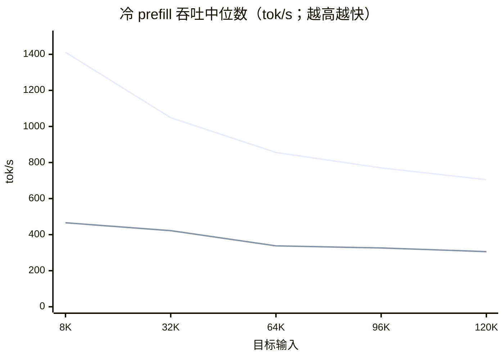
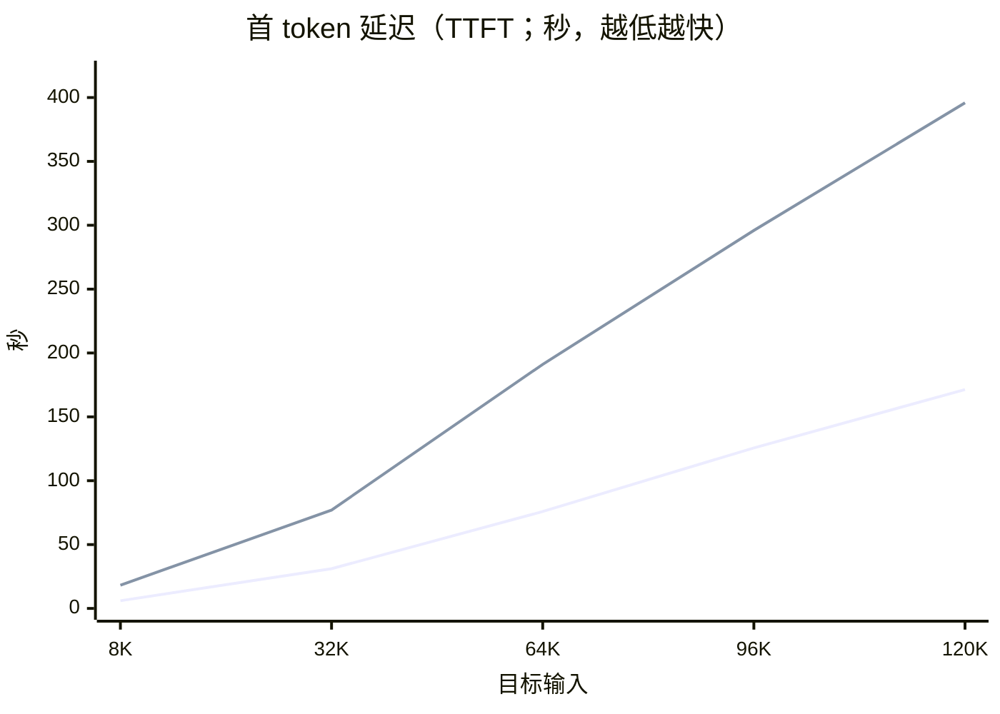
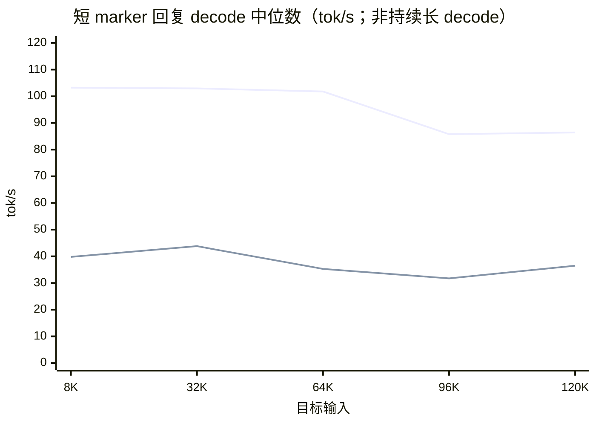
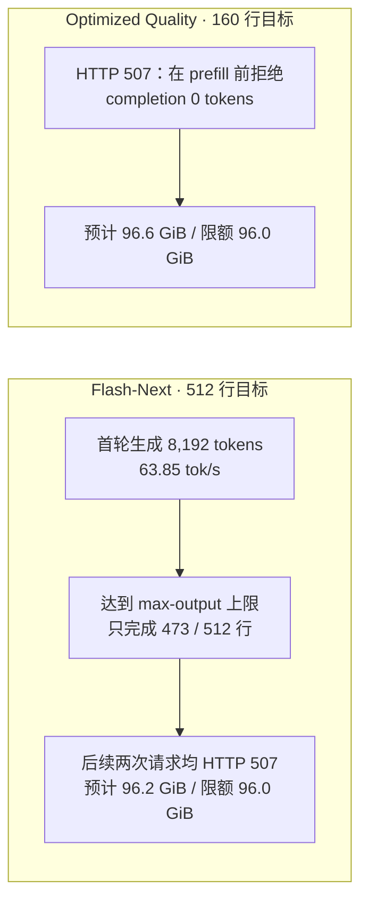
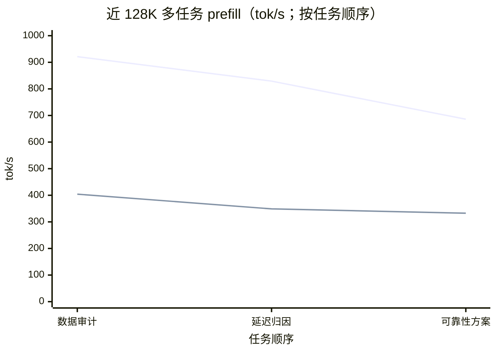
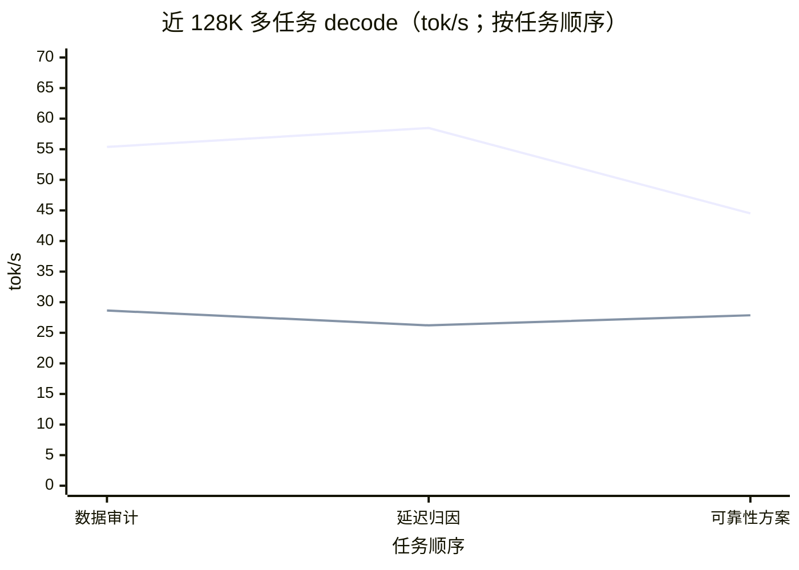

# MTPLX 本机模型性能对比

**测试批次：** 冷 prefill 2026-09-19；近 128K 持续压测 2026-09-20 · **整理日期：** 2026-09-20  
**对比对象：** Qwen3.8 Flash-Next（Optimized Speed）与 Qwen3.8 27B Optimized Quality（8-bit dynamic quant）  
**范围：** 本机 MTPLX 冷 prefill、TTFT、短 marker 回复、结构化长输出探针，以及约 120K 输入的多任务持续压测；不代表代码质量评测。

## 结论摘要

- **绝对 prefill 吞吐：Flash-Next 在五档输入长度都更快。** 120K 时为 **704.9 tok/s**，Quality 为 **305.9 tok/s**，约 **2.30×**。
- **相对衰减：Quality 的端点降幅更小，但绝对速度仍低。** 8K→120K，Flash-Next prefill 下降 **50.1%**，Quality 下降 **34.3%**。这是各模型相对自身 8K 基线的变化，不能据此说 Quality 的长上下文更快。
- **首 token 延迟：** 120K 下 Flash-Next TTFT 为 **171.36 s**，Quality 为 **395.88 s**（约 **2.31×**）。TTFT 包含服务与推理等待，不等同于纯 prefill 速度。
- **近 128K 多任务压测中，Flash-Next 的速度优势仍在，但末任务速度回落更明显。** 每模型依次完成 3 个不同任务；Flash-Next 运行 13.5 分钟，Quality 运行 30.6 分钟。按 3 个请求的中位数，Flash-Next prefill 为 **829.2 tok/s**、decode 为 **55.38 tok/s**，分别约为 Quality 的 **2.38×** 与 **1.99×**。
- **三点端点变化不是长期衰减定律。** 从第 1 个任务到第 3 个任务，Flash-Next prefill/decode 分别变化 **−25.5% / −19.6%**；Quality 分别变化 **−17.7% / −2.7%**。两模型 decode 都有中间波动，且任务输出长度不同；这些是本轮观测，不足以单独归因于温度或长期热降频。
- **温度与显存有平台限制。** 本机 `powermetrics` 提供热压力等级而无摄氏度读数；Apple Silicon 使用统一内存，未能单独拆出 GPU 显存，因此同时记录整机 RAM 与 MTPLX RSS 作为内存观测。

## 冷 prefill 吞吐曲线

每点为同一模型、同一目标输入档的 **3 个冷请求中位数**；各组 marker 均 3/3 通过、cached ratio 中位数为 0。横轴为目标输入长度，纵轴为 MTPLX `prefill_tok_s`。

## TTFT 曲线

同一批冷 prefill 请求的 TTFT 中位数；纵轴从 0 起，数值越低越好。

## 短 marker 回复 decode 观测

这些点取自冷 prefill 请求结束后的短 marker 回复，**不是持续长 decode 压力曲线**。Flash-Next 回复长度为 180–267 tokens，Quality 为 470–904 tokens；回复长度不同且各档不单调，跨模型比较需谨慎。

端点上 Flash-Next 从 103.24 降至 86.43 tok/s（**−16.3%**）；Quality 从 39.79 降至 36.48 tok/s（**−8.3%**）。Quality 的相对端点跌幅较小，但其绝对 decode 速率仍较低；样本不支持持续生成结论。

## 逐档数据

| 目标输入 | 实际 prompt tokens（Flash / Quality） | Prefill tok/s（Flash / Quality） | Flash / Quality | TTFT 秒（Flash / Quality） |
|---:|---:|---:|---:|---:|
| 8K | 8,400 / 8,406 | 1,411.4 / 465.9 | 3.03× | 6.04 / 18.19 |
| 32K | 32,401 / 32,407 | 1,048.4 / 422.2 | 2.48× | 31.13 / 76.98 |
| 64K | 64,401 / 64,407 | 855.8 / 337.9 | 2.53× | 75.85 / 191.09 |
| 96K | 96,401 / 96,407 | 770.2 / 326.1 | 2.36× | 125.68 / 295.94 |
| 120K | 120,402 / 120,408 | 704.9 / 305.9 | 2.30× | 171.36 / 395.88 |

## 结构化长输出探针：执行结果，不是速度对照

两批输出请求的目标规模并不相同：Flash-Next 请求 512 行；经校准的 Quality 探针请求 160 行（约 3.8K 输出 tokens）。下图概括执行路径；HTTP 507 是请求在 prefill 前被拒，不应画成 0 tok/s。

这些结构化探针本身**没有得到两模型同输入、同输出长度的持续 decode 对照**；下一节的 natural soak 提供了约 120K 输入的多任务生成观测，但实际 completion 长度不完全相同，不能视为严格同长对照。结构化探针的 HTTP 507 也不能用于判断哪款更省内存。

## 近 128K context 多任务持续压测对比（2026-09-20）

两款模型均使用 **131,072-token context window**，每个任务输入约 120K tokens，并以最多 8,192 输出 tokens 持续生成；输入加输出目标约 128.6K tokens，接近窗口上限。每款模型连续执行 3 个不同任务，运行期间未并发压另一款模型。速率取 MTPLX 每请求 `prefill_tok_s`、`decode_tok_s`；TTFT 为秒。任务序号表示执行顺序，不是等间隔时间点。

| 模型 | 本轮时长 | 有效任务数 | Prefill 中位数 | Decode 中位数 | TTFT 中位数 | 标记/格式检查 |
|---|---:|---:|---:|---:|---:|---:|
| Flash-Next Optimized Speed | 13.5 分钟 | 3 | 829.2 tok/s | 55.38 tok/s | 145.7 s | 3/3 通过 |
| Qwen 3.8 27B Optimized Quality（8-bit） | 30.6 分钟 | 3 | 348.9 tok/s | 27.86 tok/s | 345.9 s | 2/3 通过 |

### 每任务速度与输出

| 模型 | # | 任务 | Completion tokens | Prefill tok/s | Decode tok/s | TTFT (s) | 标记通过 |
|---|---:|---|---:|---:|---:|---:|:---:|
| Flash-Next | 1 | 数据完整性与异常审计 | 8,166 | 921.3 | 55.38 | 131.10 | 是 |
| Flash-Next | 2 | 延迟分布与缓存/分片归因 | 6,186 | 829.2 | 58.47 | 145.71 | 是 |
| Flash-Next | 3 | 可靠性改进与验证方案 | 4,452 | 686.0 | 44.51 | 175.97 | 是 |
| Optimized Quality | 1 | 数据完整性与异常审计 | 8,192 | 404.2 | 28.64 | 298.40 | 是 |
| Optimized Quality | 2 | 延迟分布与缓存/分片归因 | 6,428 | 348.9 | 26.21 | 345.88 | 是 |
| Optimized Quality | 3 | 可靠性改进与验证方案 | 8,192 | 332.6 | 27.86 | 362.58 | 否 |

第 1→3 个任务的 prefill 逐次走低；decode 则先波动、后回落。端点变化分别为 Flash-Next **−25.5% prefill / −19.6% decode**，Quality **−17.7% / −2.7%**。每模型只有三个不同任务，completion 长度也不完全相同；不能把该端点差直接解释为纯热衰减或长期稳态表现。

### CPU、GPU、内存与热状态

整机内存、MTPLX RSS 和进程 CPU 约每 15 秒采样，覆盖各自完整压测。两批顺序执行，起始内存状态不同，因此 RAM 差异只描述本轮观测，不能单独视为模型固有需求。

| 全程采样项 | Flash-Next | Optimized Quality | 口径 |
|---|---:|---:|---|
| 可用 RAM（最低 / 均值） | 15.0% / 22.2% | 27.0% / 44.6% | 本机物理内存 128 GiB |
| 整机已用 RAM 估算峰值 | 108.80 GiB | 93.44 GiB | 按系统内存采样估算 |
| MTPLX RSS 峰值 | 42.66 GiB | 35.99 GiB | 进程常驻集 |
| MTPLX 进程 CPU（中位 / 峰值） | 36.7% / 325.0% | 11.7% / 95.9% | 多核进程占用可超过 100%；峰值为采样峰值 |
| Swap（起始 → 结束） | 3,558.69 → 3,518.69 MiB | 3,638.25 → 3,614.25 MiB | 两轮均未增长 |

`powermetrics` 每 15 秒采样 SoC 功耗、GPU 活跃驻留率与热压力。Quality 的这组遥测只覆盖其最后 **8 分 02 秒 / 33 个样本**；Flash-Next 覆盖完整 **13 分 32 秒 / 55 个样本**。

| 传感遥测（观察窗口内） | Flash-Next | Optimized Quality |
|---|---:|---:|
| CPU 功耗估算均值 | 6.03 W | 5.69 W |
| GPU HW active residency 均值 | 95.1% | 98.2% |
| GPU 功耗估算均值 | 20.86 W | 19.64 W |
| 热压力样本 | Heavy 49/55；Nominal 6/55 | Heavy 33/33（仅上述末段窗口） |

`powermetrics` 在本机只提供热压力等级，没有返回 CPU/GPU 摄氏度传感器字段；因此不能诚实地填报 °C。它也不提供 Apple Silicon 的独立 GPU 显存值；上表报告统一内存总量与 MTPLX RSS。功耗为系统估算，适合作为本机本轮参考，不是精密电表读数。

Flash-Next 首轮尝试曾因连续两次 marker 未通过而在 9.1 分钟停止，未纳入上面的正式对比。正式重跑把 marker/header 校验保留为诊断项、不再作为两次失败即停条件；资源阈值、指标缺失、HTTP 507、超时与乱码/重复输出等安全检查仍启用，正式三项 marker 均通过。

## 测试口径与限制

- 两批均为本机 MTPLX Desktop（`127.0.0.1:8001`）+ Pi：context window 131,072、max output 8,192、reasoning medium、MTP/head 开启、profile Auto、KV quantization 关闭、`allow_swap=false`、MTP cohorts 关闭；Pi tools/skills/extensions/context files 关闭并使用 no-session。
- 每个模型 × 输入档有 3 个唯一语料冷请求；表中为组内中位数。prompt tokens 实际值两模型相差约 6 个，适合描述本轮直接吞吐对照。
- 两个批次并非交错同时运行，系统内存与 Swap 采样区间不同。配置快照匹配只能说明各自批次内配置未漂移，不代表系统负载完全相同。
- 模型变体/权重同时不同，不能把性能差异单独归因于量化或“质量”。本测试没有评测编码质量。
- 新增的 near-128K natural soak 每模型仅 3 个任务（Quality 30.6 分钟、Flash-Next 13.5 分钟）；尚未完成 64K/112K 持续 decode、structured vs natural 对照、cache A/B 或 45–60 分钟 soak。三点端点变化不能证明长期稳态衰减或热降频因果；Quality 的 CPU/GPU/热压力遥测也只覆盖最后约 8 分钟，绝对摄氏温度未采到。

## 原始证据

- Flash-Next 运行报告（历史本机文件，未随本报告发布） · [执行记录](devlog-projects-qwen3-8-test-notes-mtplx-flash-next-128k-pressure-test-run-2026-09-20.md) · 原始曲线 CSV（历史本机文件，未随本报告发布）
- Optimized Quality 运行报告（历史本机文件，未随本报告发布） · [执行记录](devlog-projects-qwen3-8-test-notes-mtplx-qwen38-27b-quality-pressure-test-run-2026-09-20.md) · 原始曲线 CSV（历史本机文件，未随本报告发布）
- Flash-Next 近 128K 正式重跑报告（历史本机文件，未随本报告发布） · 逐请求记录（历史本机文件，未随本报告发布） · 全程系统采样（历史本机文件，未随本报告发布）
- Optimized Quality 近 128K 压测报告（历史本机文件，未随本报告发布） · 逐请求记录（历史本机文件，未随本报告发布） · 全程系统采样（历史本机文件，未随本报告发布）
- powermetrics CPU/GPU/热压力原始遥测（历史本机文件，未随本报告发布）（Quality 部分覆盖，Flash-Next 全程覆盖）
- 交互式报告源码（历史本机文件，未随本报告发布） · [本机预览](http://127.0.0.1:4173/?view=1)（本地预览服务运行时可打开）
- Mermaid [XY Chart 语法参考](https://mermaid.js.org/syntax/xyChart.html)；命名曲线图例要求 Mermaid 11.17.0 或更新版本。

