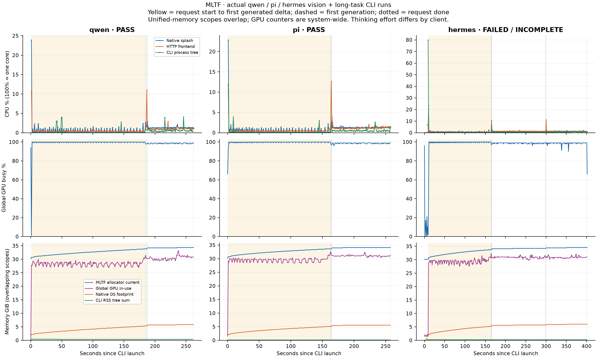
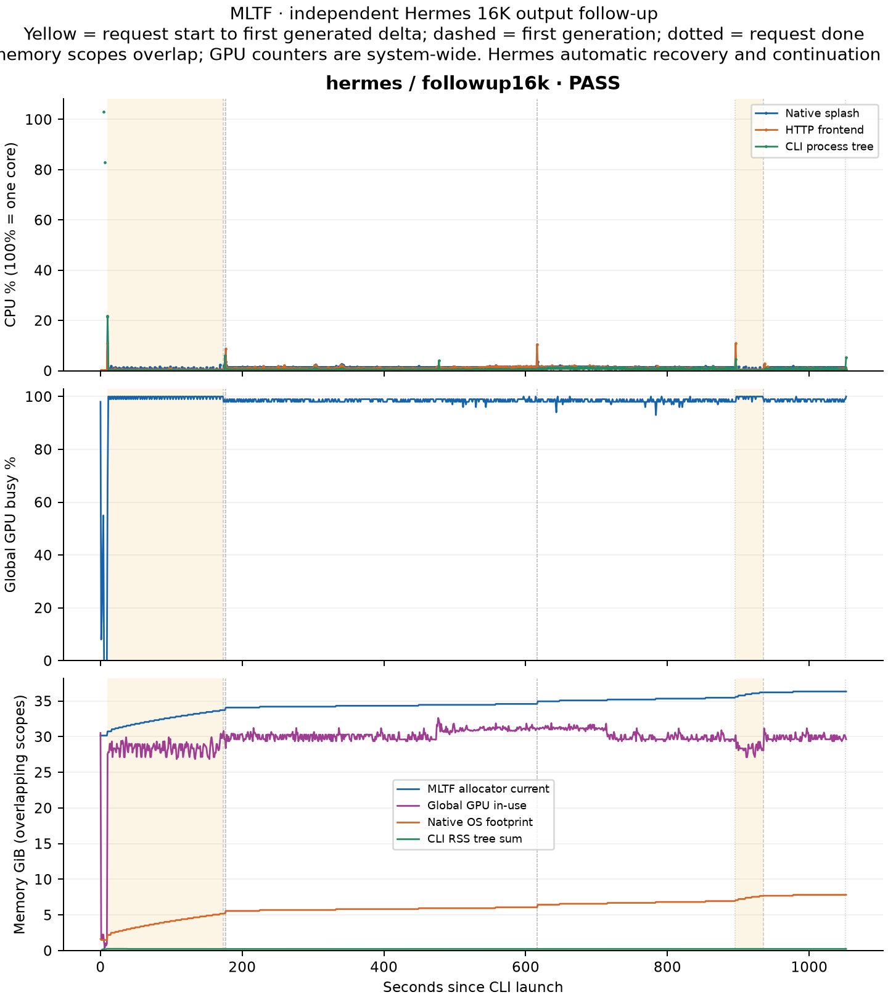

# MLTF: real qwen / pi / hermes CLI acceptance on long multimodal tasks

[English](engine-tests-2026-10-19-mltf-clients-report.md) | [简体中文](engine-tests-2026-10-19-mltf-clients-report_CN.md)

<!-- environment-context:start -->

## Workstation and system (context added 2026-10-20)

| Item | Record and evidence boundary |
|---|---|
| Workstation role | Local inference workstation |
| Current hardware reference | MacBook Pro `Mac17,6`; Apple M5 Max; 18-core CPU; 40-core GPU; 128 GB unified memory (128 GiB / 137438953472 bytes) |
| Host explicitly recorded by the source | See original report; current snapshot does not fill missing historical configuration |
| Current system snapshot | macOS 27.0.1, build `26A434`, arm64, Metal 4; captured 2026-10-20 22:03:27 UTC |
| Test-time OS | macOS 27.0.1 (26A434) |
| Historical limits | Without a separate test-time snapshot, detailed core counts are a current workstation reference. Mac specifications do not establish LAN PC or cloud inference hardware. |

[Full environment notes](../../environment.md). Model, quantization, engine, cache and request settings remain those recorded in this report. Original figures, source code and command output retain source-language evidence.

<!-- environment-context:end -->

Generated 2026-10-19T18:45:33.884644-04:00. Did all three clients fully pass the main 4096-output round? **No; see failures.**

Final end-to-end acceptance, with the independent Hermes 16K follow-up reported separately: **Pass**. Original main-round failures and invalid adapter attempts are retained in full.

Device: Apple M5 Max, 40 GPU cores, 128 GiB physical unified memory, macOS 27.0.1.

Each client uses a freshly started MLTF service with the same configuration. Actual installed CLIs attach images, request the model, read an independent local nonce file and return tool results. The proxy forwards bytes unchanged to MLTF; test hooks observe native GenerationRequest without replacing requests or sampling.

Model: `mlx-community/Qwen3.8-27B-8bit`, 131,072-token window, vision enabled, packed-q8c target weights from the original 8bit model and INT8 KV. Shared body: 88,064 tokens. Actual input includes each CLI's system prompt, tools, images and results; per-request usage is authoritative. **These are long tasks within a 128K window, not full-128K inputs.**

Recommended sampling `temperature=1 / top_p=0.95 / top_k=20` is checked against both actual client HTTP bodies and native engine requests. Initial client settings remain: qwen low and pi/hermes medium thinking. Hermes effort changes during native recovery are recorded per request. Output is capped at 4096 per request, with at most three generations. Cold-start and post-tool cache states are recorded separately.

## Functionality and overall duration

| Client | Acceptance | HTTP / native count | CLI wall seconds | Successful tool round trip | Image color/shape/order | Final-answer characters |
|---|---|---:|---:|---:|---|---:|
| qwen | Pass | 2 / 2 | 263.13 | 1 / 1 | Pass | 11,692 |
| pi | Pass | 2 / 2 | 257.74 | 1 / 1 | Pass | 16,542 |
| hermes | Fail/pending | 4 / 3 | 401.63 | 1 / 1 | Fail | 170 |

CLI wall time includes startup, client preprocessing, tools and all requests. System prompts and thinking efforts differ, so these numbers validate actual integration paths rather than ranking clients with identical prompts/reasoning budgets.

## All requests: cache, prefill and decode

| Client / request | Input / output / reasoning tokens | effort / native thinking | Final-content characters | Cached tokens | Cold/warm | TTFT¹ seconds | lifecycle prefill² tok/s | lifecycle decode³ tok/s | Request wall seconds | finish |
|---|---:|---|---:|---:|---|---:|---:|---:|---:|---|
| qwen / 0001 | 95824 / 130 / 71 | low / True | 0 | 0 | cold | 183.82 | 521.70 | 62.33 | 185.88 | tool_calls |
| qwen / 0002 | 96004 / 4096 / 1341 | low / True | 11,692 | 95808 | warm | 0.94 | 230.40 | 54.81 | 75.63 | length |
| pi / 0001 | 89323 / 77 / 11 | medium / True | 45 | 0 | cold | 162.80 | 549.10 | 72.86 | 163.77 | tool_calls |
| pi / 0002 | 89451 / 4096 / 31 | medium / True | 16,542 | 89312 | warm | 0.76 | 208.63 | 44.14 | 93.54 | length |
| hermes / 0001 | 92209 / 70 / 12 | medium / True | 0 | 0 | cold | 154.75 | 596.37 | 87.64 | 155.49 | tool_calls |
| hermes / 0002 | 92379 / 4096 / 4096 | medium / True | 0 | 92192 | warm | 0.84 | 247.88 | 30.71 | 134.05 | length |
| hermes / 0003 | 92419 / 4096 / 0 | none / False | 17,119 | 92352 | warm | 0.58 | 140.61 | 40.64 | 101.34 | length |
| hermes / 0004 | — / — / — | medium / None | 0 | None | unknown | — | — | — | — | None |

¹ TTFT ends at the first generated increment, including reasoning, final content or tool arguments. First visible final-content time is stored separately in clients-summary.json / requests.csv.
² MLTF lifecycle prefill is uncached prefill tokens / start-to-first-emission elapsed. It includes request-lifecycle overhead and first-batch generation, rather than pure GPU-kernel timing. Reused tokens are not counted as new prefill on warm requests.
³ MLTF lifecycle decode is tokens after subtracting the first complete speculative emission / first-emission-to-done elapsed. It includes reasoning, final content and tool-output tokens. This differs from /status native command throughput; both raw definitions remain. All HTTP/native per-request evidence determines speed and token totals, since terminal CLI summaries may omit truncated intermediate rounds.

Complete first-final-content times, generation-delivery intervals, prompt/decode denominators and token counts are in requests.csv (historical local file; not published with this report) and clients-summary.json (historical local file; not published with this report). Every HTTP attempt is listed; failed requests are not replaced by rerun results.

## CPU, GPU and unified memory

| Client | Native / frontend / CLI mean CPU % | Mean global GPU busy % | Native RSS / footprint peak GiB | Frontend RSS / footprint peak GiB | CLI tree RSS / footprint peak GiB | MLTF allocator peak GiB | Global GPU in-use peak GiB |
|---|---:|---:|---:|---:|---:|---:|---:|
| qwen | 0.72 / 0.68 / 0.27 | 98.97 | 1.50 / 5.82 | 0.82 / 0.59 | 0.42 / 0.32 | 34.34 | 33.18 |
| pi | 0.78 / 0.82 / 0.32 | 99.15 | 1.50 / 5.57 | 0.80 / 0.57 | 0.14 / 0.09 | 34.08 | 32.63 |
| hermes | 0.91 / 0.93 / 0.64 | 96.75 | 1.68 / 6.01 | 0.80 / 0.57 | 0.81 / 0.57 | 34.52 | 32.32 |

CPU 100% represents one logical CPU core. Native is the actual `splash` subprocess; frontend is the Python HTTP service; CLI tree includes the launch adapter and actual agent subprocesses. GPU busy/driver memory are global and may include other apps.
**RSS, physical footprint, MLTF allocator and GPU-driver memory overlap and must not be added.** Native OS footprint does not represent all Metal allocation; summing process trees can count shared pages repeatedly. No percentage RAM-saving claim is derived here.

| Client | 1Hz samples | Pressure counts | Swap start → end GiB (change) | Stale status samples | Telemetry errors |
|---|---:|---|---:|---:|---|
| qwen | 262 | {"normal": 262} | 4.70 → 4.70 (0.00) | 0 | {"process.process": 1} |
| pi | 257 | {"normal": 257} | 4.75 → 4.72 (-0.02) | 0 | {} |
| hermes | 401 | {"normal": 401} | 4.72 → 4.70 (-0.02) | 0 | {"process.process": 3} |

process.process collection errors come from races enumerating/querying short-lived CLI subprocesses that have already exited: Qwen caffeinate, and python/git during Hermes startup. Original errors and missing-sample counts remain. Native/HTTP frontend coverage is separately reported through valid_count/missing_count and server_roster_error_count; missing samples are not filled with 0.

## Validation boundaries and evidence

Image recognition and nonce results establish real multimodal input and tool round trips. Long code in the main round is truncated at the 4096 cap; the independent 16K follow-up retains its actual finish reason. Generated code and the 25 unittests are not executed, nor is answer-quality equivalence across precision paths/clients established. Sampling is stochastic and a single round provides no statistical confidence.

Pi JSON mode can exit 0 after model error/length, so finalized assistant events, settled agent state, tool results and nonce are checked together. Qwen/Hermes additionally check terminal envelopes and raw proxy/native requests.

The image source is the same 840×280 PNG. Pi/Hermes embedded bytes are checked against source SHA256. Actual Qwen CLI converts it to same-size JPEG; actual encoding/MIME, SHA256 differences, RGB mean absolute error and differing-pixel ratio are recorded explicitly. Approximate pixel acceptance is allowed only for this verified conversion. Recognition answers and native image_spans must still pass separately. The three clients cannot be said to upload identical image bytes.

Temporary profiles isolate testing, output caps, tool scope and unrelated helper requests; SDK transport is not replaced. Pi/Hermes disable automatic compaction to preserve the long body, while Qwen retains normal compaction. Each actual request is checked to retain the shared long body. Initial efforts remain; changes during automatic recovery are recorded per request.

- Per-request speed/parameter CSV (historical local file; not published with this report)
- Per-client CPU/GPU/memory summary CSV (historical local file; not published with this report)
- Per-second resource CSV (historical local file; not published with this report)
- Complete machine-readable audit (historical local file; not published with this report)
- Test plan (historical local file; not published with this report)
- Final persistent-client-configuration audit (historical local file; not published with this report)
- Service-restoration/process-cleanup audit (historical local file; not published with this report)
- Actual restored-service status (historical local file; not published with this report)
- Real-CLI offline parser (historical local file; not published with this report)

Actual CLIs reveal two missing vision-capability declarations: Qwen adds `generationConfig.modalities.image=true`, and Hermes adds `supports_vision=true` for the local model. Only the corresponding canonical model-capability fields change; sampling and other global selections remain. Qwen repair evidence (historical local file; not published with this report), Hermes repair evidence (historical local file; not published with this report). Actual HTTP/native-job evidence in this report then verifies native image requests.

## Independent Hermes 16K-output follow-up (not pooled with the 4096 main round)

The pre-recorded follow-up plan (historical local file; not published with this report) raises only test output/step budgets, retaining the image source, 88,064 body tokens, vision, 128K, initial medium thinking and recommended three sampling settings. Output cap=16,384, agent iterations=4 and proxy limit=6 generations. Original 4096-round failures remain; this section's speed/time/memory are not merged into main-round CSV/curves.

- Real CLI result: pass; exit `0`, wall **1,052.92 seconds**, HTTP/native `4/4`.
- Terminal vision: `True`; nonce tool result / final answer: `True/True`; final answer `94,183` characters.
- Native / frontend / CLI mean CPU: `1.22 / 0.99 / 0.72%`; mean global GPU busy: `97.97%`.
- Allocator peak: `36.34 GiB`, global GPU in-use peak: `32.63 GiB`; overlapping definitions must not be added. Pressure `{"normal": 1048}`, swap change `-0.02 GiB`.
- Required failed/unresolved checks: `[]`.

| Request | HTTP/forwarded | Input / output / reasoning | effort | cache tokens | TTFT seconds | prefill tok/s | decode tok/s | wall seconds | finish |
|---|---|---:|---|---:|---:|---:|---:|---:|---|
| 0001 | 200 / True | 92219 / 131 / 73 | medium | 0 | 163.67 | 563.91 | 55.48 | 165.98 | tool_calls |
| 0002 | 200 / True | 92450 / 16384 / 16384 | medium | 92192 | 1.12 | 250.91 | 37.33 | 439.96 | length |
| 0003 | 200 / True | 92490 / 16384 / 0 | none | 92320 | 0.70 | 278.36 | 58.73 | 279.63 | length |
| 0004 | 200 / True | 108919 / 6042 / 54 | medium | 92480 | 40.34 | 408.59 | 52.28 | 155.83 | stop |

All 16,384 output tokens in follow-up request 2 are reasoning, with no final content. Hermes automatically changes request 3 to none for recovery; after request 3 produces 16,384 final-content tokens, continuation triggers request 4, which restores medium and naturally stops. **Increasing the cap does not eliminate reasoning-budget exhaustion**; final success includes all time spent on native client recovery and continuation.

Hermes's terminal CLI summary reports only `6173` completion tokens; HTTP/native evidence records actual generation of `38,941` tokens (`16,511` reasoning). The summary omits truncated intermediate rounds, so all HTTP/native per-request evidence must determine speed and totals.

Native RSS/footprint peaks: `2.23 / 7.82 GiB`; frontend: `0.82 / 0.58 GiB`; CLI tree: `0.25 / 0.21 GiB`. Resource samples: `1048`; native/frontend process-collection errors: `0`; short-lived CLI query races: `2`. Original missing samples remain.

Raw evidence: hermes/followup16k (historical local file; not published with this report). Independent follow-up request CSV (historical local file; not published with this report), resource-summary CSV (historical local file; not published with this report), per-second CSV (historical local file; not published with this report), full follow-up audit (historical local file; not published with this report), independent 33-check audit (historical local file; not published with this report).

## Retained failed attempts and cleanup anomalies

- qwen / invalid-adapter (historical local file; not published with this report): the first real CLI sends no image and declares 36 tools; the coordinator stops during prefill, with CLI exit -15. Complete evidence remains and is excluded from successful main-round speed/memory conclusions.
- runner-pi-hermes.log (historical local file; not published with this report): Pi cleanup raises PermissionError: [Errno 1] Operation not permitted while the coordinator cleans stopped/zombie process groups. Application requests are judged separately through raw HTTP/native terminal evidence; completed successful Pi data remain. The coordinator is subsequently repaired and routine service restored.
- runner.log (historical local file; not published with this report): qwen cleanup raises PermissionError: [Errno 1] Operation not permitted while the coordinator cleans stopped/zombie process groups. Application requests are judged separately through raw HTTP/native terminal evidence; completed successful Pi data remain. The coordinator is subsequently repaired and routine service restored.

Routine MLTF restoration record: service-restored.json (historical local file; not published with this report), PID `59376`, ready `True`.

### qwen

Raw evidence：qwen/live (historical local file; not published with this report)，Frontend PID `51935`，native PIDs `[51948]`。
Failed/unresolved checks：`[]`。
Terminal CLI errors：`[]`。
File-read/parse errors：`[]`。

- Request 0001：HTTP 200、forwarded=True，Vision in visible final content=None、nonce=False；Required failed/unresolved checks `[]`；Observed deviations `[]`；Errors `[]`。
- Request 0002：HTTP 200、forwarded=True，Vision in visible final content=True、nonce=True；Required failed/unresolved checks `[]`；Observed deviations `[]`；Errors `[]`。
### pi

Raw evidence：pi/live (historical local file; not published with this report)，Frontend PID `47427`，native PIDs `[47434]`。
Failed/unresolved checks：`[]`。
Terminal CLI errors：`[]`。
File-read/parse errors：`[]`。

- Request 0001：HTTP 200、forwarded=True，Vision in visible final content=False、nonce=False；Required failed/unresolved checks `[]`；Observed deviations `[]`；Errors `[]`。
- Request 0002：HTTP 200、forwarded=True，Vision in visible final content=True、nonce=True；Required failed/unresolved checks `[]`；Observed deviations `[]`；Errors `[]`。
### hermes

Raw evidence：hermes/live (historical local file; not published with this report)，Frontend PID `49522`，native PIDs `[49539]`。
Failed/unresolved checks：`["cli_exit_zero", "cli_tool_answer_evidence", "vision_colors_shapes_order", "no_blocked_http_attempts"]`。
Terminal CLI errors：`[{"exit_code": 1, "error": null}]`。
File-read/parse errors：`[]`。

- Request 0001：HTTP 200、forwarded=True，Vision in visible final content=None、nonce=False；Required failed/unresolved checks `[]`；Observed deviations `[]`；Errors `[]`。
- Request 0002：HTTP 200、forwarded=True，Vision in visible final content=None、nonce=False；Required failed/unresolved checks `[]`；Observed deviations `[]`；Errors `[]`。
- Hermes automatic recovery: all 4096 output tokens from request0002 are reasoning, with no final content. Native CLI length continuation changes request0003 reasoning_effort to none, native thinking=false. Original medium remains the startup setting; temperature/top_p/top_k remain 1/.95/20. Recovery requests and duration are fully included.
- Request 0003：HTTP 200、forwarded=True，Vision in visible final content=True、nonce=True；Required failed/unresolved checks `[]`；Observed deviations `["http_original_effort_preserved", "native_thinking_enabled"]`；Errors `[]`。
- Request 0004：HTTP 429、forwarded=False，Vision in visible final content=None、nonce=False；Required failed/unresolved checks `["native_job_matched_by_exact_public_id", "native_sampling_recommended", "native_float32_sampling_matches_http", "native_sampling_matches_http", "native_frontend_pid_matches_status", "native_output_cap_matches_plan", "native_prompt_matches_usage", "native_vision_input_present", "native_thinking_matches_http_effort", "usage_inside_128k", "usage_total_consistent", "cache_counts_consistent", "prefill_rate_arithmetic_consistent", "decode_rate_arithmetic_consistent", "http_success", "stream_finished"]`；Observed deviations `["native_thinking_enabled"]`；Errors `[{"proxy_errors": "per-case generation request limit 3 exceeded"}]`。
