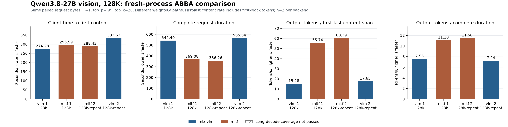
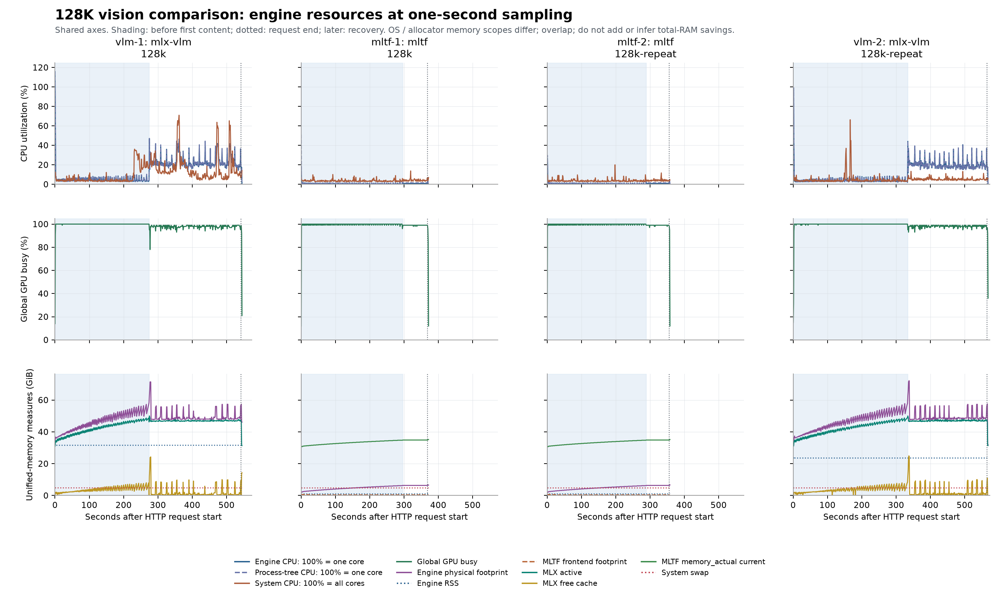
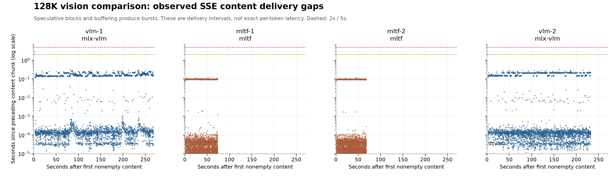

# MLTF 与 MLX-VLM：128K 图文长任务对照

[English](engine-tests-2026-10-19-mltf-comparison-report.md) | [简体中文](engine-tests-2026-10-19-mltf-comparison-report_CN.md)

<!-- environment-context:start -->

## 本机配置与系统（2026-10-20 补充）

| 项目 | 记录与证据边界 |
|---|---|
| 本机用途 | 本机推理工作站 |
| 本机硬件参考 | MacBook Pro `Mac17,6`；Apple M5 Max；18 核 CPU；40 核 GPU；128 GB 统一内存（128 GiB / 137438953472 字节） |
| 原报告明确记载的主机 | 详见原报告；未以当前快照补造历史配置 |
| 当前系统快照 | macOS 27.0.1，build `26A434`，arm64，Metal 4；采集于 2026-10-20 22:03:27 UTC |
| 实验时系统 | macOS 27.0.1 (26A434) |
| 历史配置边界 | 旧测试未保存独立快照时，详细核数只作为当前本机配置参考；内网 PC／云端推理硬件不由 Mac 配置推断 |

[完整环境说明](../../environment_CN.md)。模型、量化、引擎、缓存和请求条件以本报告原有记录为准。原始图表、源码和命令输出保留源语言证据。

<!-- environment-context:end -->

日期：2026-10-19（America/Toronto）。四个独立新进程按 VLM1 → MLTF1 → MLTF2 → VLM2 顺序运行；每个长请求后做短图片恢复，然后停止该测试服务。任一时刻只加载一个测试后端。

同一任务的请求字节复用既有 sampled VLM 请求：126,976 个处理后输入 tokens（含图片）+ 4,096 输出预算 = 131,072；temperature=1、top_p=0.95、top_k=20、thinking 关闭。两份不同图片 / 长任务各测一次每个后端；无 EOS 屏蔽、无重复筛选成功样本。每次启动后的主请求验证 cache matched tokens=0。

**数值路径不同：MLTF 0.1.2 的 q8c 权重 / INT8 KV，与 MLX-VLM 0.7.8 的 affine 8bit 权重 / BF16 KV，并非等精度实验。这里比较整套运行路径，不能把差异单独归因于某个 kernel 或 KV 格式。**

MLTF 使用独立环境和 8083 端口，128K、96 GiB Metal 预算、单活跃请求，SSD cache 关闭。target 复用当前 8bit 源；draft pinned revision 虽不同，但原始权重 SHA256 一致。视觉资产随官方模板打包，实际 image encode 与图片回答均另行验证。MLTF prefill 使用 W8A8、verify 使用 W8A16 / split2-rounded，不能认定输出质量与 VLM 等同。安装及资产校验见 setup-notes.md（历史本机文件，未随本报告发布）、model-verification.json（历史本机文件，未随本报告发布） 和 draft-source-comparison.json（历史本机文件，未随本报告发布）。生产主启动器和 qwen / pi / hermes 仍保留现有 VLM 配置。

本次两份任务的共同客户端正文交付率均值：MLTF 58.06 tok/s，VLM 16.47 tok/s，约 3.53 倍。主请求总耗时均值从 554.02 秒变为 362.67 秒，减少 34.5%；首字等待均值分别为 MLTF 292.01 秒、VLM 303.95 秒。均值仅描述本次 n=2，不代表长期稳定性或等精度质量收益。

硬件快照（2026-10-19T17:10:02-04:00）：Apple M5 Max，128.00 GiB，18 个逻辑 CPU。操作系统 / 供电 / 热状态原文见 hardware.json（历史本机文件，未随本报告发布）；各运行另存 thermal-before/after。

## 完成情况与共同客户端性能

“长 decode 通过”仅表示请求完成、输入预算核对、冷 cache 与至少 2,048 输出 tokens 等机械覆盖检查；图片识别、恢复探针单列。未执行生成的 Python 代码，不能据此认定代码功能正确。

| 运行 | 后端 / 任务 | 输入 / 输出 | 长 decode / 满4096 | 图片 / 恢复 | TTFT 秒 | 请求总秒 | 首末正文跨度秒 | 正文交付 tok/s | 输出 / 总秒 tok/s | 终止 |
| --- | --- | ---: | --- | --- | ---: | ---: | ---: | ---: | ---: | --- |
| vlm-1 | mlx-vlm / 128k | 126976 / 4096 | 通过 / 通过 | 通过 / 通过 | 274.28 | 542.40 | 268.12 | 15.28 | 7.55 | length |
| mltf-1 | mltf / 128k | 126976 / 4096 | 通过 / 通过 | 通过 / 通过 | 295.59 | 369.08 | 73.49 | 55.74 | 11.10 | length |
| mltf-2 | mltf / 128k-repeat | 126976 / 4096 | 通过 / 通过 | 通过 / 通过 | 288.43 | 356.26 | 67.82 | 60.39 | 11.50 | length |
| vlm-2 | mlx-vlm / 128k-repeat | 126976 / 4096 | 通过 / 通过 | 通过 / 通过 | 333.63 | 565.64 | 232.01 | 17.65 | 7.24 | length |

TTFT 从客户端发出 HTTP 请求到收到第一段非空正文；总耗时到 SSE 结束。它们包含前端、模板、图片和首轮推理开销，更适合共同口径比较。正文交付率统一为全部 completion tokens / 首末非空正文跨度，包含已在首块交付的 tokens，略高于严格排除首块的 decode 率。正文 SSE 按推测块成批交付；首末正文跨度并非逐 token 延迟。

| 后端 | 样本数 / 长 decode 通过 | TTFT 均值 [范围] 秒 | 总耗时均值 [范围] 秒 | 输出 / 总秒均值 [范围] tok/s |
| --- | ---: | ---: | ---: | ---: |
| mltf | 2 / 2 | 292.01 [288.43, 295.59] | 362.67 [356.26, 369.08] | 11.30 [11.10, 11.50] |
| mlx-vlm | 2 / 2 | 303.95 [274.28, 333.63] | 554.02 [542.40, 565.64] | 7.40 [7.24, 7.55] |

每个后端 n=2，仅给样本均值和范围，没有统计置信度。两种任务的请求 SHA256 配对核对如下；即使 API 设置相同，两套随机采样 / 数值路径也不保证输出相同。

- 128k：请求 SHA256 一致=True；MLTF/VLM 的 TTFT 比=1.078，总耗时比=0.680，输出/总秒比=1.470。
- 128k-repeat：请求 SHA256 一致=True；MLTF/VLM 的 TTFT 比=0.865，总耗时比=0.630，输出/总秒比=1.588。

## 后端计时（不同口径，分列保留）

| 运行 | prompt 秒 | prompt tok/s | decode 秒 | decode tok/s | cache matched |
| --- | ---: | ---: | ---: | ---: | ---: |
| vlm-1 | 273.50 | 464.26 | 268.12 | 15.28 | 0 |
| mltf-1 | 295.46 | 429.75 | 73.49 | 55.72 | 0 |
| mltf-2 | 288.30 | 440.43 | 67.82 | 60.31 | 0 |
| vlm-2 | 332.02 | 382.44 | 232.01 | 17.65 | 0 |

VLM 使用主请求 `/metrics.latest.prompt_eval_time_s`、`prefill_tok_s`、`decode_elapsed_s`、`decode_tok_s`。MLTF terminal `prompt_ms` 是 native 开始至首个推测输出块，包含首轮输出；其 decode 时间为首 native 输出至结束，吞吐分子排除第一个推测块。不能把这两列 prompt 率直接解释为纯 prefill 加速。MLTF `/status.metrics` 是累计统计，没有拿来替代主请求计时。原始 terminal timings / metrics 全保存在 summary.json 和结果 JSON。

MLTF 另有 native batch / command wall 累计计时（`/status.metrics`，与生命周期计时分开）：

| 运行 | prefill 输入 / wall 秒 / tok/s | decode 输出 / wall 秒 / tok/s |
| --- | ---: | ---: |
| mltf-1 | 126976 / 294.39 / 431.32 | 4096 / 73.22 / 55.94 |
| mltf-2 | 126976 / 288.01 / 440.88 | 4096 / 67.58 / 60.61 |

上述 command 指标为进程累计值；快照在主请求完成、恢复探针前取得。主请求前计数保存在 summary.json，须核对为零后才能作为单次请求统计。它不包含相同的 HTTP / 排队开销，也不与 VLM prompt 计时组成“纯 GPU prefill”比例。

## 内存口径与分阶段资源

**不能用 MLTF 较低的 libproc RSS / footprint 相对 VLM 计算“总 RAM 节省百分比”。本次 native OS 计数与其 Metal allocator / 全局 GPU 驱动计数明显不同；文件映射、模型后备页和 Metal 分配的归属记账不同，OS 进程数值不是完整模型 GPU 驻留量。内存结论应同时查看以下各列，并保留这些口径差异。全局驱动计数还包含桌面和其他进程，不能全部归给本服务。**

| 运行：主请求期间峰值 GiB | engine RSS / footprint | MLX active / free-cache | MLTF allocation current | 全局 GPU in-use / allocated |
| --- | ---: | ---: | ---: | ---: |
| vlm-1 | 32.18 / 71.40 | 50.01 / 24.26 | 未取得 | 73.30 / 82.34 |
| mltf-1 | 0.99 / 6.35 | 未取得 / 未取得 | 34.86 | 32.75 / 46.29 |
| mltf-2 | 0.99 / 6.34 | 未取得 / 未取得 | 34.86 | 32.80 / 46.44 |
| vlm-2 | 24.15 / 72.07 | 50.01 / 24.94 | 未取得 | 73.59 / 82.95 |

每列取本请求内各自峰值，未必同一时刻；这些统一内存计数互有重叠，不能相加或视为独立显存。MLTF memory_actual current 是分配追踪口径，VLM active/cache 是 MLX allocator 口径，也不能直接互换。

共同阶段按客户端时钟划分：发请求→首非空正文（含 prefill、图片与首输出）；首正文→请求完成（正文交付）。请求起点优先按“首正文 Unix 时间−客户端单调时钟 TTFT”还原，避免把请求前 health/metrics 快照计入；回退方式保存在 summary.json。这不是 GPU kernel 的严格 phase 边界。每秒采样，峰值可能漏掉短尖峰。CPU 100%=一个逻辑核（本机18核）；system CPU 100%=所有核；GPU busy 是整机全局值。

| 运行 / 阶段 | 样本 | engine CPU 均 / 峰 % | tree CPU 均 / 峰 % | system CPU 均 / 峰 % | 全局 GPU 均 / 峰 % | engine RSS / footprint 峰 GiB | 全局 GPU alloc / in-use 峰 GiB |
| --- | ---: | ---: | ---: | ---: | ---: | ---: | ---: |
| vlm-1 / 首正文前 | 274 | 5.07 / 115.65 | 5.07 / 115.65 | 7.27 / 36.10 | 99.65 / 100.00 | 32.18 / 58.25 | 68.74 / 59.57 |
| vlm-1 / 正文交付 | 267 | 22.87 / 47.08 | 22.87 / 47.08 | 16.03 / 70.97 | 97.78 / 99.00 | 31.57 / 71.40 | 82.34 / 73.30 |
| mltf-1 / 首正文前 | 295 | 0.35 / 21.04 | 0.91 / 50.98 | 3.61 / 10.08 | 99.47 / 100.00 | 0.99 / 6.34 | 46.18 / 32.75 |
| mltf-1 / 正文交付 | 73 | 0.86 / 0.98 | 1.53 / 1.84 | 4.15 / 13.75 | 98.95 / 99.00 | 0.99 / 6.35 | 46.29 / 31.73 |
| mltf-2 / 首正文前 | 287 | 0.35 / 26.46 | 0.89 / 29.72 | 3.71 / 20.03 | 99.47 / 100.00 | 0.99 / 6.19 | 46.25 / 32.01 |
| mltf-2 / 正文交付 | 68 | 0.89 / 2.24 | 1.54 / 2.76 | 4.06 / 11.70 | 98.91 / 99.00 | 0.99 / 6.34 | 46.44 / 32.80 |
| vlm-2 / 首正文前 | 332 | 4.23 / 99.12 | 4.23 / 99.12 | 4.75 / 66.33 | 99.50 / 100.00 | 24.15 / 57.76 | 68.26 / 58.89 |
| vlm-2 / 正文交付 | 230 | 20.11 / 44.13 | 20.11 / 44.13 | 5.23 / 13.34 | 98.06 / 99.00 | 23.55 / 72.07 | 82.95 / 73.59 |

MLTF engine 为 native splash 子进程；Python HTTP frontend 另计。VLM 为服务进程本身。RSS、physical footprint、allocator、全局驱动内存是重叠的统一内存观测，**不能相加，也不是独立显存**。进程树 RSS / footprint 求和还可能重复共享页。

| 运行 | engine PID / frontend PID | frontend footprint 峰 GiB | tree footprint 求和峰 GiB | MLX active / free-cache / 累计peak 峰 GiB | MLTF allocation current / 累计peak 峰 GiB |
| --- | --- | ---: | ---: | ---: | ---: |
| vlm-1 | [30691] / [] | 未取得 | 71.40 | 50.01 / 24.26 / 53.51 | 未取得 / 未取得 |
| mltf-1 | [33626] / [33618] | 0.64 | 6.75 | 未取得 / 未取得 / 未取得 | 34.86 / 34.86 |
| mltf-2 | [35543] / [35536] | 0.65 | 6.74 | 未取得 / 未取得 / 未取得 | 34.86 / 34.86 |
| vlm-2 | [37330] / [] | 未取得 | 72.07 | 50.01 / 24.94 / 53.51 | 未取得 / 未取得 |

MLX free-cache 是可复用 allocator cache，peak 为进程累计值；没有人为 reset。MLTF memory_actual 是 tracked dense+sparse resident 与缓存的 Metal allocation 取较大值，其 peak 同样累计；它不是 MLX active/cache。两者不同口径，空项表示该后端不提供。VLM allocator 按相同 PID、最近1.5秒内样本连接；MLTF 用 `/status` 1Hz，缓存 / stale 状态单独计数。

## 交付间隔、压力与结果边界

| 运行 | SSE 最大间隔秒 / >2s / >5s | 请求压力 normal / warn / critical | 请求 swap Δ GiB | 恢复后 swap Δ GiB | 遥测错误计数 | native stale / callback失败 |
| --- | ---: | --- | ---: | ---: | --- | ---: |
| vlm-1 | 2.70 / 1 / 0 | 541 / 0 / 0 | -0.02 | -0.02 | {} | 0 / 0 |
| mltf-1 | 0.12 / 0 / 0 | 368 / 0 / 0 | 0.00 | 0.00 | {} | 1 / 0 |
| mltf-2 | 0.11 / 0 / 0 | 355 / 0 / 0 | 0.00 | 0.00 | {} | 0 / 0 |
| vlm-2 | 2.05 / 1 / 0 | 562 / 0 / 0 | -0.02 | -0.02 | {} | 0 / 0 |

SSE 间隔衡量正文块交付停顿；DFlash / MLTF 推测块可能包含多个 tokens，不能当成精确逐 token 延迟。swap 是系统级，增量未必全由本服务造成。基线取请求开始前最近样本，结束取请求完成前最近样本，恢复后取该进程最后样本，具体偏移保存在 summary.json。启动期错误和请求期错误分别保留，native status_stale 不自动等于进程崩溃。

- **vlm-1**：正文 SSE 出现 >2s 交付间隔。请求错误：[]。
- **mltf-1**：请求期间存在 native status 缓存快照。请求错误：[]。
  MLTF 主请求前后 native 计数增量：image encodes=1，memory denied reservations=0，transport restarts=0，requests failed=0；结束时 ready=True、Metal healthy=True。
  native 推测 / 图片计数核对：{'drafted_tokens': 5327, 'accepted_draft_tokens': 3335, 'images_encodes': 1, 'transport_restarts': 0}。
- **mltf-2**：本次采样未触发资源 / 交付告警；仍仅是单次负载证据。请求错误：[]。
  MLTF 主请求前后 native 计数增量：image encodes=1，memory denied reservations=0，transport restarts=0，requests failed=0；结束时 ready=True、Metal healthy=True。
  native 推测 / 图片计数核对：{'drafted_tokens': 4977, 'accepted_draft_tokens': 3385, 'images_encodes': 1, 'transport_restarts': 0}。
- **vlm-2**：正文 SSE 出现 >2s 交付间隔。请求错误：[]。

只要存在长输出覆盖失败、压力告警、swap 增加或遥测缺口，就应结合原始记录解释；服务存活不能代替输出质量和恢复检查。服务停止时 returncode=-15 通常来自本测试主动 SIGTERM，不能单凭它判为崩溃。

## 原始证据

测试方案（历史本机文件，未随本报告发布） · 运行清单（历史本机文件，未随本报告发布） · 机器快照（历史本机文件，未随本报告发布） · 汇总 JSON（历史本机文件，未随本报告发布） · 汇总 CSV（历史本机文件，未随本报告发布） · 逐秒 CSV（历史本机文件，未随本报告发布）

- vlm-1：result（历史本机文件，未随本报告发布） · resources（历史本机文件，未随本报告发布） · allocator（历史本机文件，未随本报告发布） · request（历史本机文件，未随本报告发布） · stream（历史本机文件，未随本报告发布） · output（历史本机文件，未随本报告发布） · server_log（历史本机文件，未随本报告发布） · server_exit（历史本机文件，未随本报告发布）
- mltf-1：result（历史本机文件，未随本报告发布） · resources（历史本机文件，未随本报告发布） · request（历史本机文件，未随本报告发布） · stream（历史本机文件，未随本报告发布） · output（历史本机文件，未随本报告发布） · server_log（历史本机文件，未随本报告发布） · server_exit（历史本机文件，未随本报告发布）
- mltf-2：result（历史本机文件，未随本报告发布） · resources（历史本机文件，未随本报告发布） · request（历史本机文件，未随本报告发布） · stream（历史本机文件，未随本报告发布） · output（历史本机文件，未随本报告发布） · server_log（历史本机文件，未随本报告发布） · server_exit（历史本机文件，未随本报告发布）
- vlm-2：result（历史本机文件，未随本报告发布） · resources（历史本机文件，未随本报告发布） · allocator（历史本机文件，未随本报告发布） · request（历史本机文件，未随本报告发布） · stream（历史本机文件，未随本报告发布） · output（历史本机文件，未随本报告发布） · server_log（历史本机文件，未随本报告发布） · server_exit（历史本机文件，未随本报告发布）

既有 sampled VLM 数据仅为历史辅助：[此前稳定性报告](engine-tests-2026-10-19-vision-stability-report_CN.md)。主表使用本次四个新进程，不把历史成功样本混入均值。

清理状态见 cleanup-status.json（历史本机文件，未随本报告发布）。
