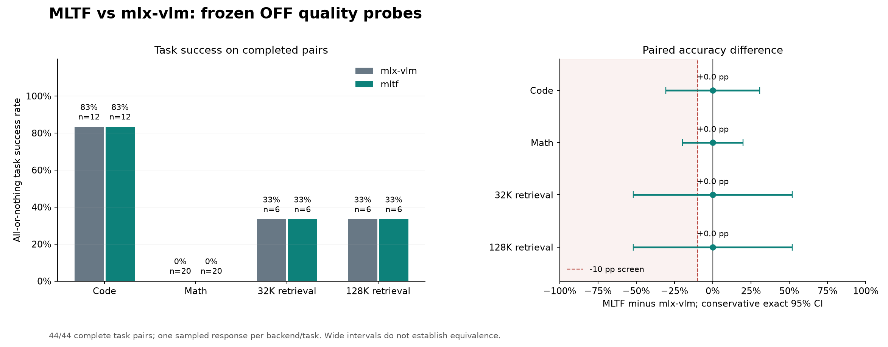
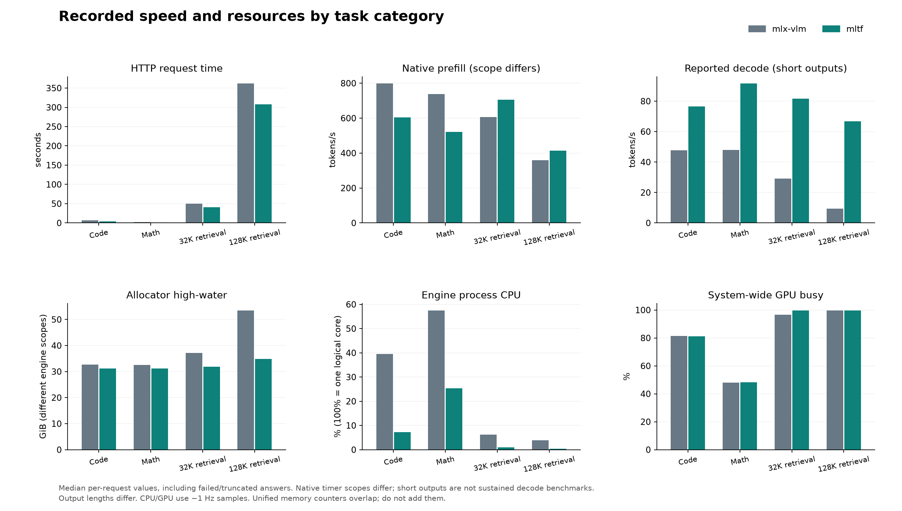

# MLTF / mlx-vlm 配对质量、速度与内存对照

生成时间：2026-10-19T22:04:41.306649-04:00，America/Toronto。

**本轮有小幅观察差异，尚未证明完全无损。** 后验统一执行原始代码，mlx-vlm 11/12、MLTF 10/12；独立 medium 数学组为 mlx-vlm 18/20、MLTF 17/20（MLTF减VLM -5.0 个百分点）。medium 预算截断为 mlx-vlm 2 次、MLTF 3 次，按失败保留；这些是小样本后验结果，不能直接归因为量化精度损失。

冻结 OFF 主组没有类别出现达到预注册 10 个百分点阈值的正确率下降。样本量有限，不能据此证明 MLTF 与 mlx-vlm 等价，也不能保证排除更小或其他任务上的损失；后验代码执行和 medium 数学组另行报告。

**OFF 数学正确率接近地板，两个后端同样低分不能用来证明能力无损。** 下文若有独立 medium thinking 组，其结果单独报告，不与 OFF 分数合并。

标准答案和测试另有独立算法复核：独立答案审计（历史本机文件，未随本报告发布）。这排查评分依据错误，不能补偿模型低分造成的分辨能力不足。

代码的冻结严格主分为 VLM 10/12、MLTF 10/12；统一放宽白名单标准库与合法局部 lambda 后，**原始代码实际全部测试通过为 VLM 11/12、MLTF 10/12**。后一项是后验诊断，不修代码、不重新生成，也不替换冻结主分。

## 条件与评分

同一份已量化的 Qwen3.8-27B 8bit target 源，vision 开启、服务窗口 128K；相同图片和 HTTP JSON，temperature=1、top_p=0.95、top_k=20，thinking OFF，每题最多 4,096 输出 tokens，允许自然 EOS。每题每后端新进程、冷 KV，逐题 AB/BA 交替；启动时间不计入请求耗时。

固定 12 道代码、20 道数学、32K/128K 各 6 个独立检索文档任务，每题只生成一次，不修复答案或选择性重抽。代码主分要求实际执行时全部隐藏测试通过；数学按冻结答案；检索按整份答案全部字段正确。视觉和格式另列，不混入主分。32K 为 28,672 处理后输入 + 4,096 输出预算，128K 为 126,976 + 4,096；输入含模板和 234 图片 tokens。

预注册计划（历史本机文件，未随本报告发布） · 独立方法审查（历史本机文件，未随本报告发布） · 冻结题目（历史本机文件，未随本报告发布） · 原始评分（历史本机文件，未随本报告发布）

## OFF 主任务成功率（冻结主组）

主分为答案或全部隐藏测试正确且推理链路校验通过。下表两端成功率与配对差值使用同一组已完成配对任务。未完成类别明确标注；完整配对前不能把部分题的率当作整个类别结果。

| 类别 | 已配对/预定 | mlx-vlm 通过 | MLTF 通过 | MLTF−VLM | 保守 exact 95% 区间 | McNemar exact p | 观察下降≥10pp |
| --- | ---: | ---: | ---: | ---: | --- | ---: | --- |
| 代码 | 12/12 | 10/12（83.3%） | 10/12（83.3%） | 0.0 pp | [-30.6, 30.6] pp | 1.0000 | 否 |
| 数学 | 20/20 | 0/20（0.0%） | 0/20（0.0%） | 0.0 pp | [-19.7, 19.7] pp | 1.0000 | 否 |
| 32K 检索 | 6/6 | 2/6（33.3%） | 2/6（33.3%） | 0.0 pp | [-51.8, 51.8] pp | 1.0000 | 否 |
| 128K 检索 | 6/6 | 2/6（33.3%） | 2/6（33.3%） | 0.0 pp | [-51.8, 51.8] pp | 1.0000 | 否 |

| 类别 | 两端都通过 | 仅 MLTF 通过 | 仅 VLM 通过 | 两端都失败 |
| --- | ---: | ---: | ---: | ---: |
| 代码 | 10 | 0 | 0 | 2 |
| 数学 | 0 | 0 | 0 | 20 |
| 32K 检索 | 2 | 0 | 0 | 4 |
| 128K 检索 | 2 | 0 | 0 | 4 |

区间按两个不一致结果概率的各 97.5% Clopper–Pearson 界作 Bonferroni 联合覆盖，再相减，保证至少 95% 覆盖，通常较宽。McNemar 只用不一致任务，表中是未校正双侧 p；四类别 Bonferroni p 另存 summary.json。10pp 是预先定义的实际影响阈值，与显著性分开。p>0.05 不代表等价；零不一致也不会被报告为零宽区间。没有把隐藏 assertion 或同文档的多个事实当成独立样本。

## 独立后验数学组：medium thinking

OFF 数学早期答案接近全错，出现难以区分两端能力的地板效应后，增加这项独立对照。两端都覆盖全部原 20 道数学题，每题各生成一次，使用同一题目、图片、推荐采样与 4,096 总输出预算，只把 thinking 切换为 medium；没有只选择错题，也没有在同一组内重抽。规则为看过 OFF 早期结果后制定，属于后验探索。

OFF 的 44 题主分、原答案及主图完整保留；medium 的 40 份回答和下面统计单独存放，不合并分母。4,096 预算包括思考和正文，达到预算的截断保留并算该组任务失败；另列因思考占满而未给正文的情况。

两端没有额外独立思考配额：VLM 实际 normalized thinking_budget 要求为 None，MLTF 使用同一 logical_max_output_tokens=4096，思考与正文共享总上限。预算与源码审计（历史本机文件，未随本报告发布）。

| 配对数学题 | mlx-vlm 通过 | MLTF 通过 | MLTF−VLM | 保守 exact 95% 区间 | McNemar exact p（探索性） |
| ---: | ---: | ---: | ---: | --- | ---: |
| 20/20 | 18/20（90.0%） | 17/20（85.0%） | -5.0 pp | [-27.9, 19.6] pp | 1.0000 |

配对结果：两端都通过 17，仅 MLTF 通过 0，仅 VLM 通过 1，两端都失败 2。这组仍然样本有限，后验增加的 p 值也不能当作预注册确认性等价证明。

| 后端 | 记录数 | 总输出 tokens / reasoning 文本字符中位数 | 第一个生成 token / 正文 TTFT s | 总耗时 s 中位数 | 后端 decode tok/s | client N/span tok/s | allocator 峰值 GiB 中位数 | 截断数 | 无正文数 |
| --- | ---: | ---: | ---: | ---: | ---: | ---: | ---: | ---: | ---: |
| mlx-vlm | 20 | 1078 / 2041 | 1.52 / 31.02 | 33.66 | 32.71 | 32.85 | 32.70 | 2 | 2 |
| mltf | 20 | 975 / 1813 | 0.79 / 14.31 | 16.47 | 61.86 | 62.35 | 31.13 | 3 | 3 |

| 后端 | 引擎 CPU % 中位数 | frontend CPU % 中位数 | 全局 GPU busy % 中位数 | RSS 峰值 GiB 中位数 | footprint 峰值 GiB 中位数 |
| --- | ---: | ---: | ---: | ---: | ---: |
| mlx-vlm | 27.95 | — | 85.06 | 24.66 | 34.08 |
| mltf | 1.72 | 0.65 | 92.95 | 1.13 | 2.41 |

此组 decode 和 client N/span 都包括思考与正文，正文 TTFT 包含此前思考耗时；正文 TTFT 的中位数仅计算实际出现正文的回答，无正文数另列，不能把该条件中位数当作全部请求的最终答案等待时间。没有将 reasoning-only 输出冒充可用答案。client N/span=总输出 tokens÷客户端首次至末次收到生成内容的间隔，分子仍含首批输出，短输出时可能偏高，只作诊断，不是持续 decode 的无偏速率。总 token 使用 SSE usage / 原生 timings。VLM 某些 reasoning_tokens 字段可能仅反映标签或计数差，不能当作完整思考 token 数，因此表中另列原始 reasoning 通道文本字符量，原 API 字段只作为证据保留。逐题结果、错误、截断、CPU/GPU 与内存口径均保存在独立文件。

medium 逐请求 CSV（历史本机文件，未随本报告发布） · medium 配对 CSV（历史本机文件，未随本报告发布） · medium 类别质量 CSV（历史本机文件，未随本报告发布） · medium 资源 CSV（历史本机文件，未随本报告发布） · medium 原始评分（历史本机文件，未随本报告发布）

medium 组仅因输出预算耗尽而失败 5 次；控制或基础设施检查异常 0 次。两类保留区分，预算失败不是被丢弃的无效抽样。

## 实际代码执行与辅助检查

| 后端 | 代码全部测试通过/已评分 | 子进程启动/实际执行测试的任务 | 隐藏测试实际通过/实际执行；未执行 | 视觉字段严格通过/已判定 | JSON可解析/已判定 | 推理链路校验通过/已记录 | 截断请求 |
| --- | ---: | ---: | ---: | ---: | ---: | ---: | ---: |
| mlx-vlm | 10/12 | 12/10 | 118/118；未执行 22 | 37/44 | 44/44 | 44/44 | 0 |
| mltf | 10/12 | 12/12 | 124/140；未执行 0 | 33/44 | 44/44 | 44/44 | 0 |

代码测试在独立 macOS sandbox 子进程中执行，限制语法能力、CPU、墙钟和内存；守卫拒绝、执行异常、超时和错误答案均保留原始 code_execution 记录。参考实现须先通过同一执行路径。上表实际执行数仅统计 worker 返回的测试记录，守卫提前拒绝的预定测试属于未评估，不能算算法答错。

视觉辅助分是**答案字段严格符合率**，同时要求字段结构、形色与顺序符合冻结规则。字符串替代列表或加入额外措辞也可能失败，不能将该百分比解释为纯识图正确率。小图只验证本轮视觉通路与简单识别，不能代表复杂视觉推理质量。

代码主分同时包含冻结的 **禁止 import** 要求、初始 AST 执行守卫和隐藏测试正确性。若代码在测试前被守卫拒绝，算法没有执行，不能把该失败解释为算法全部答错；初始守卫也可能拒绝题面未禁止的合法局部 lambda。

### 后验补充：白名单标准库与局部 lambda，执行原始代码

制定这项补充诊断的动机是观察到首个 code-02 的 VLM 答案使用 collections，因冻结的禁 import 要求被拒绝，算法尚未得到评测；随后 code-09 暴露初始 AST 守卫对合法命名局部 lambda 的限制，另有协议修订记录。规则是在看见这些结果之后增加的，属于**后验诊断**。诊断对两端全部 24 份原始代码统一允许白名单标准库 import 和合法局部 lambda，使用同一组原隐藏测试和同一 OS sandbox；不修改代码、不重抽模型答案。

严格 no-import 主分、配对统计与上面的主图保持不变。下列分数只帮助区分接口契约失败与原始算法执行结果，不替代预注册质量对照，也不作事后确认性显著性检验。

| 后端 | 严格主分通过/已评 | 原代码＋标准库通过/已诊断 | 原主分 import 拒绝 | 放宽后新增通过 | 实际执行测试/启动子进程 | 隐藏测试实际通过/执行；未执行 |
| --- | ---: | ---: | ---: | ---: | ---: | ---: |
| mlx-vlm | 10/12 | 11/12 | 1 | 1 | 12/12 | 133/140；未执行 0 |
| mltf | 10/12 | 10/12 | 0 | 0 | 12/12 | 124/140；未执行 0 |

| 原题 / 后端 | 严格主分 | 后验执行 | 隐藏测试 | 守卫或执行错误 |
| --- | --- | --- | ---: | --- |
| code-01-intervals（历史本机文件，未随本报告发布） / mlx-vlm | 通过 | 通过 | 10/10 | — |
| code-01-intervals（历史本机文件，未随本报告发布） / mltf | 通过 | 通过 | 10/10 | — |
| code-02-shortest-path（历史本机文件，未随本报告发布） / mlx-vlm | 失败 | 通过 | 12/12 | — |
| code-02-shortest-path（历史本机文件，未随本报告发布） / mltf | 失败 | 失败 | 6/12 | ["值／顺序／算法结果错误"] |
| code-03-largest-remainder（历史本机文件，未随本报告发布） / mlx-vlm | 通过 | 通过 | 10/10 | — |
| code-03-largest-remainder（历史本机文件，未随本报告发布） / mltf | 通过 | 通过 | 10/10 | — |
| code-04-version-ledger（历史本机文件，未随本报告发布） / mlx-vlm | 通过 | 通过 | 12/12 | — |
| code-04-version-ledger（历史本机文件，未随本报告发布） / mltf | 通过 | 通过 | 12/12 | — |
| code-05-escaped-fields（历史本机文件，未随本报告发布） / mlx-vlm | 通过 | 通过 | 11/11 | — |
| code-05-escaped-fields（历史本机文件，未随本报告发布） / mltf | 通过 | 通过 | 11/11 | — |
| code-06-expression-parser（历史本机文件，未随本报告发布） / mlx-vlm | 通过 | 通过 | 12/12 | — |
| code-06-expression-parser（历史本机文件，未随本报告发布） / mltf | 通过 | 通过 | 12/12 | — |
| code-07-topological-order（历史本机文件，未随本报告发布） / mlx-vlm | 通过 | 通过 | 12/12 | — |
| code-07-topological-order（历史本机文件，未随本报告发布） / mltf | 通过 | 通过 | 12/12 | — |
| code-08-edit-distance（历史本机文件，未随本报告发布） / mlx-vlm | 通过 | 通过 | 16/16 | — |
| code-08-edit-distance（历史本机文件，未随本报告发布） / mltf | 通过 | 通过 | 16/16 | — |
| code-09-ttl-lru（历史本机文件，未随本报告发布） / mlx-vlm | 失败 | 失败 | 3/10 | ["实际运行异常","值／顺序／算法结果错误"] |
| code-09-ttl-lru（历史本机文件，未随本报告发布） / mltf | 失败 | 失败 | 0/10 | ["实际运行异常","返回 None／缺少 return"] |
| code-10-components（历史本机文件，未随本报告发布） / mlx-vlm | 通过 | 通过 | 10/10 | — |
| code-10-components（历史本机文件，未随本报告发布） / mltf | 通过 | 通过 | 10/10 | — |
| code-11-weighted-scheduling（历史本机文件，未随本报告发布） / mlx-vlm | 通过 | 通过 | 10/10 | — |
| code-11-weighted-scheduling（历史本机文件，未随本报告发布） / mltf | 通过 | 通过 | 10/10 | — |
| code-12-minimum-window（历史本机文件，未随本报告发布） / mlx-vlm | 通过 | 通过 | 15/15 | — |
| code-12-minimum-window（历史本机文件，未随本报告发布） / mltf | 通过 | 通过 | 15/15 | — |

独立补充诊断 JSON（历史本机文件，未随本报告发布） · 补充诊断 CSV（历史本机文件，未随本报告发布） · 后验协议（历史本机文件，未随本报告发布） · lambda 守卫修订（历史本机文件，未随本报告发布） · 代码失败逐项审查（历史本机文件，未随本报告发布）

### 失败类型与视觉字段的只读后验审查

审查不修改主分，不运行新推理。分类可同时命中多个标签，不能相加当作互斥错误总数。字符串中出现三项正确形色标签且顺序正确，只作为原始回答的后验文字证据，不转成新的视觉正确率。

| 后端 | 已核验评分记录 | 视觉字段严格失败 | 其中自由文字仍含三项正确有序标签 | 失败分类（可重叠） |
| --- | ---: | ---: | ---: | --- |
| mlx-vlm | 44 | 7 | 5 | {"vision_field_type_contract":7,"code_no_import_instruction_contract":1,"execution_guard_unassessed":1,"math_exact_answer_incorrect":20,"null_answer_nonresponse":1,"retrieval_answer_type_or_format_contract":2,"explicit_refusal_nonanswer":1,"retrieval_answer_fields_incorrect":6} |
| mltf | 44 | 11 | 7 | {"code_algorithm_value_or_order_error":1,"vision_field_type_contract":8,"code_runtime_exception":1,"code_return_type_contract":1,"math_exact_answer_incorrect":20,"retrieval_answer_fields_incorrect":7,"vision_label_or_order_failure":3,"retrieval_answer_type_or_format_contract":1} |

失败分类原始 JSON（历史本机文件，未随本报告发布） · 逐例证据审查（历史本机文件，未随本报告发布）

### 检索答案字段的独立审查（后验，只读）

整题检索分同时要求标识答案、版本/去重/多跳规则、数值聚合与 answer 结构正确。因此整题失败不能全部归为标识查找失败，标识字段正确也不证明全部原文事实都被完整恢复。下面从原 request 独立解析事实、复核位置及 oracle，分列格式与数值；没有修改答案或主分。

| 长度 / 后端 | 整题通过/文档 | JSON可解析/文档 | answer结构正确/文档 | 标识答案正确/要求 | 数值正确/要求 | 已返回数值/要求 |
| --- | ---: | ---: | ---: | ---: | ---: | ---: |
| 32K / mlx-vlm | 2/6 | 6/6 | 6/6 | 5/5 | 4/11 | 11/11 |
| 32K / mltf | 2/6 | 6/6 | 5/6 | 5/5 | 2/11 | 8/11 |

32K 完整字段审查（历史本机文件，未随本报告发布） · 原始审计 JSON（历史本机文件，未随本报告发布）；审计完整且与原始答案核对通过。

| 长度 / 后端 | 整题通过/文档 | JSON可解析/文档 | answer结构正确/文档 | 标识答案正确/要求 | 数值正确/要求 | 已返回数值/要求 |
| --- | ---: | ---: | ---: | ---: | ---: | ---: |
| 128K / mlx-vlm | 2/6 | 6/6 | 4/6 | 4/5 | 4/11 | 7/11 |
| 128K / mltf | 2/6 | 6/6 | 6/6 | 5/5 | 4/11 | 11/11 |

128K 完整字段审查（历史本机文件，未随本报告发布） · 原始审计 JSON（历史本机文件，未随本报告发布）；审计完整且与原始答案核对通过。

这些字段来自同一文档，互相关联，只作错误定位；主统计的单位始终是独立文档，不对字段数做独立样本显著性检验。数值错误可能涉及事实选择、版本处理、去重或算术，不能仅凭最后答案唯一归因于某一环节或量化精度。

## OFF 主组速度与内存

每格为同类别已记录请求的中位数，包含质量失败与截断；数量随实验推进变化。输出长度不同会影响速度，先同时看输出 tokens 和请求耗时。Metal/MLX 数值为各后端新进程 allocator 高水位，口径不同；RSS、footprint 与全局 GPU 计数另存，均为统一内存，不能相加。

**两个后端的 prefill 速率不是同一计时口径。** MLTF 用原生请求开始至第一次 TokensEvent 的时间，包含首次推测输出前的工作；VLM 用 BatchGenerator 的 prompt_tps 反推 prompt_ms。两者均不是完整 HTTP TTFT，也不能据表中比值直接断言纯 GPU prefill 提速。共同客户端 TTFT 和请求总耗时是另行测量的。

MLTF decode 从第一次原生输出到 Done，分子扣除首批 tokens；VLM 的速率从服务器首末输出记录及扣除首批后的 tokens 算得，predicted_ms 又由总输出/速率反推，并非直接测得的同一阶段时长。**本轮质量题的答案较短，首批推测块和结束开销占比大，decode tok/s 会明显波动，不能替代 4,096-token 长输出稳定性测试。** CSV 同时保留每题输出长度、速率范围、计时定义和原始字段；短输出不被补齐或抑制 EOS。

client N/span=总输出 tokens÷客户端首次至末次收到生成内容的间隔，包含首批输出，短输出时可能偏高；它与后端速率同时保留为诊断。**相同处理后输入 126,976 tokens 时，客户端首字等待和请求总耗时是本轮更直接可比的延迟量**，但答案长度与正确性仍须一起看。

| 类别 / 后端 | 已记录 | 输出 tokens | 后端 prefill tok/s | 后端 decode tok/s | client N/span tok/s | 客户端 TTFT s | 请求耗时 s | 引擎 CPU % | 全局 GPU % | allocator 峰值 GiB | RSS 峰值 GiB |
| --- | ---: | ---: | ---: | ---: | ---: | ---: | ---: | ---: | ---: | ---: | ---: |
| 代码 / mlx-vlm | 12 | 238 | 797.77 | 47.70 | 47.92 | 1.84 | 6.78 | 39.49 | 81.31 | 32.65 | 23.83 |
| 代码 / mltf | 12 | 288 | 604.01 | 76.50 | 77.73 | 1.00 | 4.38 | 7.30 | 81.25 | 31.13 | 1.13 |
| 数学 / mlx-vlm | 20 | 31 | 738.52 | 47.88 | 49.62 | 1.61 | 2.27 | 57.52 | 48.00 | 32.61 | 24.44 |
| 数学 / mltf | 20 | 40 | 521.68 | 91.51 | 107.64 | 0.74 | 1.02 | 25.31 | 48.26 | 31.13 | 0.95 |
| 32K 检索 / mlx-vlm | 6 | 46 | 606.85 | 29.12 | 29.79 | 48.19 | 49.55 | 6.28 | 96.56 | 37.18 | 24.82 |
| 32K 检索 / mltf | 6 | 51 | 705.01 | 81.68 | 95.12 | 40.74 | 41.10 | 0.96 | 99.73 | 31.81 | 0.99 |
| 128K 检索 / mlx-vlm | 6 | 48 | 359.14 | 9.47 | 9.62 | 354.26 | 361.55 | 3.83 | 99.52 | 53.51 | 32.14 |
| 128K 检索 / mltf | 6 | 56 | 414.11 | 66.87 | 73.23 | 306.80 | 307.59 | 0.34 | 99.65 | 34.86 | 0.99 |

两端主任务都通过且推理链路有效的 14 个配对，请求耗时比 VLM/MLTF 的中位数为 1.45。该数仍受答案长度影响，不等于同一输出的纯 kernel 加速。其余配对的速度保留在逐题 CSV，未因质量失败而删除。

内存压力采样：{'normal': 4743}。单请求 swap 变化范围 -0.016 至 0.000 GiB。CPU 100%=一个逻辑核；MLTF 引擎与 frontend 分列于 CSV。GPU busy/driver 内存是全系统读数。CPU/GPU 均值与进程峰值来自约 1Hz 采样，极短请求可能只覆盖一两个点并漏掉峰值，逐题采样数保留；allocator 原生高水位补充覆盖。

## 逐题结果

| 题目 | 类别 | mlx-vlm | MLTF | VLM / MLTF 输出 tokens | VLM / MLTF 耗时 s | 原始结果 |
| --- | --- | --- | --- | --- | --- | --- |
| code-01-intervals | 代码 | 通过 | 通过 | 187 / 213 | 4.63 / 3.11 | VLM（历史本机文件，未随本报告发布） / MLTF（历史本机文件，未随本报告发布） |
| code-02-shortest-path | 代码 | 失败 | 失败 | 480 / 288 | 16.73 / 4.53 | VLM（历史本机文件，未随本报告发布） / MLTF（历史本机文件，未随本报告发布） |
| code-03-largest-remainder | 代码 | 通过 | 通过 | 173 / 172 | 4.59 / 3.35 | VLM（历史本机文件，未随本报告发布） / MLTF（历史本机文件，未随本报告发布） |
| code-04-version-ledger | 代码 | 通过 | 通过 | 150 / 195 | 6.24 / 3.26 | VLM（历史本机文件，未随本报告发布） / MLTF（历史本机文件，未随本报告发布） |
| code-05-escaped-fields | 代码 | 通过 | 通过 | 185 / 166 | 4.43 / 2.69 | VLM（历史本机文件，未随本报告发布） / MLTF（历史本机文件，未随本报告发布） |
| code-06-expression-parser | 代码 | 通过 | 通过 | 539 / 550 | 13.32 / 7.95 | VLM（历史本机文件，未随本报告发布） / MLTF（历史本机文件，未随本报告发布） |
| code-07-topological-order | 代码 | 通过 | 通过 | 280 / 301 | 6.86 / 4.43 | VLM（历史本机文件，未随本报告发布） / MLTF（历史本机文件，未随本报告发布） |
| code-08-edit-distance | 代码 | 通过 | 通过 | 202 / 462 | 5.96 / 8.27 | VLM（历史本机文件，未随本报告发布） / MLTF（历史本机文件，未随本报告发布） |
| code-09-ttl-lru | 代码 | 失败 | 失败 | 370 / 564 | 10.49 / 10.96 | VLM（历史本机文件，未随本报告发布） / MLTF（历史本机文件，未随本报告发布） |
| code-10-components | 代码 | 通过 | 通过 | 186 / 287 | 6.70 / 4.71 | VLM（历史本机文件，未随本报告发布） / MLTF（历史本机文件，未随本报告发布） |
| code-11-weighted-scheduling | 代码 | 通过 | 通过 | 491 / 229 | 14.81 / 4.32 | VLM（历史本机文件，未随本报告发布） / MLTF（历史本机文件，未随本报告发布） |
| code-12-minimum-window | 代码 | 通过 | 通过 | 275 / 313 | 8.91 / 4.26 | VLM（历史本机文件，未随本报告发布） / MLTF（历史本机文件，未随本报告发布） |
| math-01-crt | 数学 | 失败 | 失败 | 30 / 41 | 1.55 / 1.27 | VLM（历史本机文件，未随本报告发布） / MLTF（历史本机文件，未随本报告发布） |
| math-02-urn | 数学 | 失败 | 失败 | 32 / 44 | 3.25 / 1.07 | VLM（历史本机文件，未随本报告发布） / MLTF（历史本机文件，未随本报告发布） |
| math-03-grid-paths | 数学 | 失败 | 失败 | 31 / 42 | 1.56 / 1.23 | VLM（历史本机文件，未随本报告发布） / MLTF（历史本机文件，未随本报告发布） |
| math-04-recurrence | 数学 | 失败 | 失败 | 30 / 40 | 3.14 / 0.89 | VLM（历史本机文件，未随本报告发布） / MLTF（历史本机文件，未随本报告发布） |
| math-05-bounded-count | 数学 | 失败 | 失败 | 29 / 26 | 1.41 / 1.04 | VLM（历史本机文件，未随本报告发布） / MLTF（历史本机文件，未随本报告发布） |
| math-06-determinant | 数学 | 失败 | 失败 | 24 / 39 | 2.96 / 1.07 | VLM（历史本机文件，未随本报告发布） / MLTF（历史本机文件，未随本报告发布） |
| math-07-coefficient | 数学 | 失败 | 失败 | 41 / 40 | 1.62 / 1.14 | VLM（历史本机文件，未随本报告发布） / MLTF（历史本机文件，未随本报告发布） |
| math-08-conditional-expectation | 数学 | 失败 | 失败 | 31 / 42 | 2.95 / 0.94 | VLM（历史本机文件，未随本报告发布） / MLTF（历史本机文件，未随本报告发布） |
| math-09-restricted-permutations | 数学 | 失败 | 失败 | 31 / 43 | 1.54 / 1.01 | VLM（历史本机文件，未随本报告发布） / MLTF（历史本机文件，未随本报告发布） |
| math-10-modular-roots | 数学 | 失败 | 失败 | 29 / 39 | 2.92 / 0.94 | VLM（历史本机文件，未随本报告发布） / MLTF（历史本机文件，未随本报告发布） |
| math-11-linear-system | 数学 | 失败 | 失败 | 31 / 29 | 1.41 / 0.98 | VLM（历史本机文件，未随本报告发布） / MLTF（历史本机文件，未随本报告发布） |
| math-12-nonadjacent-ones | 数学 | 失败 | 失败 | 40 / 40 | 3.42 / 0.94 | VLM（历史本机文件，未随本报告发布） / MLTF（历史本机文件，未随本报告发布） |
| math-13-ballot-paths | 数学 | 失败 | 失败 | 30 / 40 | 1.43 / 1.16 | VLM（历史本机文件，未随本报告发布） / MLTF（历史本机文件，未随本报告发布） |
| math-14-power-tower | 数学 | 失败 | 失败 | 30 / 30 | 3.16 / 1.02 | VLM（历史本机文件，未随本报告发布） / MLTF（历史本机文件，未随本报告发布） |
| math-15-subset-residues | 数学 | 失败 | 失败 | 31 / 32 | 1.41 / 1.00 | VLM（历史本机文件，未随本报告发布） / MLTF（历史本机文件，未随本报告发布） |
| math-16-expected-colors | 数学 | 失败 | 失败 | 39 / 31 | 3.19 / 0.94 | VLM（历史本机文件，未随本报告发布） / MLTF（历史本机文件，未随本报告发布） |
| math-17-bounded-coins | 数学 | 失败 | 失败 | 28 / 38 | 1.35 / 1.11 | VLM（历史本机文件，未随本报告发布） / MLTF（历史本机文件，未随本报告发布） |
| math-18-directed-walks | 数学 | 失败 | 失败 | 29 / 27 | 3.18 / 0.89 | VLM（历史本机文件，未随本报告发布） / MLTF（历史本机文件，未随本报告发布） |
| math-19-dice-two-pairs | 数学 | 失败 | 失败 | 32 / 29 | 1.48 / 1.03 | VLM（历史本机文件，未随本报告发布） / MLTF（历史本机文件，未随本报告发布） |
| math-20-distinct-digit-multiples | 数学 | 失败 | 失败 | 31 / 41 | 3.03 / 0.94 | VLM（历史本机文件，未随本报告发布） / MLTF（历史本机文件，未随本报告发布） |
| retrieval-32k-01 | 32K 检索 | 通过 | 通过 | 51 / 72 | 41.45 / 35.62 | VLM（历史本机文件，未随本报告发布） / MLTF（历史本机文件，未随本报告发布） |
| retrieval-32k-02 | 32K 检索 | 失败 | 失败 | 47 / 78 | 48.39 / 36.97 | VLM（历史本机文件，未随本报告发布） / MLTF（历史本机文件，未随本报告发布） |
| retrieval-32k-03 | 32K 检索 | 失败 | 失败 | 36 / 36 | 50.14 / 43.41 | VLM（历史本机文件，未随本报告发布） / MLTF（历史本机文件，未随本报告发布） |
| retrieval-32k-04 | 32K 检索 | 通过 | 通过 | 49 / 66 | 50.61 / 42.88 | VLM（历史本机文件，未随本报告发布） / MLTF（历史本机文件，未随本报告发布） |
| retrieval-32k-05 | 32K 检索 | 失败 | 失败 | 45 / 24 | 48.96 / 40.09 | VLM（历史本机文件，未随本报告发布） / MLTF（历史本机文件，未随本报告发布） |
| retrieval-32k-06 | 32K 检索 | 失败 | 失败 | 35 / 35 | 53.36 / 42.10 | VLM（历史本机文件，未随本报告发布） / MLTF（历史本机文件，未随本报告发布） |
| retrieval-128k-01 | 128K 检索 | 通过 | 通过 | 52 / 52 | 364.62 / 311.22 | VLM（历史本机文件，未随本报告发布） / MLTF（历史本机文件，未随本报告发布） |
| retrieval-128k-02 | 128K 检索 | 失败 | 失败 | 13 / 74 | 352.75 / 315.38 | VLM（历史本机文件，未随本报告发布） / MLTF（历史本机文件，未随本报告发布） |
| retrieval-128k-03 | 128K 检索 | 失败 | 失败 | 97 / 50 | 360.19 / 303.95 | VLM（历史本机文件，未随本报告发布） / MLTF（历史本机文件，未随本报告发布） |
| retrieval-128k-04 | 128K 检索 | 通过 | 通过 | 51 / 73 | 389.46 / 324.43 | VLM（历史本机文件，未随本报告发布） / MLTF（历史本机文件，未随本报告发布） |
| retrieval-128k-05 | 128K 检索 | 失败 | 失败 | 45 / 60 | 332.32 / 265.47 | VLM（历史本机文件，未随本报告发布） / MLTF（历史本机文件，未随本报告发布） |
| retrieval-128k-06 | 128K 检索 | 失败 | 失败 | 35 / 40 | 362.91 / 282.47 | VLM（历史本机文件，未随本报告发布） / MLTF（历史本机文件，未随本报告发布） |

## 失败、截断与实验偏离

全部主任务失败、推理校验失败或截断样本均列出。详情指向原始结果与 grades.json；不以文字观感覆盖执行评分。

| 题目 / 后端 | 主任务 | 格式 | 隐藏测试 | 截断 | 推理错误 / 评分详情 |
| --- | --- | --- | ---: | --- | --- |
| code-02-shortest-path（历史本机文件，未随本报告发布） / mlx-vlm | 失败 | 通过 | 0/12 | 否 | {"inference_errors":[],"score_details":{"case_id":"code-02-shortest-path","category":"coding","response_sha256":"24a16a15bcd9acb7e1f883ba11f90ec27e0056bfadd6e372beaf56c68adcae94","json_valid":true,"parse_error":null,"vision_pass":false,"main_pass":false,"code_execution_required":false,"vision_actual":"red circle blue triangle green rectangle","code_result":{"case_id":"code-02-shortest-path","source_sha256":"9fb5223496df5755fdd3e0972f5daa6bea9bdf0c97934ed7d51f792eb03c3919","all_passed":false,"passed":0,"total":12,"tests":[],"guard_error":"ValueError: Forbidden syntax ImportFrom","wall_seconds":0.0002331659197807312},"test_fraction":0.0},"code_…（完整字段见原始评分） |
| code-02-shortest-path（历史本机文件，未随本报告发布） / mltf | 失败 | 通过 | 6/12 | 否 | {"inference_errors":[],"score_details":{"case_id":"code-02-shortest-path","category":"coding","response_sha256":"c0dfbb9caba8dd008c1d290aeae73111f4080b84099d2652a7532ba8fdbb5720","json_valid":true,"parse_error":null,"vision_pass":true,"main_pass":false,"code_execution_required":false,"vision_actual":["red circle","blue triangle","green rectangle"],"code_result":{"case_id":"code-02-shortest-path","source_sha256":"d01356c725136fec6dd7f7a6b02341b985d6b00bc74c4236026b2700663c0202","all_passed":false,"passed":6,"total":12,"tests":[{"label":"identity","passed":true,"actual":["a"],"expected":["a"],"input_mutated":false},{"label":"unreachable","passe…（完整字段见原始评分） |
| code-09-ttl-lru（历史本机文件，未随本报告发布） / mlx-vlm | 失败 | 通过 | 0/10 | 否 | {"inference_errors":[],"score_details":{"case_id":"code-09-ttl-lru","category":"coding","response_sha256":"a7998bbda5993f15849f812992922d091bea7665f7530eb4539b485a71b13b15","json_valid":true,"parse_error":null,"vision_pass":true,"main_pass":false,"code_execution_required":false,"vision_actual":["red circle","blue triangle","green rectangle"],"code_result":{"case_id":"code-09-ttl-lru","source_sha256":"c64d9c4fe5c59010bbf4f329a72fc010c66f4266f65f559bad4e858d2102485a","all_passed":false,"passed":0,"total":10,"tests":[],"guard_error":"ValueError: Forbidden call _remove_expired","wall_seconds":0.00030820793472230434},"test_fraction":0.0},"code_exe…（完整字段见原始评分） |
| code-09-ttl-lru（历史本机文件，未随本报告发布） / mltf | 失败 | 通过 | 0/10 | 否 | {"inference_errors":[],"score_details":{"case_id":"code-09-ttl-lru","category":"coding","response_sha256":"31a197d3d6bfe13980f6e3f125891d424aac0400eb04e401d92d66c0c63b34d9","json_valid":true,"parse_error":null,"vision_pass":true,"main_pass":false,"code_execution_required":false,"vision_actual":["red circle","blue triangle","green rectangle"],"code_result":{"case_id":"code-09-ttl-lru","source_sha256":"5330065796cca6c16a0b329a8d7e5a36a6fd70b5f4a8b804afc62b4134feb9cf","all_passed":false,"passed":0,"total":10,"tests":[{"label":"cache-0","passed":false,"actual":null,"expected":[],"input_mutated":false},{"label":"cache-1","passed":false,"error":"Ke…（完整字段见原始评分） |
| math-01-crt（历史本机文件，未随本报告发布） / mlx-vlm | 失败 | 通过 | —/— | 否 | {"inference_errors":[],"score_details":{"case_id":"math-01-crt","category":"math","response_sha256":"b2675d4ce1d54e1c586e6783c1709cd2c59d35e26daa944ccb18165799a6693d","json_valid":true,"parse_error":null,"vision_pass":true,"main_pass":false,"code_execution_required":false,"vision_actual":["red circle","blue triangle","green rectangle"],"answer_actual":725},"code_execution":null} |
| math-01-crt（历史本机文件，未随本报告发布） / mltf | 失败 | 通过 | —/— | 否 | {"inference_errors":[],"score_details":{"case_id":"math-01-crt","category":"math","response_sha256":"824674cea195fb277462b400d1f79fefb701c901e2890181ecf646296221d29e","json_valid":true,"parse_error":null,"vision_pass":true,"main_pass":false,"code_execution_required":false,"vision_actual":["red circle","blue triangle","green rectangle"],"answer_actual":1123},"code_execution":null} |
| math-02-urn（历史本机文件，未随本报告发布） / mlx-vlm | 失败 | 通过 | —/— | 否 | {"inference_errors":[],"score_details":{"case_id":"math-02-urn","category":"math","response_sha256":"9fe83e2147cf13ce307d51ffafbfd0456610948f0f40f784c4725f82c0fdef44","json_valid":true,"parse_error":null,"vision_pass":true,"main_pass":false,"code_execution_required":false,"vision_actual":["red circle","blue triangle","green rectangle"],"answer_actual":"7/52"},"code_execution":null} |
| math-02-urn（历史本机文件，未随本报告发布） / mltf | 失败 | 通过 | —/— | 否 | {"inference_errors":[],"score_details":{"case_id":"math-02-urn","category":"math","response_sha256":"8299bdb5c5a0a0062af193878dd9c86fd865bb6d224aa3f02dc97d0be9b48919","json_valid":true,"parse_error":null,"vision_pass":true,"main_pass":false,"code_execution_required":false,"vision_actual":["red circle","blue triangle","green rectangle"],"answer_actual":"35/203"},"code_execution":null} |
| math-03-grid-paths（历史本机文件，未随本报告发布） / mlx-vlm | 失败 | 通过 | —/— | 否 | {"inference_errors":[],"score_details":{"case_id":"math-03-grid-paths","category":"math","response_sha256":"089db3a4025f288280b9285dcdf0d6638422cdd4118b537dcf6722492a087d44","json_valid":true,"parse_error":null,"vision_pass":true,"main_pass":false,"code_execution_required":false,"vision_actual":["red circle","blue triangle","green rectangle"],"answer_actual":"725"},"code_execution":null} |
| math-03-grid-paths（历史本机文件，未随本报告发布） / mltf | 失败 | 通过 | —/— | 否 | {"inference_errors":[],"score_details":{"case_id":"math-03-grid-paths","category":"math","response_sha256":"94b0fa102482a732b016b4a5475a102e0b806da16dffe9b2920b6070bbdbc07f","json_valid":true,"parse_error":null,"vision_pass":true,"main_pass":false,"code_execution_required":false,"vision_actual":["red circle","blue triangle","green rectangle"],"answer_actual":"7224"},"code_execution":null} |
| math-04-recurrence（历史本机文件，未随本报告发布） / mlx-vlm | 失败 | 通过 | —/— | 否 | {"inference_errors":[],"score_details":{"case_id":"math-04-recurrence","category":"math","response_sha256":"b2675d4ce1d54e1c586e6783c1709cd2c59d35e26daa944ccb18165799a6693d","json_valid":true,"parse_error":null,"vision_pass":true,"main_pass":false,"code_execution_required":false,"vision_actual":["red circle","blue triangle","green rectangle"],"answer_actual":725},"code_execution":null} |
| math-04-recurrence（历史本机文件，未随本报告发布） / mltf | 失败 | 通过 | —/— | 否 | {"inference_errors":[],"score_details":{"case_id":"math-04-recurrence","category":"math","response_sha256":"6289023d5d652facf4b36f071c4de1f7bc3bac8420845121e85255a348acbfdd","json_valid":true,"parse_error":null,"vision_pass":true,"main_pass":false,"code_execution_required":false,"vision_actual":["red circle","blue triangle","green rectangle"],"answer_actual":733},"code_execution":null} |
| math-05-bounded-count（历史本机文件，未随本报告发布） / mlx-vlm | 失败 | 通过 | —/— | 否 | {"inference_errors":[],"score_details":{"case_id":"math-05-bounded-count","category":"math","response_sha256":"bc1e51750c8e196ecaf58654de60be135ffa1a864f025b5f6a65e6bb49e91b60","json_valid":true,"parse_error":null,"vision_pass":true,"main_pass":false,"code_execution_required":false,"vision_actual":["red circle","blue triangle","green rectangle"],"answer_actual":70},"code_execution":null} |
| math-05-bounded-count（历史本机文件，未随本报告发布） / mltf | 失败 | 通过 | —/— | 否 | {"inference_errors":[],"score_details":{"case_id":"math-05-bounded-count","category":"math","response_sha256":"7bca60cf779c8176564b421bd115d1e2fca449554bb8c981e6f3375a372cf6b6","json_valid":true,"parse_error":null,"vision_pass":false,"main_pass":false,"code_execution_required":false,"vision_actual":"red circle blue triangle green rectangle","answer_actual":100},"code_execution":null} |
| math-06-determinant（历史本机文件，未随本报告发布） / mlx-vlm | 失败 | 通过 | —/— | 否 | {"inference_errors":[],"score_details":{"case_id":"math-06-determinant","category":"math","response_sha256":"c660a1b0aab0a5f2f87901c2aac4ad9c949723a8da499a57ed337c9068f21378","json_valid":true,"parse_error":null,"vision_pass":true,"main_pass":false,"code_execution_required":false,"vision_actual":["red circle","blue triangle","green rectangle"],"answer_actual":-125},"code_execution":null} |
| math-06-determinant（历史本机文件，未随本报告发布） / mltf | 失败 | 通过 | —/— | 否 | {"inference_errors":[],"score_details":{"case_id":"math-06-determinant","category":"math","response_sha256":"5db4f322b95294593d3ead965b31ca5eb6a9511ddf1bf644d8fe3b544add84ad","json_valid":true,"parse_error":null,"vision_pass":true,"main_pass":false,"code_execution_required":false,"vision_actual":["red circle","blue triangle","green rectangle"],"answer_actual":42},"code_execution":null} |
| math-07-coefficient（历史本机文件，未随本报告发布） / mlx-vlm | 失败 | 通过 | —/— | 否 | {"inference_errors":[],"score_details":{"case_id":"math-07-coefficient","category":"math","response_sha256":"a14513b64820e07769d2a06c57a4e0c7a0e5892721d4bb8e48eb6d4c191e8ae7","json_valid":true,"parse_error":null,"vision_pass":true,"main_pass":false,"code_execution_required":false,"vision_actual":["red circle","blue triangle","green rectangle"],"answer_actual":"-352"},"code_execution":null} |
| math-07-coefficient（历史本机文件，未随本报告发布） / mltf | 失败 | 通过 | —/— | 否 | {"inference_errors":[],"score_details":{"case_id":"math-07-coefficient","category":"math","response_sha256":"2e14e54db19c395c65b1f9d833bf0709af882a5ea4c3c773c2edd4cf0aab66dc","json_valid":true,"parse_error":null,"vision_pass":true,"main_pass":false,"code_execution_required":false,"vision_actual":["red circle","blue triangle","green rectangle"],"answer_actual":-416},"code_execution":null} |
| math-08-conditional-expectation（历史本机文件，未随本报告发布） / mlx-vlm | 失败 | 通过 | —/— | 否 | {"inference_errors":[],"score_details":{"case_id":"math-08-conditional-expectation","category":"math","response_sha256":"3b119f62553d18343d0f4319bde3c3a20905c5954ea933a9b5e4970553649dcb","json_valid":true,"parse_error":null,"vision_pass":true,"main_pass":false,"code_execution_required":false,"vision_actual":["red circle","blue triangle","green rectangle"],"answer_actual":"7/2"},"code_execution":null} |
| math-08-conditional-expectation（历史本机文件，未随本报告发布） / mltf | 失败 | 通过 | —/— | 否 | {"inference_errors":[],"score_details":{"case_id":"math-08-conditional-expectation","category":"math","response_sha256":"31f6a4236be83fb2a0b6b6095156f3d017d6a7c62a090a88e34a2f591128f0ff","json_valid":true,"parse_error":null,"vision_pass":true,"main_pass":false,"code_execution_required":false,"vision_actual":["red circle","blue triangle","green rectangle"],"answer_actual":"14/5"},"code_execution":null} |
| math-09-restricted-permutations（历史本机文件，未随本报告发布） / mlx-vlm | 失败 | 通过 | —/— | 否 | {"inference_errors":[],"score_details":{"case_id":"math-09-restricted-permutations","category":"math","response_sha256":"6c649935b15c1b8285d35a1604e97f47d4549794e4f60bafa71e04c470ff1d0f","json_valid":true,"parse_error":null,"vision_pass":true,"main_pass":false,"code_execution_required":false,"vision_actual":["red circle","blue triangle","green rectangle"],"answer_actual":"720"},"code_execution":null} |
| math-09-restricted-permutations（历史本机文件，未随本报告发布） / mltf | 失败 | 通过 | —/— | 否 | {"inference_errors":[],"score_details":{"case_id":"math-09-restricted-permutations","category":"math","response_sha256":"0c61a3dfef103f76c932a9d0363a23681bb205a60d3ab73f4c77922043867f7e","json_valid":true,"parse_error":null,"vision_pass":true,"main_pass":false,"code_execution_required":false,"vision_actual":["red circle","blue triangle","green rectangle"],"answer_actual":"23460"},"code_execution":null} |
| math-10-modular-roots（历史本机文件，未随本报告发布） / mlx-vlm | 失败 | 通过 | —/— | 否 | {"inference_errors":[],"score_details":{"case_id":"math-10-modular-roots","category":"math","response_sha256":"a4385e09f5570519575fafbe06390297a9d603af13f248a53ed542a512eb52e4","json_valid":true,"parse_error":null,"vision_pass":true,"main_pass":false,"code_execution_required":false,"vision_actual":["red circle","blue triangle","green rectangle"],"answer_actual":16},"code_execution":null} |
| math-10-modular-roots（历史本机文件，未随本报告发布） / mltf | 失败 | 通过 | —/— | 否 | {"inference_errors":[],"score_details":{"case_id":"math-10-modular-roots","category":"math","response_sha256":"e4e4aabf4adaa71e3719f5f38a49bcd36065648e863a2c199af7c4fe028a5c91","json_valid":true,"parse_error":null,"vision_pass":true,"main_pass":false,"code_execution_required":false,"vision_actual":["red circle","blue triangle","green rectangle"],"answer_actual":16},"code_execution":null} |
| math-11-linear-system（历史本机文件，未随本报告发布） / mlx-vlm | 失败 | 通过 | —/— | 否 | {"inference_errors":[],"score_details":{"case_id":"math-11-linear-system","category":"math","response_sha256":"8061c72638fae2343e6ae065e5dad5e87b118be8024697ddab8b173e043e3a76","json_valid":true,"parse_error":null,"vision_pass":true,"main_pass":false,"code_execution_required":false,"vision_actual":["red circle","blue triangle","green rectangle"],"answer_actual":"7/3"},"code_execution":null} |
| math-11-linear-system（历史本机文件，未随本报告发布） / mltf | 失败 | 通过 | —/— | 否 | {"inference_errors":[],"score_details":{"case_id":"math-11-linear-system","category":"math","response_sha256":"afbe2408a83426f5522b51e9e09fbf47e7d0eba6f8884fee7002aa3557950ef7","json_valid":true,"parse_error":null,"vision_pass":true,"main_pass":false,"code_execution_required":false,"vision_actual":["red circle","blue triangle","green rectangle"],"answer_actual":"2"},"code_execution":null} |
| math-12-nonadjacent-ones（历史本机文件，未随本报告发布） / mlx-vlm | 失败 | 通过 | —/— | 否 | {"inference_errors":[],"score_details":{"case_id":"math-12-nonadjacent-ones","category":"math","response_sha256":"b8dd627bd5c260092661202438964e00ef3c625ac80c1d05ead45372dfcb5599","json_valid":true,"parse_error":null,"vision_pass":true,"main_pass":false,"code_execution_required":false,"vision_actual":["red circle","blue triangle","green rectangle"],"answer_actual":336},"code_execution":null} |
| math-12-nonadjacent-ones（历史本机文件，未随本报告发布） / mltf | 失败 | 通过 | —/— | 否 | {"inference_errors":[],"score_details":{"case_id":"math-12-nonadjacent-ones","category":"math","response_sha256":"87bf38acbe9536381157b1cfcf3009a75f7c00c9f04f0550f33ceba46c0196a7","json_valid":true,"parse_error":null,"vision_pass":true,"main_pass":false,"code_execution_required":false,"vision_actual":["red circle","blue triangle","green rectangle"],"answer_actual":792},"code_execution":null} |
| math-13-ballot-paths（历史本机文件，未随本报告发布） / mlx-vlm | 失败 | 通过 | —/— | 否 | {"inference_errors":[],"score_details":{"case_id":"math-13-ballot-paths","category":"math","response_sha256":"666fdf77981e2663b03a14cd5d0061063091970b13ba194582d16e475988ad98","json_valid":true,"parse_error":null,"vision_pass":true,"main_pass":false,"code_execution_required":false,"vision_actual":["red circle","blue triangle","green rectangle"],"answer_actual":"70"},"code_execution":null} |
| math-13-ballot-paths（历史本机文件，未随本报告发布） / mltf | 失败 | 通过 | —/— | 否 | {"inference_errors":[],"score_details":{"case_id":"math-13-ballot-paths","category":"math","response_sha256":"176673fcf4ada128c6964ef0baefb7230a94c5742a315d00e6d2c41b8ed1217a","json_valid":true,"parse_error":null,"vision_pass":true,"main_pass":false,"code_execution_required":false,"vision_actual":["red circle","blue triangle","green rectangle"],"answer_actual":"10"},"code_execution":null} |
| math-14-power-tower（历史本机文件，未随本报告发布） / mlx-vlm | 失败 | 通过 | —/— | 否 | {"inference_errors":[],"score_details":{"case_id":"math-14-power-tower","category":"math","response_sha256":"bda104983556a42db05d7a7e27388bd876e3d99755893c83dea61b3a00be197c","json_valid":true,"parse_error":null,"vision_pass":true,"main_pass":false,"code_execution_required":false,"vision_actual":["red circle","blue triangle","green rectangle"],"answer_actual":729},"code_execution":null} |
| math-14-power-tower（历史本机文件，未随本报告发布） / mltf | 失败 | 通过 | —/— | 否 | {"inference_errors":[],"score_details":{"case_id":"math-14-power-tower","category":"math","response_sha256":"4b3dad7c3ad2fe1342e6fe63ef50e1bd62fb6e5c8013d204c53d61a9dacc947b","json_valid":true,"parse_error":null,"vision_pass":true,"main_pass":false,"code_execution_required":false,"vision_actual":["red circle","blue triangle","green rectangle"],"answer_actual":443},"code_execution":null} |
| math-15-subset-residues（历史本机文件，未随本报告发布） / mlx-vlm | 失败 | 通过 | —/— | 否 | {"inference_errors":[],"score_details":{"case_id":"math-15-subset-residues","category":"math","response_sha256":"089db3a4025f288280b9285dcdf0d6638422cdd4118b537dcf6722492a087d44","json_valid":true,"parse_error":null,"vision_pass":true,"main_pass":false,"code_execution_required":false,"vision_actual":["red circle","blue triangle","green rectangle"],"answer_actual":"725"},"code_execution":null} |
| math-15-subset-residues（历史本机文件，未随本报告发布） / mltf | 失败 | 通过 | —/— | 否 | {"inference_errors":[],"score_details":{"case_id":"math-15-subset-residues","category":"math","response_sha256":"2a8feab549a9e20bb1ab1f3513216147c13c0372fba95d12e205ac178b095bd0","json_valid":true,"parse_error":null,"vision_pass":true,"main_pass":false,"code_execution_required":false,"vision_actual":["red circle","blue triangle","green rectangle"],"answer_actual":"1080"},"code_execution":null} |
| math-16-expected-colors（历史本机文件，未随本报告发布） / mlx-vlm | 失败 | 通过 | —/— | 否 | {"inference_errors":[],"score_details":{"case_id":"math-16-expected-colors","category":"math","response_sha256":"1e31e51cdab502f25248c1e43fa8a267bf9288d4d197d38cebfe1655c5511c9d","json_valid":true,"parse_error":null,"vision_pass":true,"main_pass":false,"code_execution_required":false,"vision_actual":["red circle","blue triangle","green rectangle"],"answer_actual":"3"},"code_execution":null} |
| math-16-expected-colors（历史本机文件，未随本报告发布） / mltf | 失败 | 通过 | —/— | 否 | {"inference_errors":[],"score_details":{"case_id":"math-16-expected-colors","category":"math","response_sha256":"c6eee734d5ccaef9bf30bb873e36fa4e58caf3b645ef5098781ddb1970ab6c5d","json_valid":true,"parse_error":null,"vision_pass":false,"main_pass":false,"code_execution_required":false,"vision_actual":"red circle blue triangle green rectangle","answer_actual":"271/140"},"code_execution":null} |
| math-17-bounded-coins（历史本机文件，未随本报告发布） / mlx-vlm | 失败 | 通过 | —/— | 否 | {"inference_errors":[],"score_details":{"case_id":"math-17-bounded-coins","category":"math","response_sha256":"79963cd5168c554e46810a795ca2e13f84b6316677b4fa925f30025de6882adc","json_valid":true,"parse_error":null,"vision_pass":true,"main_pass":false,"code_execution_required":false,"vision_actual":["red circle","blue triangle","green rectangle"],"answer_actual":1},"code_execution":null} |
| math-17-bounded-coins（历史本机文件，未随本报告发布） / mltf | 失败 | 通过 | —/— | 否 | {"inference_errors":[],"score_details":{"case_id":"math-17-bounded-coins","category":"math","response_sha256":"59915ad02523c5e0bfb692defbe5b9eb7d4b2cecf65138c7a0241d9974436d84","json_valid":true,"parse_error":null,"vision_pass":true,"main_pass":false,"code_execution_required":false,"vision_actual":["red circle","blue triangle","green rectangle"],"answer_actual":1},"code_execution":null} |
| math-18-directed-walks（历史本机文件，未随本报告发布） / mlx-vlm | 失败 | 通过 | —/— | 否 | {"inference_errors":[],"score_details":{"case_id":"math-18-directed-walks","category":"math","response_sha256":"b69912de4df3489d81731812024f24bdfd8d171cfcec9c2aff31a169d5daa597","json_valid":true,"parse_error":null,"vision_pass":true,"main_pass":false,"code_execution_required":false,"vision_actual":["red circle","blue triangle","green rectangle"],"answer_actual":72},"code_execution":null} |
| math-18-directed-walks（历史本机文件，未随本报告发布） / mltf | 失败 | 通过 | —/— | 否 | {"inference_errors":[],"score_details":{"case_id":"math-18-directed-walks","category":"math","response_sha256":"6ce105041f400f14805e2fc0c1a4d7ae92d8881540531b7214ded48c96913bed","json_valid":true,"parse_error":null,"vision_pass":false,"main_pass":false,"code_execution_required":false,"vision_actual":"red circle blue triangle green rectangle","answer_actual":2208},"code_execution":null} |
| math-19-dice-two-pairs（历史本机文件，未随本报告发布） / mlx-vlm | 失败 | 通过 | —/— | 否 | {"inference_errors":[],"score_details":{"case_id":"math-19-dice-two-pairs","category":"math","response_sha256":"e07c902b9224d68057d2cada319e87462d9f544de7efb75253945246d582e812","json_valid":true,"parse_error":null,"vision_pass":true,"main_pass":false,"code_execution_required":false,"vision_actual":["red circle","blue triangle","green rectangle"],"answer_actual":"1/12"},"code_execution":null} |
| math-19-dice-two-pairs（历史本机文件，未随本报告发布） / mltf | 失败 | 通过 | —/— | 否 | {"inference_errors":[],"score_details":{"case_id":"math-19-dice-two-pairs","category":"math","response_sha256":"896abd6b2d2e8e7bd0231a0c20c0da9f761c66d8ba5dd26975bc0ea534038c85","json_valid":true,"parse_error":null,"vision_pass":false,"main_pass":false,"code_execution_required":false,"vision_actual":"red circle, blue triangle, green rectangle","answer_actual":"3/8"},"code_execution":null} |
| math-20-distinct-digit-multiples（历史本机文件，未随本报告发布） / mlx-vlm | 失败 | 通过 | —/— | 否 | {"inference_errors":[],"score_details":{"case_id":"math-20-distinct-digit-multiples","category":"math","response_sha256":"7892572462610152767691ceddbbd083148f0e71d9ff7a69dd4bbdcd12b490cc","json_valid":true,"parse_error":null,"vision_pass":true,"main_pass":false,"code_execution_required":false,"vision_actual":["red circle","blue triangle","green rectangle"],"answer_actual":1248},"code_execution":null} |
| math-20-distinct-digit-multiples（历史本机文件，未随本报告发布） / mltf | 失败 | 通过 | —/— | 否 | {"inference_errors":[],"score_details":{"case_id":"math-20-distinct-digit-multiples","category":"math","response_sha256":"84b58b1379bb15f7fdb0f5354938a705baf04b498cb9afd09d9197a9218f6d63","json_valid":true,"parse_error":null,"vision_pass":true,"main_pass":false,"code_execution_required":false,"vision_actual":["red circle","blue triangle","green rectangle"],"answer_actual":2352},"code_execution":null} |
| retrieval-32k-02（历史本机文件，未随本报告发布） / mlx-vlm | 失败 | 通过 | —/— | 否 | {"inference_errors":[],"score_details":{"case_id":"retrieval-32k-02","category":"retrieval","response_sha256":"d6c745cf906c92606bbeceb353b221659e9bf55f024b01c5d05a530d1a6ad8ca","json_valid":true,"parse_error":null,"vision_pass":true,"main_pass":false,"code_execution_required":false,"vision_actual":["red circle","blue triangle","green rectangle"],"answer_actual":{"sku":"SK-L32-2","quantity":231,"value":3003},"field_scores":{"sku":true,"quantity":false,"value":false}},"code_execution":null} |
| retrieval-32k-02（历史本机文件，未随本报告发布） / mltf | 失败 | 通过 | —/— | 否 | {"inference_errors":[],"score_details":{"case_id":"retrieval-32k-02","category":"retrieval","response_sha256":"1eca7cc397fa2773e6b4b24d8f9612416ecfc11ad08030ae69bd1f5a828efe37","json_valid":true,"parse_error":null,"vision_pass":true,"main_pass":false,"code_execution_required":false,"vision_actual":["red circle","blue triangle","green rectangle"],"answer_actual":{"sku":"SK-L32-2","quantity":228,"value":2964},"field_scores":{"sku":true,"quantity":false,"value":false}},"code_execution":null} |
| retrieval-32k-03（历史本机文件，未随本报告发布） / mlx-vlm | 失败 | 通过 | —/— | 否 | {"inference_errors":[],"score_details":{"case_id":"retrieval-32k-03","category":"retrieval","response_sha256":"8cc195da2eb6700c3da5f86dddf3960d7798820768048b14208693a5e8c35904","json_valid":true,"parse_error":null,"vision_pass":true,"main_pass":false,"code_execution_required":false,"vision_actual":["red circle","blue triangle","green rectangle"],"answer_actual":{"paid_count":4,"paid_total":1288},"field_scores":{"paid_count":false,"paid_total":false}},"code_execution":null} |
| retrieval-32k-03（历史本机文件，未随本报告发布） / mltf | 失败 | 通过 | —/— | 否 | {"inference_errors":[],"score_details":{"case_id":"retrieval-32k-03","category":"retrieval","response_sha256":"466b7b2b9d95cbd22d0da8ebd8732d40da262c6211804e14c5d99ec4b0ca4bb4","json_valid":true,"parse_error":null,"vision_pass":true,"main_pass":false,"code_execution_required":false,"vision_actual":["red circle","blue triangle","green rectangle"],"answer_actual":{"paid_count":4,"paid_total":1148},"field_scores":{"paid_count":false,"paid_total":false}},"code_execution":null} |
| retrieval-32k-05（历史本机文件，未随本报告发布） / mlx-vlm | 失败 | 通过 | —/— | 否 | {"inference_errors":[],"score_details":{"case_id":"retrieval-32k-05","category":"retrieval","response_sha256":"ec40f12b58fd0045e864daa669b115298c433307077f7ab3ec01e313ed5a26c0","json_valid":true,"parse_error":null,"vision_pass":true,"main_pass":false,"code_execution_required":false,"vision_actual":["red circle","blue triangle","green rectangle"],"answer_actual":{"cpu_units":54,"io_units":66,"total_credits":600},"field_scores":{"cpu_units":true,"io_units":true,"total_credits":false}},"code_execution":null} |
| retrieval-32k-05（历史本机文件，未随本报告发布） / mltf | 失败 | 通过 | —/— | 否 | {"inference_errors":[],"score_details":{"case_id":"retrieval-32k-05","category":"retrieval","response_sha256":"e49fdc3c518a1bd2c0277f7c66ad67fca87556272e91a2f697fa5daa4f0ae021","json_valid":true,"parse_error":null,"vision_pass":false,"main_pass":false,"code_execution_required":false,"vision_actual":["red circle","blue triangle","green square"],"answer_actual":963},"code_execution":null} |
| retrieval-32k-06（历史本机文件，未随本报告发布） / mlx-vlm | 失败 | 通过 | —/— | 否 | {"inference_errors":[],"score_details":{"case_id":"retrieval-32k-06","category":"retrieval","response_sha256":"cfdfcba3e73e247da864c6b7ec6a4d6cb988072741673a2651ccdde64c5ebd81","json_valid":true,"parse_error":null,"vision_pass":true,"main_pass":false,"code_execution_required":false,"vision_actual":["red circle","blue triangle","green rectangle"],"answer_actual":{"task_count":4,"total_cost":196},"field_scores":{"task_count":false,"total_cost":false}},"code_execution":null} |
| retrieval-32k-06（历史本机文件，未随本报告发布） / mltf | 失败 | 通过 | —/— | 否 | {"inference_errors":[],"score_details":{"case_id":"retrieval-32k-06","category":"retrieval","response_sha256":"003e92d5ab5942d0bf405974d33248093c599458e00060817847efc8f3fbb00a","json_valid":true,"parse_error":null,"vision_pass":true,"main_pass":false,"code_execution_required":false,"vision_actual":["red circle","blue triangle","green rectangle"],"answer_actual":{"task_count":6,"total_cost":464},"field_scores":{"task_count":false,"total_cost":false}},"code_execution":null} |
| retrieval-128k-02（历史本机文件，未随本报告发布） / mlx-vlm | 失败 | 通过 | —/— | 否 | {"inference_errors":[],"score_details":{"case_id":"retrieval-128k-02","category":"retrieval","response_sha256":"e59a025d0eeed66d5d995b0f6a5034e41dc8e014f091c39142ac6d95bc052976","json_valid":true,"parse_error":null,"vision_pass":false,"main_pass":false,"code_execution_required":false,"vision_actual":"red circle","answer_actual":null},"code_execution":null} |
| retrieval-128k-02（历史本机文件，未随本报告发布） / mltf | 失败 | 通过 | —/— | 否 | {"inference_errors":[],"score_details":{"case_id":"retrieval-128k-02","category":"retrieval","response_sha256":"3487637c425fa8c72d13e848db28638903be7379928f185f361d0a07cb0acaba","json_valid":true,"parse_error":null,"vision_pass":true,"main_pass":false,"code_execution_required":false,"vision_actual":["red circle","blue triangle","green rectangle"],"answer_actual":{"sku":"SK-L128-2","quantity":344,"value":4472},"field_scores":{"sku":true,"quantity":false,"value":false}},"code_execution":null} |
| retrieval-128k-03（历史本机文件，未随本报告发布） / mlx-vlm | 失败 | 通过 | —/— | 否 | {"inference_errors":[],"score_details":{"case_id":"retrieval-128k-03","category":"retrieval","response_sha256":"3d83dddd8d78f3fbd7766720d135b0e674406b00627be0a4725858d6e1dc7cfe","json_valid":true,"parse_error":null,"vision_pass":false,"main_pass":false,"code_execution_required":false,"vision_actual":null,"answer_actual":null},"code_execution":null} |
| retrieval-128k-03（历史本机文件，未随本报告发布） / mltf | 失败 | 通过 | —/— | 否 | {"inference_errors":[],"score_details":{"case_id":"retrieval-128k-03","category":"retrieval","response_sha256":"c99148ab6158c5f97167a10418a352148797e41327b8fa3a4f47ffb4849932de","json_valid":true,"parse_error":null,"vision_pass":true,"main_pass":false,"code_execution_required":false,"vision_actual":["red circle","blue triangle","green rectangle"],"answer_actual":{"paid_count":2,"paid_total":854},"field_scores":{"paid_count":false,"paid_total":false}},"code_execution":null} |
| retrieval-128k-05（历史本机文件，未随本报告发布） / mlx-vlm | 失败 | 通过 | —/— | 否 | {"inference_errors":[],"score_details":{"case_id":"retrieval-128k-05","category":"retrieval","response_sha256":"ec40f12b58fd0045e864daa669b115298c433307077f7ab3ec01e313ed5a26c0","json_valid":true,"parse_error":null,"vision_pass":true,"main_pass":false,"code_execution_required":false,"vision_actual":["red circle","blue triangle","green rectangle"],"answer_actual":{"cpu_units":54,"io_units":66,"total_credits":600},"field_scores":{"cpu_units":true,"io_units":true,"total_credits":false}},"code_execution":null} |
| retrieval-128k-05（历史本机文件，未随本报告发布） / mltf | 失败 | 通过 | —/— | 否 | {"inference_errors":[],"score_details":{"case_id":"retrieval-128k-05","category":"retrieval","response_sha256":"2aac37a3be5cca3b5133d6e81ad899049832a3528d4744b3802d58e17bf2a2bc","json_valid":true,"parse_error":null,"vision_pass":true,"main_pass":false,"code_execution_required":false,"vision_actual":["red circle","blue triangle","green rectangle"],"answer_actual":{"cpu_units":54,"io_units":66,"total_credits":678},"field_scores":{"cpu_units":true,"io_units":true,"total_credits":false}},"code_execution":null} |
| retrieval-128k-06（历史本机文件，未随本报告发布） / mlx-vlm | 失败 | 通过 | —/— | 否 | {"inference_errors":[],"score_details":{"case_id":"retrieval-128k-06","category":"retrieval","response_sha256":"cfdfcba3e73e247da864c6b7ec6a4d6cb988072741673a2651ccdde64c5ebd81","json_valid":true,"parse_error":null,"vision_pass":true,"main_pass":false,"code_execution_required":false,"vision_actual":["red circle","blue triangle","green rectangle"],"answer_actual":{"task_count":4,"total_cost":196},"field_scores":{"task_count":false,"total_cost":false}},"code_execution":null} |
| retrieval-128k-06（历史本机文件，未随本报告发布） / mltf | 失败 | 通过 | —/— | 否 | {"inference_errors":[],"score_details":{"case_id":"retrieval-128k-06","category":"retrieval","response_sha256":"d58e9c045e62f3b2332f5c2c20ae9aed70923cad06005d587321f92a1d1cf0f8","json_valid":true,"parse_error":null,"vision_pass":true,"main_pass":false,"code_execution_required":false,"vision_actual":["red circle","blue triangle","green rectangle"],"answer_actual":{"task_count":6,"total_cost":545},"field_scores":{"task_count":false,"total_cost":false}},"code_execution":null} |

### 测试工具校验修正（保留原尝试，没有重新推理）

以下修正只复核原始请求/响应及观察证据，不替换答案。原 result.json 保持不变；分析器复核原结果、修正文件和证据 SHA256 后采用 corrected 状态。

- code-01-intervals / mlx-vlm：This VLM version emits no metrics in SSE. The original postcheck treated absent fields as a mismatch. Actual normalized generation arguments and completed GPU embedding independently satisfy the same sampling/thinking/vision checks. Future requests capture GET /metrics latest; this response is not regenerated. 原始错误：["VLM metrics image count or thinking flag differs"]；证据校验：通过。校验修正记录（历史本机文件，未随本报告发布）

medium 全量答案与预算独立审计（历史本机文件，未随本报告发布）

## 服务恢复

默认 MLTF 已恢复，8083 的实例与记录一致，128K / INT8 KV、ready 与 Metal 健康检查通过；当前空闲，本轮测试进程和观察 hook 均已退出，8082 无监听。恢复审计（历史本机文件，未随本报告发布）

## 适用范围

主组比较 thinking OFF、同样输出上限下的整套服务配置，另有全部原数学题的独立 medium 组；本轮不评估最大思考预算下的能力，也不单独定位 W8A8、INT8 KV、推测解码或 kernel 各自造成的差异。两者同为已有 8bit 源，不是对 FP16 的无损证明。每题每条件只有一次随机生成，题目为本地可复核探针，样本小且并非标准大规模基准；尤其每长度 6 个检索文档只能筛查明显错误。

逐请求质量/速度/内存 CSV（历史本机文件，未随本报告发布） · 逐题配对 CSV（历史本机文件，未随本报告发布） · 类别统计 CSV（历史本机文件，未随本报告发布） · 资源采样 CSV（历史本机文件，未随本报告发布） · 完整 JSON（历史本机文件，未随本报告发布）
