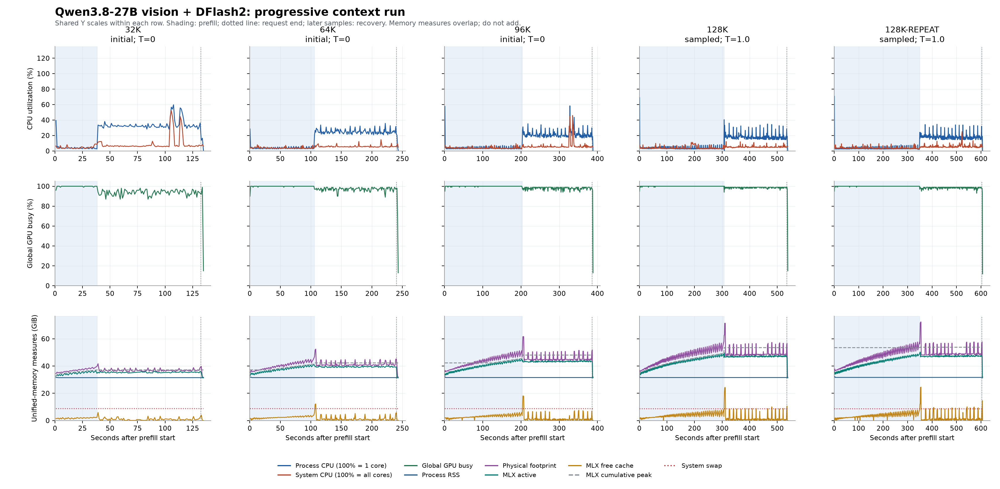
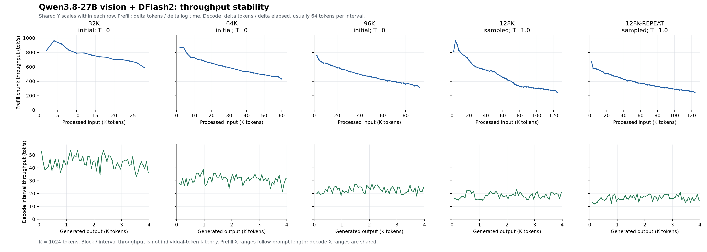

# Qwen3.8-27B 视觉 + DFlash2 阶梯稳定性实测

[English](engine-tests-2026-10-19-vision-stability-report.md) | [简体中文](engine-tests-2026-10-19-vision-stability-report_CN.md)

<!-- environment-context:start -->

## 本机配置与系统（2026-10-20 补充）

| 项目 | 记录与证据边界 |
|---|---|
| 本机用途 | 本机推理工作站 |
| 本机硬件参考 | MacBook Pro `Mac17,6`；Apple M5 Max；18 核 CPU；40 核 GPU；128 GB 统一内存（128 GiB / 137438953472 字节） |
| 原报告明确记载的主机 | 详见原报告；未以当前快照补造历史配置 |
| 当前系统快照 | macOS 27.0.1，build `26A434`，arm64，Metal 4；采集于 2026-10-20 22:03:27 UTC |
| 实验时系统 | macOS 27.0.1 (26A434) |
| 历史配置边界 | 旧测试未保存独立快照时，详细核数只作为当前本机配置参考；内网 PC／云端推理硬件不由 Mac 配置推断 |

[完整环境说明](../../environment_CN.md)。模型、量化、引擎、缓存和请求条件以本报告原有记录为准。原始图表、源码和命令输出保留源语言证据。

<!-- environment-context:end -->

日期：2026-10-19（America/Toronto）。测试通过实际 `start-server.sh` 启动 mlx-vlm 0.7.8；与之前 mlx-dspark 的纯文本基准属于不同服务实现。

本次已取得 5/5 个阶段结果，长 decode 功能检查通过 5/5，短图片恢复探针通过 5/5。五阶段运行完成。已取得阶段没有触发下述压力、换页、长间隔或功能标记。

另保留 2 项 128K 贪心解码失败样本：原任务输出 771 tokens 并重复退化，直接测试任务输出 414 tokens 并在未完成语句处结束，均未达到持续输出覆盖。最终补测改用推荐采样，不代表贪心解码的质量问题已经修复。

这是多会话阶梯测试提供的功能与资源样本，不构成长期生产稳定性、置信区间或无停顿保证。warn/critical、swap 增长与长输出间隔和功能通过分开呈现。

## 工作负载与通过条件

完整证据来自 3 个进程会话；主表跨其中 2 个：initial 提供 32K / 64K / 96K，sampled 提供 128K / 128K-repeat；continuation 的直接测试任务保留为失败样本。不能把五项主表理解为一次从 32K 连续到 128K 的同进程测试。各项前缀不同；合成图片尺寸 840×280、处理后 234 个 image tokens，实际颜色以 metadata 为准，续跑可能复用原会话的配色模板。APC 关闭，终端 timings 核查 `cache_n=0`。每项预留 4096 输出 tokens，其余预算为包含图片和 chat template 的精确输入，`enable_thinking=false`；不改变 KV 精度或 allocator cache limit。

initial 与 continuation 为 `temperature=0` 贪心解码；最终 sampled 会话恢复原始 SQLite 队列 / DAG / 测试代码任务，并使用 checkpoint 推荐采样 `temperature=1.0, top_p=0.95, top_k=20`。具体请求参数保存在下表和精确请求 JSON；采样调整只作用于这次请求，没有修改生产默认。没有运行 EOS 屏蔽、最小输出长度强制或固定长度诊断负载。任务、采样和进程重启均是实验条件变化，跨会话速度不能仅归因于上下文长度；采样任务达到长输出覆盖不能证明原贪心质量问题已解决。至少生成 2048 tokens 才覆盖长 decode；HTTP/SSE 完成、非空输出、token 预算、DFlash 参与与服务健康均由运行器检查。这里的功能通过指请求与长输出覆盖，不是所有实际任务或生成代码质量都通过。颜色和恢复检查单独记录；4096-token 截断的代码不作为完整代码质量验证。冷前缀不等于清空操作系统文件缓存或重新加载模型。

| 阶段 | 会话 / PID | 总预算 | 处理后输入 | 实际输出 | Cache | DFlash rounds / accepted | 长 decode | 颜色顺序 | 恢复 |
| --- | --- | ---: | ---: | ---: | ---: | ---: | --- | --- | --- |
| 32k | initial / 83742 | 32,768 | 28,672 | 4,096 | 0 | 939 / 3157 | 通过 | 通过 | 通过 |
| 64k | initial / 83742 | 65,536 | 61,440 | 4,096 | 0 | 987 / 3109 | 通过 | 通过 | 通过 |
| 96k | initial / 83742 | 98,304 | 94,208 | 4,096 | 0 | 1045 / 3051 | 通过 | 通过 | 通过 |
| 128k | sampled / 89735 | 131,072 | 126,976 | 4,096 | 0 | 1074 / 3022 | 通过 | 通过 | 通过 |
| 128k-repeat | sampled / 89735 | 131,072 | 126,976 | 4,096 | 0 | 1226 / 2869 | 通过 | 通过 | 通过 |

## 保留的原始 128K 失败样本

两个贪心 128K 请求均正常 SSE 结束后提前 stop：原任务出现重复退化，调整为直接测试任务后仍在未完成语句处结束，均未达到至少 2048 tokens 的长 decode 覆盖，属于生成质量 / 覆盖失败。当时服务健康；不能将运行器因覆盖断言退出及随后主动关闭进程解释为服务崩溃。后续会话包含任务提示调整以及恢复原任务后的采样调整，不能抹去这些失败样本。

| 原始样本 | 会话 / PID | 输出 tokens / finish | 服务健康 | 压力计数 | 请求 Δswap GiB | 长覆盖 |
| --- | --- | --- | --- | --- | ---: | --- |
| 128k-original | initial / 83742 | 771 / stop | healthy | normal × 377 | 0.00 | 失败 |
| 128k-direct-greedy | continuation / 88258 | 414 / stop | healthy | normal × 326 | -0.01 | 失败 |

原始结果（历史本机文件，未随本报告发布）、输出正文（历史本机文件，未随本报告发布）、SSE（历史本机文件，未随本报告发布）均保留。非空输出行的最高重复计数：`[["in-memory, in-memory, in-memory, in-memory, in-memory, in-memory,", 10], ["import base64", 9], ["import hashlib", 6]]`；最后一行见 summary.json 的 `output_last_line`。

原始结果（历史本机文件，未随本报告发布）、输出正文（历史本机文件，未随本报告发布）、SSE（历史本机文件，未随本报告发布）均保留。非空输出行的最高重复计数：`[["Purple circle, yellow triangle, blue rectangle.", 1], ["def test_001_enqueue_idempotempotent(self):", 1], ["self.assertEqual(self.clock.now(), 0)", 1]]`；最后一行见 summary.json 的 `output_last_line`。

| 会话 | 阶段 | 采样参数（来自请求） | 任务变体 |
| --- | --- | --- | --- |
| initial | 32k | `{"temperature": 0}` | 原始任务或会话清单所述任务 |
| initial | 64k | `{"temperature": 0}` | 原始任务或会话清单所述任务 |
| initial | 96k | `{"temperature": 0}` | 原始任务或会话清单所述任务 |
| sampled | 128k | `{"temperature": 1.0, "top_p": 0.95, "top_k": 20}` | original_code_task_recommended_sampling |
| sampled | 128k-repeat | `{"temperature": 1.0, "top_p": 0.95, "top_k": 20}` | original_code_task_recommended_sampling |
| initial | 128k-original | `{"temperature": 0}` | 原始任务或会话清单所述任务 |
| continuation | 128k-direct-greedy | `{"temperature": 0}` | direct_numbered_unittest_methods |

## Prefill、decode 与输出间隔

主表使用每个主请求 `metrics_after.latest` 的完整指标；终端 SSE 的 usage/timings 保存于汇总 JSON。

| 阶段 | Prefill 秒 / tok/s | Decode 秒 / tok/s | API / 客户端 TTFT 秒 | 首 / 末 64 tok/s | 末 / 首比 | 最长正文间隔 秒 | >2s / >5s 次数 |
| --- | ---: | ---: | ---: | ---: | ---: | ---: | ---: |
| 32k | 37.95 / 755.48 | 94.25 / 43.46 | 38.32 / 38.33 | 35.00 / 35.63 | 1.02 | 0.437 | 0 / 0 |
| 64k | 105.56 / 582.06 | 134.44 / 30.47 | 105.85 / 105.86 | 20.62 / 31.24 | 1.52 | 0.807 | 0 / 0 |
| 96k | 202.50 / 465.22 | 182.73 / 22.42 | 203.14 / 203.14 | 12.89 / 24.18 | 1.88 | 1.334 | 0 / 0 |
| 128k | 306.45 / 414.34 | 228.26 / 17.94 | 307.14 / 307.14 | 10.17 / 20.66 | 2.03 | 1.962 | 0 / 0 |
| 128k-repeat | 349.05 / 363.78 | 254.63 / 16.09 | 349.78 / 349.78 | 9.25 / 15.07 | 1.63 | 1.955 | 0 / 0 |

间隔由客户端收到含正文的 SSE chunk 时间计算；不包含合法 prefill 等待。DFlash 可成批提交 token，网络和文本解码也可能聚合 chunk，因此这是正文交付间隔，不能称作精确的单 token 延迟。首末 64 速率来自服务指标；比值低于 0.70 仅作观察标记，内容、接受率和负载均可能影响速率，不直接判失败。

## Prefill 进度稳定性

按主请求 request ID 单独解析 server.log，避免把恢复探针算入主请求。每块速率为 Δprocessed tokens / Δ日志时间；首块从 Prefill started 计时，包含初始视觉与调度开销。最后一条 progress 常为 prompt−1，另以 Prefill completed 的总数核对；最后 1 token 的完成尾段不混入块速率。

| 阶段 | 块数 | 首块等待 秒 | 块间隔中位 / 最大 秒 | 首 / 末块 tok/s | processed 单调 | 最后 progress / completed | 达到 prompt−1 / 最终匹配 | >30s 无进度区间 |
| --- | ---: | ---: | ---: | ---: | --- | ---: | --- | ---: |
| 32k | 14 | 2.475 | 2.724 / 3.465 | 827.47 / 590.76 | 通过 | 28671 / 28672 | 通过 / 通过 | 0 |
| 64k | 30 | 2.352 | 3.511 / 4.727 | 870.75 / 433.04 | 通过 | 61439 / 61440 | 通过 / 通过 | 0 |
| 96k | 46 | 2.695 | 4.351 / 6.458 | 759.93 / 316.97 | 通过 | 94207 / 94208 | 通过 / 通过 | 0 |
| 128k | 62 | 2.497 | 4.658 / 8.350 | 820.18 / 245.15 | 通过 | 126975 / 126976 | 通过 / 通过 | 0 |
| 128k-repeat | 62 | 3.029 | 5.585 / 8.483 | 676.13 / 241.31 | 通过 | 126975 / 126976 | 通过 / 通过 | 0 |

超过 30 秒只是本报告的观察阈值，不等于判定死锁。日志时钟分辨率为毫秒，块间隔和正文 chunk 间隔是不同指标；完整逐块 delta 与行号保存在 summary.json。

## Decode 区间吞吐量稳定性

以同一主请求的 `Decode progress/completed` 中 generated_tokens 与 elapsed 计算 Δtokens / Δelapsed，**不使用日志中的 rate 字段**。日志通常每 64 tokens 记录一次；第一个记录点作为锚点，没有假定 elapsed=0 时的已生成 token 数，末尾不足 64 的区间单独保留。

| 阶段 | 有效区间（其中 64 tokens） | 中位 / 最低 / 最高 tok/s | 首 / 末区间 tok/s | 最长区间 秒 | token / elapsed 单调 |
| --- | ---: | ---: | ---: | ---: | --- |
| 32k | 63（63） | 44.82 / 33.60 / 53.92 | 52.98 / 36.20 | 1.905 | 通过 / 通过 |
| 64k | 63（63） | 31.62 / 21.53 / 38.60 | 27.81 / 31.75 | 2.973 | 通过 / 通过 |
| 96k | 63（63） | 23.22 / 18.13 / 27.20 | 20.16 / 24.56 | 3.531 | 通过 / 通过 |
| 128k | 63（63） | 18.54 / 14.97 / 23.29 | 16.21 / 20.99 | 4.276 | 通过 / 通过 |
| 128k-repeat | 63（63） | 16.74 / 11.99 / 20.90 | 13.23 / 14.48 | 5.337 | 通过 / 通过 |

这是连续输出区间的平均吞吐量，平滑了区间内的 DFlash 成批提交，不是逐 token 延迟；它也不同于客户端正文 chunk 间隔。日志 elapsed 保留毫秒，因此区间速率有舍入误差；完整点、delta 和无效区间保存在 summary.json。

## 分阶段 CPU / GPU

| 阶段 | 时段 | 样本数 | 进程 CPU 均值 / 峰值 % | 全机 CPU 均值 / 峰值 % | 全局 GPU busy 均值 / 峰值 % |
| --- | --- | ---: | ---: | ---: | ---: |
| 32k | prefill | 38 | 4.66 / 39.41 | 4.52 / 9.01 | 99.82 / 100.00 |
| 32k | decode | 93 | 33.90 / 59.77 | 9.24 / 52.14 | 93.60 / 98.00 |
| 64k | prefill | 105 | 3.92 / 28.50 | 3.93 / 8.05 | 99.87 / 100.00 |
| 64k | decode | 134 | 24.90 / 35.67 | 5.79 / 14.69 | 97.03 / 99.00 |
| 96k | prefill | 202 | 3.97 / 57.67 | 3.85 / 9.54 | 99.94 / 100.00 |
| 96k | decode | 181 | 21.74 / 58.38 | 6.62 / 45.87 | 97.92 / 99.00 |
| 128k | prefill | 305 | 3.88 / 68.88 | 4.00 / 11.25 | 99.97 / 100.00 |
| 128k | decode | 226 | 18.38 / 40.45 | 5.25 / 12.18 | 98.57 / 100.00 |
| 128k-repeat | prefill | 347 | 3.54 / 70.67 | 3.72 / 9.49 | 99.97 / 100.00 |
| 128k-repeat | decode | 253 | 18.26 / 34.57 | 5.79 / 25.07 | 98.38 / 99.00 |

进程 CPU 100% 表示一个逻辑核，本机 18 个逻辑核理论合计约 1800%；全机 CPU 的 100% 表示全部核忙碌。GPU 为全机 IOAccelerator `Device Utilization %`，包含 WindowServer 等其他应用；不是该服务的独占 GPU 利用率。

## 分阶段内存（GiB）

| 阶段 | 时段 | RSS 峰值 | Footprint 峰值 | MLX active 峰值 | MLX free cache 峰值 | MLX 累计 peak | GPU 全局分配 / 使用峰值 |
| --- | --- | ---: | ---: | ---: | ---: | ---: | ---: |
| 32k | prefill | 31.61 | 39.72 | 36.64 | 2.48 | 37.18 | 49.45 / 40.55 |
| 32k | decode | 31.48 | 41.69 | 36.09 | 5.91 | 37.18 | 51.27 / 42.39 |
| 64k | prefill | 31.81 | 45.78 | 41.17 | 4.08 | 41.31 | 55.56 / 46.81 |
| 64k | decode | 31.51 | 52.42 | 40.58 | 12.21 | 42.30 | 62.00 / 53.10 |
| 96k | prefill | 32.03 | 51.36 | 45.11 | 6.02 | 45.61 | 61.00 / 52.41 |
| 96k | decode | 31.57 | 61.59 | 44.48 | 18.02 | 48.05 | 70.97 / 62.16 |
| 128k | prefill | 32.17 | 57.77 | 48.93 | 7.96 | 49.37 | 67.54 / 58.68 |
| 128k | decode | 31.57 | 71.40 | 50.01 | 24.26 | 53.51 | 80.97 / 72.08 |
| 128k-repeat | prefill | 32.27 | 57.68 | 48.96 | 7.71 | 53.51 | 67.22 / 58.64 |
| 128k-repeat | decode | 31.65 | 72.35 | 50.21 | 24.51 | 53.80 | 81.75 / 72.95 |

GiB=2³⁰ bytes。Apple silicon 为统一内存；RSS、footprint、MLX 与 GPU 驱动统计有重叠，**不得相加**，GPU 数值也不是独立显存。MLX active 是活跃分配；cache 是待复用的空闲 allocator buffers；peak 是自进程开始或框架上次 reset 后的高水位，不能视为当前阶段新增内存。allocator peak 检测到的下降 / reset 事件数：0（记录见 summary.json；本采集器不重置 peak）。

## 压力、swap 与阶段后回收

每阶段 baseline 取 prefill 开始前最近的系统样本；请求末尾取该请求最后一个样本；恢复后取进入下一阶段前该阶段最后一个样本。这些是约每秒采样点，精确时间偏移保存在 JSON，不代表同步瞬时值。已有 swap 的绝对值与本阶段增量分开显示。

| 阶段 | Prefill / decode / 恢复及间歇压力计数 | Baseline / 请求末 / 恢复后 swap GiB | 请求 / 恢复后 Δswap GiB | 恢复后 MLX active / cache GiB |
| --- | --- | ---: | ---: | ---: |
| 32k | normal × 38 / normal × 93 / normal × 3 | 8.75 / 8.74 / 8.74 | -0.02 / -0.02 | 31.37 / 0.00 |
| 64k | normal × 105 / normal × 134 / normal × 3 | 8.74 / 8.72 / 8.72 | -0.02 / -0.02 | 31.38 / 0.20 |
| 96k | normal × 202 / normal × 181 / normal × 3 | 8.72 / 8.71 / 8.71 | -0.01 / -0.01 | 31.38 / 0.20 |
| 128k | normal × 305 / normal × 226 / normal × 4 | 8.66 / 8.63 / 8.63 | -0.03 / -0.03 | 31.37 / 0.01 |
| 128k-repeat | normal × 347 / normal × 253 / normal × 3 | 8.63 / 8.60 / 8.60 | -0.03 / -0.03 | 31.38 / 0.20 |

**32k**：未触发所列观察标记。

**64k**：未触发所列观察标记。

**96k**：未触发所列观察标记。

**128k**：未触发所列观察标记。

**128k-repeat**：未触发所列观察标记。

128K-repeat 只观察续跑进程内两项 128K 请求之间的累积与恢复，不能与初次会话跨 PID 比较内存增长来判断泄漏。一次重复及短恢复间歇不能证明不存在内存泄漏；恢复后 cache 增长也可能只是 allocator 保留。

## 视觉与恢复证据

自动 `vision_correct` 只核对长回答首行三种颜色的出现顺序；`recovery_correct` 只核对短探针三种颜色均出现，未验证顺序。两者都不是完整视觉质量评分，形状与其他描述需结合图片及原始回答人工核查。

| 阶段 | 预期颜色（左→右） | 长回答首行 | 恢复探针回答 |
| --- | --- | --- | --- |
| 32k | blue, orange, green | blue circle, orange triangle, green rectangle. | A blue circle, an orange triangle, and a green rectangle. |
| 64k | red, purple, yellow | red circle, purple triangle, yellow rectangle. | A red circle, a purple triangle, and a yellow rectangle. |
| 96k | green, blue, red | green circle, blue triangle, red rectangle. | A green circle, a blue triangle, and a red rectangle. |
| 128k | purple, yellow, blue | purple circle, yellow triangle, and blue rectangle. | A purple circle, a yellow triangle, and a blue rectangle. |
| 128k-repeat | orange, green, purple | an orange circle, a green triangle, and a purple rectangle. | An orange circle, a green triangle, and a purple rectangle. |

另有独立的图片形状 / 颜色配对核查，见补充视觉验证（历史本机文件，未随本报告发布）；原始结论也保存在 summary.json 的 `vision_validation` 字段。该补充核查与上述运行器颜色检查分开记录。

## 采集方法与完整性

外部采集器每秒读取 libproc CPU/RSS/footprint、host CPU ticks、IOAccelerator GPU、系统压力和 swap；服务进程内每秒只读 `mx.get_active_memory/get_cache_memory/get_peak_memory`。按同一会话、PID 和时间匹配最近的 allocator 样本，最大容差 1.5 秒；baseline 也限定为同一会话和 PID。表中均值为有效采样算术平均，峰值是采样最大值，可能漏掉短暂尖峰；未取得值保持为空，不填 0。

资源 prefill 阶段从 server.log 的 `Prefill started` 到客户端第一段正文，decode 从第一段正文到请求结束；找不到日志起点时回退为结果中的请求开始时间。这个边界包含视觉编码、CPU 预处理 / 队列与首 token 的部分开销，和 API 后端 prompt_eval_time 口径不同；一秒样本及相邻 CPU 差分也可能跨边界。

资源 JSONL 解析错误：0；allocator JSONL 解析错误：0；allocator collector_error 事件：0。

| 阶段 | 资源样本 | 未匹配 allocator 样本 | 遥测错误计数 | Prefill progress 日志条数 |
| --- | ---: | ---: | --- | ---: |
| 32k | 135 | 0 | {} | 14 |
| 64k | 242 | 0 | {} | 30 |
| 96k | 386 | 0 | {} | 46 |
| 128k | 536 | 0 | {} | 62 |
| 128k-repeat | 603 | 0 | {} | 62 |

硬件：Apple M5 Max、18 逻辑 CPU、40 GPU 核、128 GiB 统一内存；macOS `27.0.1`。硬件快照抓取于 `32K decode`；电源来源 `AC Power`；`pmset powermode` 原始值 `0`，不解释未核实的枚举。快照未记录热 / 性能警告或 CPU power status，不等于全程无热限制。

版本：`mlx-dspark 0.20.3`、`mlx 0.32.4`、`mlx-metal 0.32.4`、`mlx-lm 0.32.2`、`mlx-vlm 0.7.8`、`transformers 5.20.1`。

主服务为 canonical ID `mlx-community/Qwen3.8-27B-8bit`，监听 `127.0.0.1:8082`，总上下文默认 131072，使用 incoai DFlash2；APC 关闭、单并发、prefill chunk 2048。`MLX_VLM_MEMORY_LOG` 仅启用本次 benchmark 的 allocator 记录，默认启动不额外采样。

## 原始材料

- 测试计划（历史本机文件，未随本报告发布）、运行器（历史本机文件，未随本报告发布）、主启动脚本（历史本机文件，未随本报告发布）、allocator 采集器（历史本机文件，未随本报告发布）。
- 汇总 JSON（历史本机文件，未随本报告发布）、阶段汇总 CSV（历史本机文件，未随本报告发布）、合并逐秒 CSV（历史本机文件，未随本报告发布）。
- 硬件快照（历史本机文件，未随本报告发布）、会话与实验条件清单（历史本机文件，未随本报告发布）。
- 32k：结果（历史本机文件，未随本报告发布）、逐条 SSE（历史本机文件，未随本报告发布）、输出正文（历史本机文件，未随本报告发布）、精确请求（历史本机文件，未随本报告发布）、[图片](../../assets/figures/2270b0714f2d-32k-image.png)。
- 64k：结果（历史本机文件，未随本报告发布）、逐条 SSE（历史本机文件，未随本报告发布）、输出正文（历史本机文件，未随本报告发布）、精确请求（历史本机文件，未随本报告发布）、[图片](../../assets/figures/c026c68a9e58-64k-image.png)。
- 96k：结果（历史本机文件，未随本报告发布）、逐条 SSE（历史本机文件，未随本报告发布）、输出正文（历史本机文件，未随本报告发布）、精确请求（历史本机文件，未随本报告发布）、[图片](../../assets/figures/ddb29eb56b22-96k-image.png)。
- 128k：结果（历史本机文件，未随本报告发布）、逐条 SSE（历史本机文件，未随本报告发布）、输出正文（历史本机文件，未随本报告发布）、精确请求（历史本机文件，未随本报告发布）、[图片](../../assets/figures/ac05834dea6f-128k-image.png)。
- 128k-repeat：结果（历史本机文件，未随本报告发布）、逐条 SSE（历史本机文件，未随本报告发布）、输出正文（历史本机文件，未随本报告发布）、精确请求（历史本机文件，未随本报告发布）、[图片](../../assets/figures/f394c7645a01-128k-repeat-image.png)。
- 会话 initial：资源（历史本机文件，未随本报告发布）、allocator（历史本机文件，未随本报告发布）、服务日志（历史本机文件，未随本报告发布）、服务收尾（历史本机文件，未随本报告发布）。
- 会话 continuation：资源（历史本机文件，未随本报告发布）、allocator（历史本机文件，未随本报告发布）、服务日志（历史本机文件，未随本报告发布）、服务收尾（历史本机文件，未随本报告发布）。
- 会话 sampled：资源（历史本机文件，未随本报告发布）、allocator（历史本机文件，未随本报告发布）、服务日志（历史本机文件，未随本报告发布）、服务收尾（历史本机文件，未随本报告发布）。
- 收尾记录：server-exit.json（历史本机文件，未随本报告发布）。
- 收尾记录：cleanup.json（历史本机文件，未随本报告发布）。

