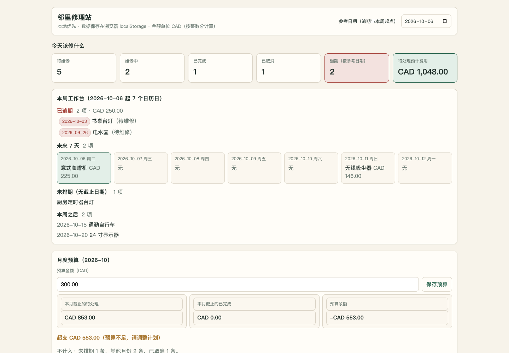
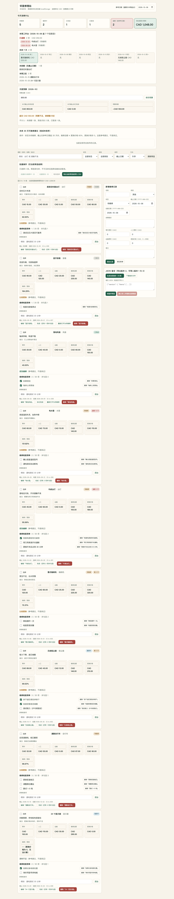

Pi 连续开发与长上下文压力实测

# Pi × 内网 Qwen 连续开发与长上下文压力实测

2026-10-06 · 邻里修理站 Repair Café · Vite / React / TypeScript

**连续压力与恢复段 151.3 分钟**四阶段开发与近128K控制段 131.3 分钟；额外64K恢复约 20.1 分钟意外接口错误 0 次；超预算正确拒绝 1 次；控制端取消 4 次；压力段健康检查失败 0/302完成模型请求 161 次（含之后的普通收尾）；压力请求 124 次

## 测试方式与边界

由已安装的 pi 作为唯一产品 coding agent，接入用户提供的内网 OpenAI 兼容 API。四阶段在同一会话中执行：核心网站、维修工作流、预算与批量操作、回归交付。主评估者设计题目、压力代理和独立验收，不代写产品实现。

在每次请求的系统消息前加入可复现的合成维修案例资料，逐步提高输入目标到64,000、96,000、122,000 tokens。资料开头逐次变化，以减少长前缀缓存复用。最大生成预算6144 tokens、temperature=0、reasoning\_effort=high。122K输入加输出预算接近131072总上下文上限；不把122K输入叫成128K输入。实际服务端usage是最终依据，本地同系列tokenizer只负责估算与偏差校准。

这是一种持续重新预填充的压力工况，比普通可复用历史缓存的代理开发更慢。长参考资料是合成数据，不等同于真实仓库自然增长到128K。没有读取PC上的GPU、温度或内存计数器，因此不能据此排除显存/内存泄漏，或保证多小时、多用户稳定性。

## 请求性能

| 阶段 | 完成次数 | 实际输入tokens | 首增量中位秒 | 总耗时中位秒 | Prefill tok/s | 生成 tok/s |
| --- | --- | --- | --- | --- | --- | --- |
| phase1 | 34 | 63,485–64,243 | 41.01 | 49.98 | 1570.2 | 61.55 |
| phase2 | 30 | 90,771–95,905 | 60.97 | 74.6 | 1582.75 | 59.5 |
| phase3 | 24 | 112,609–121,929 | 79.46 | 89.25 | 1543.7 | 56.25 |
| phase4 | 9 | 116,943–123,930 | 77.11 | 87.88 | 1531.1 | 55.2 |
| near128k-readonly | 6 | 128,759–128,964 | 84.46 | 85.95 | 1537.55 | 52.15 |
| product-recovery | 21 | 63,634–64,257 | 41.04 | 46.44 | 1570.5 | 60.8 |

| 阶段 | 缓存命中请求数 | 最大缓存tokens | 输出预算耗尽次数 |
| --- | --- | --- | --- |
| phase1 | 0 | 0 | 0 |
| phase2 | 0 | 0 | 0 |
| phase3 | 0 | 0 | 0 |
| phase4 | 4 | 123818 | 0 |
| near128k-readonly | 0 | 0 | 0 |
| product-recovery | 0 | 0 | 1 |

首增量包括思考或工具调用，并不保证已出现用户可见正文。首个正文延迟另存于CSV；纯工具响应没有正文。生成速度使用服务端timings，不用字符数估算。测试控制程序未重启AI服务；客户端人工纠偏会中断代理会话回合，但不代表服务崩溃。

## 人工干预与失败

真实连续开发用时超过原先30–60分钟的计划；执行时保留单阶段40分钟上限，未强制总时长60分钟截止。达到阶段上限会取消该代理回合并继续下一阶段，不能说原阶段完全自主成功。四阶段与接续约129K输入的只读Pi核验共享coding会话；控制核验使用1024输出预算。回归阶段曾以126340输入加6144输出申请133K预算，超过131072，服务正确拒绝；这是客户端预算越界，不是服务稳定性故障。恢复阶段另开Pi会话以项目文件延续任务，不重启模型。没有为延长负载而主动冷却AI服务。

| 请求 | 阶段 | 服务端正确拒绝的原因 |
| --- | --- | --- |
| 103 | phase4 | {"error": {"type": "invalid\_request\_error", "message": "prompt (126340 tokens) + max tokens (6144) exceeds the context (131072); requests are never truncated. Send a smaller max\_tokens (at most 4724 here), or add \"fit\_max\_tokens\": true to the model's strata-<model>.json to shorten it to the room left (#545)"}} |

| 阶段 | 控制端事件 | 时刻（相对秒） |
| --- | --- | --- |
| phase1 | pi\_end | 1996.3 |
| phase2 | pi\_timeout | 4396.4 |
| phase2 | pi\_end | 4396.4 |
| phase3 | pi\_timeout | 6796.5 |
| phase3 | pi\_end | 6796.5 |
| product-recovery | pi\_timeout | 9079.2 |
| product-recovery | pi\_end | 9079.2 |

压力与恢复段结束后有评审间隔，后续unstressed-final-polish和delivery-docs使用普通短上下文与缓存，不计入连续压力时长或高档位测速。一个恢复段客户端取消发生在网关日志尚未收尾时，原始requests.jsonl没有完成行；由progress.jsonl的request\_start和recovery\_shutdown确认，单列为控制端取消，不伪造HTTP状态。关闭了Pi自动压缩以维持压力条件；这使原会话最终撞到总预算边界，不能据此推断启用正常上下文压缩的日常Pi开发也必然中断。

## 近上限控制核验

| 用例 | 判定 | 实际答案 |
| --- | --- | --- |
| full-context-money | 通过 | {"total\_cents": 6000, "within\_sixty": true} |
| full-context-date | 通过 | {"leap\_valid": true, "nonleap\_valid": false, "days": 2} |
| full-context-migration | 通过 | {"accept\_v1": true, "reject\_v99": true, "reject\_duplicate": true} |

近上限段共六次请求，三个问题各需要先调用read工具再给结构化答案；实际输入128759–128964 tokens，输出预算1024。内容是金额、日期与备份规则的小型核验，不能把3/3当成通用推理或代码准确率。该段与此前开发共享同一coding会话。

| 时间UTC | 原因 | 种类 |
| --- | --- | --- |
| 2026-10-06T16:45:36.411942+00:00 | Prevent prohibited Google Chrome/channel chrome use; explicit user Chromium rule | operator\_client\_cancel |

模型曾把浏览器测试写成 channel: chrome，评估者在Chrome实际启动前停止该pi回合，并给下一阶段明确的Chromium二进制路径。最初传给pi的系统提示只写“Use only Chromium”，没有完整重复用户禁止channel chrome的原文，因此这是代理配置纠偏，不能当成严格的原文指令遗忘实验。由此产生的BrokenPipe记录属于评估者取消，不与服务故障混算。后续回归任务加入独立验收的真实反馈，修复前后分别留存。

## 独立验证

| 检查文件 | 通过 | 未通过说明 |
| --- | --- | --- |
| repair-cafe-final-budget-domain.json | 15/15 | 全部通过 |
| repair-cafe-final-core-ui.json | 13/13 | 全部通过 |
| repair-cafe-final-domain.json | 25/25 | 全部通过 |
| repair-cafe-final-extended-domain.json | 16/16 | 全部通过 |
| repair-cafe-final-workflow-ui.json | 8/8 | 全部通过 |
| repair-cafe-phase1-core-ui.json | 12/13 | 按名称状态类别组合筛选: locator.click: Timeout 30000ms exceeded. Call log:  - waiting for getByRole('button', { name: '清除筛选', exact: true }) |
| repair-cafe-phase1-domain.json | 25/25 | 全部通过 |
| repair-cafe-phase2-extended-domain.json | 16/16 | 全部通过 |
| repair-cafe-phase2-workflow-ui.json | 7/8 | 编辑表单完成也必须确认未勾选项: 编辑表单直接绕过未勾选清单确认 'done' !== 'pending' |
| repair-cafe-phase3-budget-domain.json | 15/15 | 全部通过 |
| repair-cafe-phase3-draft-budget-domain.json | 14/15 | v2错误settings导入拒绝: validateSettings is not defined |

| 补充界面检查 | 通过 |
| --- | --- |
| 预算、参考日期、选择清理、CSV范围、清空表单 | 5/5 |

| 最终命令 | 真实退出码 |
| --- | --- |
| unit | 0 |
| build | 0 |

第一版自写领域测试曾18项中5项失败，包括把0.1+0.2的整数分期望写成31，以及错误的时区断言。模型通过实际运行自查后修正，随后完整构建发现并修复重复函数名和备份预览条数字段错误。自写测试变绿不等于独立验收通过。最终评估应结合独立用户旅程、计算检查与构建日志。

## 最终评价

本轮单请求、模型已加载的连续长上下文工况稳定。Pi能够通过此API使用原生工具并制作有实际用途的网站，但在压力段未一次自主交付成功；阶段限时、客户端上下文预算越界和界面状态遗漏需要人工验收与恢复。最终代码经同一模型修复后，66项自写测试、56项独立领域检查和26项Chromium用户旅程通过，生产build成功。

| 项目 | 评价 | 证据 |
| --- | --- | --- |
| 服务稳定性 | 本轮通过 | 连续压力/恢复约151分钟，合法压力请求124次；近上限128759–128964输入的6次请求全部完成。健康检查压力段0失败；无非预期HTTP错误。没有PC硬件计数器，不能排除资源泄漏。 |
| 性能 | 首字随输入近似线性增长 | 64K档首增量约41秒；96K档约61秒；122K档约79秒；近129K约84.5秒。长生成阶段服务端中位数约55–62 tok/s，近上限小输出中位52.2 tok/s不等同于长生成测速。 |
| 连续任务与自主交付 | 需要人审与上下文管理 | 同一会话完成多阶段开发，但两个阶段触及40分钟回合上限；回归阶段126340+6144超总131072正确被拒绝。关闭自动压缩和强制重读资料是本轮设置，不能归因于模型或服务崩溃。后续另开恢复/短收尾会话。 |
| 功能正确性 | 修复后通过已测范围 | 发现并由Pi修复编辑完成绕过确认、预算输入不同步、隐藏选择复活、清空表单无效、组件参数接线等问题。最终66自写单元/组件、56独立领域、26独立Chromium旅程通过；均保留修复前失败。 |
| 视觉与体验 | 实用工具风格，尚非精致成品 | 桌面与390px手机无横向溢出，主任务有工作台、费用/预算和真实操作。页面较长、信息密集，标题与技术说明的层次可改善；缺少favicon产生一个404，不影响功能。 |
| 工程交付 | 可构建、可本地运行 | Vite React TypeScript，domain/components分离；README与DELIVERY由Pi写入，git分阶段快照。未改全局Pi设置，源码及交付文件不含实际API key。 |

### repair-cafe-final-top.png

### repair-cafe-final-desktop.png

### repair-cafe-final-mobile.png

## 可追溯文件

repo: $HOME/Code/repair-cafe-qwen-soak-20261006

* repair-cafe-request-metrics.csv：逐次真实性能与结束原因
* 独立验收JSON与截图：本地浏览器验证结果
* 邻里修理站\_编程题与测试方案.md：预先制定的题目、增量任务与标准
* repair-cafe-source.zip：产品源码与分阶段任务