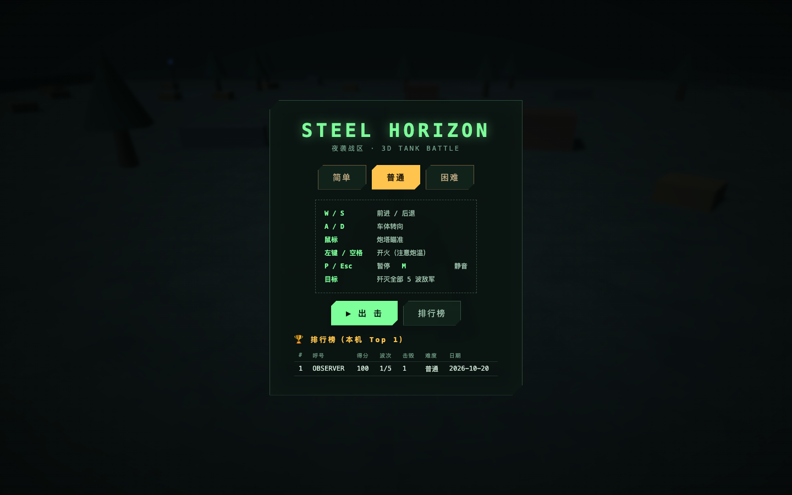
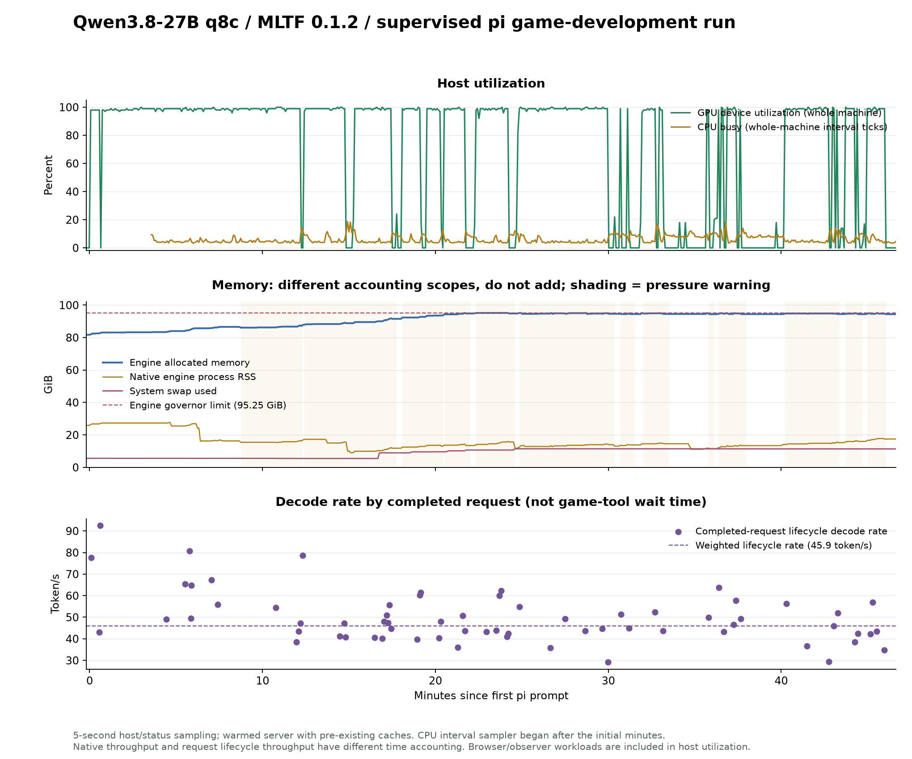

# 本地 Qwen3.8-27B-MLTF-q8c × pi：3D 坦克大战监督实验报告

[English](qwen-tests-mltf-27b-pi-tank-battle-2026-10-20-report-round-1.md) | [简体中文](qwen-tests-mltf-27b-pi-tank-battle-2026-10-20-report-round-1_CN.md)

<!-- environment-context:start -->

## 本机配置与系统（2026-10-20 补充）

| 项目 | 记录与证据边界 |
|---|---|
| 本机用途 | 本机推理工作站 |
| 本机硬件参考 | MacBook Pro `Mac17,6`；Apple M5 Max；18 核 CPU；40 核 GPU；128 GB 统一内存（128 GiB / 137438953472 字节） |
| 原报告明确记载的主机 | 详见原报告；未以当前快照补造历史配置 |
| 当前系统快照 | macOS 27.0.1，build `26A434`，arm64，Metal 4；采集于 2026-10-20 22:03:27 UTC |
| 实验时系统 | macOS 27.0.1 |
| 历史配置边界 | 旧测试未保存独立快照时，详细核数只作为当前本机配置参考；内网 PC／云端推理硬件不由 Mac 配置推断 |

[完整环境说明](../../environment_CN.md)。模型、量化、引擎、缓存和请求条件以本报告原有记录为准。原始图表、源码和命令输出保留源语言证据。

<!-- environment-context:end -->

实验日期：2026-10-20（America/Toronto）。pi 开发起点：2026-10-20 00:38:17 EDT；完成：2026-10-20 01:24:15 EDT。从发出初始提示到 pi 完成，约 **46.0 分钟**。

## 结论

这套配置完成了一个可在浏览器实际游玩的 3D 坦克大战原型。游戏实现、修复、测试脚本和自评均由本地模型经 pi 编写；监督者没有修改游戏源码。监督者共发出 **3 次文字提示**：一次纠正浏览器验收环境，两次指出实际玩法或状态缺陷。因此，本次证明的是“有限监督下能完成”，不能记为完全无监督一次成功。

引擎在本次连续工程负载中，完成 **66 个生成请求**，累计输出 **82,551 token**；原生 decode 加权吞吐约 **46.2 token/s**，原生 prefill 约 **474.1 token/s**。本次增量的请求失败、取消、Metal 失败、容量失败和引擎重启均为 **0**。但内存压力多次为 warning，记录到 **3074 次内部预留拒绝、60 次状态缓存淘汰**，全机 swap 约从 5.6 增至 11.4 GiB；不能把零请求失败解读为没有内存压力。

模型的主要短板是排错与验证判断：坐标空间和异步状态缺陷需要监督提示；部分测试会打印缺乏有效断言的 PASS。它也表现出有效的自检能力：自主修正了胜利测试漏刷敌人的问题，并通过截图发现重复 DOM ID 导致的标题错误。

## 1. 交付物与调用方法

游戏地址：[http://127.0.0.1:5179](http://127.0.0.1:5179)。项目目录：`$HOME/Code/qwen3.8-tests/mltf-27b-pi-tank-battle-2026-10-20/game`。

```sh
cd $HOME/Code/qwen3.8-tests/mltf-27b-pi-tank-battle-2026-10-20/game
npm install
npm run dev -- --host 127.0.0.1 --port 5179
```

操作：W/S 前进后退，A/D 转向，鼠标瞄准，左键或空格射击，P/Esc 暂停与继续，M 静音。排行榜保存在当前浏览器的 localStorage。

[pi 写的启动与操作说明](https://github.com/leoli-dev/llm-test-2026-10-20-game-tank-battle/tree/main/game) · [pi 自评](https://github.com/leoli-dev/llm-test-2026-10-20-game-tank-battle/tree/main/game) · pi 最终答复（历史本机文件，未随本报告发布）。

本机 MLTF 的实际入口与客户端命令：

```sh
# OpenAI-compatible API
# base URL: http://127.0.0.1:8083/v1
# model ID: local/Qwen3.8-27B-MLTF-q8c
pi --provider mltf --model local/Qwen3.8-27B-MLTF-q8c --thinking medium

~/local_llms/mltf/status.sh
```

端口和用法从历史会话《更新 mlx-dspark 和相关模型库》（`01a15498-540f-7061-ace8-14d634ac10db`）定位，再用本机 README、pi 配置、监听端口、运行参数及认证后的 `/status` 交叉验证。模型鉴权沿用本机既有配置，报告不包含认证头或密钥。

## 2. 实验设置与归因边界

| 项目 | 实际设置 |
|---|---|
| 主机 | Apple M5 Max；18 CPU 核；40 GPU 核；128 GiB 统一内存 |
| 系统 | 引擎报告 macOS 27.0.1 |
| 推理引擎 | MLTF 0.1.2；原生 Metal / Splash；DFlash2 |
| 量化与算子 | q8c；prefill W8A8；decode/verify W8A16；INT8 KV |
| 上下文上限 | 服务实际限制 131072 token |
| 内存预算 | 配置 96 GiB；运行中 governor limit 95.25 GiB |
| 存储缓存 | SSD cache 未启用；前缀与状态缓存启用 |
| pi | 1.3.0；RPC 独立会话；仅内置 read/bash/edit/write；没有调用其他模型或编码子 agent |
| 思考与采样 | medium；temperature=1.0；top_p=0.95；top_k=20；max_tokens 上限 32768，后段随上下文余量下调至 20938；由实际出站请求确认 |
| 浏览器 | 独立 Chromium；修正后默认 autoplay 限制；监督者实测全程用 `/Applications/Chromium.app` |
| 游戏技术 | Three.js + Vite + 原生 JS + WebAudio + localStorage |

初始目录为空。原始任务要求完整核心循环、环境、敌人、血量、GUI、音效、配乐、排行榜、开始/暂停/继续/重开，以及实际浏览器操作和截图自检。监督代码和日志均位于 `supervision/`，游戏位于 `game/`。

启动前已有运行中的热引擎及大量历史缓存：引擎分配量为 **81.73 GiB**。没有重启或清缓存。本报告的原生计数使用结束减开始的增量，避免混入此前请求。累计请求增量与本次代理请求数可相互核对；本次不是冷启动或纯净空缓存测试。

仅本次 pi 的请求经过 `127.0.0.1:8085` 透明本地转发，最终仍由 8083 的同一模型处理。代理记录元数据和服务端统计，不改采样或模型内容。主机每约 5 秒采样 `/status`、CPU、GPU、进程 RSS、vm_stat 和 swap。GPU 与 CPU 均为全机口径，也包括浏览器、监督采样和其他桌面应用；不能把全部变化归给模型。

## 3. 游戏验收结果

| 功能 | 实际证据 | 结论与限制 |
|---|---|---|
| 3D 环境、坦克与 GUI | Chromium 截图；地面、树木、箱体、掩体、光照、敌我坦克、HUD、小地图 | 可用，低多边形夜战原型；美术较简单、偏暗 |
| 移动、瞄准、射击 | 真实键鼠输入、位置与发射计数；转向后方向复测 | 可用；坐标缺陷经监督提示后由 pi 修复 |
| 敌人、受伤、击杀 | 监督者自然战斗实测：4 发、3 次命中、1 击杀、100 分，随后遭敌人自然击毁 | 实际核心战斗成立；敌人寻路与难度尚未系统评价 |
| 暂停、继续、重开 | 真实 UI；暂停时位置/血量不变；重开复位；清波边界复测 | 基础及已发现边界通过；波次延时缺陷经提示修复 |
| 音效与配乐 | 默认浏览器策略下点击开始；AudioContext=running；配乐定时器运行；主输出 RMS 峰值 0.0962 | 确认音频信号非零；未进行主观听感评价 |
| 死亡、保存分数、持久化 | 自然死亡后 UI 保存 OBSERVER 成绩，刷新仍保留，再开新局复位 | 监督者实测通过；本机榜，不是联网榜 |
| 五波与胜利 | pi 修正后的测试实际 40 击杀、7000 分、胜利并入榜；监督者另用确定性夹具验证胜利分支 | 辅助通关通过；冻结/摆位参与其中，不等于默认难度自然通关 |
| 标题与视觉检查 | pi 读取菜单、战斗、结算、暂停截图，自主发现重复 ID 并修复 | 有实际视觉反馈闭环 |
| 窗口变化 | 900 像素宽窗口截图及继续操作 | 桌面缩放可用；未验证手机触控 |
| 页面异常 | 监督者最终自然试玩：pageerror=0，失败资源=0；最终 smoke 控制台错误=0 | 这些具体测试内未见错误，非全部路径保证 |

pi 的主 E2E 最后记录为 **28/28，控制台/页面错误 0**，脚本当前有 28 个 ok 调用；额外有波次边界、敌人交火、完整刷兵胜利与标题测试。不能直接把这些 PASS 数当作覆盖率：有断言过弱的项目，详见第 5 节。

监督者自然试玩的浏览器帧间隔样本：中位数 16.70 ms、P95 16.70 ms，约 57.0 FPS。样本来自短时 headless Chromium、1440×900、当前简单场景，只作运行状况参考。




## 4. 开发过程与监督介入

| Toronto 时间 | 里程碑 |
|---|---|
| 00:38:17 | 发出初始任务；从空目录开始 |
| 00:42:43 | 第一批菜单和 GUI 文件落盘 |
| 00:45 左右 | 场景、坦克、程序音频、排行榜模块完成 |
| 00:49:04 | 主游戏循环落盘 |
| 00:50 | 首次启动缺少 npm dev 脚本；pi 自行修正并启动服务 |
| 00:53–01:00 | 第一轮 E2E 和瞄准诊断；修复输入/浏览器 API 错误，多次击杀验证失败 |
| 01:02 | 方向性提示后，pi 修正炮塔世界/局部旋转；E2E 27/27 |
| 01:03–01:05 | 读取截图；补交火与胜利测试；监督者复现清波暂停/重开边界问题 |
| 01:06–01:08 | pi 改为游戏循环内计时，边界回归与监督复测通过 |
| 01:09–01:14 | 初次胜利测试仅 5 击杀；pi 自主发现刷兵口径问题并改正，重跑达到 40 击杀/7000 分 |
| 01:15 起 | 截图自检发现暂停/结算标题重复 ID，自主修复并验证 |

监督介入均为文字建议，没有代码补丁：

| 次数 | Toronto 时间 | 原因 |
|---|---|---|
| 1 | 00:53:32 | 测试脚本选用 Chrome for Testing 名称的缓存可执行文件，且关闭 autoplay 限制，无法代表默认浏览器音频验收。 |
| 2 | 01:00:50 | 三轮击杀验证失败；独立真实按键复现转向后炮管世界方向与弹道相差约76度，pi仍主要调整测试等待/目标。 |
| 3 | 01:05:21 | 独立边界夹具+真实UI复现清波暂停后停止刷兵、旧延时回调污染新局。 |

第 1 次只约束验证环境。第 2 次给出转向约 76° 后炮管与弹道偏差的现象，建议检查局部/世界坐标一致性。第 3 次给出清波后暂停和重开的复现，建议检查延时任务的暂停语义与生命周期。修复方案、实现和新增测试均由 pi 完成。不能从本次实验判断不给提示它是否最终也能自行解决。

## 5. 错误与模型行为分析

| 问题 | 实际表现与处理 | 能力判断 |
|---|---|---|
| 初版场景边界构造混乱 | pi 写完后自行发现并简化边界墙几何 | 有主动回读与修正能力 |
| 启动脚本缺失 | npm run dev 失败；自行补 scripts 后成功 | 常规工程错误能恢复 |
| 测试工具细节 | 极短空格事件被游戏帧轮询漏掉；小写 escape 不被 Playwright 接受；launch 不能直接传 user-data-dir | 对浏览器测试 API 和输入时序不够稳，但能依据报错修正 |
| 浏览器/音频验收失真 | 初用 Chrome for Testing 缓存路径并关闭 autoplay 限制；监督提示后改正 | 初始遵循偏好及验收口径不足 |
| 炮塔局部/世界坐标混用 | 直行可命中；转向约 76° 后方向相差约 76°；三轮击杀验证失败，曾主要调整等待与目标 | 关键 3D 排错需要监督方向；提示后能完整修复玩家和敌人 |
| 清波延时状态缺陷 | 暂停后吞掉推进回调；旧回调污染新局 | 对跨状态异步生命周期考虑不足；提示后改为循环计时并回归 |
| 低估胜利测试范围 | 最初辅助测试把 toSpawn 清零，仅 5 击杀也称五波完成；随后自主修正为完整 40 击杀 | 自审能纠错，但首轮测试口径容易过宽 |
| 重复 DOM ID | 暂停与结算共用 over-title；截图检查后自主发现、修复并补标题验证 | 视觉能力能支持具体 UI 排错，不只是生成截图 |
| 无效 PASS | E2E 的一项转向/后退检查直接断言 true；AI 测试记录移动 0.0m 仍打印 PASS 加警告；部分 console/标题失败不直接决定进程退出码 | 测试质量仍需审查，PASS 数不足以证明功能正确 |
| 最终整套回归的随机失败 | 一轮出现 26/28：实际敌人额外命中使 hitsOnPlayer 不再等于 1，HUD 取整值又被拿去比较原始小数血量；pi 自主改为基线增量与取整值断言后重跑 | 可以修正常见测试不确定性，但早先通过不保证稳定复现 |
| shell 返回码被掩盖 | 多次使用 node … 管道到 tail；工具层可报告 exit=0，正文却有 FAIL 或异常 | 不能仅凭工具 isError 统计失败；本报告人工核对了输出正文 |

未发现持续重复同一命令且完全无进展的死循环。出现过较长推理，以及数轮偏离根因的瞄准诊断；两者需分开：长推理仍在产出新内容，排错停滞则由重复失败和错误假设识别。

游戏结构完整，模块划分基本清楚；核心 game.js 仍集中较多职责。最终视觉是简单几何构成的战区，UI 风格一致；没有充分的自然通关、长时平衡、敌人脱困策略或主观音频品质证据。评价为可继续开发的可玩原型，尚不足以作为无需审查的正式游戏交付。

自评文档总体列出了声音、辅助通关、真实死亡链路等限制；主脚本项数曾误写为 29，pi 后来自主修正为实际的 28 项。坐标问题的开发日志仍未完整标出监督提示的作用。工程过程和监督帮助以本报告的时间戳与原文记录为准。

## 6. 推理性能

| 指标 | 本次结果 |
|---|---|
| 完成 HTTP 生成请求 | 66；状态码分布 {"200": 66} |
| 总输出 token / 其中 reasoning token | 82,551 / 31,986（38.7%） |
| 累计输入 token（含重复上下文） | 4,202,375 |
| 缓存命中输入 token / 实际新增 prefill token | 4,095,232 / 107,143 |
| 输入 token 缓存占比 | 97.5% |
| 原生 prefill 吞吐 | **474.1 token/s** |
| 原生 decode 吞吐 | **46.2 token/s** |
| 请求生命周期 decode 加权速度 | 45.9 token/s |
| 单请求 decode 中位数 / P95 / 范围 | 47.2 / 75.1 / 29.1–92.6 token/s |
| 请求输入处理区间加权速度 | 454.5 token/s |
| 服务端 TTFT 中位数 / P95 / 最大 | 2.76 / 14.34 / 19.42 秒 |
| 实测最大单次输入上下文 | 106,076 token；服务上限 131072，本次未做完整 128K 极限压测 |
| 累计 HTTP 请求等待时间 | 35.3 分钟；整项 pi 工作约 46.0 分钟 |
| DFlash draft 接受率 | 38.2%；accepted / drafted = 60,051 / 157,038 |
| 前缀查找 hit / miss | 65 / 1 |
| 新图像编码 / 图像 embedding 复用 | 8 / 0 |
| 携带图像的请求 | 26；历史图像可在后续请求重复携带，不等于唯一截图数量 |

**统计口径。** 原生吞吐取 `/status.metrics` 的本次 token 增量，除以相应累计 native wall_ms 增量；是串行执行负载下的引擎工作区间速率。请求生命周期速度取服务端每次 `timings/metrics`，用总 token 除总区间时长加权，不对 tok/s 直接做算术平均。服务端会排除首个 speculative 输出块对 stream 区间的影响。

`prompt_per_second` 的分子是实际需要处理的新增 token，不含缓存 token；它的计时包含从执行开始到首个输出的工作，因此不能直接和纯大矩阵 prefill 峰值比较。TTFT 使用服务端 request_latency；代理的 first_delta_s 可能只对应 SSE role/空内容事件，本报告没有把它当首 token 延迟。

首条本次前缀 miss 请求处理 2684 个输入 token，服务端区间约 3.41 秒、约 787 token/s；这只代表热引擎上的前缀未命中，不是从磁盘加载模型的冷启动。长工程中绝大部分历史上下文复用缓存，有效减少了每轮输入等待。

按请求序号分组，最初 22 个请求的生命周期 decode 加权约 **50.4 token/s**，最后 22 个请求约 **40.2 token/s**。后组输入约 83,470–106,076 token，整体比前组慢约 20.1%。上下文、输出内容、图像历史、缓存压力均同时变化，不能把这一下降单独归因于长上下文或热降频。

耗时最长的五次请求：

| 请求序号 | 完成时间 Toronto | 请求耗时 | 输出 token | reasoning token | decode token/s |
|---|---|---|---|---|---|
| 4 | 00:42:43 | 225.1 s | 10,998 | 6,850 | 49.0 |
| 11 | 00:49:04 | 202.9 s | 10,960 | 2,033 | 54.5 |
| 16 | 00:52:45 | 124.4 s | 5,076 | 2,014 | 41.2 |
| 41 | 01:04:56 | 107.5 s | 3,551 | 2,944 | 35.9 |
| 58 | 01:21:02 | 75.2 s | 2,023 | 88 | 29.3 |

其中早期一轮请求用约 225 秒输出 10998 token，含 6850 reasoning token，属于长规划加文件生成，最终正常执行工具。长思考本身不能判为引擎挂死。

## 7. CPU、GPU、内存变化

共采集 **562** 个主机/引擎样本。单轮采样耗时中位数约 0.92 秒；采样程序与浏览器会产生额外开销，未做监控开/关对照。CPU tick 区间采样在开发开始数分钟后补入，最初阶段保留的是 top 原始数据，不能虚构相同口径的早期 CPU 基线。

| 指标 | 最小 | 中位数 | P95 | 最大 |
|---|---|---|---|---|
| 全机 GPU / 推理活跃采样 | 0.0% | 99.0% | 100.0% | 100.0% |
| 全机 CPU / 区间 tick 差值 | 3.3% | 4.8% | 11.2% | 18.8% |
| 引擎分配内存 | 81.7 GiB | 94.4 GiB | 95.2 GiB | 95.2 GiB |
| 原生引擎进程 RSS | 9.1 GiB | 14.5 GiB | 27.3 GiB | 27.7 GiB |
| 全机 wired 内存 / vm_stat | 6.8 GiB | 48.7 GiB | 49.9 GiB | 51.0 GiB |
| 全机压缩器物理占用 / vm_stat | 21.5 GiB | 43.4 GiB | 46.3 GiB | 50.0 GiB |
| 引擎估算的主机可用内存 | 7.0 GiB | 9.1 GiB | 36.9 GiB | 38.0 GiB |
| 全机已用 swap | 5.5 GiB | 10.7 GiB | 11.5 GiB | 11.5 GiB |

引擎分配量从 **81.73 GiB** 到 **94.41 GiB**，净变动 **12.69 GiB**；5 秒采样峰值 **95.21 GiB**，引擎自报本次达到的新峰值为 **95.248 GiB**。状态缓存记账从 39.81 到 52.78 GiB，KV resident backing 从 11.30 到 11.93 GiB。状态缓存本次淘汰 **60** 次，说明接近预算时发生回收。

内存压力采样计数：**normal=202, warning=360**。这是按采样点计数，不是精确压力驻留时长。预留申请拒绝增量 3074，资源挂起/恢复增量 0/0。

内部预留拒绝是 MemoryGovernor 的预算检查计数，与 HTTP 请求失败不是同一个指标。它说明内存增长申请受到约束；本轮同时观察到缓存淘汰、全部请求完成，不能将这 3074 次计为同数量的 OOM。结束快照压力已恢复 normal，但分配量与 swap 仍高于起点。

分配量、进程 RSS、GPU 驱动统计、压缩内存与 swap 属于不同记账方式。在统一内存机器上不能相加；引擎分配 90 多 GiB 也不等于权重本身占用 90 多 GiB。这里还包含此前缓存和本轮逐步增长的状态/KV。一次实验无法证明泄漏与否；本轮观察到预算内回收、请求继续完成，没有观察到 OOM。

功耗与温度未采集：无密码 sudo 的 powermetrics 被系统要求密码，本次未提升权限。没有据此声称功耗低、无热降频或长时散热稳定。



## 8. 模型与引擎分别怎么看

**模型工程能力：可以承担中等范围原型开发，但需要监督与独立验收。** 它能把宽泛需求落成可运行模块，安装依赖、恢复常规启动错误、编写真实浏览器输入脚本，并在提示后修复较深的 3D 变换和状态生命周期问题。自主发现胜利测试漏刷兵、视觉重复 ID，是实际的自检能力。需要补强的是根因定位效率、输入/浏览器 API 细节，以及测试断言和验收表述的严谨性。

**视觉能力：通路真实可用，并产生了一次具体修复。** 有截图 read 调用、实际携图请求、服务端图像编码/复用增量；最终标题缺陷也由截图检查发现。但这不等于已全面验证空间理解、审美优化或所有视觉错误检测。

**推理引擎：本轮持续负载通过，缓存复用与预算回收有效。** 本次完成请求与失败计数一致可核对，Metal 一直健康，没有传输恢复或重启。吞吐在实际工具/思考/代码/图像上下文下可用。代价是运行环境已有很高驻留分配量，warning 压力持续出现，不能只看速度忽略内存余量。

**本次无法回答的比较。** 没有用同一提示、同一缓存条件、同一硬件负载对其他模型或引擎重跑，不能据此宣称优于 oMLX、MTPLX、云模型或其他量化。也未覆盖并发、多小时持续压测、服务冷启动、完整 128K、系统休眠恢复、引擎重启恢复、所有难度自然通关或长期排行榜数据。

## 9. 复核与原始证据

监督者脚本：supervisor.py（历史本机文件，未随本报告发布）、analyze.py（历史本机文件，未随本报告发布）、observer-smoke.mjs（历史本机文件，未随本报告发布）、observer-play.mjs（历史本机文件，未随本报告发布）、observer-aim.mjs（历史本机文件，未随本报告发布）、observer-boundary.mjs（历史本机文件，未随本报告发布）。所有观察脚本在监督目录；最终文件清单可用于核对交付版本。

自然玩法证据：play-results.json（历史本机文件，未随本报告发布）；基础/音频证据：smoke-results.json（历史本机文件，未随本报告发布）；瞄准缺陷修复前后：aim-results-before-fix.json（历史本机文件，未随本报告发布） / aim-results.json（历史本机文件，未随本报告发布）；波次边界修复前后：boundary-results-before-fix.json（历史本机文件，未随本报告发布） / boundary-results.json（历史本机文件，未随本报告发布）。

- 原始完整任务提示（历史本机文件，未随本报告发布）
- 3 次监督介入的时间、原因与原文（历史本机文件，未随本报告发布）
- 发送给 pi 的全部 RPC 指令（历史本机文件，未随本报告发布）
- 带时间戳的开发和工具时间线（历史本机文件，未随本报告发布）
- 完整 pi 原始事件流（历史本机文件，未随本报告发布）
- HTTP 请求元信息、usage、timings 和 metrics（历史本机文件，未随本报告发布）
- 逐请求性能表（历史本机文件，未随本报告发布）
- 5 秒采样的引擎与主机原始数据（历史本机文件，未随本报告发布）
- CPU 时间计数与区间利用率（历史本机文件，未随本报告发布）
- 引擎基线快照（历史本机文件，未随本报告发布）
- 引擎结束快照（历史本机文件，未随本报告发布）
- 本次新增引擎日志（历史本机文件，未随本报告发布）
- 可复算的汇总统计（历史本机文件，未随本报告发布）
- 最终游戏文件 SHA-256 清单（历史本机文件，未随本报告发布）
- 实验方法与环境来源（历史本机文件，未随本报告发布）

本报告由监督者基于原始计数、实际输出、源码阅读和独立浏览器测试整理。pi 的自述保存在独立文件中；已将自述、夹具验证与自然试玩证据分开标明。
