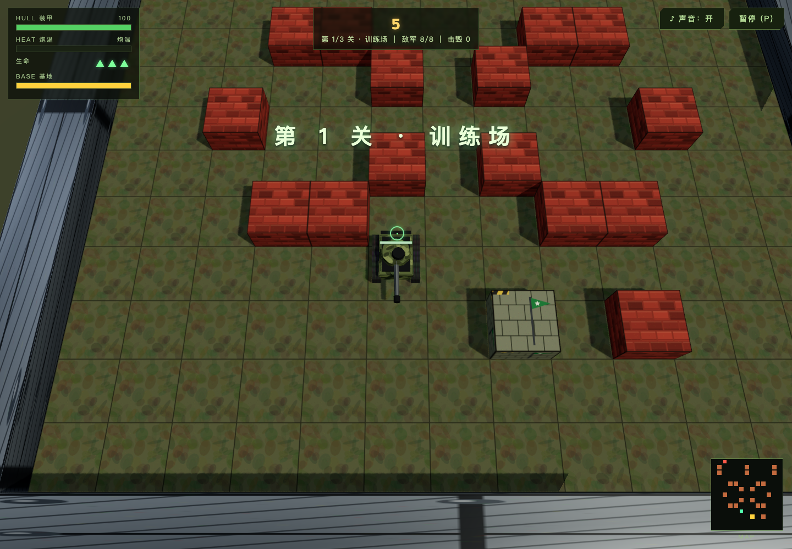
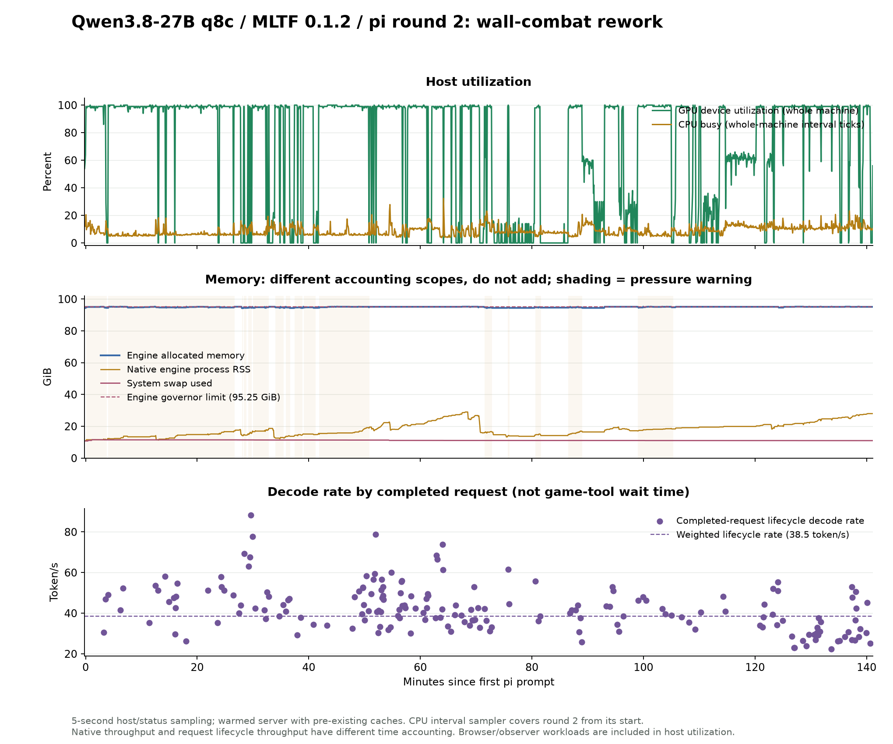

# Local Qwen3.8-27B-MLTF-q8c × pi: Tank Battle Round 2 supervised report

[English](qwen-tests-mltf-27b-pi-tank-battle-2026-10-20-report-round-2.md) | [简体中文](qwen-tests-mltf-27b-pi-tank-battle-2026-10-20-report-round-2_CN.md)

<!-- environment-context:start -->

## Workstation and system (context added 2026-10-20)

| Item | Record and evidence boundary |
|---|---|
| Workstation role | Local inference workstation |
| Current hardware reference | MacBook Pro `Mac17,6`; Apple M5 Max; 18-core CPU; 40-core GPU; 128 GB unified memory (128 GiB / 137438953472 bytes) |
| Host explicitly recorded by the source | See original report; current snapshot does not fill missing historical configuration |
| Current system snapshot | macOS 27.0.1, build `26A434`, arm64, Metal 4; captured 2026-10-20 22:03:27 UTC |
| Test-time OS | macOS 27.0.1 |
| Historical limits | Without a separate test-time snapshot, detailed core counts are a current workstation reference. Mac specifications do not establish LAN PC or cloud inference hardware. |

[Full environment notes](../../environment.md). Model, quantization, engine, cache and request settings remain those recorded in this report. Original figures, source code and command output retain source-language evidence.

<!-- environment-context:end -->

Date: 2026-10-20, America/Toronto. Round 2 ran from **07:27:25 EDT** to pi's final completion at **09:48:06 EDT**, approximately **140.7 minutes**; monitoring continued until 09:48:32 EDT. Round 1 took approximately 46 minutes. The gap between rounds is excluded from development time. This report supersedes Round 1's delivery judgment; the original report and source snapshot remain: Round 1 report (historical local file; not published with this report) / Round 1 source archive (historical local file; not published with this report). The game path in the first report now points to the newer version; use the archive for old files.

## Conclusion and delivery

The new version implements the user's core improvements: walls physically block tanks and shells, take damage and can be destroyed to open firing lines/routes; enemies arrive in batches through controlled entrances; three levels, lives and base defense are added; the entire battlefield is visible, with actual textures, bump mapping and shadows. GUI, audio, pause/resume, restart and the local leaderboard remain. **The delivery is a playable arcade prototype completed under supervision, rather than a mature game produced fully autonomously.**

An independent real keyboard/mouse playthrough of the final AI version cleared the introductory level in **38.956 seconds**: 8 kills, 7 globally destroyed walls, 44 shots and 16 enemy hits. The player took no hits, retained three lives and the base, reached level 2, and had 0 page errors. Another real-movement observation confirmed that, when the player moved away from the base, enemies could break through brick walls and reduce the base from 6→0 while the player retained 100HP. Base defense has actual consequences. Two groups of three games each on the same final AI yielded **0/6** natural three-level victories. The base-defense-priority group cleared the introductory level **3/3**, reaching level 3 twice, but still lost through base destruction. Pre-change AI win rates cannot be reused, and fixture victories cannot count as natural full clears.

**The model can build a fairly complete prototype, but lacks engineering reliability, debugging efficiency and calibrated acceptance judgments, requiring intensive external supervision. The engine remained stable under this round's actual engineering workload, at the cost of high memory usage near its budget and repeated context compaction.** Details and limits follow.

Remaining work: art still consists of simple geometry and procedural textures; final balance has only a few state-assisted-aiming samples and does not represent ordinary-player win rates; global wall counts and scoring include enemy destruction, limiting leaderboard precision; the old five-wave and new versions share the localStorage leaderboard key, making old scores incomparable. Raw death HP can still be negative (the HUD clamps it to 0 without affecting death detection). Old five-wave tests are archived separately and cannot validate the new version. Passing builds and 0 page errors must not hide these limits.


This round completed **186 generation requests**, producing **180,564 tokens** (83,128 reasoning). Native weighted decode was **38.6 token/s**, prefill **457.0 token/s**, with 0 request failures/restarts and sampled memory peaking at **95.25 GiB**.

Game entry: [Play in browser](http://127.0.0.1:5179/). Three.js / Vite / JavaScript / WebAudio / localStorage. WASD moves in world directions; mouse aims; left click/Space fires; P/Esc pauses/resumes; M mutes; R restarts. The leaderboard belongs to the current local browser.

[pi's launch instructions](https://github.com/leoli-dev/llm-test-2026-10-20-game-tank-battle/tree/main/game) · [pi's playtest record](https://github.com/leoli-dev/llm-test-2026-10-20-game-tank-battle/tree/main/game) · [pi's self-review (residual misstatements remain; see audit)](https://github.com/leoli-dev/llm-test-2026-10-20-game-tank-battle/tree/main/game) · pi's final response (historical local file; not published with this report).

## 1. Corrections following user feedback and the Round 1 judgment

Round 1 tested real movement/shooting, audio, state flow and the leaderboard, but treated basic functionality as the completion standard. It did not establish meaningful walls, level routes, reasonable beginner difficulty or sufficient material quality. The delivery judgment had to be withdrawn after the user identified missing wall tactics, an opening dogpile and untextured simple models. Script totals such as 28/28 do not answer these gameplay questions.

The same pi, model and session continued this round. The supervisor wrote task instructions, observation scripts, monitoring and reports, without editing game/ source, tests or documentation or calling another coding model. Independent observation scripts live in supervision/; pi wrote all source, tests and self-reviews inside game/. This round had **12 directional prompts**, plus 3 in Round 1, totaling 15. This is supervised completion, rather than full autonomy or a one-shot success.

Implementation includes a 13×13 tile map; brick walls destroyed by two shots; indestructible steel walls; three levels with 8/12/16 enemies and 2/3/3 concurrent enemies; staggered entrances; spawn indicators/protection; 3 lives; a base-loss condition; and a fixed full-field view. Materials use actual CanvasTexture, bump maps, armor camouflage, track patterns, brick damage and metal textures, combined with sunlight, fill light and shadows.


The visuals clearly exceed flat-color blocks, but remain an arcade prototype combining procedural assets and simple geometry: ground repetition is obvious, and environmental layering and asset detail remain limited. Texture counts and shadow switches do not replace aesthetic judgment or establish a commercial-quality product.

## 2. pi's playtests: failures retained and versions distinguished

All use default normal difficulty and real keyboard/mouse input, reading state to assist aiming and logging. Natural games do not freeze enemies, modify HP, teleport or empty spawn queues. This is neither a purely visual strategy-intelligence test nor a blind human playtest. Random spawns and movement strategies vary, so time differences are not strict causal A/B difficulty evidence. Wall destruction in the table is global and includes enemy destruction.

| Game | Duration | Level reached | Total kills | Walls destroyed | Score | Lives left / base HP | Result | Page errors |
|---|---|---|---|---|---|---|---|---|
| n1 | 98.1 s | 2 | 12 | 13 | 1615 | 2 / 0 | Defeat: base destroyed | 0 |
| n2 | 25.8 s | 1 | 3 | 4 | 320 | 3 / 0 | Defeat: base destroyed | 0 |
| n3 | 70.6 s | 2 | 13 | 4 | 1670 | 3 / 0 | Defeat: base destroyed | 0 |
| p1 | 133.9 s | 3 | 25 | 11 | 3655 | 2 / 0 | Defeat: base destroyed | 0 |
| p2 | 59.7 s | 2 | 9 | 8 | 1240 | 3 / 0 | Defeat: base destroyed | 0 |
| p3 | 131.7 s | 3 | 25 | 11 | 3705 | 1 / 0 | Defeat: base destroyed | 0 |
| s1 | 154.6 s | 3 | 32 | 17 | 4935 | 0 / 6 | Defeat: tank destroyed | 0 |
| s2 | 127.8 s | 3 | 22 | 14 | 3270 | 0 / 6 | Defeat: tank destroyed | 0 |
| s3 | 145.1 s | 3 | 28 | 18 | 4240 | 0 / 6 | Defeat: tank destroyed | 0 |
| s4 | 240.1 s | 3 | 23 | 9 | 3345 | 1 / 6 | Time limit reached; unfinished | 0 |
| s5 | 146.2 s | 2 | 14 | 11 | 1855 | 3 / 0 | Defeat: base destroyed | 0 |

s1–s3 use the first fixed full-field camera version. All naturally cleared the first two levels and lost on level 3, for **0/3** three-level victories. Heavy-enemy ordering and base AI were subsequently changed, so these cannot be called three acceptance games on the final AI. s4 uses an intermediate version with incorrect base-target coordinates: kills stopped at 23 after approximately 130 seconds, and the game was unfinished at 240 seconds. That AI version was broken; surviving to the time limit does not establish good balance. s5 is a natural game after coordinate/pathfinding repairs, losing level 2 when the base fell from 6 to 0. Base line-of-sight logic was repaired afterward.

After reading s1's win=false, 32/36 kills and all three lives exhausted, pi explicitly claimed a three-level clear, correcting it only after supervisor feedback. Reaching level 3, a script exiting 0, and no page errors do not respectively establish victory, sensible gameplay or adequate coverage.

Before the base-AI change, the supervisor also played a real-input game aiming only at on-screen enemies: **level 1 cleared in 39.129 seconds, 8 kills, 6 globally destroyed bricks, 40 shots, 16 enemy hits, 1 player hit, all three lives retained, level 2 reached, and 0 errors**. This verifies introductory progression on the pre-change base AI and does not replace final-AI retesting.

Independent natural play before modification (historical local file; not published with this report) / independent natural play on final AI (historical local file; not published with this report). pi's raw per-game JSON is saved in this round's supervision directory, including timestamped position, HP and kill records.

On the same final AI, n1–n3 used the original pursuit strategy, clearing the introductory level 2/3. p1–p3 prioritized threats nearest the base and defended it, clearing the introductory level 3/3 and level 2 in two games. Across both groups, three-level victories were 0/6, with no page errors. Different strategies and random conditions prevent extrapolating these ratios to ordinary-player win rates; all failures remain recorded.

## 3. Independent verification and evidence limits

| Check | Observed result | Boundary |
|---|---|---|
| Wall blocks tank → damage → removal → passage | Intact wall stops tank at z45.15; one shot leaves HP1; second removes wall; W advances to z37.10; 0 errors | Real keyboard/mouse; world state unchanged |
| Wall blocks shells and shields an enemy | First shot: wall HP1, enemy HP24; second: wall destroyed, enemy still 24; third: enemy HP12; fourth: enemy destroyed | Fixture freezes and positions both sides to test obstruction only; not natural combat or victory |
| Barrel direction and trajectory | Direction dot product -1 before repair, +1 afterward | Compares actual visible muzzle world direction with trajectory |
| Menu, pause, resume, restart | Menu obstruction disappears; movement/fire inputs during pause change neither position nor shot count; after resume, real W moves z47.55→42.65; restart returns to level 1 with 100HP, three lives and base 6 | Real UI input |
| Sound/music path | Start clicked under default autoplay restrictions: AudioContext running, music timer active, audio RMS peak 0.02146; mute toggles | Confirms a real signal, not a subjective audio-quality score |
| Textures and lighting | Independent scene traversal finds 8 distinct texture maps, 34 shadow-casting objects and main-light shadows enabled; screenshots show materials and shadows | Counts establish activation only; visual quality is judged separately |
| Level-clear pause/restart boundaries | Clear countdown does not advance during a 3.3-second pause; restarting while paused avoids the previous game's level-transition effects | Explicit empty-spawn-queue fixture tests state lifecycle |
| Victory screen | Correct mission-complete display after three clear transitions; no page errors | Explicit frozen/empty-queue fixture, 0 kills; verifies state branch, not natural victory |
| Death and leaderboard | Correct defeat-panel title; real UI enters OBS_R2 and retains it after reload | Base-damage hook triggers defeat; scores are isolated test-browser data |

Evidence: wall-input.json (historical local file; not published with this report), wall-target.json (historical local file; not published with this report), controls.json (historical local file; not published with this report), lifecycle.json (historical local file; not published with this report), victory-fixture.json (historical local file; not published with this report). These passing-check counts are not total product coverage.



The same independent strategy was rerun on the final AI: level 2 reached in 38.956 seconds, 8 kills, 7 globally destroyed walls, 44 shots, 16 enemy hits, 0 player hits, three lives and the base retained, and 0 errors. After the base line-of-sight repair, real movement to the left away from combat followed by waiting reduced the base 6→5→2→0, while the player retained 100HP and no page errors occurred.

## 4. Process, errors and supervision

| Toronto time | Event and significance |
|---|---|
| 07:27 | Continued the same session with user feedback and a restructuring task |
| 07:31 | pi played the old version, read images, then planned |
| 07:38–07:54 | Wrote tile map, materials, tank details, scene and main loop; first production build passed |
| 07:55–07:58 | Browser crashed because tileMeshes was uninitialized; pi repaired it autonomously, then found and repaired menu obstruction through images |
| 08:00–08:25 | Natural play exposed inability to fire, per-frame enemy exceptions, inflated wall counts and reversed barrel; pi debugged each after feedback |
| 08:18–08:32 | Repeated inline diagnostics hid root causes; guessed fields, wrong ports and repeatedly failed exact-text replacement; saved diagnostic scripts finally closed the loop |
| 08:34–08:39 | pi read actual images and repaired hidden-banner styling and excessive off-field camera space |
| 08:40–08:48 | Natural s1–s3 passed the first two levels and all lost on level 3; supervisor corrected the full-clear claim |
| 08:49–08:54 | Old E2E failed on obsolete selectors; old victory script waited on frozen new spawning; the combined command timed out after 300 seconds |
| 08:55–09:00 | Fixed heavy-for-heavy ordering; wrong two-dimensional base coordinates sent base-priority AI toward the map top and stalled s4 |
| After 09:01 | Fixed base coordinates and pathfinding toward impassable targets, confirmed actual base damage, then repaired erroneous LOS endpoint-cell blocking |

The most serious wall bug was reproduced through real input: 6 shots produced a destroyed-wall count of 114, wall HP=-60 and 126 exceptions. Rendering stored walls in a compact array, while damage logic indexed them as a dense grid. Exceptions interrupted resolution and repeatedly processed the same collision. After repair, the same 6 shots correctly removed 2 bricks along the line, without negative HP or page errors. Before repair (historical local file; not published with this report) / after repair (historical local file; not published with this report).

Testing-method issues also had substantial costs: one tool output had 51,338 characters, including 926 repeated undefined-property errors. Repeated tail/head/grep truncation hid the first exception, while shell pipelines or echo masked failure exits. Tool isError flags therefore cannot directly count total failures. Unmigrated old tests wasted 5 minutes waiting. The model repeatedly treated comments or written logic as proof of actual behavior, requiring runtime correction. Final test-entry edits also introduced a trailing JSON comma, which pi found and repaired through parsing checks.

All textual interventions in this round follow. Original wording, timestamps and reasons are in interventions.jsonl (historical local file; not published with this report).

| Prompt | Toronto time | Trigger |
|---|---|---|
| r2-01 | 08:02:45 EDT | Unable to fire, per-frame enemy exceptions and camera clipping |
| r2-02 | 08:05:58 EDT | Inflated wall-destruction counts and reversed barrel/trajectory |
| r2-03 | 08:19:57 EDT | Repeated failed diagnostics, pipelines hiding errors and wrong ports |
| r2-04 | 08:31:39 EDT | Repeated exact-text replacement failures; needed actual gameplay validation |
| r2-05 | 08:43:58 EDT | Described level-3 defeat as full three-level victory |
| r2-06 | 08:48:49 EDT | Verify heavy-enemy timing and real base threat |
| r2-07 | 08:55:35 EDT | Incorrectly declared ordering valid; 85 violations in 100 samples |
| r2-08 | 08:58:04 EDT | Wrong base coordinates clustered enemies at the map top |
| r2-09 | 09:05:37 EDT | Confused player damage with base threat; LOS wrongly blocked entity targets |
| r2-10 | 09:28:40 EDT | Stop repeated bot-strategy runs; retain failures and conclude delivery |
| r2-11 | 09:35:55 EDT | Correct false 11/11 introductory-clear claim, s4 attribution and obsolete test entries |
| r2-12 | 09:45:39 EDT | Independent pause/resume evidence passed; correct fixed-duration test preconditions and finish |

**The final self-review still contains misstatements and is not an acceptance conclusion.** Archived SELF-REVIEW says all 11 games ended in defeat and stage A had 5 tank-destruction losses. Raw JSON instead shows 3 tank-destruction losses (s1–s3), 7 base-destruction losses (s5 plus six n/p games), and 1 game still running at the limit (s4). PLAYTEST groups s1–s5 into one stage, although s4/s5 already have AI changes and should not be treated as a fixed configuration. Its assertion-level audio-unlock/window-adaptation claims cite Round 1 without rerunning the corresponding new-version checks. This report uses the supervisor's new-version signal measurements for audio; window adaptation was not specifically accepted for the new version. Pause ultimately passed both pi's actual-state-precondition regression and the supervisor's real-key checks. These contradictions, together with the corrected claim that all 11/11 games cleared the introductory level, show weak self-review calibration rather than engine request failure.


Frozen self-review copy: pi-final-SELF-REVIEW.md (historical local file; not published with this report).


## 5. Inference settings and speed

MLTF entry: **http://127.0.0.1:8083/v1**, model ID **local/Qwen3.8-27B-MLTF-q8c**. The port was located from the historical conversation “Update mlx-dspark and related model libraries,” then verified through local configuration, listening ports and the authenticated status endpoint; details are in Round 1. Isolated pi configuration transparently forwards requests through 8085 to retain timing and server statistics, without changing content or sampling.

| Item | Setting |
|---|---|
| Hardware | M5 Max，18 CPU cores / 40 GPU cores / 128 GiB unified memory |
| Engine | MLTF0.1.2，native Metal / Splash，DFlash2 |
| Quantization | q8c；W8A8 prefill，W8A16 decode/verify，INT8 KV |
| Context / budget | 131072 token；configured 96 GiB；governor approximately 95.25 GiB；SSD cache disabled |
| pi | 1.3.0；same RPC session，medium；only built-in read/bash/edit/write, no other coding model or subagent |
| Actual outbound sampling | temperature1、top_p0.95、top_k20；max_tokens varies with remaining context, up to 32768 |
| Browser | separate Chromium, default autoplay restrictions; Google Chrome not used |

| Metric | Round 1 | Round 2 |
|---|---|---|
| Completed requests | 66 | 186 |
| Output tokens (including reasoning) | 82,551 | 180,564 |
| reasoning token | 31,986 | 83,128 |
| Native weighted decode | 46.2 token/s | 38.6 token/s |
| Native weighted prefill | 474.1 token/s | 457.0 token/s |
| Request-lifecycle weighted decode | 45.9 token/s | 38.5 token/s |
| Request-lifecycle weighted prefill | 454.5 token/s | 443.4 token/s |
| Maximum actual request context | 106,076 | 114,445 |
| Request failures / cancellations in this round | 0 / 0 | 0 / 0 |
| Metal / capacity failures / engine restarts | 0 / 0 / 0 | 0 / 0 / 0 |

Native speeds use differences between starting/ending cumulative counters: decoded output tokens / decode wall time and prefill input tokens / prefill wall time. They are neither instantaneous single-batch values nor simple averages of per-request rates. Request metrics come from each SSE stream's final statistics and use different timing boundaries, so they are reported separately. Generated tokens include reasoning, code, tool arguments, documentation and compaction summaries; they are neither useful-code volume nor user-visible text speed.

Cumulative prompt accounting is 12,718,437 tokens, including 12,243,776 cached tokens; these are not all newly prefetched. Actual uncached prefill request accounting is 474,661. Server TTFT including queueing has a median of 2.97 seconds and P95 of 20.08 seconds. DFlash draft acceptance is approximately 36.9%. Newly encoded images total 11 and image-embedding reuses total 23. Historical images recur in context, so every image-bearing request must not count as a new visual observation.

Lifecycle-weighted decode is 41.25 token/s for the first 62 requests, 39.16 for the middle 62 and 33.96 for the last 62. A later decline and fluctuations are observed. Output structure, context, cache and host load were uncontrolled, with no power/temperature evidence. The decline therefore cannot be directly attributed to thermal throttling or engine degradation. Here, stability primarily means request availability rather than constant throughput.

The two rounds differ in task content, output structure, images, cache and context. This is an engineering-workload observation; speed differences cannot directly establish engine degradation. There is no controlled comparison with other models/engines.

## 6. Context-compaction cost

This round had 3 automatic compactions, each resuming work with the same model/session and no engine restart. Compaction helper requests total 6, with 15,540 output tokens and 11.07 minutes of combined duration. Reestablishing the prefix after resumption has additional cost, excluded from those summary-request times.

| Compaction | Estimated tokens before | Estimated tokens after | Summary output tokens | Of these, reasoning |
|---|---|---|---|---|
| 1 | 115,781 | 22,891 | 3,902 | 568 |
| 2 | 116,465 | 27,173 | 6,360 | 1,519 |
| 3 | 115,358 | 25,063 | 5,278 | 1,114 |

Repeated exceptions and verbose debugging amplify context cost. Successful compaction shows that the long session can continue, not that subsequent judgments are all correct: incorrect result interpretation and obsolete mismatched tests still occurred. Original compaction events remain in the full RPC log. An older event whitelist omitted that event name from the simplified timeline, but the raw data is complete and was used to recalculate these totals.

## 7. CPU, GPU and memory changes

There are 1694 samples at approximately 5-second intervals. CPU uses differences in Mach interval ticks; GPU uses IORegistry device utilization. Both are system-wide, including pi's browser, the independent observation browser, desktop apps and sampling overhead. RSS, unified-memory allocation, compression and swap use different accounting and must not be added. Without power/temperature readings, absence of thermal throttling cannot be claimed.

| Metric | Minimum | Median | P95 | Maximum |
|---|---|---|---|---|
| System CPU / interval tick differences | 3.84% | 7.98% | 14.80% | 32.32% |
| System GPU during active inference | 0.00% | 99.00% | 100.00% | 100.00% |
| Engine allocated memory | 94.28 GiB | 95.11 GiB | 95.21 GiB | 95.25 GiB |
| Native engine process RSS | 10.85 GiB | 17.23 GiB | 26.59 GiB | 29.01 GiB |
| System wired | 6.47 GiB | 50.55 GiB | 53.05 GiB | 53.94 GiB |
| System compressor physical usage | 24.97 GiB | 37.29 GiB | 42.60 GiB | 50.61 GiB |
| Engine-estimated available host memory | 5.73 GiB | 8.98 GiB | 36.78 GiB | 37.57 GiB |
| System used swap | 10.79 GiB | 11.12 GiB | 11.50 GiB | 11.59 GiB |

This round continues a warm engine: allocation starts at **94.41 GiB**, ends at **95.11 GiB**, and reaches a sampled peak of **95.250 GiB**. Earlier caches were not cleared, so this is neither pure weight memory nor cold-start usage. The native engine's lifetime peak also carries over from Round 1 and cannot all be attributed to this round.

Pressure samples: {"normal": 1014, "warning": 680}. State-cache evictions increase by **390**, internal budget-reservation rejections by **12274**, and resource suspension/resumption is 0/0. Internal rejections count budget checks, rather than the same number of request OOMs. Reclamation and continued request completion are both observed. A single experiment also cannot establish the presence or absence of a memory leak.

GPU is usually near full utilization during inference and can fall to 0 during tool waits. During the old test's 300-second wait, the scheduler had no prefill/decode and GPU was 0, clearly identifying a test-workflow wait. This period is neither a model hang nor part of native generation-speed denominators.



## 8. Capability and stability assessment

**Implementation capability: it can turn broad requirements into a genuinely playable prototype, with intensive supervision.** Walls, levels, procedural textures, audio, UI state and browser scripts all become real implementations. Cross-module consistency is difficult: grid/render indices, wrapper/Three objects, two-/three-dimensional coordinates, visible muzzle/trajectory and target-cell/LOS all have substantive bugs, and restructuring introduces regressions. Large generated-code volume alone does not establish engineering reliability.

**Self-checking and vision: the paths work, but coverage and judgment vary.** pi autonomously found menu obstruction and a persistent level banner through images, then changed to full-field framing after camera feedback. Vision led to concrete repairs. However, it repeatedly called failures or inadequate evidence successful: level-3 defeat became full victory; heavy-for-heavy substitution became valid ordering; player damage became a base attack. Final documentation again claimed all 11 games cleared the introductory level and attributed the AI stall to the bot. Actual results and assertions require independent verification.

**Debugging efficiency: clearly inadequate in this round.** Repeatedly truncated exceptions, guessed fields, failed text replacements, obsolete tests waiting indefinitely and repeated compaction consumed substantial time and tokens. The supervisor supplied no patches but still intervened 12 times. This does not support reliable autonomous completion of a full game. The effective approach is incremental execution, retaining the complete first error, constraining judgments with reproducible behavior, and preserving failures.

**Engine stability: stable under the monitored workload, with high memory cost.** The two rounds total 252 completed requests and 263,115 output tokens. This round shows no request, Metal or capacity failures or transport restarts. Automatic compaction and subsequent image requests continue successfully. High allocation, warning pressure, budget rejections and cache evictions coexist; zero request failures does not establish ample resource headroom.

This is neither a model ranking nor a generalizable capability score. Other desktop loads are uncontrolled, with no cold-start/cache-clear control, concurrent stress, full-context limit, sleep/resume or other engine/quantization comparison. Natural gameplay samples are few and use state-assisted aiming, so they do not represent ordinary-player win rates. Headless startup timing varies: a fixed 9-second wait once failed to reach the enemy-spawn precondition; waiting for actual state passed. No formal game FPS/frame-time test was performed. Final remaining issues and unverified areas are documented at this report's beginning and in pi's self-review.

## 9. Reproduction and raw records

```sh
# 使用既有本机 pi provider 配置
pi --provider mltf --model local/Qwen3.8-27B-MLTF-q8c --thinking medium
# 实际 API base URL: http://127.0.0.1:8083/v1

cd $HOME/Code/qwen3.8-tests/mltf-27b-pi-tank-battle-2026-10-20/game
npm install
npm run dev -- --host 127.0.0.1 --port 5179
```

Authentication keys are not published in reports/logs. Raw request logs retain parameters and SSE statistics, not authentication headers. Isolated pi configuration contains credentials and is not a report attachment.

Round 2 initial task (historical local file; not published with this report) · Request timing/statistics (historical local file; not published with this report) · Complete pi events (historical local file; not published with this report) · Simplified timeline (historical local file; not published with this report) · Host/engine sampling (historical local file; not published with this report) · CPU interval samples (historical local file; not published with this report) · Engine start snapshot (historical local file; not published with this report) · Engine end snapshot (historical local file; not published with this report) · New engine logs from this round (historical local file; not published with this report) · Aggregate statistics (historical local file; not published with this report) · Per-request statistics (historical local file; not published with this report) · Final game-file SHA256 (historical local file; not published with this report).

Incorrect-target-coordinate observation (historical local file; not published with this report) · Observation before base line-of-sight repair (historical local file; not published with this report) · Observation after base line-of-sight repair (historical local file; not published with this report) · Heavy-enemy ordering-error samples (historical local file; not published with this report). Supervision and analysis scripts are saved in supervision; final and Round 1 snapshots are retained separately for traceability: Round 2 source archive (historical local file; not published with this report). The supervisor compiled this report from raw counters, tool results, source reading and independent Chromium tests. pi's documents are statements by the evaluated agent and do not replace this report's evidence checks.
