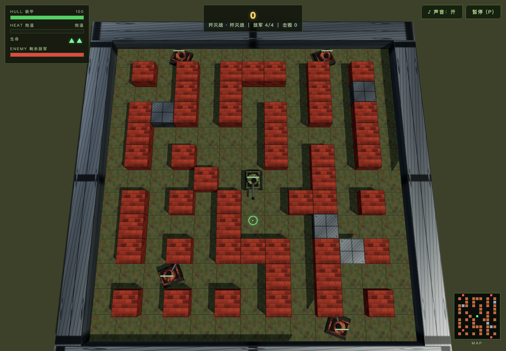
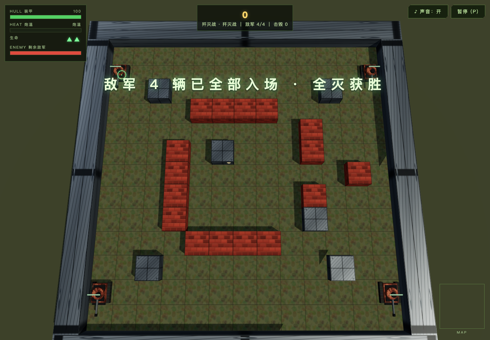
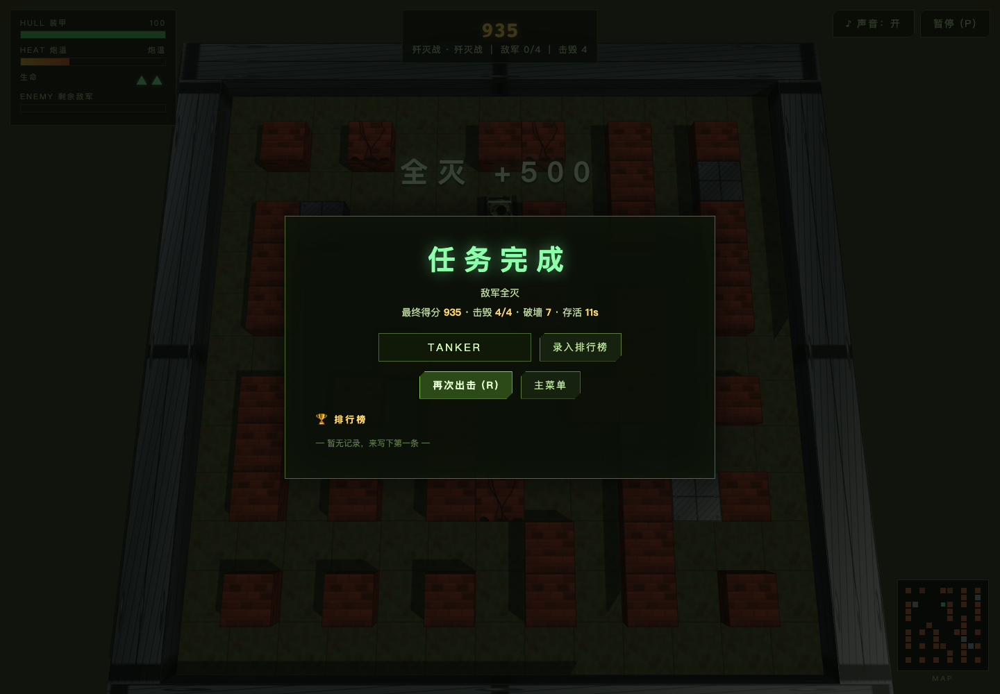
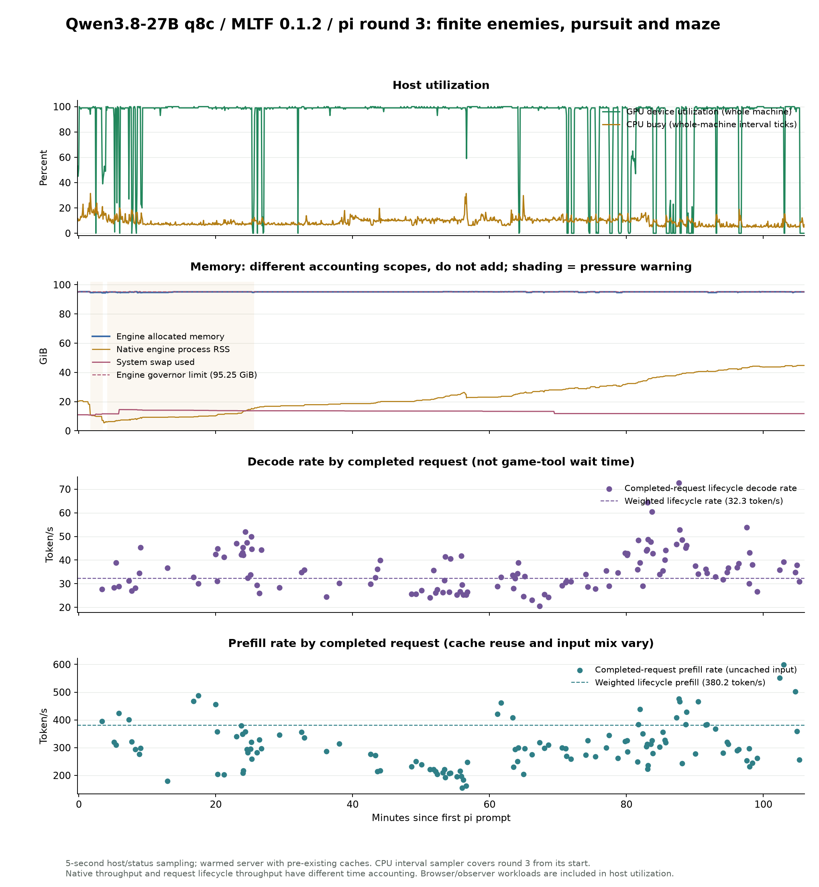

# Qwen3.8-27B-MLTF-q8c × pi：第三轮游戏重构与本机性能报告

[English](qwen-tests-mltf-27b-pi-tank-battle-2026-10-20-report-round-3.md) | [简体中文](qwen-tests-mltf-27b-pi-tank-battle-2026-10-20-report-round-3_CN.md)

<!-- environment-context:start -->

## 本机配置与系统（2026-10-20 补充）

| 项目 | 记录与证据边界 |
|---|---|
| 本机用途 | 本机推理工作站 |
| 本机硬件参考 | MacBook Pro `Mac17,6`；Apple M5 Max；18 核 CPU；40 核 GPU；128 GB 统一内存（128 GiB / 137438953472 字节） |
| 原报告明确记载的主机 | 详见原报告；未以当前快照补造历史配置 |
| 当前系统快照 | macOS 27.0.1，build `26A434`，arm64，Metal 4；采集于 2026-10-20 22:03:27 UTC |
| 实验时系统 | macOS 27.0.1 |
| 历史配置边界 | 旧测试未保存独立快照时，详细核数只作为当前本机配置参考；内网 PC／云端推理硬件不由 Mac 配置推断 |

[完整环境说明](../../environment_CN.md)。模型、量化、引擎、缓存和请求条件以本报告原有记录为准。原始图表、源码和命令输出保留源语言证据。

<!-- environment-context:end -->

2026-10-20，America/Toronto。本轮同一 pi 会话从 **09:58:25 EDT** 至 **11:43:41 EDT**，约 **105.3 分钟**。同一 MLTF 进程、模型与暖缓存，没有清缓存或重启。第一轮报告（历史本机文件，未随本报告发布）和第二轮报告（历史本机文件，未随本报告发布）已保留；本报告更新当前游戏的交付判断。

## 交付与结论

[直接玩新版](http://127.0.0.1:5179/)。默认模式改为 **4 辆敌人开局全部出现的有限歼灭战**，没有补兵、自动下一波或下一关；敌人追击并攻击玩家，基地退出目标与胜负判定。地图为 **13×13、49 砖墙+4 钢墙的巷道迷宫**，保留两发破砖、贴图光影、GUI、血量、音效配乐、暂停继续、重开和本机排行榜。玩家两条命，每条100HP；R3使用独立排行榜存储键。

pi 首组三局均自然胜利，含后续回归共9局、9局自然胜利，监督者在最终迷宫上另两局自然胜利。自然局均用**真实键鼠输入、读取状态辅助瞄准/记录，部分辅助选路**，没有冻结、瞬移、改血量或清空敌人来造通关。不是纯视觉策略测验或人类盲测。另一次不射击的真实移动观察中，敌人造成20次命中、耗尽玩家两条命。固定敌群、追击、真实墙体和可完成性均有实证。

**目前仍是很短的入门街机原型，不能称为成熟完整游戏。** 单地图、四个同类敌人、约十秒高精度脚本清场，内容量、难度层次和耐玩性有限。美术仍为简单几何与程序贴图，资产细节和环境层次不足。

模型最终完成了改动，但本轮需 **12 次文字提示**。监督者没有编辑 game/ 的源码、测试或文档，也没调用其他编码模型/子agent；只写提示、独立观察脚本、遥测与报告。大量时间耗于需求误解、地图推演、错误测试和误诊，不能描述为稳定自主完成。

本轮 **125 个请求、145,772 输出token（reasoning 67,531）**；原生加权 **decode 32.5 token/s、prefill 387.8 token/s**，请求/Metal/容量失败与重启均0，内存峰值 **95.248 GiB**。三轮吞吐下降，零异常主要说明可用性稳定，不代表速度恒定。



## 1. 对用户反馈和上一轮判断的修正

旧版不是数值意义的无限敌人，而是三关共36敌、补位刷兵、清场自动续关，形成用户反感的连续压力。敌人又以基地为主目标，玩家自身经常满血却因基地毁坏失败。第二轮将基地防守与渐进出兵作为改进，没有满足用户真正想玩的“有限敌群追玩家”，本轮明确移除这一前提。

4敌同时在四角出现，出生闪烁、距离和迷宫隔离提供准备时间；HUD显示存活/总数，最后一个敌人死亡即胜利，再玩由玩家主动选择。敌人按玩家格子重寻路，绕行或打砖，逼近与近距离横走；炮塔转向带延迟并有散布，炮弹仍受墙阻挡。普通敌人每发10伤害，pi每局实际中弹两次扣20HP，没有把伤害降到近零制造“可赢”。

地图由pi固定种子生成后固化，**每次重开同一张图，不是运行时随机迷宫**。初始不破墙，四个入口到玩家均可达，校验所选的一条最短路径分别13/13/15/13格、各4次转角，并有分支与环路。4m格宽大于坦克碰撞直径2.3m。结构计数只是辅助，不能证明所有物理转角永不卡住或玩法一定有趣。



第一次C形墙图、第二次四门图都未直接验收。监督根据实际全图指出孤墙/开阔地问题后，pi才转向巷道生成器。这些返工属于需求理解成本，不能把最终设计说成一次成功。

## 2. pi 自己玩的结果与重复回归

普通难度，同一最终迷宫和点射修复后的逻辑。操作计时从进入战斗、开始机器人控制后算，game.time含开局，因此7.6秒操作时间不等于点击开始后的总时长。每局结算后再等5秒，均保持over/0敌，没有自动续兵。

| 局次 | 操作 / 游戏总时长 | 击杀 | 全局破墙 | 发射 / 命中敌人 | 玩家中弹 | HP / 剩余命 | 得分 | 结果 |
|---|---|---|---|---|---|---|---|---|
| 首组-1 | 7.6 / 9.5 s | 4/4 | 6 | 20 / 8 | 2 | 80 / 2 | 930 | 胜利 |
| 首组-2 | 7.7 / 9.4 s | 4/4 | 5 | 21 / 8 | 2 | 80 / 2 | 925 | 胜利 |
| 首组-3 | 7.7 / 9.4 s | 4/4 | 5 | 21 / 8 | 2 | 80 / 2 | 925 | 胜利 |
| 回归1-1 | 7.6 / 9.5 s | 4/4 | 5 | 20 / 8 | 1 | 90 / 2 | 925 | 胜利 |
| 回归1-2 | 7.7 / 9.4 s | 4/4 | 5 | 21 / 8 | 2 | 80 / 2 | 925 | 胜利 |
| 回归1-3 | 7.7 / 9.4 s | 4/4 | 6 | 21 / 8 | 1 | 90 / 2 | 930 | 胜利 |
| 回归2-1 | 7.6 / 9.5 s | 4/4 | 5 | 20 / 8 | 1 | 90 / 2 | 925 | 胜利 |
| 回归2-2 | 7.7 / 9.4 s | 4/4 | 6 | 21 / 8 | 1 | 90 / 2 | 930 | 胜利 |
| 回归2-3 | 7.7 / 9.4 s | 4/4 | 5 | 21 / 8 | 2 | 80 / 2 | 925 | 胜利 |

各次正式试玩pageerror/console error共0，正式三局stall记录0；**这不抹去此前多次启动/前置测试失败**。脚本读取敌人位置投影鼠标瞄准，以真实WASD逼近、后退、横走，卡住换方向，不修改世界。pi实际读取了全图、破墙与胜利截图。破墙为全局计数，包含敌方破坏且给玩家加分，不能全部归为玩家打碎。得分为400击杀+500清场+5×破墙。

原始三局JSON（历史本机文件，未随本报告发布） · 当时试玩脚本（历史本机文件，未随本报告发布） · [pi试玩记录](https://github.com/leoli-dev/llm-test-2026-10-20-game-tank-battle/tree/main/game) · [pi自评](https://github.com/leoli-dev/llm-test-2026-10-20-game-tank-battle/tree/main/game)。自评是被测模型自述，不替代监督验收。

首组三局全胜且80HP，说明已从难以守住基地转为很容易完成的小局。状态辅助瞄准影响很大，全部胜利也不能代表人类胜率，更不能证明难度曲线和战术深度成熟。

后续回归沿用同一策略和同一地图，均为真实输入，不能作为独立人类样本；重复执行也计入总耗时。回归1原始记录（历史本机文件，未随本报告发布）、回归2原始记录（历史本机文件，未随本报告发布）。

## 3. 独立验证与证据边界

最终迷宫点射修复前自然局约11.41秒：4杀、27发、8次命中敌人、玩家中弹1次、90HP/2命、925分。点射修复后再玩约11.26秒：4杀、27发、未中弹、100HP/2命、935分。均无pageerror，均未修改状态。后者清场后等待仍为over/0敌，真实UI录入OBS_R3，刷新后胜利记录保留。

总量验证不仅看硬编码toSpawn=0，还记录初始4个敌人的对象ID；后续存活ID均为初始集合子集，采样中“存活+击杀=4”，没有新增。无射击追击观察采用真实移动，目标格随玩家变化并造成真实伤害；部分预定移动被墙挡住，不将计划路线冒充全部走完。没有穷举所有敌人的全部转角和长期避障。

| 项目 | 实测结果 | 边界与原始证据 |
|---|---|---|
| 自然清场/无续兵/排行榜 | 最终逻辑4杀；等待仍胜利0敌；保存刷新保留 | natural-final（历史本机文件，未随本报告发布），真实键鼠，只读状态辅助 |
| 追玩家、打玩家 | 4敌开局，目标随移动变化，20次命中导致两命耗尽 | pursuit-observer（历史本机文件，未随本报告发布），不射击、无冻结，不是胜率样本 |
| 墙挡车/挡弹/破后通行 | x14.85被挡；一发墙HP1敌24；二发墙毁敌仍24；三发敌12；四发击毁；再走到x21.85 | wall-fixture（历史本机文件，未随本报告发布），明确冻结AI并摆放敌我，未改砖/HP，非自然战斗 |
| 暂停继续/重开 | 暂停按W/Space位置和发射数不变；继续后z23.55→18.65；重开4敌2命满血零分 | controls（历史本机文件，未随本报告发布），冻结AI隔离流程，非自然局 |
| 音频/静音 | 正常autoplay限制下真实点击解锁；context running、音乐运行、RMS峰值0.02785 | 同controls；实际信号，不代表主观听感评分 |
| 贴图/投影 | 有纹理实例、主光投影，图中可辨砖、金属、迷彩和地面纹理 | 全图与场景遍历；纹理实例数不等于独特素材数或美术质量 |
| 点射修复 | 修复前隔1秒的三次70ms短按仍仅1炮，修复后1→2→3炮 | 前（历史本机文件，未随本报告发布） / 后（历史本机文件，未随本报告发布），真实输入，冻结AI仅隔离检查 |
| 页面与资源 | 最终菜单/全图/暂停捕获无页面异常或失败请求 | capture（历史本机文件，未随本报告发布） |



## 4. 过程、错误与监督介入

| Toronto时间 | 事件 |
|---|---|
| 09:58 | 同一会话收到R3用户反馈，遥测恢复 |
| 10:01–10:03 | 旧版静置观察：玩家满血，敌人毁基地；写有限歼灭战方案 |
| 10:11–10:15 | 首次地图修改；第一次上下文压缩 |
| 10:18–10:24 | 战斗规则/AI/UI改动并构建；独立验证固定4敌和真实追击 |
| 10:27–10:41 | 四门图仍偏离迷宫；转角判据错误和长时间纸面推演 |
| 10:46–10:54 | 生成器、忘挖节点错误、候选筛选、固化真正巷道图 |
| 10:54–11:03 | 独立自然清场、追击与墙体验证；第二次压缩；点射修复 |
| 11:09–11:19 | pi试玩脚本多次前置失败，修复松键/数组判断后正式三局全胜 |
| 11:22–11:28 | 回归失败、掩码退出、重写冒烟又超时，最后整套通过；多次自然回归均保留 |
| 11:30起 | pi更新玩法说明/试玩/自评；监督整理报告和版本归档 |

提示发出到首次游戏源码修改约13分钟。第一个请求约201秒，输出5433 token，其中5283为reasoning。token生成快不等于工程完成快。

发生的实质问题：精确文本替换失败；macOS不支持cat -A；非async回调内await导致语法错误；测试放/tmp无法解析playwright且后面重犯；中间图把玩家放进钢格；凭记忆粘贴地图不一致（pi自行发现并纠正）；转角判据把直线也计作转角；小例子的手算期望值错误；生成器忘挖新节点却先改外圈；点射冷却只在按住时扣减；测试松键仍发送keydown；等待把敌人数组与数字4比较，永不成立。

pi能自行修正部分语法、投影和粘贴错误，但关键需求偏差、生成器根因、点射与判据多次依赖文字提示。反复head/tail/grep/echo会掩盖shell失败，工具isError数不等于全部错误次数。原始FAIL/EXIT=1均保留，不能因外层退出0当通过。

最终生产构建退出0；test:all包含maze-check、smoke、tap、flow和play，最后一轮退出0，36条PASS日志及三局自然胜利。此前有整套失败后被管道误记0、一次通过后重写冒烟又15秒超时，最终恢复通过，均保留；重复回归不是新增玩法成果。最终完整日志（历史本机文件，未随本报告发布）。pi的flow在生命周期测试中直接清除敌人以触发结算，是辅助夹具，不能计作自然胜利。

Headless启动检查多次出现time不前进或超时；数组判断、等待分支与参数位置是确定的测试错误，不能归因GPU或MLTF。其余时序差异未定位到底层原因。独立真实输入多次正常、最终三局正常，只能证明修正后的测试能工作，不能反推此前每次停顿原因相同。rAF探针不是正式游戏帧率测试。回归还出现固定斜向移动/跨格断言失败，pi改用明确通路和可观察位置；未为测试削弱迷宫或更改时间步。

| 提示 | Toronto时间 | 触发原因 |
|---|---|---|
| r3-hint-01 | 10:24:58 EDT | 独立追击正常，防止误判停帧；实际全图迷宫仍偏四C形加中央直道 |
| r3-hint-02 | 10:32:40 EDT | 第二版地图退化为四道独立长墙；自然10.8s胜利不能代替迷宫验收 |
| r3-hint-03 | 10:39:39 EDT | maze-check 转角判据把直线算转弯，可能造成假通过 |
| r3-hint-04 | 10:44:20 EDT | 连续文字坐标/路线推演，地图进度停滞；提示改用程序验证闭环 |
| r3-hint-05 | 10:49:06 EDT | 生成器忘挖目标节点，初始失败后误诊外圈并添加无效补丁 |
| r3-hint-06 | 10:58:41 EDT | 真实短按Space三次隔1秒仍只1炮，冷却仅按住时扣减 |
| r3-hint-07 | 11:04:16 EDT | 独立点射修复已通过，pi固定sleep脚本时钟停滞易误诊游戏逻辑 |
| r3-hint-08 | 11:10:36 EDT | 自然试玩前置超时、反复Node sleep停帧；按键助手释放仍发送keydown |
| r3-hint-09 | 11:13:59 EDT | 修复等待逻辑仅在fight执行，intro阶段依然旧轮询，前置超时再次复现 |
| r3-hint-10 | 11:17:22 EDT | waitForFunction将enemies数组与4比较导致永不满足，模型误猜GPU问题 |
| r3-hint-11 | 11:24:10 EDT | smoke固定斜向移动/goal断言失败，管道掩码，防止为测试改坏已通过迷宫 |
| r3-hint-12 | 11:32:26 EDT | PLAYTEST混写回归数值、旧图与最终迷宫独立结果、错误墙格及未明时序归因 |

自评文档审计还发现：把较早截图分数/破砖数混入最后一组，把旧四墙图10.8秒与最终迷宫11.41秒结果混写，错误声称(5,6)有砖，并将未明启动停顿确定归因为环境。经最后提示，pi重新读取JSON/截图/地图格修正；也自行把“点射策略”改为实际持续连发。最终结果以本报告和冻结原始记录为准，DEVLOG保留的更早轮次历史误述仍需对照对应监督报告。

仍有文档残余需要审慎：README把2HP砖墙写成“第二发裂纹、第三发摧毁”，并在玩法段写敌人1.5秒冷却，而基础敌人配置为1.8秒；其所谓2.6rad/s实际上是插值跟踪系数，不能当固定角速度。独立实测明确为第一发裂纹、第二发摧毁。README的“独立开发、自测、自修”只能指唯一代码作者，不能抹掉12次监督提示。自评只写音频间接证据，本报告另有RMS信号实测。未为纠正每个文字误述而继续拉长开发，当前权威数值以源码和原始记录为准。冻结自评审计（历史本机文件，未随本报告发布）。

全部提示原文（历史本机文件，未随本报告发布）。监督只给定位和方法建议，没有提供游戏补丁。提示发出不代表所有修复只能归因提示，pi自主发现的恢复另作记录。监督报告脚本的一次引号构造错误也已修正，属于监督工具问题，不记为pi或引擎错误。

## 5. 本机配置与吞吐

API **http://127.0.0.1:8083/v1**，模型 **local/Qwen3.8-27B-MLTF-q8c**。端口最初由历史会话《更新 mlx-dspark 和相关模型库》及本机监听/认证接口确认，来源详见第一轮。采集经本机8085透明代理保存请求参数和SSE统计，不改采样/内容。密钥只由私有配置读取，含凭据配置不作为报告附件。

M5 Max：18 CPU核、40 GPU核、128GiB统一内存。MLTF0.1.2，原生Metal/Splash+DFlash2，q8c，W8A8 prefill/W8A16 decode verify，INT8 KV，SSD缓存关闭。配置预算96GiB，governor约95.25GiB，上下文131072。pi1.3.0，medium；出站temperature1/top_p0.95/top_k20，max_tokens随余量调整、最高32768。独立Chromium，未用Google Chrome、未豁免autoplay。

| 指标 | 第一轮 | 第二轮 | 第三轮 |
|---|---|---|---|
| 完成请求 | 66 | 186 | 125 |
| 输出token（含思考） | 82,551 | 180,564 | 145,772 |
| reasoning token | 31,986 | 83,128 | 67,531 |
| 原生decode token/s | 46.2 | 38.6 | 32.5 |
| 原生prefill token/s | 474.1 | 457.0 | 387.8 |
| 请求口径decode token/s | 45.9 | 38.5 | 32.3 |
| 请求口径prefill token/s | 454.5 | 443.4 | 380.2 |
| 最大实际prompt token | 106,076 | 114,445 | 114,775 |
| 请求失败 / 取消 | 0 / 0 | 0 / 0 | 0 / 0 |
| Metal / 容量失败 / 重启 | 0 / 0 / 0 | 0 / 0 / 0 | 0 / 0 / 0 |

本轮服务端TTFT中位 **3.85s**，P95 **39.56s**，最大 **102.04s**；DFlash接受比 **36.9%**。新增图像编码5次、嵌入复用58次；携带历史图片的请求次数不是新视觉观察次数。

原生速度以before/after累计token和wall时间差值加权，不简单平均每请求t/s；请求口径取完成SSE统计，计时边界不同故单列。输出包含思考、代码、工具参数、文档和压缩摘要，不等于有效代码量。prompt累计记账9,581,366，其中缓存9,148,832，请求未缓存prefill432,534，不能把所有prompt当重新输入。

按请求顺序近似三等分，生命周期加权decode为 **32.00 / 28.90 / 38.18 token/s**。三轮46.2→38.6→32.5及本轮波动为实际观察；输出结构、上下文、缓存、主机负载和swap未控制，没有功耗/温度证据，**不能断言热降频、内存泄漏或某个引擎缺陷是原因**。没有其他引擎/量化A/B对照。

## 6. 长上下文成本与CPU/GPU/内存变化

本轮开始已继承约88052 token上下文，非新会话。自动压缩 **3次**，辅助生成 **6请求、16,775输出token、13.26分钟**。恢复后前缀重建还有后续prefill成本，不混入上述摘要耗时。

| 次数 | 压缩前→后token估计 | 输出token | 其中reasoning | 辅助生成耗时 |
|---|---|---|---|---|
| 1 | 122,811 → 29,999 | 5,339 | 1,145 | 4.51 min |
| 2 | 115,883 → 26,927 | 5,798 | 1,096 | 4.87 min |
| 3 | 115,224 → 26,807 | 5,638 | 1,160 | 3.88 min |

共 **1274** 个约5秒采样点，含提示前约12秒基线与pi结束后约50秒收尾。CPU来自Mach区间tick差，GPU来自IORegistry设备利用率。均为全机口径，包括浏览器、pi、监督、桌面与采样。RSS、统一内存分配、wired、压缩与swap记账不同，不能相加。

| 指标 | 最小 | 中位数 | P95 | 最大 |
|---|---|---|---|---|
| 全机CPU | 4.49% | 8.91% | 14.76% | 31.48% |
| 推理活跃时全机GPU | 0.00% | 99.00% | 100.00% | 100.00% |
| 引擎分配 | 94.46 GiB | 95.13 GiB | 95.24 GiB | 95.25 GiB |
| 原生引擎RSS | 5.50 GiB | 22.66 GiB | 43.76 GiB | 44.75 GiB |
| 全机已用swap | 10.80 GiB | 13.41 GiB | 14.12 GiB | 14.56 GiB |
| 全机wired | 6.44 GiB | 51.10 GiB | 54.68 GiB | 55.54 GiB |
| 全机压缩器物理占用 | 3.95 GiB | 29.58 GiB | 43.56 GiB | 47.87 GiB |
| 引擎估算主机可用 | 5.47 GiB | 9.01 GiB | 21.51 GiB | 36.84 GiB |

引擎分配 **95.114→95.111GiB**，采样峰值 **95.248GiB**，缓存未清，这不是纯权重大小/冷启动内存。压力分布 **{"normal": 995, "warning": 279}**；状态缓存淘汰增量 **252**，预算预留拒绝 **13055**，资源挂起/恢复 **0/0**。系统swap从11.00GiB到11.77GiB，中途峰值更高，不能描述为单调增长。预算拒绝不等于同数目的请求OOM；本轮请求均继续完成。



## 7. 能力和稳定性判断

**实现能力：能在监督下做小型可玩原型，需求判断和自检较弱。** 追击、有限敌群、真实破墙、程序贴图、音频和状态流能落地；但迷宫反复退为孤墙，对“代码存在/脚本PASS/实际好玩”的区分不足。简单数组判断引起多轮排错，生成器忘挖节点却先修外圈，说明常依赖猜测、运行证据约束不足。12次提示仍未接手代码，不能描述为完全自主。

**视觉和试玩：通路可用，评价校准有限。** pi真实读图并完成三局键鼠试玩，瞄准依赖状态投影；同图同类敌人、小样本与很短清场不能泛化成可靠趣味性判断。监督必须从实际全图判断迷宫，不能接受计数替代体验。

**引擎：本轮可用性稳定，资源余量和吞吐要保守评价。** 三轮共 **377请求、408,887输出token**，各轮未观察请求、Metal、容量失败或传输重启；长会话压缩后继续工作，图像请求正常。但内存贴近预算、存在warning/缓存淘汰/预算检查，swap峰值更高且吞吐下降，零报错不等于余量充足或速度恒定。

残余限制：单地图、4个同类敌人、敌方破砖也为玩家加分；程序地面重复、几何和环境细节有限；没有穷举避障、正式游戏FPS/帧时、并发推理、休眠恢复、冷启动或上下文极限。没有其他模型/引擎对照。交付是有限、可完成、会追人的迷宫坦克原型，不再以功能齐全推导完整成熟游戏。

## 8. 复现与资料

```sh
pi --provider mltf --model local/Qwen3.8-27B-MLTF-q8c --thinking medium
# API base URL: http://127.0.0.1:8083/v1
cd $HOME/Code/qwen3.8-tests/mltf-27b-pi-tank-battle-2026-10-20/game
npm run dev -- --host 127.0.0.1 --port 5179
```

WASD世界方向移动，鼠标瞄准，左键/Space射击，P/Esc暂停继续，M静音；重开按钮或结算后R。排行榜仅当前浏览器本地。收尾停止pi监督代理和采样，保留既有引擎与游戏服务。

第一轮代码归档（历史本机文件，未随本报告发布） · 第二轮代码归档（历史本机文件，未随本报告发布） · 第三轮代码归档（历史本机文件，未随本报告发布） · 最终文件SHA256（历史本机文件，未随本报告发布）。历史报告game路径现可能指向新版，旧实现以对应归档为准。

初始任务（历史本机文件，未随本报告发布） · 监督口径（历史本机文件，未随本报告发布） · 完整pi事件（历史本机文件，未随本报告发布） · 时间线（历史本机文件，未随本报告发布） · 请求统计（历史本机文件，未随本报告发布） · 主机与引擎采样（历史本机文件，未随本报告发布） · CPU区间采样（历史本机文件，未随本报告发布） · 引擎起点（历史本机文件，未随本报告发布） · 引擎终点（历史本机文件，未随本报告发布） · 新增引擎日志（历史本机文件，未随本报告发布） · 汇总（历史本机文件，未随本报告发布） · 逐请求指标（历史本机文件，未随本报告发布） · 过程审计（历史本机文件，未随本报告发布） · pi最终答复（历史本机文件，未随本报告发布）。

报告由监督者根据原始日志、源码阅读和独立Chromium检查整理。pi自述中的未复测项或判断误差以独立证据和原始结果为准。
