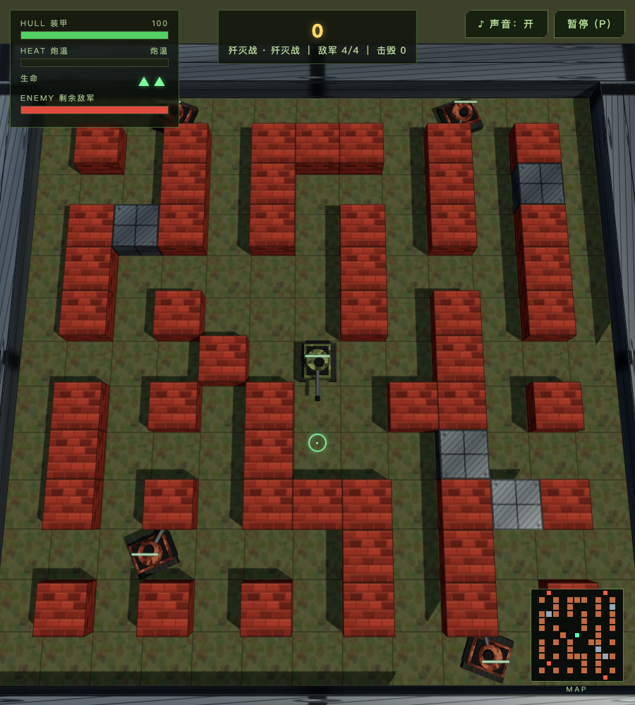
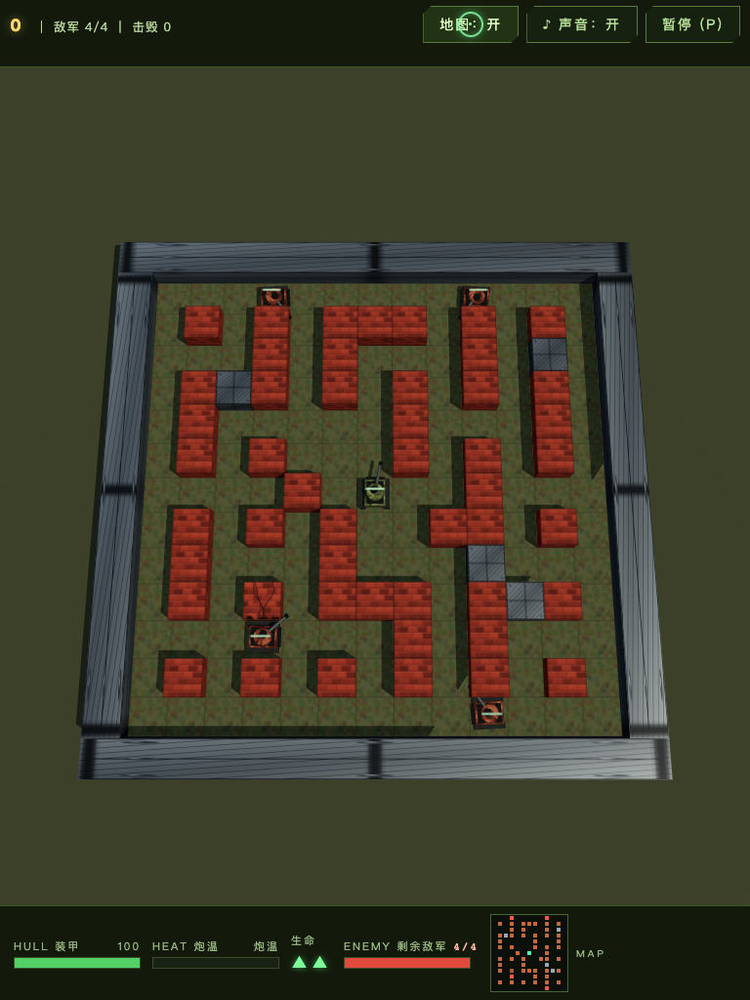
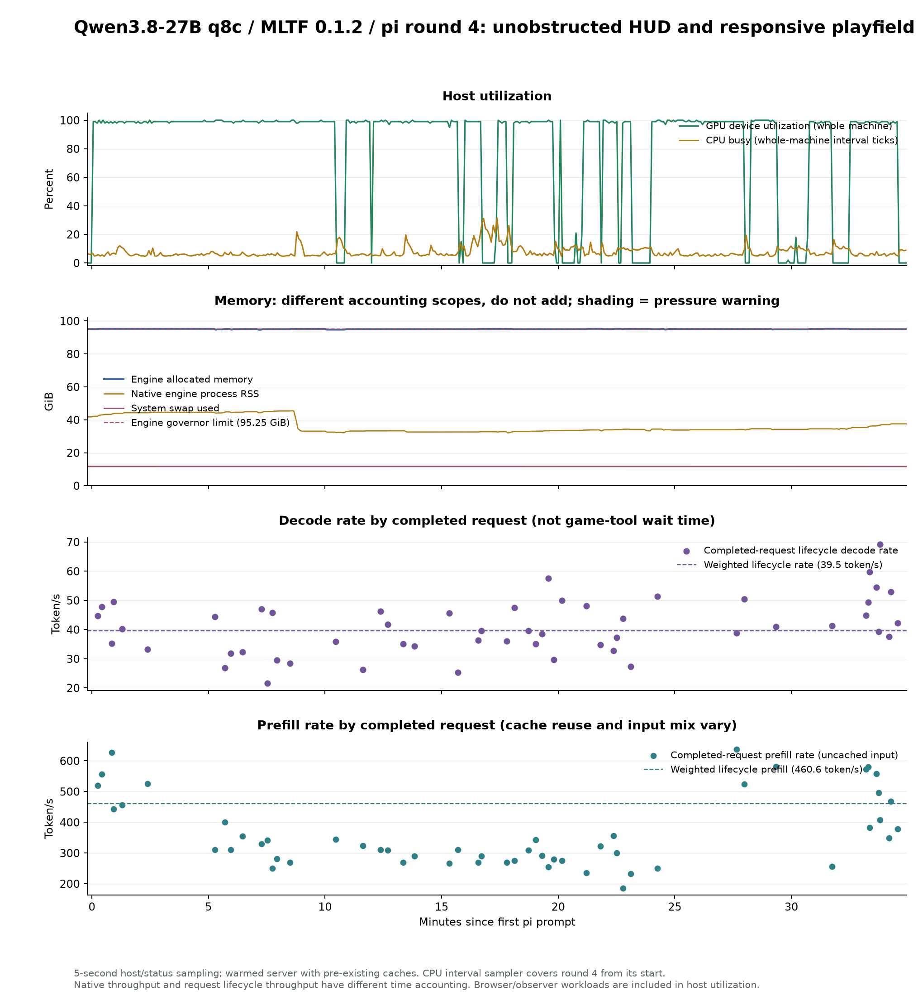

# MLTF / Qwen3.8-27B supervised local experiment: R4 UI-obstruction repair

[English](qwen-tests-mltf-27b-pi-tank-battle-2026-10-20-report-round-4.md) | [简体中文](qwen-tests-mltf-27b-pi-tank-battle-2026-10-20-report-round-4_CN.md)

<!-- environment-context:start -->

## Workstation and system (context added 2026-10-20)

| Item | Record and evidence boundary |
|---|---|
| Workstation role | Local inference workstation |
| Current hardware reference | MacBook Pro `Mac17,6`; Apple M5 Max; 18-core CPU; 40-core GPU; 128 GB unified memory (128 GiB / 137438953472 bytes) |
| Host explicitly recorded by the source | See original report; current snapshot does not fill missing historical configuration |
| Current system snapshot | macOS 27.0.1, build `26A434`, arm64, Metal 4; captured 2026-10-20 22:03:27 UTC |
| Test-time OS | macOS 27.0.1 |
| Historical limits | Without a separate test-time snapshot, detailed core counts are a current workstation reference. Mac specifications do not establish LAN PC or cloud inference hardware. |

[Full environment notes](../../environment.md). Model, quantization, engine, cache and request settings remain those recorded in this report. Original figures, source code and command output retain source-language evidence.

<!-- environment-context:end -->

The user reported that the life bar obscured the respawn point and the minimap obscured the lower-right corner. This round continues the same pi session and MLTF service. Only pi modifies the game; the supervisor supplies two prompts, independent retesting and data collection. HUD is ultimately moved outside the canvas into top/bottom bars. The minimap is collapsed by default and occupies bar space when expanded. Across four window sizes, the battlefield and complete models of all four spawning tanks remain visible, with 0 HUD/battlefield overlap. The existing fixed four enemies, player pursuit, maze and elimination-victory rules remain.

**Delivery: [Open game](http://127.0.0.1:5179/).** Refresh an already-open old page. The user's screenshot contains the older base/three-level interface; this round reproduces and repairs the same type of obstruction on the server's current R3 baseline.

**Conclusion for this round:** under supervision, the model completes coordinated layout, camera, mouse-projection and responsive changes. It can write browser scripts, engage in actual combat and read screenshots. Test diagnosis still requires intervention: incorrect DOMRect fields cause two false-positive rounds and an unnecessary extra CSS change. The engine completes 53 requests with failures/cancellations/Metal faults/restarts of 0/0/0/0; native decode is 39.72 token/s and prefill 469.86 token/s. These findings apply to this task and this warm local service.

## 1. Experimental boundaries and reproduction conditions

| Item | Condition |
|---|---|
| Developer | pi 1.3.0, local/Qwen3.8-27B-MLTF-q8c [mltf], medium, continuing the existing session |
| Inference service | MLTF 0.1.2, Metal Splash + DFlash2; W8A8 prefill / W8A16 decode verify, INT8 KV, SSD cache disabled |
| Machine | Apple M5 Max, 18 CPU / 40 GPU, 128 GiB unified memory |
| Context / memory settings | Maximum 131,072 tokens; configured budget 96 GiB, governor 95.25 GiB; no tuning or restart this round |
| Local ports | 8083 inference API; 8085 transparent observation proxy; 5179 game Vite service |
| Browser | /Applications/Chromium.app/Contents/MacOS/Chromium, Playwright headless; no autoplay exemption |
| Round start / pi completion | 2026-10-20 11:50:04 EDT → 2026-10-20 12:24:38 EDT |
| pi work / total sampling | 34.57 / 34.96 minutes |
| Prompts and implementation roles | Initial task + 2 supervisory prompts; supervisor does not modify game/ implementation, tests or documentation |

Initial prompt (historical local file; not published with this report), supervision constraints (historical local file; not published with this report), prompt records (historical local file; not published with this report). The API key is not shown; existing local credentials are reused.

## 2. Reproduction and final interface

An independent baseline first checks the current service. At 900×1000, the life bar overlaps approximately 8,013 px² of projected battlefield and the minimap approximately 18,176 px². HUD obscures the upper-left spawning tank, while the two lower spawning models are partly outside the view. At 768×1024, all four spawning models are partly clipped. The widescreen baseline itself has none of these active-play obstructions, showing why the previous round's widescreen-only inspection missed them.

pi creates separate top information and bottom status bars. The minimap starts closed and expands into the lower bar; opening instructions participate in bar layout. Narrow layouts retain enemy N/4, kills, armor and other numeric indicators. Render size, camera framing, mouse-ground intersection and projection helpers use the actual canvas rectangle, with ResizeObserver responding to bar-height changes. Transparent HUD is not used to hide obstruction.

| Viewport | Baseline active play | Final active battlefield/HUD overlap | Full spawning tank models visible and unobstructed |
|---|---|---|---|
| 1440×900 | Complete；0 | Complete；0px² | 4/4 |
| 1280×800 | Complete；0 | Complete；0px² | 4/4 |
| 900×1000 | Clipped；hud-left 8013px²；minimap-wrap 18176px² | Complete；0px² | 4/4 |
| 768×1024 | Clipped；hud-left 9278px²；minimap-wrap 18090px² | Complete；0px² | 4/4 |

Every final size checks opening instructions, active play and expanded minimap: HUD groups do not overlap, with no horizontal overflow or page errors. Independent checks project real tank-mesh vertices into bounding extents rather than using spawn-point centers as substitutes for complete models. Baseline data (historical local file; not published with this report), final data (historical local file; not published with this report), independent check script (historical local file; not published with this report).

## 3. Actual play and interaction verification

pi runs Chromium itself: natural widescreen clear at 1280×800 with 20 shots / 8 enemy hits, 90HP, 2 lives, 925 points and 9.5s game time; real movement/aimed shooting at 900×1000 with 27 shots / 8 hits and a 12s clear; real pause/resume clicks at 768×1024; and reading wide/narrow screenshots. Natural-play scripts do not freeze AI, change HP or teleport, but use game state for target selection/projection, so they are not purely visual blind human play.

The supervisor separately retests with independent camera projection and real WASD, mouse and Space input, without aiming through the game's projectToScreen helper:

| Run | Result | Game time | Shots / enemy hits | HP / lives left | Score |
|---|---|---|---|---|---|
| Supervisor 1440×900 | Victory | 11.63s | 28/8 | 70 / 2 | 930 |
| Supervisor 900×1000 | Victory | 11.60s | 28/8 | 90 / 2 | 930 |
| Supervisor 900×1000 (before numeric-indicator completion) | Victory | 11.08s | 26/8 | 80 / 2 | 935 |

The supervisor's final portrait game remains under observation for 5 seconds after victory, without reinforcements or another automatic wave. Real score saving survives page reload in the leaderboard. Both final independent games retain the initial enemy-ID set, maintain alive+kills=4 and a pending-spawn queue of 0. Widescreen raw sequence (historical local file; not published with this report), portrait raw sequence/persistence (historical local file; not published with this report), real-input script (historical local file; not published with this report).

Independent live-resize fixture: **23/23 pass**, following 1440×900 → 900×1000 → expanded minimap → 768×1024 → 1280×800 → collapsed map. Each step checks renderer, camera aspect, projection and actual mouse-ground aiming. For 4 ground targets per step, independent/helper projection error is below 0.01px and real mouse-intersection error below 0.1m. Real post-resize movement, paused time/movement/shooting, resumed movement and restart to four enemies/two lives also pass. **This geometric fixture freezes enemy AI and is separate from natural games; it is not combat-victory evidence.** Fixture description/data (historical local file; not published with this report), script (historical local file; not published with this report).

pi's final layout script passes 46/46 and playtest script 8/8; production build passes. Details: [pi's round playtest record](https://github.com/leoli-dev/llm-test-2026-10-20-game-tank-battle/tree/main/game), [layout test](https://github.com/leoli-dev/llm-test-2026-10-20-game-tank-battle/tree/main/game), [playtest](https://github.com/leoli-dev/llm-test-2026-10-20-game-tank-battle/tree/main/game). The first combined regression times out at old smoke-test time progression. Two standalone runs pass; after bounded wake-up retries are added, the final combined regression produces 90 PASS lines and TESTALL_EXIT=0. Complete output: initial failure (historical local file; not published with this report), final regression (historical local file; not published with this report), pi test outputs (historical local file; not published with this report).

## 4. Process, errors and supervision

| Time (UTC) | Observation / response |
|---|---|
| 15:50 | Existing session receives task, reads user screenshot and reproduces current layout |
| Around 15:58 | pi completes separate top/bottom bars, camera framing and canvas projection; first build passes |
| 16:00 | First prompt: independent checks find opening instructions overlap buttons at width 900 and narrow layouts hide all enemy numbers; preserve compact numbers and repair bar layout |
| 16:06–16:07 | Two pi self-test rounds fail: native DOMRect is treated as an l/t/r/b object, making overlap always true; numeric regex also misses nonbreaking spaces. False positives persist after styling changes |
| 16:07–16:09 | Temporary script in /tmp produces ERR_MODULE_NOT_FOUND; moving it into game/tests works. Debug rectangles already show no real overlap, but layout remains repeatedly suspected |
| 16:09 | Second prompt: compare native rectangle fields with transformed debug fields; stop repeatedly modifying correct CSS |
| 16:10 | pi repairs the criterion; 46 layout checks pass; actual keyboard/mouse play continues |
| 16:11 | Wide/narrow natural combat and button checks pass; pi reads screenshots |
| 16:12–16:14 | First combined smoke regression times out; two standalone smoke runs pass; pi adds bounded wake-up retries |
| 16:14–16:18 | Long-session context compaction: 2 helper requests, 5,663 output tokens, 3 minutes 43 seconds, included in this round's statistics |
| 16:20 | Final combined regression returns 0 with 90 PASS lines; round documentation begins |
| 16:23 | README exact-text edit fails to match; pi rereads the file to locate it; documentation-tool error |

The initial prompt is not counted as an intervention; both supervisory prompts are retained verbatim. No supervisor-written patch, model switch or other development agent is used. Some test commands wrap scripts with echoing their exit code: failures remain visible through R4LAYOUT_EXIT=1 and FAIL, while the outer shell returns 0, so tool success alone is insufficient. Final scripts themselves return 0. Both initial failed rounds remain in the complete timeline (historical local file; not published with this report), rather than being deleted to report only PASS.

The audit summary (historical local file; not published with this report) detects errors through keyword/tool-flag heuristics rather than an exhaustive error count. For example, FAIL output with a successful wrapper requires log review. The supervisor also mistook observation JSON's top level for an array, then reread the results field after KeyError; that mistake is not attributed to the evaluated model.

## 5. Inference performance and stability

| Metric | Round measurement |
|---|---|
| Proxy request starts / ends | 53 / 53；HTTP distribution {'200': 53} |
| Native completed / failed / cancelled | 53 / 0 / 0 |
| Output / of these reasoning | 53,052 / 17,686 tokens |
| Maximum actual single-request prompt | 114,122 tokens |
| Native decode | 39.72 token/s |
| Native prefill | 469.86 token/s，165,062 new input tokens |
| Request-lifecycle decode / prefill | 39.54 / 460.65 token/s |
| Per-request decode median / P95 | 39.59 / 55.72 token/s |
| TTFT median / P95 / maximum | 3.44 / 41.15 / 82.02 seconds |
| Speculative token acceptance ratio | 38.93% |
| New image encodings / reuses | 10 / 38 |
| Context compaction | 1 instance; helper requests total 3.72 minutes (if present, included in this round's total time/requests) |
| Metal / capacity failure / restarts | 0 / 0 / 0 |
| state eviction / governor reservation rejections | 107 / 6564 (counts are not request failures) |

Native rates divide round-specific changes in engine cumulative tokens by wall-time changes. Request-lifecycle rates use total request tokens divided by their respective summed timings. Their first-block and phase boundaries differ, so they are not combined, nor do they measure end-to-end development speed. Prefill counts only uncached input. The long session/cache are reused, so this is not a cold-start benchmark. Tool waits, tests and documentation count toward work duration, but not decode throughput.

## 6. CPU, GPU and memory changes

Sampling contains 422 host/status points at a target interval of approximately 5 seconds. CPU additionally uses Mach tick differences for system-wide busy, covering the round's start. IORegistry GPU is whole-device utilization, including browsers/observation programs, rather than exclusive model usage.

| Resource | Median / P95 / peak or start/end |
|---|---|
| System CPU busy | 6.21% / 15.43% / 31.26% |
| GPU samples while engine is in prefill/decode | 99.00% / 100.00% / 100.00% |
| Engine allocated memory | 95.111 → 95.081 GiB；peak 95.247 GiB |
| Native engine process RSS | median 34.18 GiB；range 32.04–45.46 GiB |
| System swap usage | median 11.68 GiB；range 11.65–11.69 GiB |
| System wired / compressor | median 53.74 / 14.91 GiB |
| Engine host available | minimum 6.39 GiB；median 9.03 GiB |
| Memory-pressure state | {'normal': 422} |

Allocation, RSS, unified-memory device resources and system swap use different definitions and must not be added. Earlier model cache and swap already exist at the start and are not new usage from this round. Operating near the governor cap without crashing establishes availability for this task, rather than the absence of memory pressure or a long-term leak.

## 7. Capability assessment and remaining limits

**Implementation:** the model converts UI obstruction into an outside-canvas layout while updating camera framing, mouse coordinates and resize handling. Independent measurements support the repair. Existing AI/fixed-enemy play remains; the game is not rebuilt this round.

pi's documentation has measurement/interpretation errors: it lists 7 playtest checks rather than the actual 8, and some canvas heights and the 768-wide top-bar height are incorrect. Calling conservative bounding-sphere fitting “maximum zoom” is also unsupported. This report uses independent DOM/camera measurements and lists the self-report comparison (historical local file; not published with this report).

**Self-checking:** scripted browser operation and image reading work, but self-authored assertions remain fallible. After two false-positive rounds, it does not immediately compare data structures, spending extra tokens on styles and temporary scripts. Supervision also has to identify completely hidden narrow-screen numeric indicators. Explicit acceptance criteria plus independent supervision are appropriate; the model's all-pass claim cannot be the only evidence.

**Engine stability:** native request statistics and proxy records cross-check, with no observed request failures, cancellations, Metal faults or service restarts. Cross-round rates vary with prompt length, cache, images, output, speculative acceptance and host load, so differences cannot be directly attributed to temperature or model degradation.

Cumulative round records (different tasks, not a controlled cross-round comparison):

| Round | pi minutes | Requests | Native decode token/s | Native prefill token/s | Request failures / Metal / restarts |
|---|---|---|---|---|---|
| R1 | 46.0 | 66 | 46.16 | 474.10 | 0 / 0 / 0 |
| R2 | 140.7 | 186 | 38.62 | 456.98 | 0 / 0 / 0 |
| R3 | 105.3 | 125 | 32.47 | 387.78 | 0 / 0 / 0 |
| R4 | 34.6 | 53 | 39.72 | 469.86 | 0 / 0 / 0 |

Rate changes alone do not establish continuing slowdown: R4 differs in tasks, prefix hits and output mix. Hardware counters cover development/testing; no constant-context, fixed-prompt, repeated-round throughput benchmark was run.

**Game/evaluation limits:** visuals remain a prototype of procedural textures and simplified models. Camera framing is conservative, particularly widescreen empty space; complete visibility does not establish finished visual quality. The narrowest tested width is 768px, without claims of phone-touch support. Repeated use of one map and state-assisted automatic input does not establish novice difficulty, pure visual reasoning, map diversity or long-term game stability. Headless WebAudio unlock/running state is not a substitute for human listening.

## 8. Files and integrity

- Round analysis JSON (historical local file; not published with this report), per-request statistics (historical local file; not published with this report), raw request logs (historical local file; not published with this report)
- Raw resource samples (historical local file; not published with this report), CPU tick samples (historical local file; not published with this report), engine start state (historical local file; not published with this report), end state (historical local file; not published with this report)
- Event timeline (historical local file; not published with this report), audit (historical local file; not published with this report), final source manifest (historical local file; not published with this report), source snapshot (historical local file; not published with this report)
- Frozen prior reports: R1 (historical local file; not published with this report), R2 (historical local file; not published with this report), R3 (historical local file; not published with this report). This R4 assessment adds to prior evidence rather than replacing it.
