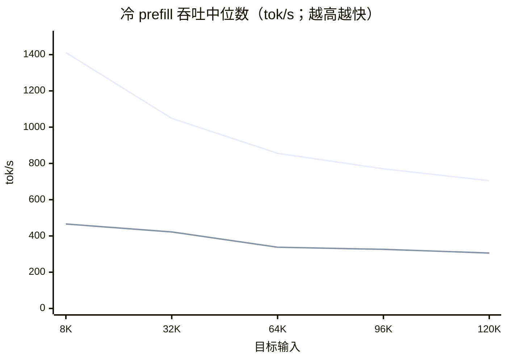
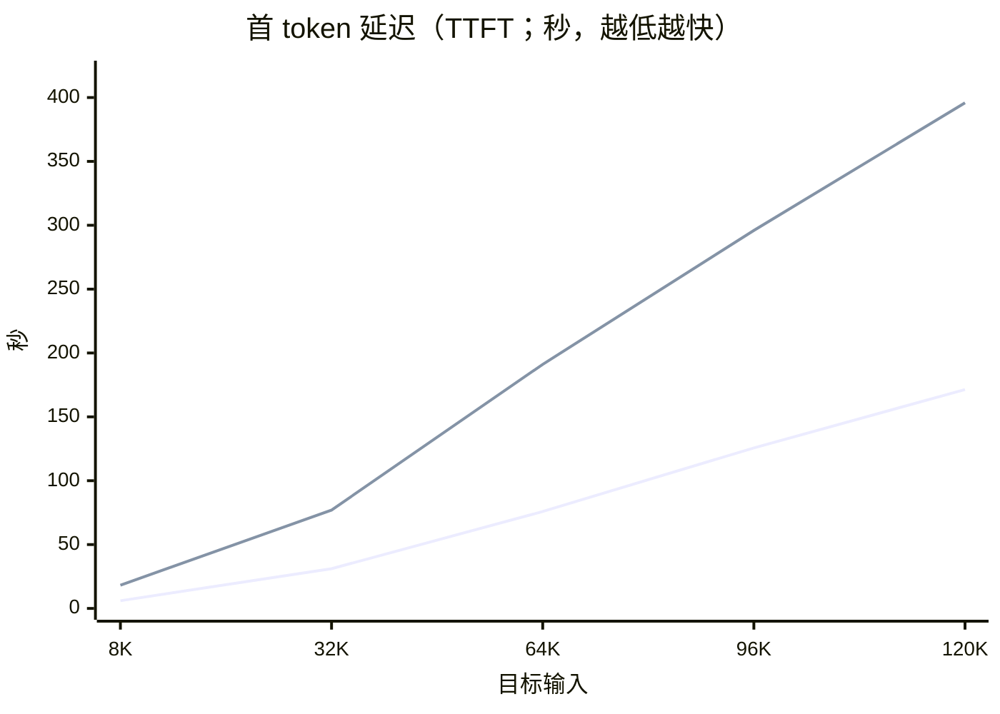
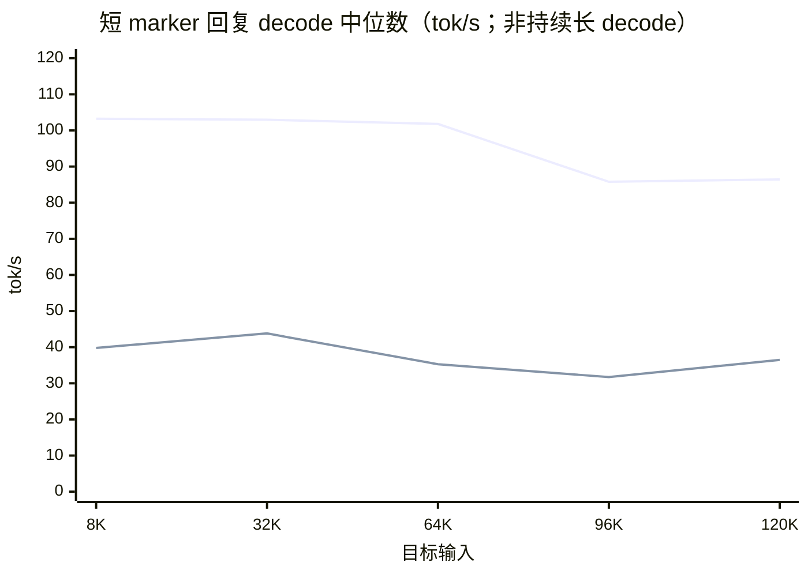
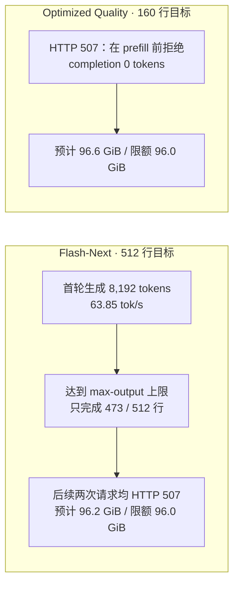
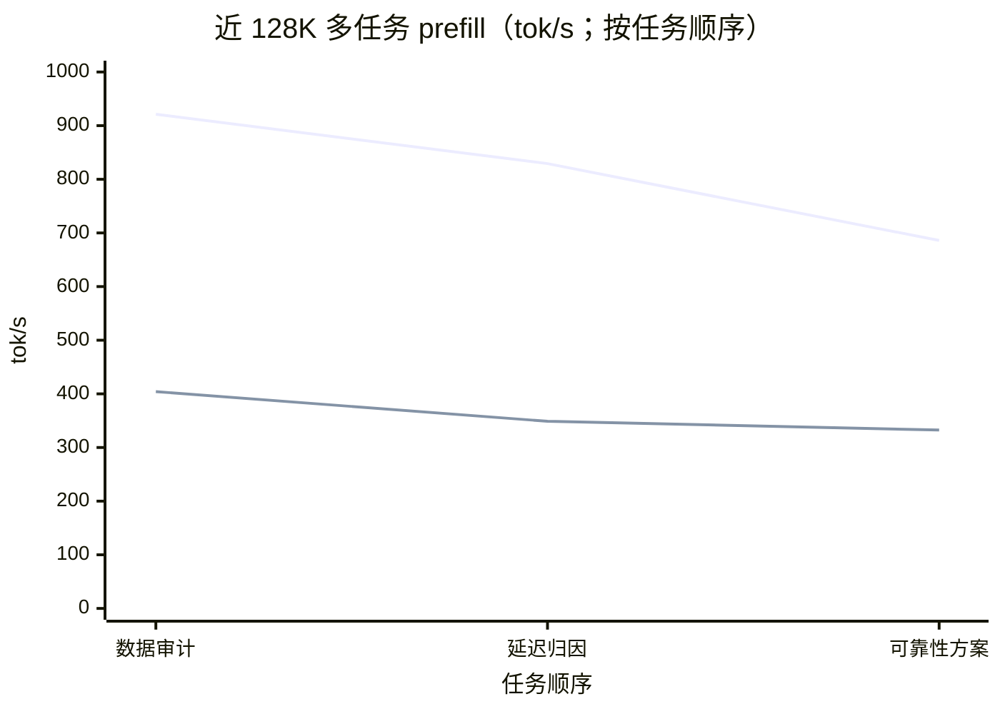
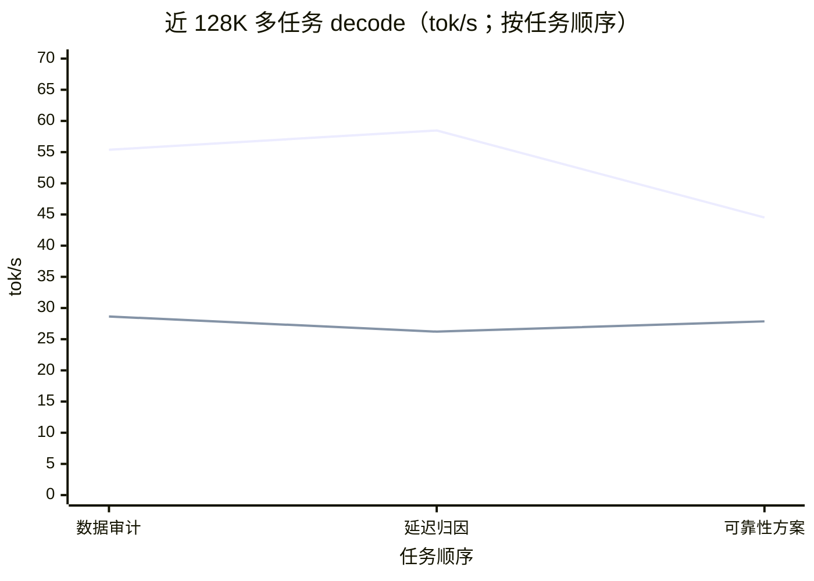

# MTPLX Local Model Performance Comparison

[English](qwen-tests-mtplx-model-comparison-report-2026-09-20.md) | [简体中文](qwen-tests-mtplx-model-comparison-report-2026-09-20_CN.md)

<!-- environment-context:start -->

## Workstation and system (context added 2026-10-20)

| Item | Record and evidence boundary |
|---|---|
| Workstation role | Local inference workstation |
| Current hardware reference | MacBook Pro `Mac17,6`; Apple M5 Max; 18-core CPU; 40-core GPU; 128 GB unified memory (128 GiB / 137438953472 bytes) |
| Host explicitly recorded by the source | See original report; current snapshot does not fill missing historical configuration |
| Current system snapshot | macOS 27.0.1, build `26A434`, arm64, Metal 4; captured 2026-10-20 22:03:27 UTC |
| Test-time OS | Not recorded in the surviving test evidence; current OS is not substituted |
| Historical limits | Without a separate test-time snapshot, detailed core counts are a current workstation reference. Mac specifications do not establish LAN PC or cloud inference hardware. |

[Full environment notes](../../environment.md). Model, quantization, engine, cache and request settings remain those recorded in this report. Original figures, source code and command output retain source-language evidence.

<!-- environment-context:end -->

**Test Batch:** Cold prefill 2026-09-19; near-128K sustained stress test 2026-09-20 · **Compilation Date:** 2026-09-20  
**Subjects:** Qwen3.8 Flash-Next (Optimized Speed) and Qwen3.8 27B Optimized Quality (8-bit dynamic quant)  
**Scope:** Local MTPLX cold prefill, TTFT, short marker responses, structured long-output probes, and multi-task sustained stress testing with approximately 120K input; does not represent code quality evaluation.

## Conclusion Summary

- **Absolute prefill throughput: Flash-Next is faster across all five input length tiers.** At 120K, it is **704.9 tok/s**, while Quality is **305.9 tok/s**, approximately **2.30×**.
- **Relative decay: Quality has a smaller endpoint drop, but absolute speed remains lower.** From 8K to 120K, Flash-Next prefill decreased by **50.1%**, and Quality decreased by **34.3%**. This is the change relative to each model's own 8K baseline and does not imply that Quality is faster for long contexts.
- **Time to First Token (TTFT):** At 120K, Flash-Next TTFT is **171.36 s**, and Quality is **395.88 s** (approximately **2.31×**). TTFT includes service and inference wait times and is not equivalent to pure prefill speed.
- **In the near-128K multi-task stress test, Flash-Next's speed advantage persists, but the speed drop in the final task is more pronounced.** Each model sequentially completed 3 different tasks; Flash-Next ran for 13.5 minutes, and Quality ran for 30.6 minutes. Based on the median of 3 requests, Flash-Next prefill was **829.2 tok/s** and decode was **55.38 tok/s**, approximately **2.38×** and **1.99×** of Quality, respectively.
- **Three-point endpoint changes are not a long-term decay law.** From task 1 to task 3, Flash-Next prefill/decode changed by **−25.5% / −19.6%**, respectively; Quality changed by **−17.7% / −2.7%**, respectively. Both models' decode showed intermediate fluctuations, and task output lengths varied; these are observations from this round and are insufficient to attribute solely to temperature or long-term thermal throttling.
- **Temperature and VRAM have platform limitations.** Local `powermetrics` provides thermal pressure levels but no Celsius readings; Apple Silicon uses unified memory, so GPU VRAM could not be isolated separately; therefore, both system-wide RAM and MTPLX RSS were recorded as memory observations.

## Cold Prefill Throughput Curve

Each point is the **median of 3 cold requests** for the same model and same target input tier; all group markers passed 3/3, with a median cached ratio of 0. The x-axis is target input length, and the y-axis is MTPLX `prefill_tok_s`.

## TTFT Curve

TTFT median for the same batch of cold prefill requests; the y-axis starts from 0, with lower values being better.

## Short Marker Response Decode Observations

These points are taken from short marker responses following the end of cold prefill requests and are **not a sustained long decode pressure curve**. Flash-Next response lengths were 180–267 tokens, and Quality were 470–904 tokens; response lengths differ and are non-monotonic across tiers, so cross-model comparisons should be made with caution.

At the endpoint, Flash-Next dropped from 103.24 to 86.43 tok/s (**−16.3%**); Quality dropped from 39.79 to 36.48 tok/s (**−8.3%**). The relative endpoint drop for Quality was smaller, but its absolute decode rate remained lower; the samples do not support a conclusion of sustained generation.

## Per-tier data

| Target input | Actual prompt tokens (Flash / Quality) | Prefill tok/s (Flash / Quality) | Flash / Quality | TTFT seconds (Flash / Quality) |
|---:|---:|---:|---:|---:|
| 8K | 8,400 / 8,406 | 1,411.4 / 465.9 | 3.03× | 6.04 / 18.19 |
| 32K | 32,401 / 32,407 | 1,048.4 / 422.2 | 2.48× | 31.13 / 76.98 |
| 64K | 64,401 / 64,407 | 855.8 / 337.9 | 2.53× | 75.85 / 191.09 |
| 96K | 96,401 / 96,407 | 770.2 / 326.1 | 2.36× | 125.68 / 295.94 |
| 120K | 120,402 / 120,408 | 704.9 / 305.9 | 2.30× | 171.36 / 395.88 |

## Structured long-output probe: execution results, not a speed comparison

The target sizes for the two batches of output requests were not identical: Flash-Next requested 512 lines; the calibrated Quality probe requested 160 lines (approximately 3.8K output tokens). The figure below summarizes the execution path; HTTP 507 indicates the request was rejected before prefill and should not be depicted as 0 tok/s.

These structured probes themselves **did not yield a sustained decode comparison with identical input and output length for both models**; the natural soak in the next section provides multi-task generation observations with approximately 120K input, but the actual completion lengths were not entirely identical and cannot be regarded as a strict equal-length comparison. The HTTP 507 from the structured probes also cannot be used to determine which model is more memory-efficient.

## Near 128K context multi-task sustained stress test comparison (2026-09-20)

Both models used a **131,072-token context window**, with each task input being approximately 120K tokens, and sustained generation with up to 8,192 output tokens; the target for input plus output was approximately 128.6K tokens, approaching the window limit. Each model executed 3 different tasks consecutively, without concurrently stressing the other model during the run. Rates are taken from MTPLX per-request `prefill_tok_s`, `decode_tok_s`; TTFT is in seconds. Task sequence numbers indicate execution order, not equidistant time points.

| Model | Round duration | Valid tasks | Prefill median | Decode median | TTFT median | Marker/format check |
|---|---:|---:|---:|---:|---:|---:|
| Flash-Next Optimized Speed | 13.5 minutes | 3 | 829.2 tok/s | 55.38 tok/s | 145.7 s | 3/3 passed |
| Qwen 3.8 27B Optimized Quality (8-bit) | 30.6 minutes | 3 | 348.9 tok/s | 27.86 tok/s | 345.9 s | 2/3 passed |

### Per-task speed and output

| Model | # | Task | Completion tokens | Prefill tok/s | Decode tok/s | TTFT (s) | Marker passed |
|---|---:|---|---:|---:|---:|---:|:---:|
| Flash-Next | 1 | Data integrity and anomaly audit | 8,166 | 921.3 | 55.38 | 131.10 | Yes |
| Flash-Next | 2 | Latency distribution and cache/sharding attribution | 6,186 | 829.2 | 58.47 | 145.71 | Yes |
| Flash-Next | 3 | Reliability improvement and verification plan | 4,452 | 686.0 | 44.51 | 175.97 | Yes |
| Optimized Quality | 1 | Data integrity and anomaly audit | 8,192 | 404.2 | 28.64 | 298.40 | Yes |
| Optimized Quality | 2 | Latency distribution and cache/sharding attribution | 6,428 | 348.9 | 26.21 | 345.88 | Yes |
| Optimized Quality | 3 | Reliability improvement and verification plan | 8,192 | 332.6 | 27.86 | 362.58 | No |

The prefill for tasks 1→3 decreased sequentially; decode fluctuated first, then declined. The endpoint changes were **−25.5% prefill / −19.6% decode** for Flash-Next, and **−17.7% / −2.7%** for Quality. Each model had only three distinct tasks, and completion lengths were not entirely identical; therefore, this endpoint difference cannot be directly interpreted as pure thermal decay or long-term steady-state performance.

### CPU, GPU, Memory, and Thermal State

System-wide memory, MTPLX RSS, and process CPU were sampled approximately every 15 seconds, covering their respective complete stress tests. The two batches were executed sequentially with different initial memory states; therefore, RAM differences only describe the observations of this round and cannot be viewed in isolation as inherent model requirements.

| Full-run sampling items | Flash-Next | Optimized Quality | Basis |
|---|---:|---:|---|
| Available RAM (min / mean) | 15.0% / 22.2% | 27.0% / 44.6% | Local physical memory 128 GiB |
| Estimated peak system-wide used RAM | 108.80 GiB | 93.44 GiB | Estimated from system memory sampling |
| MTPLX RSS peak | 42.66 GiB | 35.99 GiB | Process resident set |
| MTPLX process CPU (median / peak) | 36.7% / 325.0% | 11.7% / 95.9% | Multi-core process usage can exceed 100%; peak is the sampling peak |
| Swap (start → end) | 3,558.69 → 3,518.69 MiB | 3,638.25 → 3,614.25 MiB | No increase in either round |

`powermetrics` sampled SoC power consumption, GPU active residency, and thermal pressure every 15 seconds. This set of telemetry for Quality only covers its final **8 min 02 s / 33 samples**; Flash-Next covers the complete **13 min 32 s / 55 samples**.

| Sensor telemetry (within observation window) | Flash-Next | Optimized Quality |
|---|---:|---:|
| CPU power consumption estimated mean | 6.03 W | 5.69 W |
| GPU HW active residency mean | 95.1% | 98.2% |
| GPU power consumption estimated mean | 20.86 W | 19.64 W |
| Thermal pressure samples | Heavy 49/55; Nominal 6/55 | Heavy 33/33 (only the aforementioned final segment window) |

`powermetrics` on this machine only provides thermal pressure levels and does not return CPU/GPU Celsius sensor fields; therefore, °C cannot be honestly reported. It also does not provide independent GPU memory values for Apple Silicon; the table above reports total unified memory and MTPLX RSS. Power consumption is a system estimate, suitable as a reference for this local round, not a precision meter reading.

The first attempt of Flash-Next was stopped at 9.1 minutes due to two consecutive marker failures and was not included in the formal comparison above. The formal rerun retained marker/header validation as a diagnostic item, no longer as a stop condition after two failures; safety checks such as resource thresholds, missing metrics, HTTP 507, timeouts, and garbled/duplicate output remained enabled, and all three formal markers passed.

## Test Scope and Limitations

- Both batches used the local MTPLX Desktop (`127.0.0.1:8001`) + Pi: context window 131,072, max output 8,192, reasoning medium, MTP/head enabled, profile Auto, KV quantization disabled, `allow_swap=false`, MTP cohorts disabled; Pi tools/skills/extensions/context files disabled and no-session used.
- Each model × input tier had 3 unique corpus cold requests; the table shows the median within each group. The actual prompt token counts differed by approximately 6 tokens between the two models, suitable for describing the direct throughput comparison in this run.
- The two batches were not run interleaved simultaneously; system memory and Swap sampling intervals differed. Configuration snapshot matching only indicates that configurations did not drift within their respective batches, not that system loads were identical.
- Model variants/weights were also different, so performance differences cannot be attributed solely to quantization or "quality." This test did not evaluate coding quality.
- The newly added near-128K natural soak had only 3 tasks per model (Quality 30.6 minutes, Flash-Next 13.5 minutes); 64K/112K sustained decode, structured vs natural comparison, cache A/B, or 45–60 minute soak have not yet been completed. Three-point endpoint changes cannot prove long-term steady-state decay or thermal throttling causality; Quality's CPU/GPU/thermal pressure telemetry also only covered the last approximately 8 minutes, and absolute Celsius temperatures were not captured.

## Original evidence

- Flash-Next run report (historical local file; not published with this report) · [Execution record](devlog-projects-qwen3-8-test-notes-mtplx-flash-next-128k-pressure-test-run-2026-09-20.md) · Raw curve CSV (historical local file; not published with this report)
- Optimized Quality run report (historical local file; not published with this report) · [Execution record](devlog-projects-qwen3-8-test-notes-mtplx-qwen38-27b-quality-pressure-test-run-2026-09-20.md) · Raw curve CSV (historical local file; not published with this report)
- Flash-Next formal near-128K rerun report (historical local file; not published with this report) · Per-request records (historical local file; not published with this report) · Full-run system sampling (historical local file; not published with this report)
- Optimized Quality near-128K pressure-test report (historical local file; not published with this report) · Per-request records (historical local file; not published with this report) · Full-run system sampling (historical local file; not published with this report)
- Raw powermetrics CPU/GPU/thermal-pressure telemetry (historical local file; not published with this report) (partial Quality coverage, full Flash-Next coverage)
- Interactive report source (historical local file; not published with this report) · [Local preview](http://127.0.0.1:4173/?view=1) (available while the local preview service is running)
- Mermaid [XY Chart syntax reference](https://mermaid.js.org/syntax/xyChart.html); named curve legends require Mermaid 11.17.0 or later.
