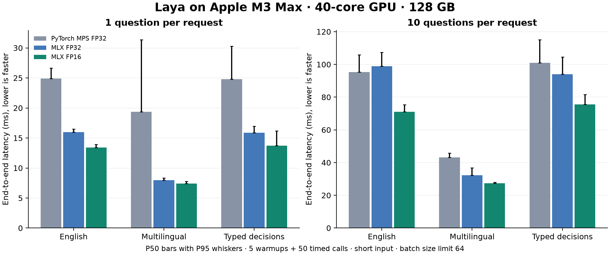

# 本地基准测试

[English](source-benchmarks.md) | [简体中文](source-benchmarks_CN.md)

<!-- environment-context:start -->

## 本机配置与系统（2026-10-20 补充）

| 项目 | 记录与证据边界 |
|---|---|
| 本机用途 | 本机推理工作站 |
| 本机硬件参考 | MacBook Pro `Mac17,6`；Apple M5 Max；18 核 CPU；40 核 GPU；128 GB 统一内存（128 GiB / 137438953472 字节） |
| 原报告明确记载的主机 | Apple M3 Max / 40 核 GPU / 128 GiB（原报告记载） |
| 当前系统快照 | macOS 27.0.1，build `26A434`，arm64，Metal 4；采集于 2026-10-20 22:03:27 UTC |
| 实验时系统 | macOS 27.2 / arm64（原报告记载） |
| 历史配置边界 | 旧测试未保存独立快照时，详细核数只作为当前本机配置参考；内网 PC／云端推理硬件不由 Mac 配置推断 |

[完整环境说明](../../environment_CN.md)。模型、量化、引擎、缓存和请求条件以本报告原有记录为准。原始图表、源码和命令输出保留源语言证据。

<!-- environment-context:end -->

测量环境为 **Apple M3 Max**，40 核 GPU，**128 GiB 统一内存**，macOS-27.2-arm64-64 位，Python 3.12.13.

这些是在同一台 Mac 上对原生 MLX 移植版和固定版本的上游 PyTorch 运行时进行的本地测量。它们并非与上游 T4 或第三方 API 数据的比较。

## 方法

- 每个检查点/后端在独立的新进程中顺序运行，每个工作负载和计时模式包含 5 次预热迭代和 50 次计时迭代。
- 端到端计时包括提示构建、分词、张量构建、模型执行、校准和结果格式化。模型加载和下载不计入在内。
- 前向计时使用预准备的设备张量，包括编码器、决策头、评分头和动作头。每个样本都同步 GPU 完成状态；仅延迟的 MLX 图构建从不作为推理进行计时。
- 所有后端接收相同的状态和问题 JSON。报告生成器验证输入哈希、令牌总数和填充序列长度是否匹配。
- 5/10/50 问题夹具循环使用三个问题模板。发布的运行时评估每一行，没有结果缓存或去重；这些行测量重复模板的批量吞吐量。优化研究应添加不同问题的负载，详见 docs/PERFORMANCE_RESEARCH.md。
- MLX 在这些测量中使用 batch_size=64，以便即使 50 个问题也能放入一个批次中。公共运行时默认设置为 16 以限制内存；更改批次大小可能会改变吞吐量。
- PyTorch MPS 使用上游默认的 FP32。MLX FP32 提供相同精度的比较。MLX FP16 以牺牲部分数值精度为代价换取速度和内存；其加速效果包含了该精度变化。
- P50/P95 是测量到的墙钟延迟的百分位数。吞吐量是问题数 / 平均延迟，而不是 P50 的倒数。原始 JSON 包含每个计时样本。
- 这是一台开发机器，每种配置运行一次，伴有正常的操作系统活动。未对跨设备性能或生产环境耐久性提出任何主张。



## 端到端短输入延迟

所有值均为每请求毫秒数。P95 显示在 `/` 之后。

| 检查点 | 问题数 | 令牌 / 填充长度 | PyTorch MPS FP32 P50 / P95 | MLX FP32 P50 / P95 | MLX FP16 P50 / P95 | FP16 问题/秒 |
|---|---:|---:|---:|---:|---:|---:|
| laya | 1 | 93 / 93 | 24.92 / 26.65 | 15.95 / 16.50 | 13.42 / 13.92 | 74.0 |
| laya | 5 | 427 / 93 | 56.41 / 59.05 | 50.49 / 55.38 | 41.80 / 45.33 | 119.0 |
| laya | 10 | 855 / 93 | 95.26 / 105.79 | 98.82 / 107.28 | 71.07 / 75.30 | 139.1 |
| laya | 50 | 4237 / 93 | 497.86 / 512.97 | 450.71 / 503.35 | 336.03 / 383.51 | 146.8 |
| laya-multilingual | 1 | 91 / 91 | 19.35 / 31.36 | 7.99 / 8.35 | 7.39 / 7.79 | 134.5 |
| laya-multilingual | 5 | 432 / 91 | 29.40 / 34.19 | 19.02 / 20.24 | 16.46 / 16.91 | 304.1 |
| laya-multilingual | 10 | 862 / 91 | 43.16 / 45.80 | 32.34 / 36.71 | 27.39 / 28.02 | 365.6 |
| laya-multilingual | 50 | 4287 / 91 | 194.17 / 209.58 | 151.39 / 168.60 | 127.56 / 142.77 | 395.0 |
| laya-typed-decisions | 1 | 93 / 93 | 24.80 / 30.30 | 15.86 / 16.98 | 13.71 / 16.17 | 70.4 |
| laya-typed-decisions | 5 | 427 / 93 | 59.88 / 67.51 | 53.33 / 68.34 | 41.90 / 50.23 | 116.5 |
| laya-typed-decisions | 10 | 855 / 93 | 100.89 / 115.07 | 94.08 / 104.49 | 75.62 / 81.58 | 131.2 |
| laya-typed-decisions | 50 | 4237 / 93 | 469.72 / 506.29 | 457.34 / 507.93 | 380.56 / 420.40 | 130.5 |

## 全上下文延迟

长输入填满每个检查点配置的极限，包括问题和选项令牌。

| 检查点 | 问题数 | 填充长度 | PyTorch MPS FP32 P50 | MLX FP32 P50 | MLX FP16 P50 |
|---|---:|---:|---:|---:|---:|
| laya | 1 | 512 | 65.58 | 61.33 | 44.93 |
| laya | 10 | 512 | 586.59 | 534.24 | 420.99 |
| laya-multilingual | 1 | 1024 | 52.94 | 47.21 | 37.63 |
| laya-multilingual | 10 | 1024 | 534.49 | 451.33 | 389.49 |
| laya-typed-decisions | 1 | 1024 | 116.80 | 117.67 | 99.23 |
| laya-typed-decisions | 10 | 1024 | 1440.33 | 1231.17 | 1000.29 |

## 内存

MLX 峰值分配内存包括模型权重、输入和中间值；缓存内存单独记录。原始 JSON 中 MPS 当前的张量/驱动分配是不同的指标，不作为可比较的峰值呈现。

| 检查点 | 参数 | FP16 权重 (MiB) | FP16 峰值：1 短问题 (MiB) | FP16 峰值：10 全上下文问题 (MiB) |
|---|---:|---:|---:|---:|
| laya | 421,293,827 | 803.6 | 943.6 | 1833.0 |
| laya-multilingual | 321,908,995 | 614.0 | 687.6 | 1501.7 |
| laya-typed-decisions | 421,293,827 | 803.6 | 943.6 | 1643.7 |

## 数值一致性与稳定性

真实检查点验证涵盖 16 个案例，每个检查点和精度 63 个问题：八种语言、空状态和长状态、对话列表、掩码令牌字面量、结构化标准、混合问题批次以及 20 个选项。这衡量的是对上游的保真度，而非每个模型答案的正确性。

| 检查点 | 精度 | Argmax 一致性 | 最大校准概率误差 | 重复调用 | 活动内存增长（字节） |
|---|---|---:|---:|---:|---:|
| laya | float32 | 63/63 | 0.0000052 | 100 | 0 |
| laya | float16 | 63/63 | 0.0054443 | 100 | 0 |
| laya-multilingual | float32 | 63/63 | 0.0000012 | 100 | 0 |
| laya-multilingual | float16 | 63/63 | 0.0012887 | 100 | 0 |
| laya-typed-decisions | float32 | 63/63 | 0.0000027 | 100 | 0 |
| laya-typed-decisions | float16 | 63/63 | 0.0016849 | 100 | 0 |

每次重复调用都会检查有限的 logits 以及针对相同输入和批次形状的可精确重复的公共 JSON。内存增长是在垃圾回收并清除 MLX 缓存后测量的。每个用例的 JSON 还记录了原始动作-logit 误差：动作 logits 可能具有较大的幅度，因此动作 softmax 概率是单独检查的。FP32 概率容差为 0.0001，FP16 容差为 0.02；这些阈值是在测量之前在验证脚本中设置的。

## 标注任务样本

AG News 测试集：256 个样本，类别数量相等，随机种子 20260919. 这是一个小型英文分类样本；AG News 出现在上游的训练混合数据中，而 typed-decisions 检查点针对不同的任务。源版本、采样索引、金标准标签以及两个后端的预测结果均在 `benchmarks/results/accuracy.json` 中。不重新分发任何样本文本。

| 检查点 | 上游 MPS FP32 准确率 | MLX FP16 准确率 | 预测一致性 |
|---|---:|---:|---:|
| laya | 0.9570 | 0.9570 | 256/256 |
| laya-multilingual | 0.9453 | 0.9453 | 256/256 |
| laya-typed-decisions | 0.9648 | 0.9648 | 256/256 |

## 版本与复现

```json
{
  "mlx": "0.32.2",
  "mlx-metal": "0.32.2",
  "numpy": "2.5.3",
  "torch": "2.14.0",
  "transformers": "5.17.0",
  "tokenizers": "0.23.2",
  "huggingface-hub": "1.32.0"
}
```

```bash
uv sync --extra dev --extra reference --extra benchmark --extra demo
source .venv/bin/activate
gh repo clone NandhaKishorM/laya .upstream
git -C .upstream checkout 6a5819129eb220570792e417e49723d697efd76f
python -m benchmarks.download
pytest -q
python -m benchmarks.validate --repeats 100
python -m benchmarks.run --iterations 50 --warmup 5
python -m benchmarks.accuracy --per-class 64
python -m benchmarks.report
```

基准测试使用原始上游 safetensors 以及来自 `benchmarks/common.py` 的显式固定 Hugging Face 版本。请顺序运行 GPU 命令。已签入的 `uv.lock` 捕获了依赖环境。`benchmarks/results/` 包含原始测量数据；未提交任何下载的模型权重。
